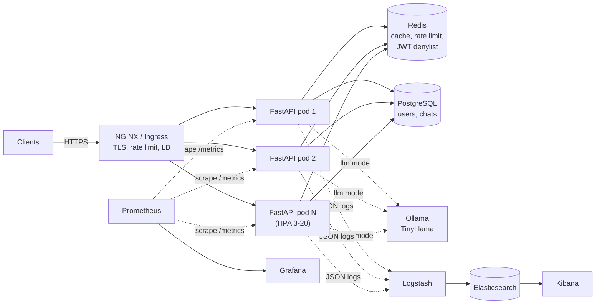

# ScaleBotAI — Cloud-Native High-Scale Chatbot Platform

ScaleBotAI is a production-style chatbot backend built with **FastAPI**. It is designed to serve
**1,000,000+ API requests per day** with **99.9 % availability**, **< 300 ms average latency** and
**zero-downtime deployments**. The platform runs on **Docker** and **Kubernetes**, is delivered by a
**Jenkins** CI/CD pipeline, and is observed with **Prometheus/Grafana** and the **ELK** stack.

The bot is a DevOps & cloud learning assistant with two interchangeable engines:

| Engine | `CHATBOT_MODE` | How it answers | Typical latency |
|---|---|---|---|
| Option 1 — rule-based (default) | `rule` | Intent matching over 30+ DevOps/cloud intents, answers cached in Redis | ~1–5 ms |
| Option 2 — Tiny LLM | `llm` | TinyLlama served by Ollama, last 5 turns as context, automatic fallback to rules | ~0.5–5 s (CPU) |



## Features

- **Users:** register, log in (username or email), JWT access + refresh tokens with rotation, logout
  (token revocation), profile update, change password, delete account.
- **Chat:** start a new chat, continue an existing conversation, list/rename/delete conversations,
  paginated history, delete history, 1–5 star feedback on answers.
- **Admin:** total users, total chats, daily request counts, analytics dashboard, system statistics
  (CPU, memory, DB pool, Redis), dependency health, user management (deactivate, promote).
- **Operations:** liveness/readiness probes, Prometheus metrics, structured JSON logs, request IDs.
- **Resilience:** the API keeps serving if Redis goes down (fail-open); the LLM engine falls back to
  rules behind a circuit breaker; schema bootstrap is safe across replicas (Postgres advisory lock).

## Repository layout

```
scalebotai/
├── src/app/                 FastAPI application
│   ├── api/routes/          auth, users, chat, bot, admin, health routers
│   ├── chatbot/             rule-based engine, Ollama/TinyLlama engine, factory
│   ├── core/                config, security (JWT/bcrypt), logging, metrics, errors
│   ├── db/                  SQLAlchemy models + async engine
│   ├── middleware/          request id, metrics, access log
│   ├── schemas/             Pydantic request/response models
│   └── services/            business logic, cache, rate limiter, analytics
├── tests/
│   ├── unit/, integration/  pytest suites (SQLite + fakeredis, no services needed)
│   └── load/                k6, Locust and JMeter load tests
├── docker/                  API Dockerfile (multi-stage), NGINX, Postgres init
├── docker-compose.yml       full local stack (API, DBs, NGINX, Prometheus, Grafana, ELK)
├── k8s/                     Kubernetes manifests, deployment strategies, monitoring, logging
├── jenkins/                 Jenkinsfile + Jenkins setup
├── monitoring/              Prometheus rules, Grafana dashboards, Logstash/Filebeat configs
├── scripts/                 deploy, rollback, smoke test, minikube bootstrap
└── docs/                    capstone documentation (start at docs/README.md)
```

## Quick start

### 1. Run the tests (no Docker needed)

```bash
python -m venv .venv
source .venv/bin/activate            # Windows: .venv\Scripts\activate
pip install -r requirements-dev.txt
pytest --cov=app                     # 60 tests
ruff check src tests                 # lint
```

### 2. Run the full stack with Docker Compose

```bash
cp .env.example .env                 # then change every change-me value
docker compose up -d --build
docker compose up -d --scale chatbot-api=3     # three replicas behind NGINX
```

| Service | URL |
|---|---|
| API (through NGINX, self-signed TLS) | https://localhost — Swagger UI at https://localhost/docs |
| Grafana | http://localhost:3000 (admin / `GRAFANA_ADMIN_PASSWORD`) |
| Prometheus | http://localhost:9090 |
| Kibana | http://localhost:5601 |

Enable the TinyLlama engine: set `CHATBOT_MODE=llm` in `.env`, then

```bash
docker compose --profile llm up -d
docker compose exec ollama ollama pull tinyllama
```

### 3. Deploy to Kubernetes (minikube)

```bash
bash scripts/bootstrap-minikube.sh   # starts minikube, builds image, creates TLS secret, applies k8s/base
kubectl -n scalebotai get pods,hpa,ingress
```

Add `<minikube ip> api.scalebotai.local` to your hosts file, then open https://api.scalebotai.local/docs.
See [docs/07-kubernetes-implementation.md](docs/07-kubernetes-implementation.md) for the full lab.

### 4. Try the API

```bash
BASE=https://localhost
curl -k -X POST $BASE/api/v1/auth/register -H 'Content-Type: application/json' \
  -d '{"username":"alice","email":"alice@scalebotai.dev","password":"Str0ngPassw0rd"}'
TOKEN=$(curl -sk -X POST $BASE/api/v1/auth/login -H 'Content-Type: application/json' \
  -d '{"username":"alice","password":"Str0ngPassw0rd"}' | python -c "import sys,json;print(json.load(sys.stdin)['access_token'])")
curl -k -X POST $BASE/api/v1/chat -H "Authorization: Bearer $TOKEN" -H 'Content-Type: application/json' \
  -d '{"message":"What is a Kubernetes deployment?"}'
```

## API overview (32 endpoints)

| Group | Endpoints |
|---|---|
| Operations | `GET /health`, `GET /health/live`, `GET /health/ready`, `GET /metrics` |
| Auth | `POST /api/v1/auth/{register,login,logout,refresh,change-password}` |
| Users | `GET/PUT/DELETE /api/v1/users/me`, `GET /api/v1/users/me/stats` |
| Chat | `POST /api/v1/chat`, `POST/GET /api/v1/chat/conversations`, `GET/PATCH/DELETE /api/v1/chat/conversations/{id}`, `GET/DELETE /api/v1/chat/history`, `POST /api/v1/chat/{chat_id}/feedback` |
| Bot | `GET /api/v1/bot/info` |
| Admin | `GET /api/v1/admin/{analytics,system,health,users,feedback}`, `GET /api/v1/admin/stats/{users,chats,requests}`, `PATCH /api/v1/admin/users/{id}` |

Full request/response schemas: [docs/05-api-design.md](docs/05-api-design.md) or the live
OpenAPI docs at `/docs`.

## Configuration

All settings are environment variables (see [.env.example](.env.example)). Non-secret values live
in the `scalebotai-config` ConfigMap and secrets in the `scalebotai-secrets` Secret on Kubernetes.
The app logs a warning at startup when `JWT_SECRET_KEY` is the default or shorter than 32 characters.

## CI/CD

[jenkins/Jenkinsfile](jenkins/Jenkinsfile): Checkout → Build → Unit Test → Lint → Docker Build →
Security Scan (Trivy) → Docker Push → Kubernetes Deploy (rolling | canary | blue-green) → Smoke Test
→ automatic Rollback on failure. Setup guide: [jenkins/README.md](jenkins/README.md).

## Documentation

The capstone report lives in [docs/](docs/README.md): executive summary, architecture diagrams,
database and API design, Docker, Kubernetes, CI/CD, monitoring, security, load-testing strategy,
deployment strategies, design decisions, resume content and viva questions.

## License

MIT
