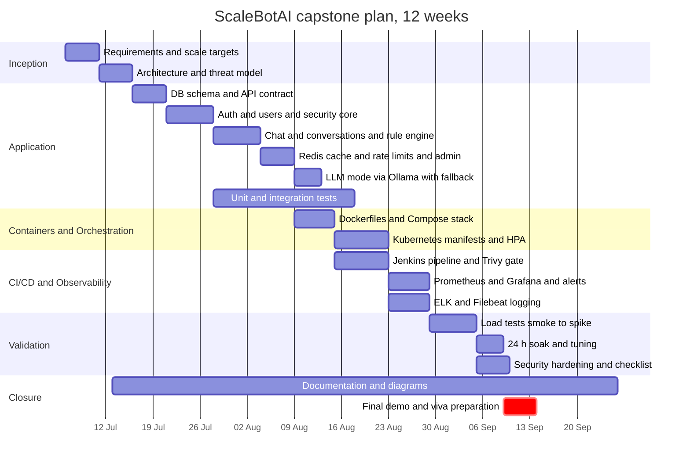

# 01 — Executive Summary, Objectives and Scope

> **Project:** ScaleBotAI — Cloud-Native High-Scale Chatbot Platform
> **Type:** Final-year engineering capstone (Cloud Computing and DevOps)
> **Related documents:** [02 Architecture Diagrams](02-architecture-diagrams.md) · [03 Component Design](03-component-design.md) · [04 Database Design](04-database-design.md) · [05 API Design](05-api-design.md) · [10 Security Architecture](10-security-architecture.md) · [11 Load Testing Strategy](11-load-testing-strategy.md)

---

## 1. Executive Summary

**What it is.** ScaleBotAI is a production-style chatbot backend that answers questions about Cloud and DevOps topics (Docker, Kubernetes, Jenkins, CI/CD, Git, NGINX, Redis, PostgreSQL, Prometheus, Grafana, ELK, scaling). The capstone is not the bot itself. It is the platform around the bot: a stateless FastAPI service that can be containerised, orchestrated, autoscaled, deployed by a pipeline, observed and secured. The service exposes 32 REST endpoints covering authentication, user profiles, conversations and chat history, feedback, bot information, admin analytics, and operational health and metrics.

**Why it exists.** Most student projects stop at "it runs on my laptop". This project shows the engineering needed to run the same code at a defined service level: **1,000,000+ requests/day, 99.9 % availability, average latency below 300 ms, 100–500 concurrent requests at peak, CPU and memory autoscaling, and zero-downtime deployments.** Each target maps to a design mechanism (Section 3) and to a measurement (Section 8).

**How it works (one paragraph).** Clients reach the platform over HTTPS through NGINX: a reverse-proxy container in Docker Compose, or the ingress-nginx controller in Kubernetes. NGINX terminates TLS, rate-limits per IP and load-balances across N identical FastAPI pods. Each pod runs one Uvicorn process on port 8000. Each pod is fully asynchronous (asyncpg, redis-py asyncio, httpx) and keeps no local state, so the Horizontal Pod Autoscaler can scale the API tier from 3 to 20 replicas on CPU (70 %) and memory (75 %). PostgreSQL 16 stores users, conversations, chats and feedback. Redis 7 provides the bot-response cache, profile and analytics caches, per-user rate limiting, the JWT revocation denylist and daily request counters. Two chatbot engines are available through `CHATBOT_MODE`. The default is a deterministic rule/intent engine (`rule`) that answers in milliseconds. The alternative (`llm`) calls TinyLlama through Ollama and falls back to the rule engine automatically on timeout. Jenkins builds, tests, lints, scans (Trivy), pushes and rolls out every commit, and rolls back automatically if the post-deploy smoke test fails. Prometheus and Grafana provide metrics and alerting. Elasticsearch, Logstash, Kibana and Filebeat provide structured JSON log search.

**Key results and targets.** Numbers marked *(target)* are design targets that the load-test plan in [doc 11](11-load-testing-strategy.md) validates.

| Dimension | Target | Design mechanism |
|---|---|---|
| Daily volume | ≥ 1,000,000 req/day ≈ 11.6 req/s avg, ~116 req/s peak (10×), headroom 500 req/s *(target)* | Stateless pods, async I/O, HPA 3→20, Redis cache |
| Availability | 99.9 % (≤ 43.8 min downtime / month) *(target)* | ≥ 3 replicas, probes, PDB, rolling updates with `maxUnavailable: 0`, automated rollback |
| Latency | Average < 300 ms, p95 tracked *(target)* | Rule engine (~1–5 ms), Redis cache-aside, connection pooling, indexed queries |
| Concurrency | 100–500 in-flight requests at peak *(target)* | Event-loop concurrency per pod × horizontal replicas |
| Elasticity | Autoscale on CPU 70 % and memory 75 %, 3–20 pods | HPA `autoscaling/v2` + metrics-server |
| Deployments | Zero downtime, automatic rollback | RollingUpdate maxSurge 25 % / maxUnavailable 0, readiness gating, `kubectl rollout undo` |

**Technology highlights.** Python 3.12 · FastAPI · Pydantic v2 · SQLAlchemy 2 (async) · PostgreSQL 16 · Redis 7 · NGINX / ingress-nginx · Docker multi-stage images (non-root, uid 10001) · Docker Compose (12 services + optional Ollama) · Kubernetes (Deployments, StatefulSet, HPA, PDB, NetworkPolicies, RBAC, Kustomize) · Jenkins declarative pipeline with Trivy gate and automated rollback · Prometheus + Grafana · ELK + Filebeat · k6 / Locust / JMeter · JWT (HS256) + bcrypt (cost 12).

---

## 2. Problem Statement

Conversational assistants are now a common front door for products and internal tools. Building one that *answers* is easy. Building one that keeps answering under real traffic is the hard part. A naïve deployment (a single Flask/FastAPI process on a VM, a local SQLite file, manual `scp` deployments, no metrics) fails in predictable ways:

1. **No horizontal scalability.** The process holds state in memory (sessions, caches), so a second instance cannot be added without breaking users. Throughput is capped by one CPU core.
2. **Fragile availability.** One crash, one OS patch or one bad deployment takes the whole service down. With no health checks, nothing restarts the process or routes traffic away from it.
3. **Unpredictable latency.** Every request recomputes the answer and hits the database, and calls to a slow model block the server.
4. **Slow, risky releases.** Manual builds and copies take hours, are not reproducible and have no rollback path, so teams release rarely and in large batches.
5. **No visibility.** Without metrics and centralised logs, the team learns about outages from users, and root-cause analysis means guessing.
6. **Weak security posture.** Plain-text or fast-hashed passwords, no TLS, secrets committed to Git, containers running as root, and an open internal network.

**Problem to solve:** design, build and validate a chatbot platform that removes each failure mode above using standard cloud-native and DevOps practice, and that meets an explicit, measurable service-level target of 1M+ requests/day, 99.9 % availability and < 300 ms average latency.

---

## 3. Objectives (Measurable)

Each objective maps to one of the scale targets, the mechanism that achieves it, and the evidence used to verify it.

| # | Objective | Scale target | Mechanism (where) | Verification (metric / test) |
|---|---|---|---|---|
| O1 | Sustain high daily volume | **1M+ req/day** (11.6 req/s avg, 116 req/s peak, 500 req/s headroom) | Stateless API pods, async I/O, Redis cache-aside, DB connection pool (`DB_POOL_SIZE=10`, `DB_MAX_OVERFLOW=20`) | k6 load/soak tests; `sum(increase(scalebot_http_requests_total[24h]))` |
| O2 | High availability | **99.9 % uptime** (≤ 43.8 min/month) | `replicas: 3` minimum, liveness/readiness/startup probes, PodDisruptionBudget, anti-affinity, StatefulSet + PVC for Postgres | Soak test 24 h; availability SLI `1 − 5xx/total` from `scalebot_http_requests_total` |
| O3 | Low latency | **Average < 300 ms** | Rule engine default, Redis response cache, indexed queries, one async worker per pod | `scalebot_http_request_duration_seconds` (`_sum/_count`) and p95 via `histogram_quantile` |
| O4 | Handle peak concurrency | **100–500 concurrent requests** | Event-loop concurrency per pod × N pods; NGINX keepalive upstreams | `sum(scalebot_http_requests_in_progress)`; k6 VU ramp |
| O5 | Elastic scaling | **CPU 70 % / memory 75 % autoscaling**, 3–20 pods | HPA `autoscaling/v2` with fast scale-up and slow scale-down behaviour; metrics-server | `kubectl get hpa -w` during stress/spike phases; replica count panel in Grafana |
| O6 | Safe, fast releases | **Zero-downtime deploys**, automatic rollback | RollingUpdate maxSurge 25 % / maxUnavailable 0; readiness gating; Jenkins smoke test → `kubectl rollout undo` | Run k6 during `kubectl set image`: 0 failed requests; Jenkins stage results |
| O7 | Full automation | Commit → production with no manual build step | `jenkins/Jenkinsfile` (9 stages + automatic rollback), `Makefile`, `scripts/*.sh` | Pipeline duration and success rate; DORA metrics (Section 8) |
| O8 | Observability | Every request measured and logged | Prometheus metrics (`scalebot_*`), JSON logs with `request_id`, Grafana dashboards, Kibana | Dashboards render live; alert rules fire in a fault-injection drill |
| O9 | Security by default | No critical findings at go-live | JWT + bcrypt, TLS, rate limiting, NetworkPolicies, non-root containers, Trivy gate | Trivy gate: 0 fixable CRITICAL CVEs and 0 committed secrets (HIGH reported and reviewed); Bandit gate; checklist in [doc 10](10-security-architecture.md) |

**Capacity arithmetic (for the viva):**

- 1,000,000 req/day ÷ 86,400 s = **11.57 req/s** average.
- Peak factor 10× ⇒ **~116 req/s**. The design headroom is **500 req/s**.
- Little's Law, L = λ × W. At 116 req/s and W = 0.3 s, L ≈ **35 requests in flight**. At 500 req/s and 0.3 s, L ≈ **150**. The "100–500 concurrent" target therefore covers peak traffic even when latency degrades to ~1 s.

---

## 4. Scope

### 4.1 In scope

| Area | Included |
|---|---|
| Application | FastAPI backend with 32 endpoints: auth (register/login/logout/refresh/change-password), users, chat and conversations, history, feedback, bot info, admin analytics, health, metrics |
| Chatbot | Option 1: rule/intent engine (default). Option 2: Ollama + TinyLlama with automatic fallback. Redis response cache |
| Data | PostgreSQL 16 schema (users, conversations, chats, feedback) with constraints and indexes. Redis key design |
| Containerisation | Multi-stage Dockerfile, NGINX image with auto-generated dev TLS, Docker Compose stack with 3 networks and 7 named volumes |
| Orchestration | Kubernetes manifests (Kustomize): Deployment, Service, Ingress, HPA, PDB, StatefulSet, PVCs, ConfigMap, Secret, NetworkPolicies, ServiceAccounts, RBAC |
| CI/CD | Jenkins declarative pipeline: build, unit test, lint, image build, Trivy scan, push, deploy (rolling / canary / blue-green), smoke test, automatic rollback |
| Observability | Prometheus metrics and alert rules, Grafana dashboards, ELK pipeline with Filebeat (K8s) and Logstash file input (Compose) |
| Load testing | k6 (primary), Locust and JMeter scripts. Plan covering smoke, baseline, load, stress, spike and 24 h soak |
| Security | Threat model (STRIDE), OWASP API Top 10 mapping, hardening of every layer |
| Documentation | Architecture, design, implementation, operations and viva preparation documents |

### 4.2 Out of scope (explicitly)

| Item | Reason / future work |
|---|---|
| Web or mobile front-end UI | API-first project. Clients are Swagger UI, curl and load generators |
| Highly available PostgreSQL (replication, automatic failover) | Documented as future work (CloudNativePG / Patroni / managed RDS); see [doc 03 §3.8](03-component-design.md) |
| Redis Sentinel / Cluster | Future work. The app is designed to fail open when Redis is unavailable |
| Multi-region deployment and disaster recovery | Beyond capstone budget. Backups and PITR are described |
| GPU inference and LLM fine-tuning | TinyLlama on CPU is used only to demonstrate the integration pattern |
| Social login / OAuth2 / SSO, email verification, MFA | Listed as future hardening |
| Managed WAF / CDN | NGINX rate limiting is the edge control in scope |
| Billing, multi-tenancy | Not required by the problem statement |

---

## 5. Technology Stack

The **Version** column states the targeted major/minor line. The exact pinned tags live in `requirements.txt`, `docker/*/Dockerfile`, `docker-compose.yml` and `k8s/base/`.

| Layer | Technology | Version | Purpose | Lab concept demonstrated |
|---|---|---|---|---|
| Language / runtime | Python | 3.12 | Application language | Cloud-native application development |
| Web framework | FastAPI (Starlette) | 0.142 | Async REST API, dependency injection, OpenAPI docs | Microservice / API design |
| ASGI server | Uvicorn (standard extras) | 0.54 | Serves the app. One worker per container, `--proxy-headers` | Containerisation (one process per container) |
| Validation / settings | Pydantic v2 (+ pydantic-settings, email-validator) | 2.13 / 2.15 | Request/response schemas, env-based configuration | 12-factor configuration (Cloud computing) |
| ORM / driver | SQLAlchemy (async) + asyncpg | 2.1 / 0.31 | Non-blocking DB access, bound parameters, connection pool | Persistence in cloud apps |
| Database | PostgreSQL | 16 (alpine) | System of record (users, conversations, chats, feedback) | StatefulSet + PVC (Kubernetes) |
| Cache / KV | Redis server (redis-py asyncio client) | 7.4 / 8.1 | Response cache, rate limiting, JWT denylist, counters | Performance and scaling |
| Security libs | PyJWT, bcrypt | 2.15 / 5.0 | HS256 tokens, password hashing (SHA-256 pre-hash + bcrypt cost 12) | Application security |
| HTTP client | httpx | 0.28 | Async calls to Ollama | Service-to-service communication |
| LLM runtime (optional) | Ollama + TinyLlama 1.1B | 0.3.14 / `tinyllama` | Generative answers in `llm` mode | Containerised AI service |
| Metrics library | prometheus_client, psutil | 0.26 / 7.2 | `/metrics` exposition, process stats | Monitoring |
| Reverse proxy / LB | NGINX (Compose), ingress-nginx (K8s) | 1.27 (alpine) / controller v1.x | TLS termination, load balancing, `limit_req`, HTTP→HTTPS | Deployment, load balancing |
| Containers | Docker Engine, Docker Compose v2 | 24+ / 2.2x+ | Multi-stage images, local multi-service stack | Docker, Containerisation |
| Orchestration | Kubernetes + Kustomize | 1.28+ | Deployments, StatefulSet, HPA, PDB, NetworkPolicy, RBAC | Kubernetes, Cloud computing |
| Autoscaling metrics | metrics-server | 0.7.x | CPU/memory resource metrics for the HPA | Automation (elastic scaling) |
| Image registry | Docker Hub | — | Stores `scalebotai/scalebotai-api:<BUILD_NUMBER>-<sha>` | Deployment |
| Version control | Git + GitHub | — | Source of truth, webhooks, PR review | Git |
| CI/CD | Jenkins (LTS, declarative pipeline) | 2.4xx LTS | Build → test → scan → push → deploy → smoke → rollback | Jenkins, CI/CD, Automation |
| Code quality | pytest (+ pytest-cov), ruff, bandit, fakeredis, aiosqlite | 9.1 / 0.16 / 1.9 | Unit/integration tests, lint/format, static security analysis, no external services needed | CI, DevSecOps |
| Image security | Trivy | latest 0.x | Image CVE report (HIGH/CRITICAL), gate on fixable CRITICAL, secret scan gate, IaC misconfiguration report | DevSecOps |
| Metrics / alerting | Prometheus + exporters (postgres, redis, nginx), kube-state-metrics (K8s) | 2.55 / 0.15, 1.62, 1.3 | Scraping, PromQL, alert rules | Monitoring |
| Dashboards | Grafana | 11.3 | Provisioned datasources and dashboards | Monitoring |
| Logging | Elasticsearch, Logstash, Kibana, Filebeat | 8.15 | Centralised JSON logs, indices `scalebot-{log_type}-logs-*` | Monitoring (logging) |
| Load testing | k6 (+ k6-operator), Locust, JMeter | 1.x / 2.x / 5.6 | Smoke → soak test phases | Performance engineering |
| Certificates | Self-signed (dev, `k8s/tls/create-tls-secret.sh`), cert-manager + Let's Encrypt `ClusterIssuer` (prod, `k8s/tls/cert-manager-issuer.yaml`) | 1.x | TLS certificates | Deployment security |

---

## 6. Lab-Concept Coverage Matrix

| Lab concept | Where it is demonstrated (repo paths) | What to show the examiner | Detail doc |
|---|---|---|---|
| **Cloud computing** | `k8s/base/` (provider-neutral manifests for EKS/GKE/AKS or local clusters), `.env.example` and ConfigMap `scalebotai-config` (12-factor config), stateless API design in `src/app/` | Same image runs on a laptop (Compose) and a cluster (K8s). Elastic scale-out 3→20 pods | [07](07-kubernetes-implementation.md), [12](12-deployment-strategies.md) |
| **DevOps** | `Makefile`, `jenkins/Jenkinsfile`, `scripts/`, `monitoring/`, `tests/` | The full plan → code → build → test → release → deploy → operate → monitor loop | [08](08-cicd-jenkins.md), [09](09-monitoring-logging.md) |
| **Docker** | `docker/api/Dockerfile` (multi-stage, non-root uid 10001), `docker/nginx/`, `.dockerignore`, `docker/postgres/init/` | `docker build -f docker/api/Dockerfile .`, image size and layer caching, `docker scout` / Trivy output | [06](06-docker-implementation.md) |
| **Kubernetes** | `k8s/base/*.yaml` (00-namespaces … 12-network-policies), `k8s/base/kustomization.yaml`, `k8s/monitoring/`, `k8s/logging/`, `k8s/optional/` (Ollama, exporters), `k8s/tls/` | `kubectl apply -k k8s/base`, HPA scaling, self-healing after `kubectl delete pod`, rolling update | [07](07-kubernetes-implementation.md) |
| **Git** | `.gitignore`, branch strategy (feature → PR → `main`), commit SHA in image tag `<BUILD_NUMBER>-<git short sha>` | Webhook-triggered build. Traceability from running pod back to commit | [08](08-cicd-jenkins.md) |
| **CI/CD** | `jenkins/Jenkinsfile`, `scripts/smoke_test.sh`, `scripts/deploy.sh`, `scripts/rollback.sh` | Nine-stage pipeline with quality and security gates, plus automatic rollback | [08](08-cicd-jenkins.md) |
| **Jenkins** | `jenkins/Jenkinsfile`, `jenkins/plugins.txt`, `jenkins/README.md`; credentials `dockerhub-credentials`, `kubeconfig-scalebotai`; parameters `DEPLOY_STRATEGY`, `SKIP_DEPLOY` | Blue Ocean / stage view, parameterised build, credentials binding | [08](08-cicd-jenkins.md) |
| **Containerization** | `docker-compose.yml` (12 services + optional `ollama`, networks `frontend`/`backend`/`monitoring`, 7 named volumes) | `docker compose up -d --scale chatbot-api=3`. NGINX load-balances across replicas | [06](06-docker-implementation.md) |
| **Monitoring** | `src/app/` (`scalebot_*` metrics, JSON logging), `monitoring/prometheus/prometheus.yml`, `monitoring/prometheus/alert-rules.yml`, `monitoring/grafana/`, `monitoring/logstash/`, `monitoring/filebeat/` | Live Grafana dashboard during a load test. Kibana search by `request_id` | [09](09-monitoring-logging.md) |
| **Deployment** | `k8s/base/` (RollingUpdate, PDB), `k8s/strategies/` (rolling-update, blue-green), `scripts/deploy.sh`, `scripts/rollback.sh`, Jenkins `DEPLOY_STRATEGY` = rolling / canary / blue-green, labels `track` and `color` | Zero-downtime rollout under load. Canary and blue-green switch | [12](12-deployment-strategies.md) |
| **Automation** | Jenkins pipeline, HPA, Kubernetes reconciliation, table auto-creation under an advisory lock, bootstrap admin, auto-generated dev TLS cert, Grafana provisioning, `Makefile` targets | No manual step from `git push` to running pods. Self-healing and self-scaling | [07](07-kubernetes-implementation.md), [08](08-cicd-jenkins.md) |

---

## 7. Key Features

### 7.1 End-user features

- **Account lifecycle.** Register, log in with username *or* email, log out (token revocation), refresh tokens (with rotation), change password, update profile, delete account (cascades to conversations, chats and feedback).
- **Chat.** Send a message. A new conversation starts automatically when no `conversation_id` is supplied. Each response carries `bot_mode`, `cached` and `latency_ms`, so the user can see how it was produced.
- **Conversations.** Create, list (paginated), open with full message history (continue a chat), rename and delete.
- **History.** Paginated history across all conversations or filtered by one, plus a "clear all history" action.
- **Feedback.** Rate any bot answer 1–5 with an optional comment. Rating again updates the existing rating (upsert).
- **Personal statistics.** Total conversations, messages, feedback given, first and last chat time.

### 7.2 Admin features (role `admin`)

- **Analytics dashboard API.** Users, chats, requests over the last 7 days and feedback in one call (cached 30 s).
- **Statistics.** User stats (total/active/admin/new), chat stats (totals, today, average per user, average bot latency), daily request series for 1–30 days (from Redis counters).
- **System view.** Pod hostname, version, uptime, CPU %, RSS memory, DB pool usage, Redis info and cache hit ratio.
- **Dependency health.** Database, Redis and chatbot status with measured latencies.
- **User management.** Search and list users, activate/deactivate accounts, promote/demote role.
- **Feedback summary.** Total, average and 1..5 distribution.

### 7.3 Chatbot features

- **Option 1 — rule engine (default, `CHATBOT_MODE=rule`).** Keyword and regex intent matching for greetings, help and DevOps topics (docker, kubernetes, jenkins, ci/cd, git, nginx, redis, postgres, prometheus, grafana, elk, cloud, scaling, …). Deterministic, so responses are cached in Redis under `bot:resp:{mode}:{sha256(question)}`.
- **Option 2 — LLM mode (`CHATBOT_MODE=llm`).** Ollama `/api/chat` with model `tinyllama`. The last 5 exchanges are sent as context. A timeout (`OLLAMA_TIMEOUT_SECONDS`) triggers automatic fallback to the rule engine, reported as `bot_mode = "rule-fallback"`.
- **Introspection.** `GET /api/v1/bot/info` returns mode, model, number of intents and LLM availability.
- **Instrumentation.** `scalebot_chat_messages_total{bot_mode,cached}` and `scalebot_bot_response_seconds{bot_mode}` let the two engines be compared directly in Grafana.

### 7.4 Platform features

- `/health`, `/health/live`, `/health/ready` for orchestrators. `/metrics` for Prometheus (never exposed publicly).
- Uniform error envelope with `request_id`. Headers `X-Request-ID`, `X-Process-Time-ms`, `X-RateLimit-*`.
- JSON structured logs with `log_type` ∈ {api, user, error, system}, routed to separate Elasticsearch indices.

---

## 8. Success Metrics

| Category | Metric | Target | How it is measured |
|---|---|---|---|
| Throughput | Requests per day | ≥ 1,000,000 | `sum(increase(scalebot_http_requests_total[24h]))`; Redis `stats:requests:{date}` via `/api/v1/admin/stats/requests` |
| Throughput | Sustained peak rate | ≥ 116 req/s (design 500 req/s) | k6 `http_reqs` rate. `sum(rate(scalebot_http_requests_total[1m]))` |
| Latency | Average response time | < 300 ms | `sum(rate(scalebot_http_request_duration_seconds_sum[5m])) / sum(rate(scalebot_http_request_duration_seconds_count[5m]))` |
| Latency | p95 response time | < 500 ms (tracked) | `histogram_quantile(0.95, sum by (le) (rate(scalebot_http_request_duration_seconds_bucket[5m])))` |
| Reliability | Availability (SLI) | ≥ 99.9 % | `1 - sum(rate(scalebot_http_requests_total{status=~"5.."}[30d])) / sum(rate(scalebot_http_requests_total[30d]))` |
| Reliability | Error rate under load | < 1 % | k6 `http_req_failed`, 5xx ratio panel |
| Concurrency | In-flight requests handled | 100–500 without SLO breach | `sum(scalebot_http_requests_in_progress)` |
| Elasticity | Scale-out reaction | New pods serving ~30–60 s after a sustained breach *(estimate)* | HPA events. Replica-count panel (kube-state-metrics) |
| Resources | CPU / memory per pod at peak | < 80 % / < 80 % | `rate(process_cpu_seconds_total[1m])`, `process_resident_memory_bytes`, cAdvisor container metrics |
| Cache | Bot-response cache hit ratio | ≥ 60 % on realistic traffic *(target)* | `scalebot_cache_hits_total{cache="bot_response"}` ÷ (hits + misses) |
| Delivery | Pipeline lead time (commit → prod) | < 15 min *(target)* | Jenkins build duration |
| Delivery | Deployment downtime | 0 failed requests during rollout | k6 running during `kubectl set image` |
| Delivery | Mean time to recover (bad release) | < 5 min via automatic rollback | Smoke test failure → `kubectl rollout undo` timing |
| Security | Fixable CRITICAL image CVEs / committed secrets | 0 at release (HIGH findings reviewed) | Trivy stage gates and archived report |
| Quality | Unit test pass rate / lint / SAST | 100 % / 0 ruff errors / 0 Bandit MEDIUM+ findings | Jenkins Unit Test and Lint stages |

---

## 9. Project Timeline (12 weeks)

| Milestone | End of week | Exit criterion |
|---|---|---|
| M1 Architecture baseline | 2 | Contract, diagrams and threat model approved |
| M2 Feature-complete API | 6 | 32 endpoints pass unit tests |
| M3 Containerised and orchestrated | 8 | `docker compose up` and `kubectl apply -k k8s/base` both healthy |
| M4 Automated delivery and observability | 10 | Green Jenkins run end-to-end. Dashboards live |
| M5 Validated at scale | 12 | Load-test success criteria met. Go-live security checklist complete |
