# 02 — Architecture Diagrams

This document contains the nine required architecture views of ScaleBotAI, preceded by a C4-style context view and followed by two request-level sequence diagrams. All diagrams are Mermaid and render on GitHub and in VS Code (Markdown Preview Mermaid Support).

| # | View | Section |
|---|---|---|
| 0 | System context (C4 level 1) | [§0](#0-system-context-c4-level-1) |
| 1 | Complete high-level architecture | [§1](#1-complete-high-level-architecture) |
| 2 | Detailed component diagram (inside the API) | [§2](#2-detailed-component-diagram-fastapi-service) |
| 3 | Deployment diagram (Docker Compose and Kubernetes) | [§3](#3-deployment-diagram) |
| 4 | Kubernetes architecture | [§4](#4-kubernetes-architecture-diagram) |
| 5 | CI/CD pipeline | [§5](#5-cicd-diagram) |
| 6 | Monitoring and logging | [§6](#6-monitoring-diagram) |
| 7 | Network | [§7](#7-network-diagram) |
| 8 | Database (ER) | [§8](#8-database-diagram) |
| 9 | Load-testing architecture | [§9](#9-load-testing-architecture-diagram) |
| 10 | Request lifecycle: `POST /api/v1/chat` | [§10](#10-request-lifecycle-post-apiv1chat) |
| 11 | Login sequence | [§11](#11-login-sequence) |

Conventions: solid arrows are request/data flow, dotted arrows are control, observation or optional paths, and cylinders are stateful stores. Port numbers match `docker-compose.yml` and the Kubernetes manifests.

---

## 0. System Context (C4 level 1)

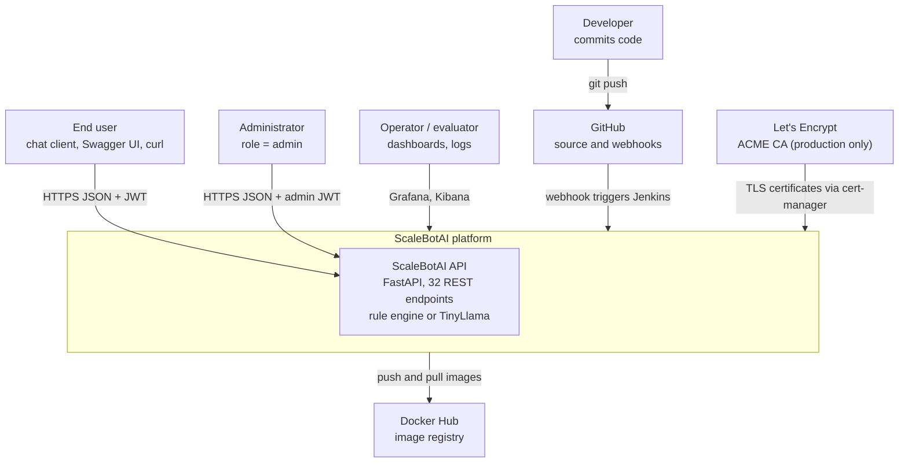

**Key design points**
- The platform has two kinds of human users: API consumers (end users and admins) and operators. Operators use Grafana and Kibana, never the database directly.
- External dependencies are limited to GitHub, Docker Hub and, in production, an ACME CA. The runtime path has **no third-party SaaS dependency**, and the optional LLM runs in-cluster.

---

## 1. Complete High-Level Architecture

The high-level view has five planes: **edge** (DNS, TLS, load balancing), **application** (stateless API pods and their data stores), **monitoring** (metrics and alerting), **logging** (ELK) and **CI/CD** (build and release).

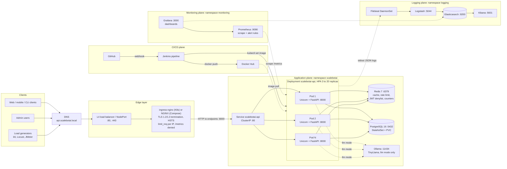

**Key design points**
- **Stateless compute, stateful stores.** API pods keep no session or cache state in memory. All shared state lives in PostgreSQL (durable) or Redis (ephemeral), so any pod can serve any request and the HPA can add or remove pods freely.
- **Single TLS termination point** at the edge. Traffic inside the cluster is plain HTTP on a private network protected by NetworkPolicies (see §7). A service mesh with mTLS is listed as future work.
- **`/metrics` is never public.** The Compose NGINX denies it explicitly, the Kubernetes Ingress does not route it (only `/api` and `/health`), and Prometheus scrapes pods directly on the cluster network.
- **Observability is out-of-band.** Metrics are pulled and logs are shipped from node log files, so a monitoring or logging outage does not affect request handling.
- **CI/CD changes as little as possible.** For the default rolling strategy, Jenkins only changes the Deployment's image (`kubectl set image`). Everything else is declarative (`kubectl apply -k k8s/base`), which keeps rollouts and rollbacks atomic and auditable. Canary and blue-green additionally manage the `track`/`color`-labelled Deployments and Service selector ([doc 12](12-deployment-strategies.md)).

---

## 2. Detailed Component Diagram (FastAPI service)

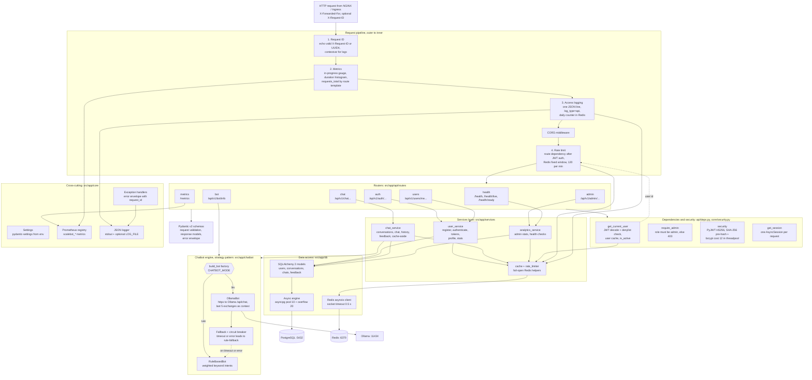

**Key design points**
- **Layered architecture.** Routers handle HTTP concerns only (status codes, schemas). Services hold the business rules. The ORM layer holds the SQL. Each layer can be unit-tested with fakes (SQLite via aiosqlite and fakeredis).
- **Pipeline order matters.** Stages 1–3 are implemented by one pure-ASGI middleware (`src/app/middleware/request_context.py`), which avoids per-middleware overhead.
  - It assigns the request ID first, so every later log line and error carries it.
  - It wraps everything else, so rejected (429) and failed (5xx) requests are measured and logged too.
  - `/metrics` and `/health*` are excluded from metrics and the daily counter.
- **Rate limiting runs right after authentication.** It is the last link before the handler and is implemented as a FastAPI dependency (`src/app/api/deps.py`) chained after `get_current_user`. It keys on `user:{id}` for authenticated routes and on `ip:{client_ip}` for anonymous ones (login, register). The client IP comes from `X-Forwarded-For`, which is trusted because Uvicorn runs with `--proxy-headers`.
- **Strategy pattern for the bot.** `CHATBOT_MODE` selects an engine at start-up. The LLM engine carries its own fallback and circuit breaker, so a slow or absent Ollama degrades answer quality but never availability.
- **Fail-open Redis.** Every Redis call is wrapped, and on error the request proceeds without cache, rate limit or denylist, and an error log is emitted (throttled). Availability is preferred over these protections (trade-off discussed in [doc 03](03-component-design.md) and [doc 10](10-security-architecture.md)).
- **CPU-bound work off the event loop.** bcrypt hashing and verification run in Starlette's threadpool, so a 250 ms hash does not stall other requests on the same pod.

---

## 3. Deployment Diagram

### 3a. Development: Docker Compose (single host)

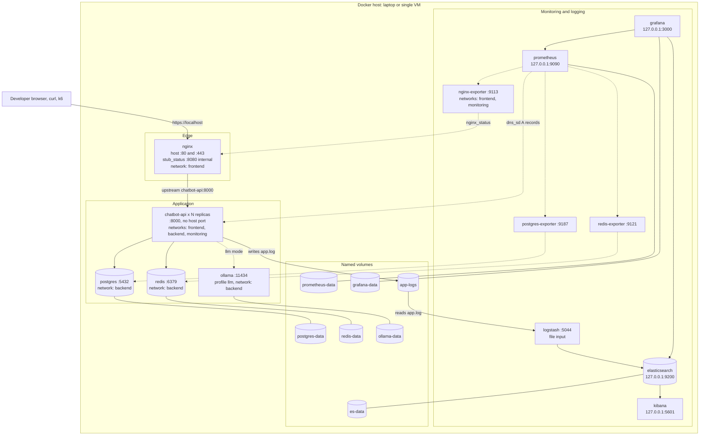

**Key design points**
- `chatbot-api` has **no `container_name` and no host port**. That is what makes `docker compose up -d --scale chatbot-api=3` possible: Docker's embedded DNS returns one A record per replica, NGINX balances across them, and Prometheus discovers each one through `dns_sd_configs` (type A).
- Three user-defined bridge networks isolate tiers. Containers can only talk across a network they share. The database and Redis are reachable only on `backend` and never from the host. Operator UIs (Prometheus 9090, Grafana 3000, Kibana 5601) bind to `127.0.0.1` by default (`MONITORING_BIND_ADDR`), and Elasticsearch always binds to `127.0.0.1:9200` because its security is disabled for local development.
- Every service inherits `restart: unless-stopped` and `no-new-privileges`. The API container also runs with a read-only root filesystem and all capabilities dropped.
- Logs reach ELK through the shared `app-logs` volume: the API appends JSON lines to `/var/log/scalebotai/app.log`, and Logstash's `file` input tails them.

### 3b. Production: Kubernetes (multi-node)

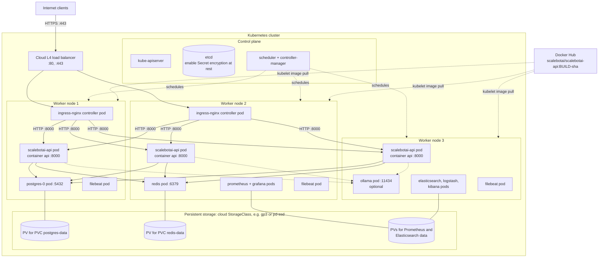

**Key design points**
- Placement is decided by the scheduler. The diagram shows one valid outcome where **topology spread constraints** (`maxSkew: 1` across nodes) keep API replicas on different nodes, so losing a node removes at most one replica.
- Two ingress-nginx controller replicas sit behind the cloud load balancer, which removes the edge single point of failure.
- Stateful workloads (`postgres` StatefulSet, `redis`) use PersistentVolumeClaims `postgres-data` and `redis-data`. If a node fails, the pod is rescheduled and re-attaches its volume (subject to the storage class's zone constraints).
- Every node pulls the same immutable image tag `<BUILD_NUMBER>-<git short sha>`, which is what makes `kubectl rollout undo` deterministic.

---

## 4. Kubernetes Architecture Diagram

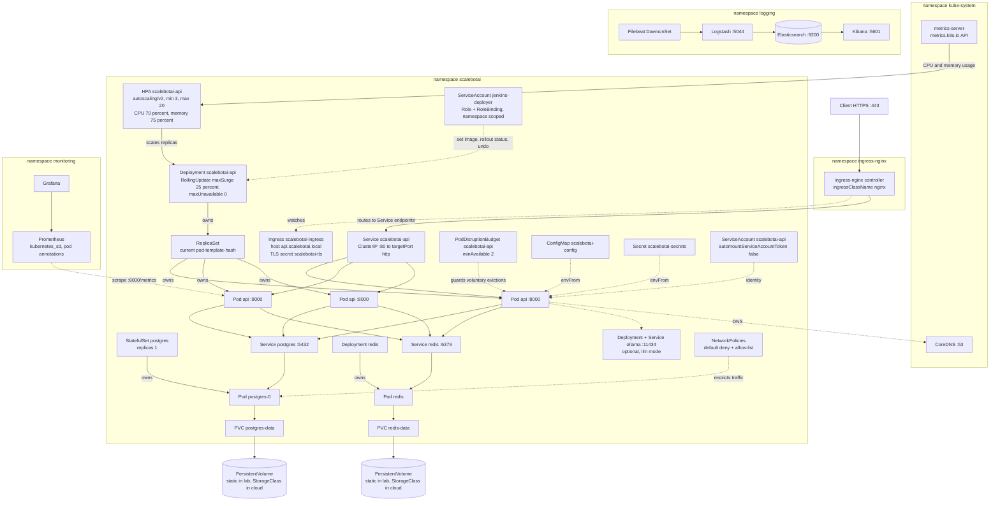

**Key design points**
- **Ownership chain.** The Deployment owns ReplicaSets, which own Pods. A rolling update creates a new ReplicaSet and scales the old one down. The old ReplicaSet is kept (`revisionHistoryLimit`), which is what `kubectl rollout undo` scales back up.
- **HPA ↔ metrics-server.** metrics-server aggregates kubelet/cAdvisor usage every ~15 s and exposes `metrics.k8s.io`. The HPA control loop compares usage against *requests* (250m CPU, 256Mi memory) and sets `spec.replicas` between 3 and 20. Prometheus is **not** in the autoscaling path, so a monitoring outage cannot break scaling.
- **ingress-nginx routes to endpoints directly.** The controller reads the Service's EndpointSlices and load-balances to pod IPs on port 8000, bypassing kube-proxy. The ClusterIP Service (port 80) is used by in-cluster clients and smoke tests.
- **Configuration split.** Non-secret settings come from ConfigMap `scalebotai-config` and secrets from Secret `scalebotai-secrets`, both injected as environment variables (12-factor).
- **Least privilege.** The API ServiceAccount has no token mounted, because the app never calls the Kubernetes API. Jenkins uses the separate `jenkins-deployer` ServiceAccount, limited by a namespace-scoped Role.
- **Disruption safety.** The PDB (`minAvailable: 2`) stops `kubectl drain` and cluster upgrades from evicting API pods below two. Rolling updates are not governed by PDBs; the RollingUpdate setting `maxUnavailable: 0` gives the equivalent guarantee during deploys.
- **Pod Security Admission.** Namespace `scalebotai` is labelled `pod-security.kubernetes.io/enforce: restricted`, so the API server rejects any pod that runs as root, keeps capabilities or lacks a seccomp profile.

---

## 5. CI/CD Diagram

```mermaid
flowchart LR
    DEVR["Developer"]
    GHR["GitHub repository<br/>main branch"]

    subgraph jenkins["Jenkins declarative pipeline: jenkins/Jenkinsfile"]
        direction LR
        S1["1 Checkout<br/>git SHA, BUILD_NUMBER"]
        S2["2 Build<br/>venv + requirements-dev"]
        S3["3 Unit Test<br/>pytest, JUnit + coverage"]
        S4["4 Lint, parallel<br/>ruff check, ruff format --check,<br/>bandit SAST"]
        S5["5 Docker Build<br/>tag BUILD_NUMBER-sha"]
        S6["6 Security Scan, Trivy<br/>report HIGH and CRITICAL,<br/>block secrets and fixable CRITICAL"]
        S7["7 Docker Push, main and develop<br/>dockerhub-credentials"]
        S8{{"8 Kubernetes Deploy, main only<br/>DEPLOY_STRATEGY: rolling, canary, blue-green<br/>kubeconfig-scalebotai"}}
        S9["9 Smoke Test<br/>scripts/smoke_test.sh BASE_URL"]
        S1 --> S2 --> S3 --> S4 --> S5 --> S6 --> S7 --> S8 --> S9
    end

    HUBR[("Docker Hub<br/>scalebotai/scalebotai-api")]
    K8SR["Kubernetes<br/>namespace scalebotai"]
    FAILB["Pipeline FAILED<br/>nothing deployed"]
    RBK["10 Rollback<br/>scripts/rollback.sh,<br/>kubectl rollout undo"]
    DONE["Release complete<br/>image tag recorded"]

    DEVR -->|"git push / PR merge"| GHR
    GHR -->|"webhook"| S1
    S3 -.->|"tests fail"| FAILB
    S4 -.->|"lint or SAST fails"| FAILB
    S6 -.->|"secret or CVE gate fails"| FAILB
    S7 -->|"docker push"| HUBR
    S8 -->|"kubectl set image + rollout status 300s"| K8SR
    HUBR -.->|"image pull"| K8SR
    S8 -.->|"rollout timeout"| RBK
    S9 -->|"pass"| DONE
    S9 -.->|"fail"| RBK
    RBK -->|"previous ReplicaSet restored"| K8SR
```

| Stage | What it proves | Fails the build when | Typical duration *(estimate)* |
|---|---|---|---|
| Checkout | Exact commit is built | — | < 10 s |
| Build | Dependencies resolve on Python 3.12 | pip resolution error | 30–60 s (cached) |
| Unit Test | Business logic correct (SQLite + fakeredis, no services) | any test fails | 30–90 s |
| Lint (parallel) | Style (`ruff check`, `ruff format --check`) and static security analysis (`bandit`) | any ruff violation, or a Bandit finding of MEDIUM+ severity | < 30 s |
| Docker Build | Multi-stage image builds reproducibly | build error | 1–3 min (layer cache) |
| Security Scan | No secrets committed to the repo. No *fixable* CRITICAL CVEs in the image. HIGH/CRITICAL report and IaC misconfiguration report archived | Trivy secret scan or `--severity CRITICAL --ignore-unfixed` image scan exits ≠ 0 | 30–90 s |
| Docker Push (`main`, `develop`) | Image available to the cluster | registry auth/push error | 20–60 s |
| Kubernetes Deploy (`main` only) | New pods pass readiness, old pods drained | `rollout status` timeout (300 s) | 1–3 min |
| Smoke Test | Real user journey works on the live endpoint | any check non-zero | 10–30 s |
| Rollback (post-failure) | Service restored to last good revision | — | < 2 min |

**Key design points**
- **Fail fast, cheapest checks first.** Tests, lint and SAST run before the slow image build. The image is scanned *before* it is pushed, so an image with a fixable CRITICAL CVE never reaches the registry. HIGH findings are reported for review rather than blocking, a deliberate trade-off so that unfixable upstream CVEs do not stall delivery.
- **Immutable, traceable artefacts.** The tag `<BUILD_NUMBER>-<git short sha>` links a running pod to its Jenkins build and Git commit. `latest` is pushed only from `main` as a convenience (the base manifest's initial image). Every pipeline deployment pins the exact tag with `kubectl set image`.
- **Automated rollback** (`scripts/rollback.sh`) is triggered by both a rollout timeout and a failed smoke test. A `post { failure }` safety net rolls back if the pipeline dies mid-deploy. This bounds the mean time to recover to a few minutes.
- **Credentials never appear in the Jenkinsfile.** `dockerhub-credentials` (username/password) and `kubeconfig-scalebotai` (secret file) are injected through credentials binding and masked in the logs.
- `SKIP_DEPLOY=true` turns the pipeline into pure CI, for example on feature branches.

---

## 6. Monitoring Diagram

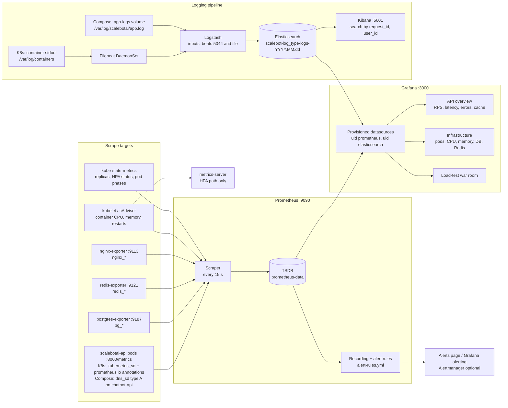

| Signal | Source | Example use |
|---|---|---|
| `scalebot_http_requests_total{method,route,status}` | API | RPS, error ratio, availability SLI |
| `scalebot_http_request_duration_seconds` (histogram) | API | Average and p50/p95/p99 latency against the 300 ms objective |
| `scalebot_http_requests_in_progress` | API | Concurrency (100–500 target) |
| `scalebot_chat_messages_total{bot_mode,cached}`, `scalebot_bot_response_seconds{bot_mode}` | API | Rule vs LLM comparison, fallback rate |
| `scalebot_cache_hits_total` / `scalebot_cache_misses_total{cache}` | API | Hit ratio per cache (`bot_response`, `user`, `analytics`) |
| `scalebot_rate_limited_total`, `scalebot_auth_events_total{event}` | API | Abuse and credential-stuffing detection |
| `scalebot_db_pool_checked_out` / `scalebot_db_pool_size` | API | Connection-pool saturation |
| `pg_*`, `redis_*`, `nginx_*` | Exporters | Database connections, Redis memory, NGINX active connections |
| `kube_deployment_*`, `kube_horizontalpodautoscaler_*` | kube-state-metrics (K8s) | Replica counts and HPA decisions during load tests |
| JSON logs (`log_type` = api, user, error, system) | API → ELK | Per-request forensics by `request_id`, audit of user events |

**Key design points**
- **Pull model.** Prometheus discovers targets dynamically (pod annotations in K8s, DNS A records in Compose), so newly scaled replicas are scraped automatically.
- **Recording rules** pre-compute the SLO queries (RPS, error ratio, p95, average latency), and alert rules are written against those recordings, for example `HighErrorRate` (> 1 %), `HighAvgLatency` / `HighLatencyP95` (> 300 ms), `ScaleBotAPIDown`, `DBPoolSaturation`, `RedisDown`, `PostgresDown`, `LowCacheHitRatio`.
- **Metrics and logs are joined by `request_id`.** Every error envelope and log line carries it, so a Grafana spike can be traced to individual requests in Kibana.
- **Separate indices per `log_type`** (`scalebot-api-logs-*`, `scalebot-user-logs-*`, `scalebot-error-logs-*`, `scalebot-system-logs-*`) allow different retention periods, for example a longer one for audit (`user`).

---

## 7. Network Diagram

### 7a. Kubernetes traffic path and ports

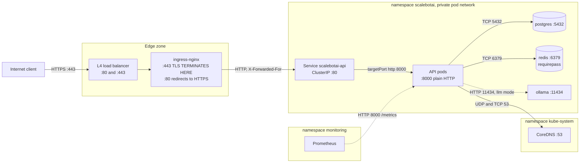

### 7b. Docker Compose networks

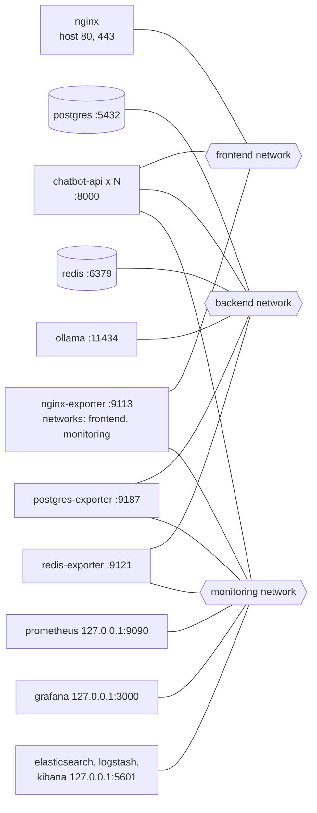

Network membership matches `docker-compose.yml`. `nginx-exporter` joins `frontend` to read `nginx:8080/nginx_status` and `monitoring` to be scraped, so NGINX itself never needs to be on the monitoring network. The exporters bridge `backend` and `monitoring` in the same way. Details are in [doc 06](06-docker-implementation.md).

### 7c. NetworkPolicy allow-list (namespace `scalebotai`, file `k8s/base/12-network-policies.yaml`)

The baseline is **`default-deny-all`**, which denies **both ingress and egress** for every pod in the namespace. Additive allow rules then open exactly the flows the architecture needs:

| Policy | From | To | Port | Why |
|---|---|---|---|---|
| `allow-dns-egress` | Every pod in `scalebotai` | CoreDNS (`k8s-app: kube-dns`, namespace `kube-system`) | UDP/TCP 53 | Name resolution |
| `allow-api-ingress` | Namespace `ingress-nginx` | `app: scalebotai-api` | TCP 8000 | Public API traffic |
| `allow-api-ingress` | Namespace `monitoring` | `app: scalebotai-api` | TCP 8000 | Prometheus `/metrics` scrape |
| `allow-api-egress` | `app: scalebotai-api` | `app: postgres` / `app: redis` / `app: ollama` | TCP 5432 / 6379 / 11434 | SQL, cache and limiter, LLM |
| `allow-postgres-ingress` | `app: scalebotai-api`, `app: postgres-exporter` | `app: postgres` | TCP 5432 | Queries, database metrics |
| `allow-redis-ingress` | `app: scalebotai-api`, `app: redis-exporter` | `app: redis` | TCP 6379 | Cache, Redis metrics |
| `allow-ollama-ingress` | `app: scalebotai-api` | `app: ollama` | TCP 11434 | LLM mode only |
| (implicit) | Anything else | Any pod | — | **Denied** |

Rules for exporter scraping and the Ollama model download sit next to those optional workloads in `k8s/optional/`. Kubelet health probes come from the node and are always allowed.

**Key design points**
- **TLS termination point:** NGINX (Compose) or ingress-nginx (Kubernetes). HSTS tells browsers never to downgrade. Internal hops are on the private pod network, isolated by NetworkPolicies.
- **Only the edge is exposed.** In Compose, the host publishes 80/443 for NGINX. The operator UIs (3000, 9090, 5601) and Elasticsearch (9200) bind to loopback. PostgreSQL, Redis and the API publish no host ports. In Kubernetes, the Ingress routes only the `/api` and `/health` path prefixes, so `/metrics` and `/docs` are not reachable from outside.
- **Defence against lateral movement.** A compromised pod cannot open a connection that no allow rule permits. Because egress is denied by default, a compromised API pod cannot reach the internet or other namespaces either. NetworkPolicies need a CNI that enforces them (Calico, Cilium; e.g. `minikube start --cni=calico`), and minikube's default CNI silently ignores them.

---

## 8. Database Diagram

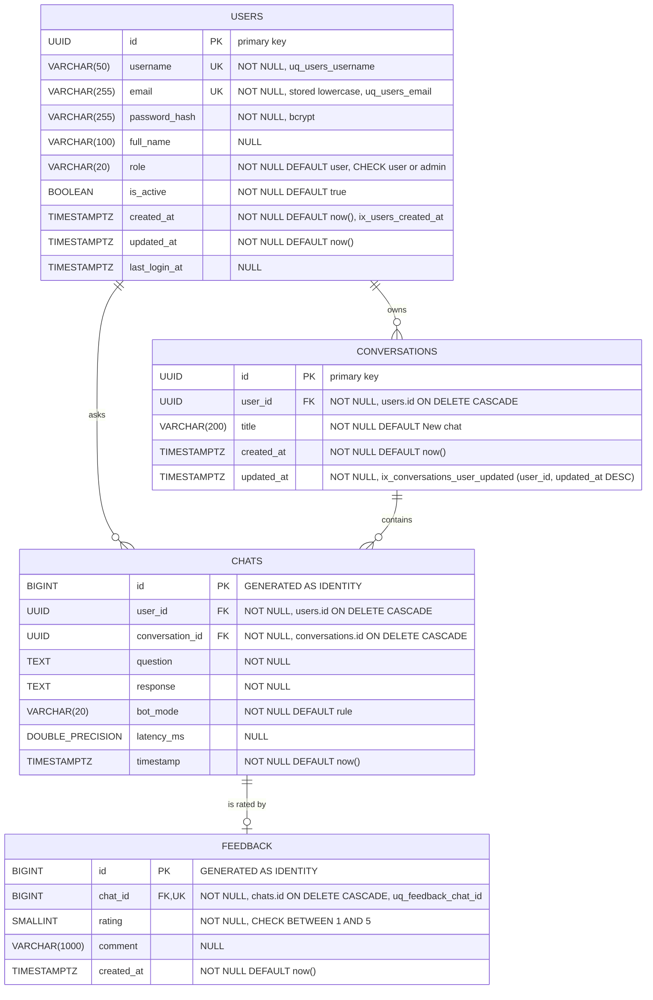

| Table | Indexes (besides PK) | Serves |
|---|---|---|
| users | `uq_users_username`, `uq_users_email`, `ix_users_created_at` | Login by username/email, "new users today/7d" |
| conversations | `ix_conversations_user_updated (user_id, updated_at DESC)` | "My conversations, most recent first" |
| chats | `ix_chats_user_timestamp (user_id, timestamp DESC)`, `ix_chats_conversation_timestamp (conversation_id, timestamp)`, `ix_chats_timestamp (timestamp)` | History pages, conversation replay, "chats today" |
| feedback | `uq_feedback_chat_id` (unique) | One rating per answer, upsert |

**Key design points**
- `chats.user_id` is deliberately **denormalised** (it is derivable from the conversation). It lets history and per-user stats use a single index range scan without a join.
- **Cascades** implement "delete my account" and "delete conversation" in one statement and keep referential integrity at the database level.
- A `UNIQUE` foreign key in `feedback` turns the 1:N relationship into **1:0..1**, which is how the rating upsert is enforced.
- UUID keys for users and conversations stop ID enumeration in URLs. `BIGINT` identity for the high-volume `chats` table keeps its indexes compact.
- Redis keys complement the schema: `bot:resp:{mode}:{sha256}`, `user:{id}`, `analytics:summary`, `ratelimit:{user_or_ip}:{epoch_minute}`, `jwt:denylist:{jti}`, `stats:requests:{YYYY-MM-DD}`. Full detail is in [doc 04](04-database-design.md).

---

## 9. Load Testing Architecture Diagram

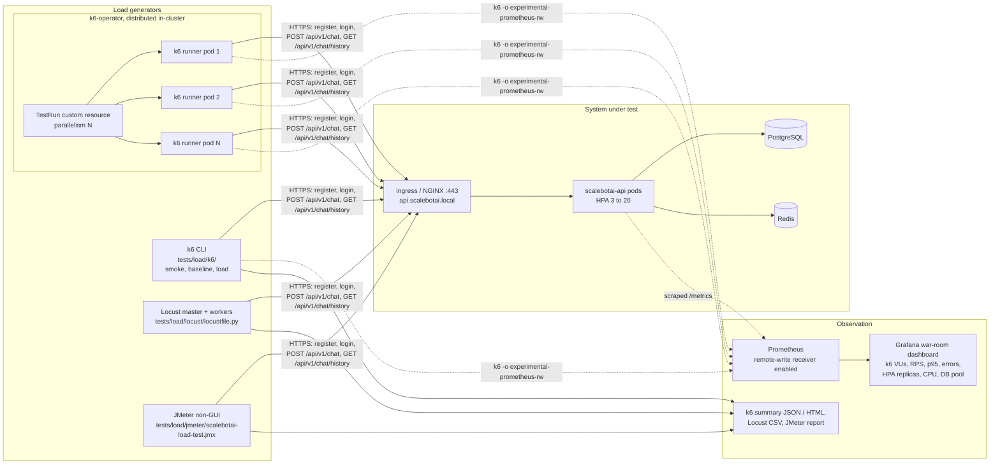

| Phase | Virtual users | Duration *(indicative)* | Purpose | Generator |
|---|---|---|---|---|
| Smoke | 100 | 1–2 min | Scripts and environment work | k6 CLI |
| Baseline | 1,000 | 10 min | Reference latency at 3 replicas | k6 CLI |
| Load | 10,000 | 30 min | Peak-day traffic; HPA scale-out | k6 CLI or k6-operator |
| Stress | 25,000 | 20 min | Find the breaking point and first bottleneck | k6-operator |
| Spike | 50,000 | sudden ramp | Scale-up speed, error rate during the ramp | k6-operator |
| Soak | steady peak load | 24 h | Memory leaks, connection exhaustion, 99.9 % | k6-operator |

**Key design points**
- **Generators run outside the pods under test.** Generators that compete for the same CPU distort results, so the k6-operator runners go on a separate node pool or in a separate cluster.
- **Distributed generation** (k6-operator `parallelism`) is needed above roughly 10–20k VUs per machine *(estimate)*, and is how the 25k and 50k phases are reached.
- **One pane of glass.** k6 pushes its client-side metrics to Prometheus with remote write. Prometheus must be started with `--web.enable-remote-write-receiver`. The war-room dashboard then plots client-observed latency next to server-side `scalebot_http_request_duration_seconds` and HPA replica counts.
- **Rate limits must be adjusted for load tests.** A test from few source IPs or few users would hit `RATE_LIMIT_PER_MINUTE=120`. Raise it for the test window, or create many users and distribute source IPs. Full detail is in [doc 11](11-load-testing-strategy.md).
- Success criteria: average < 300 ms, error rate < 1 %, availability 99.9 %, CPU < 80 %, memory < 80 %.

---

## 10. Request Lifecycle: `POST /api/v1/chat`

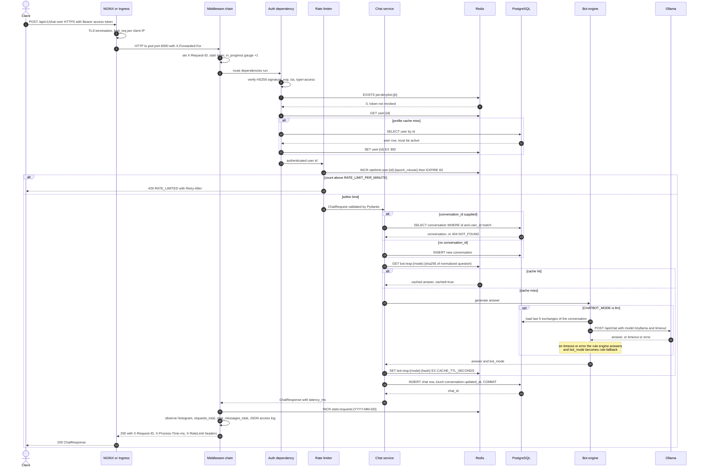

**Key design points**
- **Cheapest rejection first.** NGINX drops floods before they reach Python. The JWT signature is checked locally (no I/O) before any Redis or database call.
- **Latency budget (rule mode, cache hit, estimate):** TLS and proxying ~1–3 ms, JWT ~0.1 ms, 3–4 Redis round trips ~0.3 ms each, one conversation `SELECT` plus one `INSERT … COMMIT` ~2–6 ms. That is **~5–15 ms server time**, well under the 300 ms objective. LLM mode adds 0.5–5 s on CPU, which is why it is not the default.
- **The cache stores the expensive part, not the write.** Every exchange is still persisted (history is a feature). The cache removes bot computation, which matters most for the LLM.
- **Every hop is observable.** The same `request_id` appears in the response header, the access log, any error envelope and Kibana.

---

## 11. Login Sequence

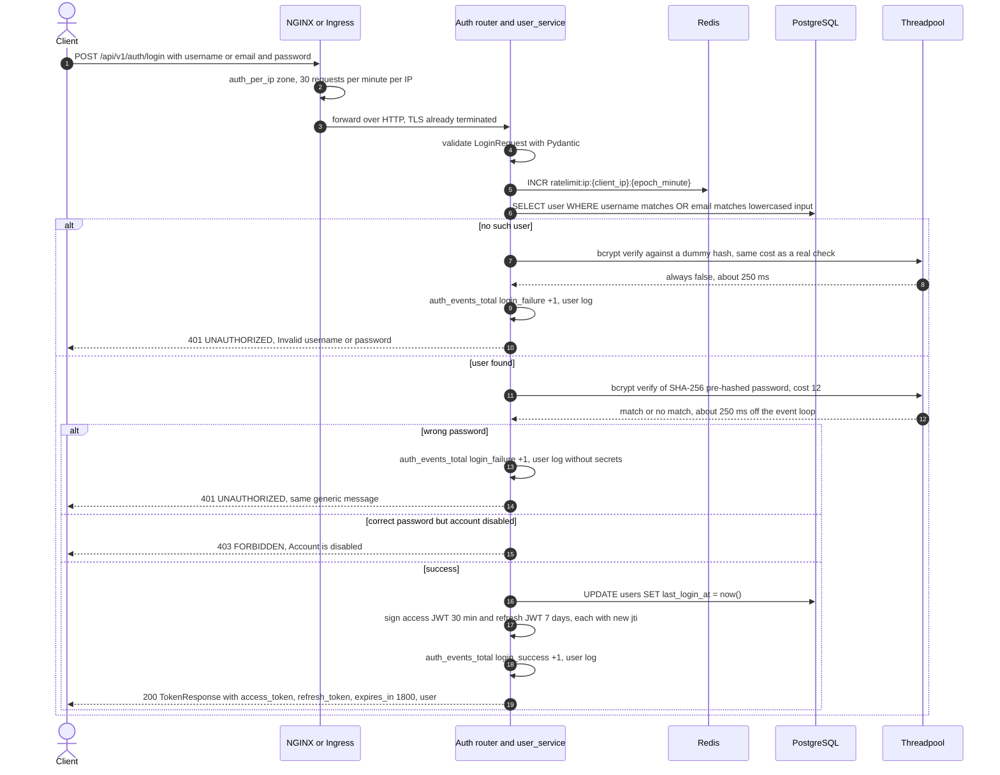

**Key design points**
- **No user enumeration through login.** The body is the same for "no such user" and "wrong password", and the timing is equalised by verifying against a dummy bcrypt hash, so neither reveals which usernames exist. The disabled-account status (403) is returned only *after* a correct password.
- **bcrypt runs in the threadpool.** One login costs ~250 ms of CPU *(estimate)* but does not block the event loop, so chat requests on the same pod are unaffected. Login is still the most CPU-expensive endpoint and the prime target for credential stuffing. Both rate-limit layers (NGINX `auth_per_ip` and Redis per IP) and the `login_failure` counter address this; see [doc 10](10-security-architecture.md).
- **Stateless verification, stateful revocation.** Tokens are verified with the shared secret alone, so any pod can verify any token. Revocation (logout, refresh rotation) is recorded in Redis under `jwt:denylist:{jti}` with a TTL equal to the token's remaining lifetime, so the denylist cleans itself up.
