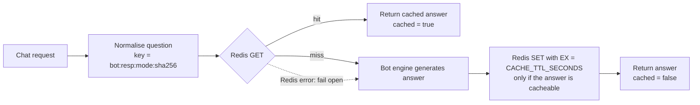
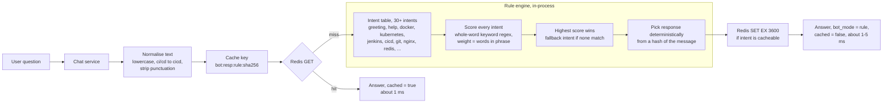
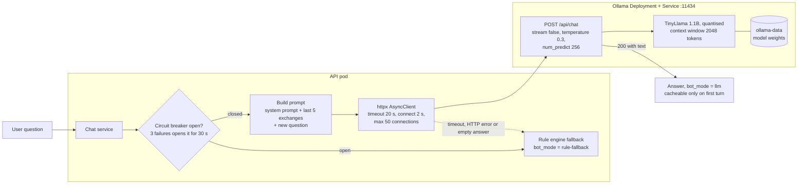
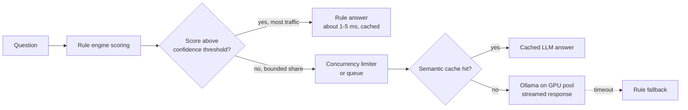

# 03 — Component Design and High-Availability Design

This document explains each building block of ScaleBotAI, shows how they work together to meet the availability and performance targets, and compares the two chatbot engines. Diagrams referenced as "§n of doc 02" are in [02 Architecture Diagrams](02-architecture-diagrams.md).

> Numbers marked *(estimate)* are engineering estimates used for sizing. The load-test plan in [doc 11](11-load-testing-strategy.md) replaces them with measured values.

---

## 1. Component Overview

| Component | Role | Runs as (Compose / Kubernetes) | Port |
|---|---|---|---|
| FastAPI app (`app`) | Business API, chatbot, auth, metrics | `chatbot-api` × N / Deployment `scalebotai-api` (3–20) | 8000 |
| PostgreSQL 16 | System of record | `postgres` / StatefulSet `postgres` + PVC `postgres-data` | 5432 |
| Redis 7 | Cache, rate limiter, JWT denylist, counters | `redis` / Deployment `redis` + PVC `redis-data` | 6379 |
| NGINX | TLS, reverse proxy, load balancer, edge rate limiting | `nginx` / ingress-nginx controller | 80, 443 (8080 internal status) |
| Ollama + TinyLlama | Optional generative engine | `ollama` (profile `llm`) / Deployment + Service `ollama` | 11434 |
| Prometheus | Metrics collection, alert rules | `prometheus` / namespace `monitoring` | 9090 |
| Grafana | Dashboards | `grafana` / namespace `monitoring` | 3000 |
| Elasticsearch, Logstash, Kibana, Filebeat | Central log store, pipeline, UI, shipper | Compose services / namespace `logging` | 9200, 5044, 5601 |
| Jenkins | CI/CD orchestrator | External to the cluster | 8080 (Jenkins UI) |

---

## 2. Component Explanations

### 2.1 FastAPI application and its layers

The application is a single Python package, `app` (source in `src/app/`, `/app/app` in the image), organised in layers with one-way dependencies (top to bottom):

| Layer | Package (under `src/app/`) | Responsibility | Must not |
|---|---|---|---|
| Entry point | `main.py` | `create_app()` registers middleware (request context, CORS), routers and exception handlers. Lifespan start-up (DB, Redis, bot engine, table creation, bootstrap admin) and graceful shutdown | Contain business logic |
| Middleware | `middleware/request_context.py` | Pure-ASGI: request ID, metrics, JSON access log, daily request counter | Know about business rules |
| Routers (API) | `api/routes/` (health, auth, users, chat, bot, admin) | HTTP mapping: path, method, status code, response model, dependencies | Run SQL directly |
| Dependencies | `api/deps.py` | `get_current_user` (JWT + denylist + user cache), rate-limit dependencies (per user / per IP), `require_admin`, `get_session` (one `AsyncSession` per request) | Hold state across requests |
| Schemas | `schemas/` | Pydantic v2 request/response models and the `Page[T]` envelope | Touch I/O |
| Services | `services/` (`user_service`, `chat_service`, `analytics_service`, `cache`, `rate_limiter`) | Use cases (register, chat, analytics, …), cache-aside, rate limiting, counters | Know about HTTP |
| Chatbot | `chatbot/` | `BotEngine` interface, `RuleBasedBot`, `OllamaBot`, factory | Access the DB |
| Data | `db/` | SQLAlchemy models, async engine and pool, schema bootstrap under an advisory lock | Know about users of the data |
| Core | `core/` | Settings, security (JWT/bcrypt), Redis factory, JSON logging, metrics registry, error envelope, request context | Depend on upper layers |

**Why this structure:** it is testable (routers can be exercised with `httpx.AsyncClient` against SQLite and fakeredis), replaceable (the chatbot is a strategy and the database is behind SQLAlchemy), and it keeps cross-cutting concerns such as logging, metrics and errors in one place, so every endpoint behaves consistently.

**Start-up.** `create_app()` configures JSON logging. Then the lifespan handler of each replica:
1. Creates the DB engine (pool), the Redis client and the bot engine (`build_bot`).
2. Logs an `insecure_config` warning if `JWT_SECRET_KEY` is the default or shorter than 32 characters.
3. Creates tables if `AUTO_CREATE_TABLES=true`, inside `pg_advisory_xact_lock`, retrying while PostgreSQL boots, so three replicas starting together do not race.
4. Creates the bootstrap admin if `ADMIN_PASSWORD` is set and the user is missing.
5. Publishes `scalebot_app_info` and the pool-size gauge.

On SIGTERM, Uvicorn stops accepting connections, finishes in-flight requests and the lifespan disposes the pools. This is what makes rolling updates lossless.

### 2.2 Pydantic v2 validation

Every request body and query parameter is declared as a typed model. FastAPI validates it **before** the handler runs and returns `422 VALIDATION_ERROR` in the standard envelope (`details` lists each failing field). Examples of rules enforced:

- `RegisterRequest.username`: 3–50 characters matching `^[a-zA-Z0-9_.-]+$`. `email`: `EmailStr`. `password`: 8–128 characters with at least one letter and one digit.
- `ChatRequest.message`: 1–2000 characters after stripping. `conversation_id`: optional UUID.
- `FeedbackRequest.rating`: 1–5. Pagination `size`: 1–100.

Benefits: (1) a whole class of injection and overflow bugs is rejected at the boundary; (2) response models filter output, so `password_hash` can never be serialised by accident; (3) the same models generate the OpenAPI document. Settings are also Pydantic (`pydantic-settings`), so a malformed environment variable fails the pod at start-up instead of at the first request.

### 2.3 Async I/O model and one Uvicorn worker per pod

**Event loop.** Uvicorn runs one asyncio event loop per process. Every I/O call is non-blocking: PostgreSQL through **asyncpg**, Redis through **redis-py asyncio** and Ollama through **httpx.AsyncClient**. While one request waits for the database, the loop serves others. A typical rule-mode chat request spends ~5–15 ms in the server, mostly waiting on the network *(estimate)*, so one process can keep dozens of requests in flight.

**CPU-bound work is offloaded.** bcrypt (~250 ms at cost 12) runs in Starlette's threadpool (`run_in_threadpool`). bcrypt's native extension releases the GIL while hashing, so the event loop keeps serving other requests during a login.

**Why exactly one worker per container** (`--workers 1`):

| Reason | Explanation |
|---|---|
| Correct metrics | `prometheus_client` keeps metrics in process memory. Multiple workers would need multiprocess mode (shared files, restricted gauge semantics). With one process per pod, every scrape is the whole truth for that pod |
| HPA accuracy | The HPA scales on pod CPU/memory relative to requests. A small, uniform unit (1 process, 250m request, 1 CPU limit) gives fine-grained, predictable scaling |
| No duplicated supervision | Kubernetes (or Compose) already restarts crashed processes and load-balances across replicas. A Gunicorn master inside the pod would duplicate this |
| Clear failure domain | An OOM kill or crash affects exactly one worker and is visible as a pod restart |
| Predictable connection maths | DB connections = pods × (`DB_POOL_SIZE` + `DB_MAX_OVERFLOW`), with no hidden multiplier |
| Simple graceful shutdown | Uvicorn is PID 1 (exec-form `CMD`) and receives SIGTERM directly |

Trade-off: each extra process costs ~80–120 MB of baseline memory *(estimate)*. That is accepted because the scheduler packs pods efficiently.

**Per-pod capacity (estimate).** About 3–5 ms of CPU per rule-mode request gives ~150–250 req/s per pod at its 1-CPU limit. Three pods therefore cover the 116 req/s peak with headroom, and the 500 req/s design point needs ~3–5 pods, well within the HPA maximum of 20.

### 2.4 PostgreSQL 16

PostgreSQL is the system of record for `users`, `conversations`, `chats` and `feedback` (schema in §8 of doc 02 and [doc 04](04-database-design.md)). Reasons for choosing it:

- ACID transactions: a chat exchange and its conversation timestamp are committed atomically.
- Rich constraints (`CHECK`, `UNIQUE`, cascading FKs), so data integrity does not depend on application code.
- Composite indexes for every hot query (history by user and time, conversation replay).
- Advisory locks, used to serialise schema creation across replicas.
- A mature HA ecosystem (streaming replication, CloudNativePG, Patroni, managed RDS/Cloud SQL) for the next step.

Access goes through SQLAlchemy 2 async with an asyncpg pool per pod: `pool_size=10`, `max_overflow=20`, `pool_timeout=10 s`, `pool_pre_ping`, `pool_recycle=1800 s`. In Kubernetes, PostgreSQL runs as StatefulSet `postgres` with a stable identity (`postgres-0`), a stable DNS name and PVC `postgres-data`, and is started with `max_connections=300` (200 in the Compose stack).

### 2.5 Redis 7

Redis is the shared, in-memory state that keeps the API pods stateless:

| Use | Key | TTL | Why Redis |
|---|---|---|---|
| Bot-response cache | `bot:resp:{mode}:{sha256(normalized question)}` | `CACHE_TTL_SECONDS` (3600 s) | Sub-millisecond reads shared by all replicas |
| Profile cache | `user:{id}` | 300 s | Avoids a `SELECT` on hot paths |
| Admin analytics cache | `analytics:summary` | 30 s | Aggregate queries are expensive |
| Rate limiter | `ratelimit:{user_or_ip}:{epoch_minute}` | 60 s | Atomic `INCR` gives one counter for all pods |
| JWT denylist | `jwt:denylist:{jti}` | Remaining token life | Revocation without a DB table; self-cleaning |
| Daily request counter | `stats:requests:{YYYY-MM-DD}` | 35 days | Cheap analytics for `/admin/stats/requests` |

**Fail-open policy.** Every Redis call is wrapped: on error the request continues as if the key were missing, and an error is logged at most once every 10 s. The first error also opens a 5 s circuit breaker, so during an outage requests skip Redis instantly instead of each waiting on connect timeouts (measured: ~73 ms average chat latency with Redis stopped, versus ~2 s without the breaker; see ADR-015 in doc 13). A Redis outage therefore costs latency and some protections (rate limiting, denylist) but not availability of the request path. Persistence (RDB/AOF on PVC `redis-data`) only speeds up warm-up. Correctness never depends on Redis data.

### 2.6 NGINX (Compose) and ingress-nginx (Kubernetes)

NGINX is the single entry point:
- HTTP→HTTPS redirect.
- TLS 1.2/1.3 termination with HTTP/2, a session cache and no session tickets.
- Security headers (HSTS, `nosniff`, `X-Frame-Options: DENY`, `Referrer-Policy`, `Permissions-Policy`).
- JSON access logs carrying the same `request_id` the API uses.
- Per-IP `limit_req`: 50 r/s for the API, a stricter 30 r/min zone for `login`/`register`, and per-IP `limit_conn`.
- `/metrics` denied publicly.
- An internal `stub_status` on `:8080/nginx_status` for `nginx-exporter`.

In Compose the upstream `chatbot-api:8000` is re-resolved through Docker DNS (`resolver 127.0.0.11 valid=10s` with `server … resolve`), so `--scale chatbot-api=N` is picked up without a reload. In Kubernetes the same role is played by the **ingress-nginx** controller, configured through the `scalebotai-ingress` Ingress (host `api.scalebotai.local`, TLS secret `scalebotai-tls`) and annotations.

### 2.7 Docker

`docker/api/Dockerfile` is multi-stage:

- **builder** compiles the dependencies into `/opt/venv`.
- **test** runs `pytest` at build time when targeted.
- **runtime** is `python:3.12-slim` plus the venv plus the code, running as **uid/gid 10001**. The code is owned by root and read-only to the app user, there is a stdlib-based `HEALTHCHECK` on `/health/live`, OCI labels are set, and the exec-form `CMD` runs Uvicorn with one worker.

Dependency layers are ordered before the source code for cache efficiency, and BuildKit cache mounts keep pip/apt caches out of the image layers. `docker-compose.yml` wires 12 services (+ optional `ollama`) across the `frontend`, `backend` and `monitoring` networks with 7 named volumes. Details: [doc 06](06-docker-implementation.md).

### 2.8 Kubernetes objects

| Object | Name | Purpose / key settings |
|---|---|---|
| Namespace | `scalebotai`, `monitoring`, `logging` | Isolation boundary for RBAC, NetworkPolicy and quotas |
| Deployment | `scalebotai-api` | `replicas: 3`, container `api`, port `http` 8000, RollingUpdate maxSurge 25 % / maxUnavailable 0, requests 250m/256Mi, limits 1 CPU/512Mi |
| Probes | — | startup and liveness `GET /health/live` (no dependency checks, so a DB outage never triggers restarts); readiness `GET /health/ready` (pings DB and Redis, returns 503 only when the **database** is unreachable, because Redis is fail-open) |
| Service | `scalebotai-api` | ClusterIP port 80 → targetPort `http` |
| Ingress | `scalebotai-ingress` | Class `nginx`, host `api.scalebotai.local`, TLS secret `scalebotai-tls` |
| HorizontalPodAutoscaler | `scalebotai-api` | `autoscaling/v2`, 3–20, CPU 70 %, memory 75 %. Scale-up: no stabilisation, max(+100 %, +4 pods) per 15 s. Scale-down: 300 s stabilisation, −10 % per 60 s |
| PodDisruptionBudget | `scalebotai-api` | `minAvailable: 2`, so a drain or upgrade can never leave fewer than two API pods |
| StatefulSet + Service | `postgres` | Stable identity `postgres-0`, PVC `postgres-data` |
| Deployment + Service | `redis` | PVC `redis-data`, password from Secret |
| ConfigMap / Secret | `scalebotai-config` / `scalebotai-secrets` | Non-secret settings and credentials injected as env vars |
| ServiceAccount | `scalebotai-api` | `automountServiceAccountToken: false` |
| ServiceAccount + Role + RoleBinding | `jenkins-deployer` → Role `scalebotai-deployer` | Namespace-scoped rights to manage Deployments, Services, Ingress and HPA for the rollout strategies. **No access to Secrets** |
| Role + RoleBinding | `scalebotai-viewer` → group `scalebotai-developers` | Read-only debugging (pods, logs, events, rollouts), no Secrets |
| NetworkPolicy | `default-deny-all` + 6 allow policies | Ingress **and** egress denied by default. Allow-list in §7c of doc 02 |
| Pod Security Admission | namespace labels | `enforce: restricted` on `scalebotai` |
| Labels | `app.kubernetes.io/name`, `app.kubernetes.io/part-of`, `app`, `tier`, `track`, `color` | Selection, canary (`track: stable/canary`), blue-green (`color: blue/green`) |

Manifests are in `k8s/base/` and applied with `kubectl apply -k k8s/base`. Details: [doc 07](07-kubernetes-implementation.md), [doc 12](12-deployment-strategies.md).

### 2.9 Jenkins

A declarative pipeline (`jenkins/Jenkinsfile`) with stages Checkout → Build → Unit Test → Lint (ruff + Bandit, in parallel) → Docker Build → Security Scan (Trivy: report HIGH/CRITICAL, block committed secrets and fixable CRITICAL CVEs) → Docker Push (`main`/`develop`) → Kubernetes Deploy (`main`) → Smoke Test, plus an automatic Rollback (`scripts/rollback.sh`) when deploy or smoke test fails.
- Parameters: `DOCKERHUB_USER`, `DEPLOY_STRATEGY` (rolling | canary | blue-green), `SKIP_DEPLOY`.
- Credentials: `dockerhub-credentials` and `kubeconfig-scalebotai`, bound only inside the stages that need them.
- Agent tools: python3.12, docker, kubectl, trivy, curl.

Details: [doc 08](08-cicd-jenkins.md).

### 2.10 Prometheus

Pull-based metrics:
- **Compose:** discovers every `chatbot-api` replica through `dns_sd_configs` (type A), and also scrapes `postgres-exporter:9187`, `redis-exporter:9121`, `nginx-exporter:9113` and itself every 15 s.
- **Kubernetes:** discovers pods through `kubernetes_sd_configs` and the `prometheus.io/scrape|port|path` annotations.

Recording rules pre-compute RPS, error ratio, average and p95 latency. Alert rules (`monitoring/prometheus/alert-rules.yml`) cover API down, error rate > 1 %, average/p95 latency > 300 ms, CPU, memory, cache hit ratio, DB-pool saturation, rate-limit spikes and exporter or dependency down.

### 2.11 Grafana

Datasources (`prometheus`, `elasticsearch`) and dashboards are **provisioned from files** (`monitoring/grafana/provisioning/`, `monitoring/grafana/dashboards/*.json`), so a fresh container comes up fully configured. Dashboards: API overview (RPS, latency percentiles, errors, cache hit ratio, bot mode mix), infrastructure (pods, CPU, memory, PostgreSQL, Redis, NGINX), and the load-testing war room.

### 2.12 ELK stack and Filebeat

- The API writes one JSON object per line (fields `@timestamp`, `level`, `logger`, `message`, `service`, `environment`, `hostname`, `log_type`, `request_id`, `user_id`, …).
- In **Compose**, the API also appends to `/var/log/scalebotai/app.log` on the shared `app-logs` volume, which Logstash tails with its `file` input.
- In **Kubernetes**, a Filebeat DaemonSet reads container logs on every node and ships them to Logstash's `beats` input on port 5044.
- Logstash routes each event to `scalebot-{log_type}-logs-YYYY.MM.dd` in Elasticsearch, and Kibana is used for search and audit.

Details: [doc 09](09-monitoring-logging.md).

### 2.13 Ollama and TinyLlama (Option 2)

Ollama is a local model server with an HTTP API. ScaleBotAI calls `POST /api/chat` with model `tinyllama` (TinyLlama 1.1B chat, ~640 MB quantised download, 2,048-token context window) and these parameters: `stream: false`, `temperature: 0.3`, `num_predict: 256`. The prompt is a fixed system prompt plus the last 5 exchanges plus the new message. The client has a total timeout of `OLLAMA_TIMEOUT_SECONDS` (20 s), a 2 s connect timeout and a 50-connection pool. A **circuit breaker** opens after 3 consecutive failures and stays open for 30 s, so requests stop waiting on a dead model server. Any failure returns the rule engine's answer with `bot_mode = "rule-fallback"`. Model weights live on the `ollama-data` volume. Comparison with Option 1 is in §4.

---

## 3. High-Availability Design

### 3.1 How Redis improves performance

**Pattern: cache-aside (lazy loading).**

1. Normalise the question (lowercase, collapse whitespace, strip punctuation) so trivially different phrasings share a key, then hash it with SHA-256 for a fixed-length key.
2. `GET` the key. On a hit, return immediately and increment `scalebot_cache_hits_total{cache="bot_response"}`.
3. On a miss, compute the answer, `SET … EX ttl` and increment the miss counter. Answers that depend on time ("what time is it") or on conversation context (LLM follow-ups) are marked non-cacheable.

**TTL choices.** Bot answers use 3600 s: they change only on redeploy, and the TTL bounds staleness after a content update. Profiles use 300 s and are invalidated on update. Analytics use 30 s, because admins accept slightly stale dashboards in exchange for protecting the DB from aggregate queries. Rate-limit windows use 60 s. Denylist entries live for the token's remaining life.

**Hit-ratio maths.** Let *h* be the hit ratio, *t_c* the cache lookup time and *t_m* the time of the miss path (bot computation and its I/O).

> E[T] = h · t_c + (1 − h) · (t_c + t_m)

With **h = 0.8, t_c = 1 ms, t_m = 40 ms**: E[T] = 0.8 × 1 + 0.2 × (1 + 40) = 0.8 + 8.2 = **9.0 ms**. Without the cache, every request costs 40 ms, so the cache gives a **4.4× faster** average and **80 % less load** on the bot/DB path (5× fewer computations).

The same formula in LLM mode (t_m ≈ 2,000 ms *(estimate)*): E[T] = 0.8 × 1 + 0.2 × 2,001 ≈ **401 ms**, against 2,000 ms uncached. Caching is what makes a slow engine tolerable, but only for repeated, context-free questions.

| Hit ratio *h* | E[T], t_m = 40 ms | E[T], t_m = 2,000 ms (LLM) |
|---|---|---|
| 0 % | 41 ms | 2,001 ms |
| 50 % | 21 ms | 1,001 ms |
| 80 % | 9 ms | 401 ms |
| 95 % | 3 ms | 101 ms |

Other performance effects: Redis-backed rate limiting and the denylist give *global* (cross-pod) semantics with O(1) atomic operations. The profile and analytics caches remove repeated `SELECT`s and aggregates. The daily counter (`INCR`) replaces a `COUNT(*)` over a growing table.

### 3.2 How PostgreSQL provides persistence

| Mechanism | What it guarantees |
|---|---|
| **ACID transactions** | A chat insert and the conversation `updated_at` touch commit together or not at all. Concurrent users see consistent snapshots (MVCC) |
| **Write-ahead log (WAL)** | Every change is written sequentially to the WAL and `fsync`ed before commit is acknowledged. After a crash, PostgreSQL replays the WAL, so committed data survives |
| **Constraints** | `UNIQUE` usernames and emails, `CHECK` on role and rating, cascading FKs. Integrity holds even if application code has a bug |
| **PersistentVolumeClaim** | Data lives on `postgres-data`, outside the pod. Deleting or rescheduling `postgres-0` re-attaches the same volume. In Compose, the named volume `postgres-data` survives `docker compose down` (but not `down -v`) |
| **Backups** | Logical: scheduled `pg_dump` (e.g. a nightly Kubernetes CronJob to object storage) for portability. Physical: base backups plus continuous **WAL archiving** enable **point-in-time recovery (PITR)** to any second within the retention window, for example "just before the bad migration" |
| **Recovery objectives (target)** | RPO ≤ 5 min with WAL archiving (24 h with nightly dumps only), RTO ≤ 30 min for restoring onto a fresh PVC |
| **Replicas (future work)** | Streaming replication to hot standbys for read scaling and automatic failover through CloudNativePG or Patroni, or a managed Multi-AZ RDS/Cloud SQL instance. See §3.8 |

### 3.3 How Kubernetes provides fault tolerance

| Mechanism | Failure handled | How |
|---|---|---|
| **ReplicaSet reconciliation** | Pod crash, node loss, accidental `kubectl delete pod` | The controller continuously compares desired with actual replicas and creates replacements within seconds |
| **Liveness probe** (`/health/live`) | Deadlocked or hung process | kubelet restarts the container after consecutive failures. The probe checks no dependencies, so a DB outage does not cause a restart storm |
| **Readiness probe** (`/health/ready`) | Pod cannot reach the database, or is still starting or shutting down | The pod is removed from Service endpoints and receives no traffic until healthy again. Redis status is reported but does not gate readiness |
| **Startup probe** | Slow cold start | Holds off liveness checks until the app is up, so slow starts are not killed |
| **PodDisruptionBudget** | Voluntary disruptions (node drain, cluster upgrade) | The eviction API refuses evictions that would drop available API pods below the budget |
| **Topology spread / anti-affinity** | Node or zone failure | `topologySpreadConstraints` with `maxSkew: 1` across nodes (soft, so a one-node lab cluster still schedules) spread replicas, so one failure removes at most a fraction of capacity |
| **Rolling updates** (maxSurge 25 %, maxUnavailable 0) | Bad or interrupted deploys | New pods must be Ready before old ones are terminated, capacity never drops below `replicas`, and `rollout undo` restores the previous ReplicaSet |
| **Resource requests/limits** | Noisy neighbours, memory leaks | Guaranteed scheduling capacity. A leaking pod is OOM-killed and restarted alone |
| **Graceful termination** | In-flight requests during scale-down or deploy | Endpoint removal happens in parallel with termination. A `preStop` sleep of 5 s keeps the pod serving while ingress and kube-proxy remove it, then SIGTERM lets Uvicorn drain open requests within `terminationGracePeriodSeconds: 30` |

### 3.4 How the HPA provides scaling

The HPA (`autoscaling/v2`) runs a control loop (default every 15 s) using resource metrics from metrics-server:

> **desiredReplicas = ceil( currentReplicas × currentMetricValue / targetMetricValue )**

Utilisation is measured **relative to the container's request** (CPU 250m, memory 256Mi), and the HPA computes this for each metric and takes the **maximum**. No action is taken if the ratio is within the default 10 % tolerance (0.9–1.1). The result is clamped to [minReplicas 3, maxReplicas 20] and to the `behavior` policies (`k8s/base/09-hpa.yaml`):

- **Scale-up:** stabilisation window 0 s, and per 15 s the HPA may add the larger of 100 % of current pods or 4 pods.
- **Scale-down:** stabilisation window 300 s, then at most 10 % of pods removed per 60 s.

**Worked example: scale-out from 3 to 6 pods.**

| Step | Value |
|---|---|
| Steady state | 3 pods, ~120m CPU each (48 % of 250m), ~150Mi memory (59 % of 256Mi) |
| Traffic spike | Total CPU demand rises to 1,050m, i.e. 350m per pod = **140 %** utilisation (possible because the limit is 1 CPU = 400 % of the request) |
| CPU calculation | ceil(3 × 140 / 70) = ceil(6.0) = **6** |
| Memory calculation | pods at ~180Mi = 70 % → ceil(3 × 70 / 75) = ceil(2.8) = 3 |
| Decision | max(6, 3) = **6 replicas**. The scale-up policy allows max(3 × 100 %, 4) = +4 pods per 15 s, so 3 → 6 happens in one step |
| After scale-out | 1,050m / 6 = 175m per pod = 70 %, exactly at target, so the loop is stable |
| Load drops | Utilisation falls to 30 % → ceil(6 × 30 / 70) = 3. The HPA first waits out the 300 s stabilisation window (it uses the highest recommendation of the last 5 min), then removes at most 10 % per minute, so a short dip does not cause flapping |

**Reaction time** *(estimate)*: metrics-server resolution ~15 s, HPA sync 15 s, then pod scheduling, start-up and readiness ~10–30 s. New capacity therefore serves traffic **~30–60 s** after a spike begins, which is why `minReplicas: 3` already covers the 116 req/s peak with headroom.

**Memory caveat.** CPython rarely returns freed memory to the OS, so a memory-based target can block scale-down. The memory target (75 % of 256Mi ≈ 192Mi) is set well above the steady-state RSS, so in practice it acts as a safety valve and CPU drives scaling.

### 3.5 How NGINX provides load balancing

| Feature | Configuration (Compose NGINX / ingress-nginx equivalent) | Benefit |
|---|---|---|
| **Algorithm** | Round-robin across all `chatbot-api` replicas (default). `least_conn` is the documented alternative for LLM mode, where latencies are uneven. ingress-nginx: `round_robin` or `ewma` | Even spread of short, uniform requests. `least_conn`/`ewma` avoid queueing behind slow requests |
| **Health-aware upstreams** | `max_fails=3 fail_timeout=10s`, `proxy_next_upstream error timeout http_502 http_503` (2 tries) | A failing replica is skipped and idempotent retries go to a healthy one |
| **Dynamic membership** | `resolver 127.0.0.11 valid=10s` with `server chatbot-api:8000 resolve` | Scaled replicas join or leave without a reload |
| **Upstream keepalive** | `keepalive 64`, HTTP/1.1 to the upstream | No TCP handshake per request, lower latency and fewer ephemeral ports |
| **TLS offload** | TLS 1.2/1.3, ECDHE + AES-GCM/ChaCha20, session cache, HTTP/2 | Python never spends CPU on cryptography. Session resumption avoids full handshakes |
| **Rate limiting** | `limit_req` 50 r/s per IP (burst 100), 30 r/min on login/register, `limit_conn` per IP | Floods are dropped in C before reaching Python. Brute-force protection |
| **Buffering** | `proxy_buffering on`, small client body limit (1 MB), client timeouts | Slow clients are absorbed by NGINX, so a Python worker is never held by a slow reader (slow-loris) |
| **Compression** | gzip for JSON ≥ 1 KB | Smaller responses, faster on mobile networks |

### 3.6 How CI/CD provides faster deployments

| Aspect | Manual process *(estimate)* | Jenkins pipeline *(estimate)* |
|---|---|---|
| Lead time, commit → production | 1–2 h (build locally, copy, SSH, restart, check by hand) | ~8–15 min, fully automatic |
| Consistency | Depends on the operator's machine | Same Jenkinsfile, same image, every time |
| Quality gates | Often skipped under time pressure | Unit tests, ruff, Bandit and Trivy are mandatory |
| Downtime during deploy | Minutes (restart) | Zero (rolling update, readiness gating) |
| Recovery from a bad release | 30+ min (find and rebuild the old version) | < 2–5 min (`kubectl rollout undo`, triggered automatically by the smoke test) |
| Traceability | Unknown which code is running | Image tag `<BUILD_NUMBER>-<sha>` maps to the commit |

These map to the four **DORA metrics**: deployment frequency goes up, lead time for changes goes down, change failure rate goes down (gates), and time to restore service goes down (automatic rollback). Small, frequent releases are less risky than large, rare ones, which is the core argument for CI/CD.

### 3.7 Availability budget

**99.9 % availability** allows 0.1 % unavailability:

| Window | Allowed downtime |
|---|---|
| Per year (365 d) | 8 h 45 min 36 s |
| Per month (30.44 d average) | **43 min 50 s ≈ 43.8 min** |
| Per week | 10 min 5 s |
| Per day | 1 min 26 s |
| In requests, at 1M/day | 1,000 failed requests/day ≈ 30,000/month |

**Composite availability (illustrative).**
- Components in series multiply: A = A₁ × A₂ × … × Aₙ.
- *n* redundant replicas in parallel, each with availability *a*, give A = 1 − (1 − a)ⁿ.

| Tier | Assumption *(estimate)* | Tier availability |
|---|---|---|
| Edge (2 ingress replicas, each 99.5 %) | parallel | 1 − 0.005² = 99.9975 % |
| API (3 replicas, each 99 %) | parallel | 1 − 0.01³ = 99.9999 % |
| PostgreSQL (single instance, reschedule + maintenance) | series | 99.9 % |
| Redis (single instance), *if it is a hard dependency* | series | 99.9 % |

- With Redis as a hard dependency: 0.999975 × 0.999999 × 0.999 × 0.999 ≈ **99.80 %**, which **misses** the target.
- With Redis as a soft dependency (fail-open): 0.999975 × 0.999999 × 0.999 ≈ **99.897 %**, essentially on the target with no margin.

**Conclusions for the viva:**
1. Replicating the stateless tier is cheap and makes it almost irrelevant to availability.
2. The **single PostgreSQL instance is the dominant term**, so database HA is the first item of future work.
3. Redis must stay a *soft* dependency, and the implementation keeps it soft. The request path fails open, and `/health/ready` pings Redis but gates only on the database: `/health` reports `degraded` while `/health/ready` stays 200. If readiness required Redis, a Redis outage would mark every pod NotReady and turn a degradation into a full outage (the 99.80 % case). Making Redis itself highly available (Sentinel) is still future work, because a Redis outage weakens rate limiting and token revocation. See [doc 13](13-design-decisions-and-future.md).

**Spending the budget.** Deployments cost 0 min (rolling updates). A PostgreSQL pod reschedule costs ~1–2 min per event *(estimate)*. A node failure costs ~0 min for the API (other replicas) but ~1–5 min if it hosts `postgres-0` (volume re-attach). The budget therefore allows roughly 10–20 database-affecting incidents per month, which is enough for a capstone and not for a business-critical system.

### 3.8 Single points of failure and bottlenecks

| Component | SPOF? | Impact if it fails | Current mitigation | Future / production HA |
|---|---|---|---|---|
| **PostgreSQL** (StatefulSet, 1 replica) | **Yes** | Reads and writes fail. Readiness fails, so the API returns 503 | PVC persistence, automatic pod rescheduling, WAL durability, backups/PITR, `PostgresDown` alert | **CloudNativePG** or **Patroni** (primary + 2 streaming standbys, automatic failover, ~30 s), or **managed RDS / Cloud SQL Multi-AZ**. Read replicas for analytics |
| **Redis** (1 instance) | Partial (soft for requests) | No cache (higher latency), no app-level rate limit, no denylist (revoked tokens valid until `exp`, at most 30 min). Pods stay Ready (database-only readiness gate) | Fail-open client, NGINX `limit_req` backstop, persistence on `redis-data`, `RedisDown` alert | **Redis Sentinel** (1 primary, 2 replicas, 3 sentinels), Redis Cluster, or managed ElastiCache / Memorystore |
| PostgreSQL connection capacity | Bottleneck (mitigated) | The pool is per pod: the code defaults (10 + 20) would allow 20 × 30 = 600 connections > `max_connections=300` | Kubernetes ConfigMap sets 5 + 3 per pod ⇒ 20 × 8 = 160; `pool_timeout`, `DBPoolSaturation` and `TooManyPostgresConnections` alerts | **PgBouncer** (transaction pooling) beyond ~35 pods or when more services share the database |
| API pods | No | Remaining replicas absorb the load | 3–20 replicas, probes, PDB, spread, HPA | Multi-zone spread |
| Ingress controller | Yes if 1 replica | Total outage | ≥ 2 controller replicas behind a cloud LB | Multi-zone, managed LB health checks |
| NGINX (Compose) | Yes | Dev stack unavailable | `restart: unless-stopped` | Not applicable (development only) |
| Single node / zone (lab cluster) | Yes | Everything on it is lost | — (lab) | Multi-node, multi-AZ node pools |
| Control plane / etcd | Partial | Running pods keep serving, but no scheduling, scaling or deploys | Managed control plane | HA control plane (3 etcd members) |
| Ollama | No (soft) | Answers fall back to the rule engine | Timeout, circuit breaker, fallback | Multiple replicas, GPU node pool |
| Docker Hub | Partial | New nodes cannot pull images, so scale-out onto them fails | Images cached on existing nodes | Private registry / pull-through mirror (ECR, GCR, Harbor) |
| Jenkins | No (runtime unaffected) | Cannot deploy | Documented manual `kubectl` runbook | Jenkins configuration-as-code + backup, or a managed CI |
| Prometheus / ELK | No (runtime unaffected) | Loss of visibility only. The HPA uses metrics-server, not Prometheus | Separation of HPA and monitoring paths | Prometheus HA pair / Thanos, 3-node Elasticsearch cluster |
| JWT signing secret | Security SPOF | If leaked, tokens can be forged | Secret object, never in Git or images | Key rotation with a `kid` header, asymmetric RS256/EdDSA with JWKS |

---

## 4. Chatbot Engine: Option 1 vs Option 2

Both engines implement the same `BotEngine` interface (`reply(message, history) → BotReply{text, mode, intent, cacheable}`). The factory picks one from `CHATBOT_MODE` at start-up, so the rest of the system (persistence, caching, metrics, API) is identical for both.

### 4.1 Option 1: rule-based engine (`CHATBOT_MODE=rule`, default)

- **Matching.** Each intent lists keyword phrases. A phrase that matches as whole words scores its word count, so the more specific phrase wins ("docker compose" beats "docker").
- **Determinism.** The response variant is chosen from a hash of the normalised message, so the same question always gets the same answer, which is what makes it safely cacheable.
- **Dynamic intents** (current time or date) are marked non-cacheable.

### 4.2 Option 2: Ollama + TinyLlama (`CHATBOT_MODE=llm`)

- **Separate Deployment, not a sidecar.** A sidecar would add 1–2 GB to *every* API pod and tie model scaling to API scaling. As its own Deployment and Service, Ollama can be sized, scheduled (for example onto a GPU node pool with taints and tolerations) and scaled independently. Only the API pods may reach it (NetworkPolicy).
- **Context window management.** Only the last 5 exchanges are sent, and answers are capped at 256 generated tokens and 4,000 characters, which keeps prompts inside TinyLlama's 2,048-token window.
- **Failure isolation.** Timeout, circuit breaker and fallback mean an Ollama outage never produces a 5xx. The metric `scalebot_chat_messages_total{bot_mode="rule-fallback"}` makes it visible.

### 4.3 Detailed comparison

| Criterion | Option 1: rule engine | Option 2: TinyLlama via Ollama |
|---|---|---|
| Latency per answer *(estimate)* | **~1–5 ms** (in-process). ~1 ms on cache hit | **~0.5–5 s** CPU-only for short answers. Longer prompts or outputs exceed this |
| Throughput per instance *(estimate)* | Thousands of answers/s per core (string matching) | ~1–4 concurrent generations per Ollama instance, ~10–30 tokens/s on 4 vCPU |
| Memory | **~50 MB** within the existing API pod | **~1–2 GB** per Ollama instance (weights + KV cache + runtime) |
| CPU usage | Negligible (< 1 ms CPU per answer) | Saturates 2–4 cores while generating |
| Scalability | Scales automatically with API pods (HPA) | Separate, heavy scaling unit. Practically needs a GPU for high QPS |
| Cost at 1M req/day *(estimate)* | ≈ 0 marginal cost | Tens of CPU nodes (see §4.4) or GPU instances |
| Answer quality | Accurate and curated within ~30+ topics. Generic fallback outside them | Fluent, open-ended, handles paraphrases. Shallow and sometimes wrong (1.1B parameters) |
| Determinism / cacheability | Fully deterministic, so 100 % cacheable | Non-deterministic (temperature 0.3) and context-dependent. Only first-turn answers cached |
| Hallucination risk | None (answers are authored) | **High** for a small model; it may invent commands or flags |
| Prompt-injection risk | Not applicable | Present. Mitigated by a fixed system prompt, no tools, no data access and an output cap ([doc 10](10-security-architecture.md)) |
| Ops complexity | None beyond the API | Model pull and pinning, PVC, memory sizing, readiness, extra NetworkPolicy, timeouts and circuit breaker |
| Failure behaviour | In-process, no network dependency | Network dependency. Fallback after timeout or circuit breaker |
| Observability | `scalebot_bot_response_seconds{bot_mode="rule"}` | `{bot_mode="llm"}` and the `rule-fallback` rate |
| **Fit for 1M req/day at < 300 ms average** | **Yes**, with large headroom | **No** on CPU. Only with GPUs, a high cache hit ratio or a small share of traffic |

### 4.4 Capacity maths (Little's Law, L = λ × W)

| Scenario | λ (req/s) | W (s) | Concurrent work L | Resources *(estimate)* |
|---|---|---|---|---|
| Rule engine at peak | 116 | 0.005 | **0.6** | A fraction of one core across the API pods |
| LLM at peak | 116 | 2.0 | **232** generations in flight | At 4 parallel generations per instance: ~58 Ollama instances ≈ 116 GB RAM and ~230 vCPU |
| LLM at daily average | 11.6 | 2.0 | 23 | ~6 Ollama instances |

**Average-latency budget for a mixed (hybrid) workload.** If a fraction *x* of requests goes to the LLM (2,000 ms) and the rest to the rule path (~15 ms end-to-end):

> 2000·x + 15·(1 − x) < 300 ⇒ x < 285 / 1985 ≈ **14 %**

The 300 ms *average* objective therefore tolerates the LLM for at most about one request in seven, and the p95 would still be dominated by LLM requests.

### 4.5 Recommendation

1. **Default: Option 1 (`CHATBOT_MODE=rule`).** It is the only option that meets the latency SLO (< 300 ms average) at 1M+ requests/day on commodity CPUs. It is deterministic, fully cacheable and adds no operational surface.
2. **Option 2 as an opt-in feature** behind `CHATBOT_MODE=llm`, deployed through the Compose profile `llm` or the optional Ollama Deployment. It demonstrates AI-service integration (timeouts, circuit breaker, graceful degradation) without risking availability, because every failure falls back to the rule engine.
3. **Future work: hybrid routing.** Answer with the rule engine when the intent score is above a confidence threshold, and send only unmatched questions to the LLM. Bound the LLM share to below ~14 % (§4.4), put a concurrency limiter or queue in front of Ollama, add a semantic (embedding-similarity) cache, stream tokens to clients, and run the model on a GPU node pool.

