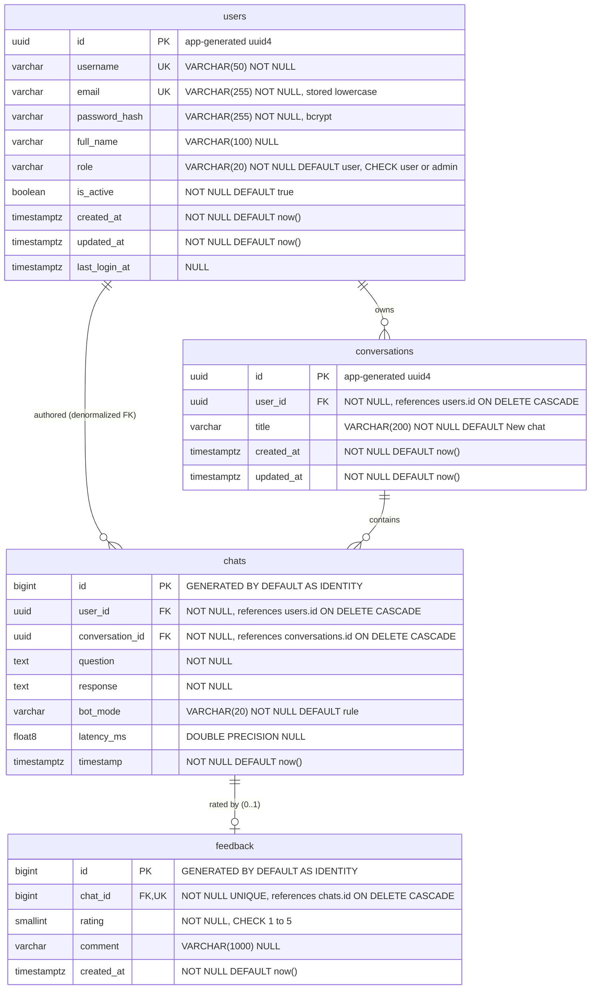
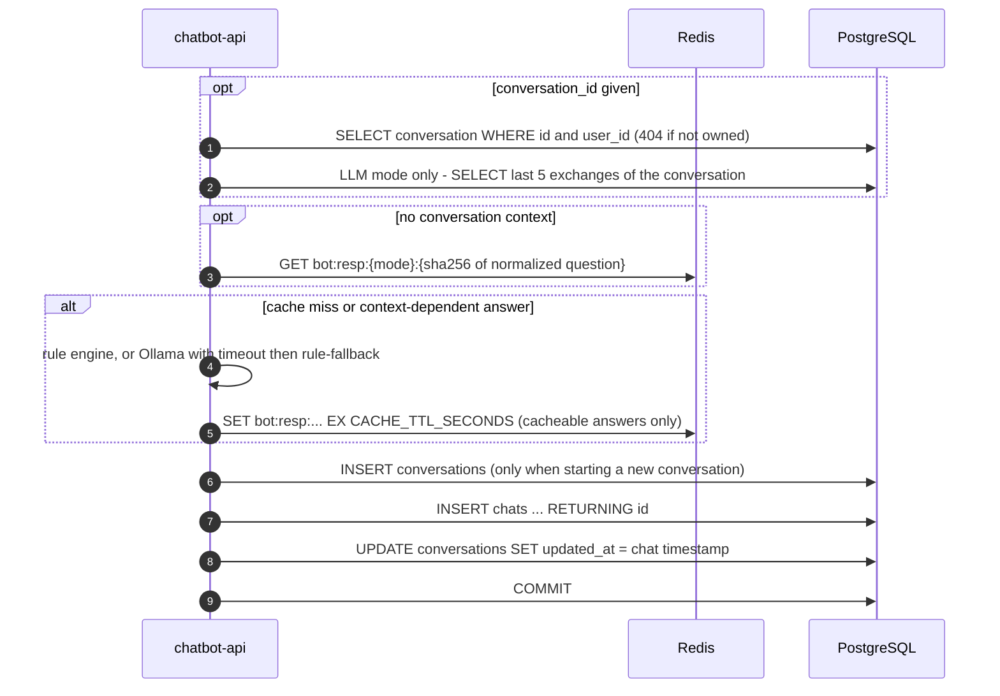

# 04 — Database Design

> **Scope.** The relational model behind ScaleBotAI (PostgreSQL 16), the Redis key space that complements it,
> the indexes and the queries they serve, normalization, optimization at scale, capacity estimates,
> backup/recovery and data-privacy behaviour.
>
> **Source of truth.** The SQLAlchemy 2.x (async) models in `src/app/db/models.py` create the schema at
> startup (`AUTO_CREATE_TABLES=true`), guarded by a PostgreSQL advisory lock so that concurrent replicas
> never race on `CREATE TABLE`. The DDL in §5 is what the models generate: identity columns, `DESC`
> composite indexes and constraint names come from the models' naming convention
> (`pk_<table>`, `fk_<table>_<column>_<referred table>`, `uq_<table>_<column>`, `ck_<table>_<name>`).

---

## 1. Design goals

| Goal | How the schema meets it |
|---|---|
| Correctness under concurrency | Uniqueness, referential integrity and value ranges are enforced **in the database** (UNIQUE, FK, CHECK), not only in Python. Races between replicas (e.g. two registrations of the same username) are resolved by the constraint and surfaced as `409 CONFLICT`. |
| Fast hot paths | Every per-request query (login, history, conversation messages, ownership checks) is a primary-key or composite-index lookup — no sequential scans on the request path. |
| Simple, safe deletion | `ON DELETE CASCADE` along `users → conversations → chats → feedback` makes account deletion and history deletion a single statement in a single transaction. |
| Horizontal app scaling | Application-generated UUIDs (no central sequence for users/conversations), stateless app pods, and a bounded connection pool per pod. |
| Time-series friendliness | `chats` is append-mostly and ordered by `timestamp`, which enables BRIN indexes and monthly range partitioning when volume grows (§9). |

---

## 2. Entity–Relationship diagram



### 2.1 Relationships

| Relationship | Cardinality | Enforced by | Meaning |
|---|---|---|---|
| `users` → `conversations` | 1 : N (0..N) | `conversations.user_id` FK, `ON DELETE CASCADE` | A user owns any number of conversations; a conversation belongs to exactly one user and never changes owner. |
| `conversations` → `chats` | 1 : N (0..N) | `chats.conversation_id` FK, `ON DELETE CASCADE` | A conversation is an ordered thread of question/answer exchanges. `POST /api/v1/chat/conversations` can create an empty one. |
| `users` → `chats` | 1 : N (0..N) | `chats.user_id` FK, `ON DELETE CASCADE` | Deliberate denormalization (see §7.2): lets history and per-user stats be answered from `chats` alone. |
| `chats` → `feedback` | 1 : 0..1 | `feedback.chat_id` FK **+ UNIQUE** (`uq_feedback_chat_id`) | Each bot answer can be rated at most once; re-rating replaces the previous rating (upsert). |

Reading the chain end-to-end: **1 user : N conversations : N chats : 0..1 feedback per chat.**

---

## 3. Why one row per exchange?

A `chats` row stores **both** the user's question and the bot's response (`question`, `response`). The
alternative — one row per message with a `sender` column — doubles the row count, needs a self-join or window
function to pair a question with its answer, and makes "rate this answer" ambiguous. Because the bot always
answers synchronously, a question and its answer are created together and are never edited independently,
so storing them as one row is both simpler and cheaper. The API mirrors this: `ChatResponse.chat_id` is the
`chats.id` that `POST /api/v1/chat/{chat_id}/feedback` rates.

---

## 4. Table specifications

### 4.1 `users`

| Column | Type | Constraints | Description |
|---|---|---|---|
| `id` | `UUID` | **PK** (`pk_users`), NOT NULL | Generated in Python (`uuid.uuid4()`) before insert — no DB default is relied on. Non-guessable, so IDs in URLs (`PATCH /api/v1/admin/users/{user_id}`) do not reveal user counts. |
| `username` | `VARCHAR(50)` | NOT NULL, **UNIQUE** (`uq_users_username`) | 3–50 chars, `^[a-zA-Z0-9_.-]+$` (validated by Pydantic `RegisterRequest`). Used for login. |
| `email` | `VARCHAR(255)` | NOT NULL, **UNIQUE** (`uq_users_email`) | Normalised to **lowercase** before insert/update, so the plain unique constraint behaves case-insensitively. Login accepts username *or* email. |
| `password_hash` | `VARCHAR(255)` | NOT NULL | bcrypt hash (cost `BCRYPT_ROUNDS=12`; the password is SHA-256 pre-hashed so passwords longer than bcrypt's 72-byte limit still count fully — see `src/app/core/security.py`). Never returned by any API (`UserResponse` has no such field). |
| `full_name` | `VARCHAR(100)` | NULL | Optional display name. |
| `role` | `VARCHAR(20)` | NOT NULL, DEFAULT `'user'`, **CHECK** `role IN ('user','admin')` (`ck_users_role`) | RBAC role embedded in the JWT `role` claim. Admin endpoints require `admin`. |
| `is_active` | `BOOLEAN` | NOT NULL, DEFAULT `true` | Soft-disable switch set by `PATCH /api/v1/admin/users/{user_id}`; inactive users cannot log in or use existing tokens. |
| `created_at` | `TIMESTAMPTZ` | NOT NULL, DEFAULT `now()` | Registration time (UTC). Indexed for admin "new users today / 7d". |
| `updated_at` | `TIMESTAMPTZ` | NOT NULL, DEFAULT `now()` | Last profile change; maintained by the application (ORM `onupdate`). |
| `last_login_at` | `TIMESTAMPTZ` | NULL | Set on every successful login; NULL until the first login. |

### 4.2 `conversations`

| Column | Type | Constraints | Description |
|---|---|---|---|
| `id` | `UUID` | **PK** (`pk_conversations`) | App-generated uuid4. Returned as `conversation_id` in `ChatResponse`. |
| `user_id` | `UUID` | NOT NULL, **FK** → `users.id` `ON DELETE CASCADE` | Owner. Every conversation query filters on it (ownership check ⇒ other users' conversations return `404`, never `403`, so existence is not leaked). |
| `title` | `VARCHAR(200)` | NOT NULL, DEFAULT `'New chat'` | `'New chat'` when created empty via `POST /api/v1/chat/conversations` without a title; when `POST /api/v1/chat` starts a conversation, the first message (whitespace-collapsed, truncated to 60 chars) becomes the title. Renamed via `PATCH /api/v1/chat/conversations/{conversation_id}` (1–200 chars). |
| `created_at` | `TIMESTAMPTZ` | NOT NULL, DEFAULT `now()` | Creation time. |
| `updated_at` | `TIMESTAMPTZ` | NOT NULL, DEFAULT `now()` | Last activity — set to the new exchange's timestamp whenever a message is appended, so the list endpoint shows the most recently active conversation first (renaming does not change it). |

### 4.3 `chats` (one row = one question/answer exchange)

| Column | Type | Constraints | Description |
|---|---|---|---|
| `id` | `BIGINT` | **PK** (`pk_chats`), `GENERATED BY DEFAULT AS IDENTITY` | Monotonic surrogate key; compact (8 bytes) for the highest-volume table and for the `feedback` FK. Exposed as `chat_id`. |
| `user_id` | `UUID` | NOT NULL, **FK** → `users.id` `ON DELETE CASCADE` | Denormalized owner (equals the conversation's `user_id`). |
| `conversation_id` | `UUID` | NOT NULL, **FK** → `conversations.id` `ON DELETE CASCADE` | Parent conversation. |
| `question` | `TEXT` | NOT NULL | User message, 1–2000 chars after strip (validated by `ChatRequest`). |
| `response` | `TEXT` | NOT NULL | Bot answer. `TEXT` because LLM answers have no natural upper bound; values > ~2 KB are compressed/TOASTed automatically. |
| `bot_mode` | `VARCHAR(20)` | NOT NULL, DEFAULT `'rule'` | Engine that produced the answer: `rule`, `llm`, or `rule-fallback` (LLM timed out/unavailable). |
| `latency_ms` | `DOUBLE PRECISION` | NULL | Bot processing time in ms (feeds `avg_bot_latency_ms`). NULL is allowed for rows imported without timing. |
| `timestamp` | `TIMESTAMPTZ` | NOT NULL, DEFAULT `now()` | Exchange time (UTC). Quoted as `"timestamp"` in hand-written SQL because `timestamp` is also a type keyword. |

### 4.4 `feedback`

| Column | Type | Constraints | Description |
|---|---|---|---|
| `id` | `BIGINT` | **PK** (`pk_feedback`), `GENERATED BY DEFAULT AS IDENTITY` | Surrogate key, returned as `FeedbackResponse.id`. |
| `chat_id` | `BIGINT` | NOT NULL, **UNIQUE** (`uq_feedback_chat_id`), **FK** → `chats.id` `ON DELETE CASCADE` | The rated exchange. UNIQUE makes the relationship 1 : 0..1 and is the conflict target of the upsert. |
| `rating` | `SMALLINT` | NOT NULL, **CHECK** `rating BETWEEN 1 AND 5` (`ck_feedback_rating`) | 1 (poor) … 5 (excellent). Also validated by Pydantic (`FeedbackRequest`), the CHECK is the last line of defence. |
| `comment` | `VARCHAR(1000)` | NULL | Optional free-text comment (≤ 1000 chars). |
| `created_at` | `TIMESTAMPTZ` | NOT NULL, DEFAULT `now()` | Time of the first rating (re-rating replaces `rating`/`comment` in place and keeps the row). |

### 4.5 Conventions

- **Time:** every timestamp is `TIMESTAMPTZ`, stored as UTC; the API serialises ISO-8601 UTC. "Today" in admin
  statistics means the current **UTC** calendar day.
- **Identifiers:** UUIDs for user-facing entities (users, conversations) — generated by the application, which
  allows the ID to be known (and logged) before the insert and avoids a round-trip for `RETURNING id`.
  `BIGINT` identities for the two high-volume child tables (`chats`, `feedback`).
- **Constraint naming:** `pk_<table>`, `uq_<table>_<column>`, `fk_<table>_<column>_<referred_table>`,
  `ck_<table>_<name>`, `ix_<table>_<columns>`. Predictable names make error mapping (e.g. "which unique
  constraint was violated → which 409 message") and future migrations straightforward.
- **No triggers, no stored procedures.** All business logic lives in the application layer, which keeps the
  schema portable (the unit tests run the same models on SQLite via `aiosqlite`).

---

## 5. Canonical PostgreSQL DDL

```sql
-- ScaleBotAI reference schema — PostgreSQL 16
-- Created by the application at startup (AUTO_CREATE_TABLES=true) under a pg_advisory_lock.
-- NOTE: UUID primary keys are generated by the application in Python (uuid.uuid4()).
--       No gen_random_uuid() default is used or required. If you ever insert rows manually,
--       you may add  DEFAULT gen_random_uuid()  (built into PostgreSQL 13+, no extension needed).

BEGIN;

CREATE TABLE users (
    id             UUID          NOT NULL,
    username       VARCHAR(50)   NOT NULL,
    email          VARCHAR(255)  NOT NULL,          -- stored lowercase by the application
    password_hash  VARCHAR(255)  NOT NULL,          -- bcrypt
    full_name      VARCHAR(100)  NULL,
    role           VARCHAR(20)   NOT NULL DEFAULT 'user',
    is_active      BOOLEAN       NOT NULL DEFAULT true,
    created_at     TIMESTAMPTZ   NOT NULL DEFAULT now(),
    updated_at     TIMESTAMPTZ   NOT NULL DEFAULT now(),
    last_login_at  TIMESTAMPTZ   NULL,
    CONSTRAINT pk_users           PRIMARY KEY (id),
    CONSTRAINT uq_users_username  UNIQUE (username),
    CONSTRAINT uq_users_email     UNIQUE (email),
    CONSTRAINT ck_users_role      CHECK (role IN ('user', 'admin'))
);

CREATE INDEX ix_users_created_at ON users (created_at);

CREATE TABLE conversations (
    id          UUID          NOT NULL,
    user_id     UUID          NOT NULL,
    title       VARCHAR(200)  NOT NULL DEFAULT 'New chat',
    created_at  TIMESTAMPTZ   NOT NULL DEFAULT now(),
    updated_at  TIMESTAMPTZ   NOT NULL DEFAULT now(),
    CONSTRAINT pk_conversations PRIMARY KEY (id),
    CONSTRAINT fk_conversations_user_id_users
        FOREIGN KEY (user_id) REFERENCES users (id) ON DELETE CASCADE
);

CREATE INDEX ix_conversations_user_updated ON conversations (user_id, updated_at DESC);

CREATE TABLE chats (
    id               BIGINT            GENERATED BY DEFAULT AS IDENTITY,
    user_id          UUID              NOT NULL,
    conversation_id  UUID              NOT NULL,
    question         TEXT              NOT NULL,
    response         TEXT              NOT NULL,
    bot_mode         VARCHAR(20)       NOT NULL DEFAULT 'rule',
    latency_ms       DOUBLE PRECISION  NULL,
    "timestamp"      TIMESTAMPTZ       NOT NULL DEFAULT now(),
    CONSTRAINT pk_chats PRIMARY KEY (id),
    CONSTRAINT fk_chats_user_id_users
        FOREIGN KEY (user_id) REFERENCES users (id) ON DELETE CASCADE,
    CONSTRAINT fk_chats_conversation_id_conversations
        FOREIGN KEY (conversation_id) REFERENCES conversations (id) ON DELETE CASCADE
);

CREATE INDEX ix_chats_user_timestamp         ON chats (user_id, "timestamp" DESC);
CREATE INDEX ix_chats_conversation_timestamp ON chats (conversation_id, "timestamp");
CREATE INDEX ix_chats_timestamp              ON chats ("timestamp");

CREATE TABLE feedback (
    id          BIGINT         GENERATED BY DEFAULT AS IDENTITY,
    chat_id     BIGINT         NOT NULL,
    rating      SMALLINT       NOT NULL,
    comment     VARCHAR(1000)  NULL,
    created_at  TIMESTAMPTZ    NOT NULL DEFAULT now(),
    CONSTRAINT pk_feedback          PRIMARY KEY (id),
    CONSTRAINT uq_feedback_chat_id  UNIQUE (chat_id),          -- also creates unique index uq_feedback_chat_id
    CONSTRAINT fk_feedback_chat_id_chats
        FOREIGN KEY (chat_id) REFERENCES chats (id) ON DELETE CASCADE,
    CONSTRAINT ck_feedback_rating   CHECK (rating BETWEEN 1 AND 5)
);

COMMIT;
```

**Startup sequence (application, `src/app/db/session.py`).** On boot each replica opens one transaction and
runs `SELECT pg_advisory_xact_lock(815100001)` (the constant `SCHEMA_LOCK_KEY` shared by all replicas) →
`Base.metadata.create_all` (creates only missing tables) → `COMMIT`, which releases the transaction-scoped
lock automatically. The block is retried up to 10 times, 3 s apart, while PostgreSQL is still starting.
The bootstrap admin (`ADMIN_USERNAME`/`ADMIN_EMAIL`/`ADMIN_PASSWORD`) is then created if missing; a replica that
loses that race gets an `IntegrityError` on `uq_users_username` and simply rolls back.
Without the lock, two pods starting together could both see "table missing" and both issue `CREATE TABLE`;
the loser fails with `duplicate key value violates unique constraint "pg_type_typname_nsp_index"` — even
`CREATE TABLE IF NOT EXISTS` is not race-free in PostgreSQL. The lock serialises the critical section across
the whole cluster at near-zero cost. (Schema *evolution* is out of scope for `create_all`; Alembic is listed as
future work in `docs/13-design-decisions-and-future.md`.)

**Note on index direction.** `ix_chats_user_timestamp` and `ix_conversations_user_updated` are declared
`DESC` in the models to document the "newest first" access pattern. Functionally an ascending index would
serve the same queries: PostgreSQL scans a B-tree in either direction, so `ORDER BY "timestamp" DESC` on an
ascending index is an `Index Scan Backward` with no sort step. Direction only matters for mixed-direction
multi-column sorts (e.g. `ORDER BY a ASC, b DESC`), which ScaleBotAI does not use.

**Optional hardening (not part of the implemented schema):**
`CHECK (bot_mode IN ('rule','llm','rule-fallback'))`, `CHECK (latency_ms >= 0)`, and a composite FK that
guarantees the denormalized `chats.user_id` always matches the conversation owner (§7.2).

---

## 6. Indexes and the queries they serve

PostgreSQL does **not** index foreign-key columns automatically. Every FK below is covered by the leading
column of an index, which matters twice: for the lookups themselves and for `ON DELETE CASCADE`, which
otherwise scans the whole child table for each deleted parent row.

| Index | Table (columns) | Type | Serves | Endpoint(s) |
|---|---|---|---|---|
| `pk_users` | users (`id`) | B-tree, unique | Load user from JWT `sub`; admin `PATCH` by id; FK target | every authenticated request (when `user:{id}` cache misses), `/api/v1/admin/users/{user_id}` |
| `uq_users_username` | users (`username`) | B-tree, unique | Login by username; duplicate check on register | `POST /api/v1/auth/login`, `POST /api/v1/auth/register` |
| `uq_users_email` | users (`email`) | B-tree, unique | Login by email; duplicate check on register / email change | `login`, `register`, `PUT /api/v1/users/me` |
| `ix_users_created_at` | users (`created_at`) | B-tree | `new_users_today`, `new_users_7d` range counts; admin user list ordered by registration | `/api/v1/admin/stats/users`, `/api/v1/admin/analytics`, `/api/v1/admin/users` |
| `pk_conversations` | conversations (`id`) | B-tree, unique | Ownership check `WHERE id = ? AND user_id = ?`; FK target | all `/api/v1/chat/conversations/{conversation_id}` routes, `POST /api/v1/chat` with `conversation_id` |
| `ix_conversations_user_updated` | conversations (`user_id`, `updated_at DESC`) | B-tree, composite | "My conversations, most recent first, page N" with no sort step; per-user conversation count; covers FK `user_id` for cascades | `GET /api/v1/chat/conversations`, `/api/v1/users/me/stats`, account deletion |
| `pk_chats` | chats (`id`) | B-tree, unique | Feedback ownership check `WHERE id = ? AND user_id = ?`; FK target for `feedback` | `POST /api/v1/chat/{chat_id}/feedback` |
| `ix_chats_user_timestamp` | chats (`user_id`, `timestamp DESC`) | B-tree, composite | Paginated global history newest-first; `count/min/max(timestamp)` per user; covers FK `user_id` | `GET /api/v1/chat/history`, `/api/v1/users/me/stats`, `DELETE /api/v1/chat/history` |
| `ix_chats_conversation_timestamp` | chats (`conversation_id`, `timestamp`) | B-tree, composite | Messages of one conversation in chronological order; history filtered by `?conversation_id=`; last-5-exchanges LLM context (backward scan + `LIMIT 5`); `message_count`; covers FK for cascades | `GET /api/v1/chat/conversations/{conversation_id}`, `GET /api/v1/chat/history?conversation_id=`, `POST /api/v1/chat` (LLM mode) |
| `ix_chats_timestamp` | chats (`timestamp`) | B-tree | Time-range queries across all users: "chats today" as a range scan, windowed latency averages, retention deletes (§8.8, §10) | `/api/v1/admin/stats/chats`, `/api/v1/admin/analytics`, maintenance jobs |
| `pk_feedback` | feedback (`id`) | B-tree, unique | Row identity | — |
| `uq_feedback_chat_id` | feedback (`chat_id`) | B-tree, unique | `ON CONFLICT (chat_id)` upsert target; `LEFT JOIN feedback ON chat_id` when rendering `ChatMessage.feedback`; covers FK for cascades | `POST /api/v1/chat/{chat_id}/feedback`, history & conversation detail |

**Why composite indexes in this column order?** The equality predicate (`user_id = ?`, `conversation_id = ?`)
comes first and the range/sort column (`timestamp`, `updated_at`) second. PostgreSQL can then jump straight to
one user's slice of the B-tree and read it already in the requested order, stopping after `LIMIT` rows — an
`Index Scan` with no `Sort` node. The `DESC` in `ix_chats_user_timestamp` matches the newest-first ordering
(a plain ascending index would also work through a backward scan; `DESC` documents the intent).

**Write cost.** `chats` carries 4 B-tree indexes (PK + 3). Each insert therefore performs ~5 page
modifications. At the design peak (~116 req/s, ~40 % chat writes ⇒ ~50 inserts/s; ~200 inserts/s at the
500 req/s headroom) this is far below what a single PostgreSQL instance sustains (thousands of inserts/s).

---

## 7. Normalization

### 7.1 Normal-form analysis

| Table | Candidate keys | Non-trivial FDs | Normal form |
|---|---|---|---|
| `users` | `{id}`, `{username}`, `{email}` | every attribute depends on each key, nothing else | **BCNF** — every determinant is a candidate key |
| `conversations` | `{id}` | `id → user_id, title, created_at, updated_at` | **BCNF** |
| `chats` | `{id}` | `id → all`; and `conversation_id → user_id` (a conversation has exactly one owner) | **2NF**, *not strictly 3NF* because of the deliberate redundancy below |
| `feedback` | `{id}`, `{chat_id}` | `id → all`, `chat_id → all` | **BCNF** (both determinants are keys) |

- **1NF:** all columns are atomic; no repeating groups (messages are rows, not arrays; feedback is a row,
  not a JSON blob).
- **2NF:** every key is a single column, so partial dependencies cannot exist.
- **3NF:** no non-key attribute depends on another non-key attribute — with one documented exception.

### 7.2 The one intentional denormalization: `chats.user_id`

`chats.user_id` can be derived as `conversations.user_id` via `chats.conversation_id`, i.e. the transitive
dependency `chats.id → conversation_id → user_id`. It is kept on purpose:

1. **Hot-path performance.** `GET /api/v1/chat/history` (the most frequent read) becomes a single-table range
   scan on `ix_chats_user_timestamp` instead of a join through `conversations` followed by a sort across all
   of a user's conversations.
2. **Simple ownership checks.** "May this user rate chat 1042?" is `WHERE id = 1042 AND user_id = :me` on one
   row.
3. **Cheap per-user stats and bulk deletes** without touching `conversations`.

**Why the redundancy is safe here:** a conversation never changes owner (no endpoint updates
`conversations.user_id`), and the application writes `chats.user_id` from the already-verified conversation
owner in the same transaction. If stronger guarantees are needed, the database can enforce the invariant:

```sql
ALTER TABLE conversations ADD CONSTRAINT uq_conversations_id_user UNIQUE (id, user_id);
ALTER TABLE chats ADD CONSTRAINT fk_chats_conversation_owner
    FOREIGN KEY (conversation_id, user_id) REFERENCES conversations (id, user_id) ON DELETE CASCADE;
```

### 7.3 Other modelling choices

- **`feedback` is a separate table, not two nullable columns on `chats`.** Feedback is sparse (most answers
  are never rated), has its own lifecycle (`created_at`, upsert), and keeping it separate keeps the hot
  `chats` rows narrow. The UNIQUE FK gives the same 1:0..1 semantics as columns would.
- **`role` as a CHECKed `VARCHAR`, not a `roles` table or a PostgreSQL `ENUM`.** Two fixed roles do not
  justify a join; a CHECK constraint can be altered in one statement, whereas removing a value from an ENUM
  type is awkward.
- **Lower-cased email + plain UNIQUE** instead of `citext` or `UNIQUE (lower(email))` keeps the schema
  extension-free and portable to SQLite for unit tests.

---

## 8. Main query patterns

The repository layer (SQLAlchemy Core/ORM with bound parameters — never string concatenation, which rules
out SQL injection) issues statements equivalent to the following.

### 8.1 Paginated chat history — `GET /api/v1/chat/history?page=&size=`

```sql
-- page items (Page[ChatMessage]); newest first
SELECT c.id, c.conversation_id, c.question, c.response, c.bot_mode, c.latency_ms, c."timestamp",
       f.rating, f.comment
FROM   chats c
LEFT   JOIN feedback f ON f.chat_id = c.id
WHERE  c.user_id = :user_id
ORDER  BY c."timestamp" DESC, c.id DESC
LIMIT  :size OFFSET (:page - 1) * :size;

-- total for Page.total / Page.pages
SELECT count(*) FROM chats WHERE user_id = :user_id;
```

*Index support:* `ix_chats_user_timestamp` delivers rows already ordered by `timestamp DESC`, so the planner
reads at most `OFFSET + LIMIT` index entries (`id DESC` is only a tie-breaker, handled by an incremental sort
on equal timestamps). The ORM (`src/app/services/chat_service.py`) loads the feedback with SQLAlchemy's
`selectinload`, i.e. a second statement `SELECT … FROM feedback WHERE chat_id IN (<ids on this page>)` — the
same result as the `LEFT JOIN` shown, served by `uq_feedback_chat_id` (≤ 100 probes). The count is an
index(-only) scan over one user's slice. With `?conversation_id=` the predicate becomes
`WHERE c.user_id = :user_id AND c.conversation_id = :cid`, served by `ix_chats_conversation_timestamp`
(scanned backwards for newest-first).

### 8.2 Conversation with its messages — `GET /api/v1/chat/conversations/{conversation_id}`

```sql
-- 1) ownership check (404 if no row)
SELECT id, title, created_at, updated_at
FROM   conversations
WHERE  id = :conversation_id AND user_id = :user_id;

-- 2) messages in chronological order
SELECT c.id, c.conversation_id, c.question, c.response, c.bot_mode, c.latency_ms, c."timestamp",
       f.rating, f.comment
FROM   chats c
LEFT   JOIN feedback f ON f.chat_id = c.id
WHERE  c.conversation_id = :conversation_id
ORDER  BY c."timestamp" ASC, c.id ASC;
```

*Index support:* step 1 is a primary-key lookup; step 2 is a forward range scan on
`ix_chats_conversation_timestamp` with no sort.

### 8.3 Conversation list with message counts — `GET /api/v1/chat/conversations`

```sql
SELECT cv.id, cv.title, cv.created_at, cv.updated_at,
       (SELECT count(*) FROM chats ch WHERE ch.conversation_id = cv.id) AS message_count
FROM   conversations cv
WHERE  cv.user_id = :user_id
ORDER  BY cv.updated_at DESC
LIMIT  :size OFFSET (:page - 1) * :size;
```

*Index support:* `ix_conversations_user_updated` returns the page pre-sorted; the correlated count runs only
for the ≤ `size` rows on the page, each as an index-only scan on `ix_chats_conversation_timestamp`
(a `GROUP BY` over a join would count messages of *all* the user's conversations before paginating).

### 8.4 LLM context (last 5 exchanges) — `POST /api/v1/chat` in `llm` mode

```sql
SELECT question, response
FROM   chats
WHERE  conversation_id = :conversation_id
ORDER  BY "timestamp" DESC
LIMIT  5;            -- reversed in Python to chronological order before sending to Ollama
```

*Index support:* backward scan of `ix_chats_conversation_timestamp`, touching exactly 5 entries.

### 8.5 Feedback upsert — `POST /api/v1/chat/{chat_id}/feedback`

```sql
-- 1) ownership check + existing rating (404 if the chat does not exist or belongs to someone else)
SELECT id FROM chats WHERE id = :chat_id AND user_id = :user_id;
SELECT * FROM feedback WHERE chat_id IN (:chat_id);           -- selectinload

-- 2a) no rating yet
INSERT INTO feedback (chat_id, rating, comment) VALUES (:chat_id, :rating, :comment);
-- 2b) already rated → replace in place (created_at keeps the first-rating time)
UPDATE feedback SET rating = :rating, comment = :comment WHERE id = :feedback_id;
```

If two requests rate the same answer concurrently, both may try the `INSERT`; `uq_feedback_chat_id` rejects the
second with an `IntegrityError`, and the service rolls back and retries once as an update — the **constraint**,
not the application check, guarantees "at most one rating per answer". The single-statement PostgreSQL
equivalent is:

```sql
INSERT INTO feedback (chat_id, rating, comment) VALUES (:chat_id, :rating, :comment)
ON CONFLICT (chat_id) DO UPDATE SET rating = EXCLUDED.rating, comment = EXCLUDED.comment
RETURNING id, chat_id, rating, comment, created_at;
```

*Index support:* PK lookup on `chats`; `uq_feedback_chat_id` serves the lookup and is the uniqueness arbiter.

### 8.6 Admin user counts — `GET /api/v1/admin/stats/users`

```sql
SELECT count(*)                                   AS total_users,
       count(*) FILTER (WHERE is_active)          AS active_users,
       count(*) FILTER (WHERE role = 'admin')     AS admin_users,
       count(*) FILTER (WHERE created_at >= :today_start_utc)   AS new_users_today,
       count(*) FILTER (WHERE created_at >= :seven_days_ago_utc) AS new_users_7d
FROM   users;
```

*Index support:* one pass computes all five numbers (`FILTER` avoids five round-trips). The `users` table is
small (thousands to low millions of rows), so a single sequential/index-only pass is cheap; if only the
"new users" figures are needed, they are range scans on `ix_users_created_at`
(`WHERE created_at >= :today_start_utc`). The application computes `:today_start_utc` (UTC midnight) in
Python, which keeps the predicate sargable — wrapping the column in a function (`date(created_at) = …`) would
defeat the index.

### 8.7 Chat statistics: total, chats today, average latency — `GET /api/v1/admin/stats/chats`

The service computes the three `chats` figures in **one pass** (`src/app/services/analytics_service.py`):

```sql
SELECT count(*)                                               AS total_chats,
       count(*) FILTER (WHERE "timestamp" >= :today_start_utc) AS chats_today,
       avg(latency_ms)                                        AS avg_bot_latency_ms
FROM   chats;

SELECT count(*) FROM conversations;      -- total_conversations
SELECT count(*) FROM users;              -- divisor for avg_chats_per_user
```

*Index support (honest note):* all-time `count(*)` and `avg()` must visit every row — no B-tree can avoid that,
so this is a (parallel) sequential or index-only scan. That is the right trade-off at capstone scale: one scan
yields three numbers, and the combined dashboard (`/api/v1/admin/analytics`) is cached in Redis for 30 s
(`analytics:summary`), so it runs at most twice a minute per cluster regardless of how many admins refresh.

### 8.8 Scaling the chat statistics

When `chats` holds hundreds of millions of rows, split the figures so each one is index-supported:

```sql
-- chats today: range scan on ix_chats_timestamp touching only today's ~400 k entries
SELECT count(*) FROM chats WHERE "timestamp" >= :today_start_utc;

-- latency over a bounded window instead of all time
SELECT avg(latency_ms) FROM chats WHERE "timestamp" >= now() - interval '24 hours';
```

Make the latency query index-only with a covering index
`CREATE INDEX … ON chats ("timestamp") INCLUDE (latency_ms)`, maintain all-time totals in an hourly roll-up table
(or Redis counters), and use `pg_class.reltuples` when an approximate total is good enough. Bot latency
percentiles are better taken from Prometheus (`scalebot_bot_response_seconds`) than from SQL.

### 8.9 Feedback distribution — `GET /api/v1/admin/feedback`

```sql
SELECT rating, count(*) AS n
FROM   feedback
GROUP  BY rating
ORDER  BY rating;            -- Python fills missing ratings with 0 → {"1": n, ..., "5": n}

SELECT count(*) AS total, avg(rating)::float AS average_rating FROM feedback;
```

*Index support:* `feedback` is a sparse, narrow table (a few % of chats), so a hash aggregate over it is cheap;
the result is part of the 30 s cached analytics payload. A covering index on `(rating)` would allow an
index-only scan if the table grows large.

### 8.10 Per-user stats — `GET /api/v1/users/me/stats`

```sql
SELECT count(*) AS total_messages, min("timestamp") AS first_chat_at, max("timestamp") AS last_chat_at
FROM   chats WHERE user_id = :user_id;                                   -- ix_chats_user_timestamp

SELECT count(*) AS total_conversations FROM conversations WHERE user_id = :user_id;  -- ix_conversations_user_updated

SELECT count(*) AS feedback_given
FROM   feedback f JOIN chats c ON c.id = f.chat_id
WHERE  c.user_id = :user_id;                                            -- ix_chats_user_timestamp + uq_feedback_chat_id
```

### 8.11 Deletes

```sql
-- DELETE /api/v1/chat/history  → 200 {"deleted": n}, n = number of exchanges (chats rows) removed
DELETE FROM chats WHERE user_id = :user_id;            -- rowcount → n; feedback cascades
DELETE FROM conversations WHERE user_id = :user_id;    -- now-empty conversations (same transaction)

-- DELETE /api/v1/chat/conversations/{conversation_id}  → 204
DELETE FROM conversations WHERE id = :conversation_id AND user_id = :user_id;

-- DELETE /api/v1/users/me  → 204 (conversations, chats and feedback cascade)
DELETE FROM users WHERE id = :user_id;
```

*Index support:* each cascade level finds its children through an index whose leading column is the FK
(`ix_conversations_user_updated`, `ix_chats_conversation_timestamp`/`ix_chats_user_timestamp`,
`uq_feedback_chat_id`).

### 8.12 Write path of `POST /api/v1/chat`



All writes of one message commit atomically in the request's session. Answers that depend on conversation
context (LLM mode with history), on the current time, or that came from the rule fallback are not cached.

**Connection-holding caveat.** When a message continues an existing conversation, the ownership `SELECT` opens
the session's transaction *before* the bot is called, so in LLM mode a pooled connection stays checked out for
the duration of the Ollama call (bounded by `OLLAMA_TIMEOUT_SECONDS=20` and the LLM circuit breaker). In rule
mode this is microseconds and irrelevant. For heavy LLM traffic, end the read transaction (commit) before calling
the model, or use a separate short-lived session for the reads, so slow inference cannot exhaust the pool.

---

## 9. Optimization strategy

### 9.1 Connection-pool sizing

Each app process owns one SQLAlchemy async engine (asyncpg driver) with a `QueuePool`:
`DB_POOL_SIZE=10` persistent connections, up to `DB_MAX_OVERFLOW=20` extra under bursts, waiting at most
`DB_POOL_TIMEOUT=10` s for a free connection; `pool_pre_ping=True` discards dead connections (e.g. after a
database restart) and `pool_recycle=1800` replaces connections older than 30 minutes
(`src/app/db/session.py`). Because the container runs **one uvicorn worker**, there is exactly one pool per pod.

The design budget is **`max_connections = 200`** — the value Docker Compose starts PostgreSQL with
(`docker-compose.yml`). The Kubernetes StatefulSet raises it to **300** (`k8s/base/04-postgres.yaml`) to give the
HPA more room; the reasoning below is identical, only the ceiling moves. A few connections are reserved
(`superuser_reserved_connections = 3`) and some are needed by `postgres-exporter`, backups and operators.

The invariant to respect is:

```
pods_max × (DB_POOL_SIZE + DB_MAX_OVERFLOW) + reserved/ops connections  <  max_connections
```

| Scenario | Pods | Per-pod max | Total | Verdict |
|---|---|---|---|---|
| Compose, `--scale chatbot-api=3` (`.env`: 10 + 20) | 3 | 30 | 90 | OK (`max_connections=200`) |
| K8s at HPA minimum (ConfigMap: 5 + 3) | 3 | 8 | 24 | OK |
| K8s at HPA maximum (ConfigMap: 5 + 3) | 20 | 8 | **160** | OK — 140 of 300 left for exporters, backups and admins |
| *Counter-example:* K8s at HPA maximum with the code defaults (10 + 20) | 20 | 30 | 600 | 2× over the StatefulSet's 300 ⇒ `FATAL: sorry, too many clients already` — why the ConfigMap overrides the defaults |

**How many connections does a pod actually need?** By Little's law, busy connections = arrival rate × time
each request holds a connection. At the 500 req/s headroom spread over 20 pods (25 req/s per pod) and ~10 ms of
DB time per request, a pod keeps on average 25 × 0.010 ≈ **0.25** connections busy. Even a 10× burst fits in a
handful. Large pools do not add throughput — they only add idle server processes (each ~5–10 MB of RAM on the
DB host) and contention.

**Recommendations**

1. **Kubernetes profile (implemented):** `k8s/base/01-configmap.yaml` sets `DB_POOL_SIZE=5`,
   `DB_MAX_OVERFLOW=3` ⇒ 20 × 8 = 160 connections, leaving 140 of `max_connections=300` for exporters,
   backups and admins.
2. **At scale: PgBouncer in transaction-pooling mode** between the pods and PostgreSQL. Pods may open
   thousands of cheap client connections; PgBouncer multiplexes them onto e.g. 50–80 real server connections
   (`pool_mode = transaction`, `default_pool_size = 50`, `max_client_conn = 5000`). Caveat for asyncpg:
   transaction pooling breaks *named* prepared statements, so either disable asyncpg's statement cache
   (`connect_args={"statement_cache_size": 0}` and SQLAlchemy's `prepared_statement_cache_size=0`) or use
   PgBouncer ≥ 1.21 with `max_prepared_statements` enabled. Session-level features (session advisory locks,
   `SET`, `LISTEN`) must not straddle transactions; ScaleBotAI's schema bootstrap already uses the
   transaction-scoped `pg_advisory_xact_lock`, which is safe under transaction pooling.
3. **Observe before tuning:** the app exports `scalebot_db_pool_checked_out` and `scalebot_db_pool_size`
   (pool saturation) and `/api/v1/admin/system` shows `db_pool{size, checked_out, overflow}`; postgres-exporter
   exposes `pg_stat_activity` counts per state.

### 9.2 Keyset vs offset pagination

`Page[T]` uses **offset** pagination (`page`, `size`, `total`, `pages`) because it is simple, supports "jump to
page N" and a total count, and a single user's history is small (hundreds to a few thousand rows).

Offset cost grows linearly with depth: page 500 of size 20 reads and discards 9,980 index entries, and
concurrent inserts shift rows between pages (duplicates or gaps while paging). **Keyset (seek) pagination**
fixes both — cost is constant regardless of depth:

```sql
SELECT ... FROM chats
WHERE  user_id = :user_id
  AND  ("timestamp", id) < (:last_timestamp, :last_id)     -- cursor from the previous page
ORDER  BY "timestamp" DESC, id DESC
LIMIT  :size;
```

Pair it with `CREATE INDEX ... ON chats (user_id, "timestamp" DESC, id DESC)` for a pure index scan. Planned as a
`?cursor=` alternative for infinite-scroll clients (API v2); `total` would then be omitted or approximated.

### 9.3 Partial and covering indexes

| Index (proposal) | Purpose |
|---|---|
| `CREATE INDEX ix_chats_ts_latency ON chats ("timestamp") INCLUDE (latency_ms);` | Index-only scans for windowed latency averages (§8.8). |
| `CREATE INDEX ix_chats_fallback ON chats ("timestamp") WHERE bot_mode = 'rule-fallback';` | Tiny partial index to chart LLM fallback rate without scanning all chats. |
| `CREATE INDEX ix_users_active_created ON users (created_at) WHERE is_active;` | Active-user listings that skip disabled accounts. |
| `CREATE EXTENSION pg_trgm; CREATE INDEX ix_users_username_trgm ON users USING gin (username gin_trgm_ops);` (same for email) | Makes the admin `?search=` (`ILIKE '%term%'`) index-assisted; a B-tree cannot serve a leading wildcard. |

Every extra index costs write throughput and RAM; add one only when `pg_stat_statements` shows the query
matters.

### 9.4 BRIN on `chats."timestamp"` for analytics

`chats` is append-mostly, so physical row order closely follows `timestamp`. A **BRIN** (Block Range INdex)
stores only min/max per range of 128 pages — kilobytes instead of the gigabytes a B-tree needs at hundreds of
millions of rows:

```sql
CREATE INDEX ix_chats_timestamp_brin ON chats USING brin ("timestamp") WITH (pages_per_range = 64);
```

Use it for wide analytic ranges (daily/weekly aggregates); keep the B-tree `ix_chats_timestamp` while point-ish
queries like "today" dominate, or replace it with BRIN once the table is very large and partitioned.

### 9.5 Monthly range partitioning of `chats`

When `chats` reaches hundreds of GB, partition it by month:

```sql
CREATE TABLE chats (
    id BIGINT GENERATED BY DEFAULT AS IDENTITY,
    ...,
    "timestamp" TIMESTAMPTZ NOT NULL DEFAULT now(),
    PRIMARY KEY (id, "timestamp")                -- the partition key must be part of every unique key
) PARTITION BY RANGE ("timestamp");

CREATE TABLE chats_2026_10 PARTITION OF chats
    FOR VALUES FROM ('2026-10-01 00:00+00') TO ('2026-11-01 00:00+00');
```

Benefits: partition pruning for time-bounded queries, smaller per-partition indexes that fit in RAM,
per-partition `VACUUM`, and **retention by `DETACH PARTITION … ; DROP TABLE`** (instant, no bloat) instead of a
huge `DELETE`. Costs: the primary key becomes `(id, "timestamp")`, so `feedback` must reference
`(chat_id, chat_timestamp)`; per-user history queries without a time bound touch every partition (mitigated by
adding a time bound, e.g. last 12 months); partitions must be pre-created (automate with `pg_partman` or a
CronJob). This is why partitioning is deferred until the volume justifies it.

### 9.6 Autovacuum tuning

- **`chats` (insert-heavy):** PostgreSQL 13+ triggers vacuum on inserts (`autovacuum_vacuum_insert_scale_factor`),
  which keeps the visibility map current so count queries become index-only. For very large tables lower the
  scale factors per table so vacuum/analyze run on a fixed amount of change rather than 20 % of the table:
  ```sql
  ALTER TABLE chats SET (autovacuum_vacuum_scale_factor = 0.02,
                         autovacuum_analyze_scale_factor = 0.01,
                         autovacuum_vacuum_insert_scale_factor = 0.05);
  ```
- **`conversations` (update-heavy):** every message bumps `updated_at`, which is an **indexed** column, so these
  updates cannot be HOT (heap-only tuple) updates — each creates a new heap tuple *and* new index entries. Give it
  aggressive per-table settings (`autovacuum_vacuum_scale_factor = 0.01`, `autovacuum_vacuum_cost_limit = 1000`)
  and watch `n_dead_tup` in `pg_stat_user_tables`.
- **`feedback` (upserts):** each re-rating leaves a dead tuple; default settings suffice at its size.
- Monitor bloat and vacuum lag with postgres-exporter (`pg_stat_user_tables_n_dead_tup`,
  `last_autovacuum`) in Grafana.

### 9.7 Read replicas for admin analytics

Admin analytics (`/api/v1/admin/analytics`, `/stats/*`, `/feedback`) are aggregate, read-only and tolerant of
seconds of staleness (they are already cached for 30 s). Route them to a **streaming-replication hot standby**
through a second, read-only engine/session factory; user-facing reads that must see their own writes (history
right after sending a message) stay on the primary. This isolates long aggregates from OLTP latency and also
provides a failover candidate (managed by CloudNativePG or Patroni in Kubernetes).

### 9.8 Redis caching of hot reads

| Key | TTL | What it saves |
|---|---|---|
| `bot:resp:{mode}:{sha256(normalized question)}` | `CACHE_TTL_SECONDS` = 3600 s | Re-computing identical answers (FAQ-style traffic hits this heavily); reported as `cached: true` |
| `user:{id}` | 300 s | The `users` PK lookup on every authenticated request |
| `analytics:summary` | 30 s | All admin aggregates in §8.6–8.9 — at most one computation per 30 s regardless of dashboard refreshes |
| `ratelimit:{user_or_ip}:{epoch_minute}` | 60 s | (rate limiting, not DB load) |
| `jwt:denylist:{jti}` | remaining token life | (token revocation) |
| `stats:requests:{YYYY-MM-DD}` | 35 days | Daily request counts without writing a DB row per request |

Writes that change cached data delete the key (cache-aside with explicit invalidation for `user:{id}`; pure
TTL expiry for aggregates). Hit ratio is visible as `scalebot_cache_hits_total{cache}` /
`scalebot_cache_misses_total{cache}` and `redis.keyspace_hit_ratio` in `/api/v1/admin/system`.
If Redis is unreachable the app **fails open**: it reads from PostgreSQL directly and logs an error.

### 9.9 Measure first: `pg_stat_statements` and slow-query logging

```sql
-- postgresql.conf: shared_preload_libraries = 'pg_stat_statements'; then:
CREATE EXTENSION IF NOT EXISTS pg_stat_statements;

SELECT left(query, 80) AS query, calls,
       round(total_exec_time::numeric, 1) AS total_ms,
       round(mean_exec_time::numeric, 2)  AS mean_ms,
       rows
FROM   pg_stat_statements
ORDER  BY total_exec_time DESC
LIMIT  10;
```

Complement with `log_min_duration_statement = 250ms`, `auto_explain` for slow plans, and
`EXPLAIN (ANALYZE, BUFFERS)` when changing an index. Optimise by **total time** (frequency × cost), not by the
single slowest query.

---

## 10. Capacity estimation (estimates)

Assumptions (to be replaced with measured values from load tests and production metrics):
1,000,000 requests/day; **~40 % are chat messages** (the rest: history, auth, profile, admin, health is excluded);
average question ~200 B, average answer ~600 B.

| Item | Calculation | Estimate |
|---|---|---|
| New `chats` rows | 1,000,000 × 40 % | **~400,000 rows/day** (≈ 4.6/s average, ≈ 46/s at a 10× peak) |
| Heap size per row | 24 B tuple header + 8 (id) + 16 + 16 (UUIDs) + ~800 (text) + ~6 (bot_mode) + 8 (latency) + 8 (timestamp) + page/alignment overhead | **≈ 1 KB** |
| Heap growth | 400 k × 1 KB | **≈ 400 MB/day ≈ 12 GB/month** (before indexes) |
| Index growth (4 B-trees, ~25–45 B per entry each, ~70–90 % leaf fill) | 400 k × ~170 B | ≈ 70 MB/day ≈ **2 GB/month** |
| `conversations` | ~8 exchanges per conversation ⇒ ~50 k rows/day × ~150 B (+ indexes) | ≈ 10 MB/day |
| `feedback` | ~5 % of answers rated ⇒ ~20 k rows/day × ~100 B | ≈ 2 MB/day |
| `users` | registrations are comparatively rare | negligible |
| **Total relational growth** | | **≈ 14–15 GB/month ≈ 170–180 GB/year** |
| WAL generated | ≈ data written + full-page images after checkpoints | ~0.5–1 GB/day (sizes the PITR archive) |
| Redis memory | bot-response cache (unique questions × ~1 KB) + 120-key/minute rate-limit window + denylist | tens to low hundreds of MB; set `maxmemory` + `allkeys-lru` |

**Implications:** a single PostgreSQL 16 instance with 100–200 GB of fast SSD and 8–16 GB RAM (so the hot
indexes fit in `shared_buffers` + OS cache) handles the first year. Growth beyond that is handled by retention
and partitioning rather than vertical scaling.

**Retention policy (proposal)**

| Data | Retention | Mechanism |
|---|---|---|
| `chats` / `feedback` | 12 months online (configurable) | Monthly partitions; older partitions exported (pg_dump of the partition or Parquet to object storage) then dropped |
| Accounts deleted by the user | Removed immediately (cascade) | `DELETE /api/v1/users/me` |
| Daily request counters | 35 days | Redis TTL on `stats:requests:{YYYY-MM-DD}` |
| Bot-response cache | 1 hour | `CACHE_TTL_SECONDS` |
| Database backups | 7 daily + 4 weekly (+ WAL for the PITR window) | CronJob prune / backup tool retention |
| Application logs (ELK) | Per index lifecycle policy (e.g. 30 days) | Daily indices `scalebot-{log_type}-logs-YYYY.MM.dd` |

---

## 11. Backup and recovery

### 11.1 Strategy

| Layer | Mechanism | Protects against |
|---|---|---|
| Logical backup | `pg_dump --format=custom` nightly (CronJob below), restore with `pg_restore` | Accidental deletes/bugs (restore selected tables), version upgrades, moving environments |
| Physical backup + **WAL archiving** | Weekly base backup (`pg_basebackup` or pgBackRest/WAL-G) + continuous archiving of WAL segments to object storage (`archive_mode = on`, `archive_timeout = 60s`) | Disk/node loss; enables **point-in-time recovery (PITR)** to any second, e.g. "just before the bad `DELETE` at 14:03" (`recovery_target_time` + `recovery.signal`) |
| Replication (future) | Streaming replica with automated failover (CloudNativePG/Patroni) | Primary failure with minimal downtime — replication is **not** a backup (it replicates the bad `DELETE` too) |
| Redis | RDB/AOF on the `redis-data` PVC | Mostly cache: losing it costs warm-up time; the denylist loss reactivates logged-out tokens for at most their remaining life (≤ 30 min) |

Follow the **3-2-1 rule**: a PVC in the same cluster is not an off-site backup — copy dumps to object storage
(S3/MinIO/GCS) in another failure domain, encrypted.

### 11.2 RPO / RTO targets

| Tier | Mechanism | RPO (max data loss) | RTO (time to restore) |
|---|---|---|---|
| Capstone baseline | Nightly `pg_dump` CronJob to a PVC | ≤ 24 h | ≈ 15–30 min (DB-size dependent) |
| Production target | Base backups + WAL archiving (`archive_timeout = 60s`) | **≤ 5 min** (typically ≤ 1 min) | **≤ 30 min** |
| HA (future) | + streaming replica with automated failover | seconds (async) / 0 (sync) | < 2 min |

Context: 99.9 % availability allows ~43 minutes of downtime per month, so a single database restore must fit
well inside 30 minutes — which is why restore drills matter as much as backups.

### 11.3 Kubernetes CronJob: nightly `pg_dump` to a PVC (example)

Optional component (not part of `k8s/base` by default); reuses `scalebotai-config` and `scalebotai-secrets`.

```yaml
apiVersion: v1
kind: PersistentVolumeClaim
metadata:
  name: postgres-backups
  namespace: scalebotai
  labels:
    app.kubernetes.io/name: postgres-backup
    app.kubernetes.io/part-of: scalebotai
spec:
  accessModes: ["ReadWriteOnce"]
  resources:
    requests:
      storage: 20Gi
---
apiVersion: batch/v1
kind: CronJob
metadata:
  name: postgres-backup
  namespace: scalebotai
  labels:
    app.kubernetes.io/name: postgres-backup
    app.kubernetes.io/part-of: scalebotai
spec:
  schedule: "30 2 * * *"            # 02:30 every day
  timeZone: "Etc/UTC"               # CronJob timeZone is GA since Kubernetes 1.27
  concurrencyPolicy: Forbid         # never run two dumps at once
  startingDeadlineSeconds: 600
  successfulJobsHistoryLimit: 3
  failedJobsHistoryLimit: 3
  jobTemplate:
    spec:
      backoffLimit: 2
      activeDeadlineSeconds: 3600
      template:
        metadata:
          labels:
            app.kubernetes.io/name: postgres-backup
            app.kubernetes.io/part-of: scalebotai
        spec:
          restartPolicy: OnFailure
          automountServiceAccountToken: false
          securityContext:
            runAsNonRoot: true
            runAsUser: 70             # 'postgres' user in the postgres:16-alpine image
            runAsGroup: 70
            fsGroup: 70
          containers:
            - name: pg-dump
              image: postgres:16-alpine
              imagePullPolicy: IfNotPresent
              env:
                - name: PGHOST
                  value: postgres
                - name: PGPORT
                  value: "5432"
                - name: PGDATABASE
                  valueFrom:
                    configMapKeyRef: { name: scalebotai-config, key: POSTGRES_DB }
                - name: PGUSER
                  valueFrom:
                    secretKeyRef: { name: scalebotai-secrets, key: POSTGRES_USER }
                - name: PGPASSWORD
                  valueFrom:
                    secretKeyRef: { name: scalebotai-secrets, key: POSTGRES_PASSWORD }
                - name: RETENTION_DAYS
                  value: "7"
              command: ["/bin/sh", "-c"]
              args:
                - |
                  set -eu
                  TS="$(date -u +%Y%m%dT%H%M%SZ)"
                  OUT="/backups/scalebotai-${TS}.dump"
                  echo "Dumping ${PGDATABASE}@${PGHOST} -> ${OUT}"
                  pg_dump --format=custom --compress=9 --no-owner --no-privileges --file="${OUT}.partial"
                  mv "${OUT}.partial" "${OUT}"
                  pg_restore --list "${OUT}" > /dev/null      # verify the archive is readable
                  find /backups -name 'scalebotai-*.dump' -mtime +"${RETENTION_DAYS}" -delete
                  ls -lh /backups
              securityContext:
                allowPrivilegeEscalation: false
                readOnlyRootFilesystem: true
                capabilities: { drop: ["ALL"] }
              resources:
                requests: { cpu: 100m, memory: 128Mi }
                limits:   { cpu: 500m, memory: 512Mi }
              volumeMounts:
                - name: backups
                  mountPath: /backups
          volumes:
            - name: backups
              persistentVolumeClaim:
                claimName: postgres-backups
```

### 11.4 Restore runbook (logical backup)

```bash
# 1. Stop writers. HPA does not scale a Deployment whose replicas field is 0, so this is a clean maintenance mode.
kubectl -n scalebotai scale deployment/scalebotai-api --replicas=0

# 2. Copy the chosen dump to the database pod and restore it (drops and recreates the objects in the dump).
kubectl -n scalebotai cp ./scalebotai-20261006T023000Z.dump postgres-0:/tmp/restore.dump
kubectl -n scalebotai exec postgres-0 -- \
  sh -c 'pg_restore --clean --if-exists --no-owner -U "$POSTGRES_USER" -d "$POSTGRES_DB" /tmp/restore.dump'

# 3. Sanity checks
kubectl -n scalebotai exec postgres-0 -- \
  sh -c 'psql -U "$POSTGRES_USER" -d "$POSTGRES_DB" -c "SELECT count(*) FROM users; SELECT max(\"timestamp\") FROM chats;"'

# 4. Bring the API back (HPA resumes from here) and run the smoke test
kubectl -n scalebotai scale deployment/scalebotai-api --replicas=3
kubectl -n scalebotai rollout status deployment/scalebotai-api --timeout=300s
./scripts/smoke_test.sh https://api.scalebotai.local
```

Rehearse the restore monthly into a scratch namespace and record the measured RTO — an untested backup is not
a backup.

---

## 12. Data privacy

| Requirement | Implementation |
|---|---|
| **Right to erasure** (GDPR Art. 17 style) | `DELETE /api/v1/users/me` → `DELETE FROM users WHERE id = :me`; `ON DELETE CASCADE` removes all conversations, chats and feedback **atomically in one transaction** — no orphaned personal data, no multi-step cleanup job that can half-fail. Returns `204`. |
| Partial erasure | `DELETE /api/v1/chat/history` (all exchanges, `200 {"deleted": n}`) and `DELETE /api/v1/chat/conversations/{conversation_id}` (`204`). |
| Caches | The `user:{id}` profile cache is evicted on profile change/deletion and in any case expires within 300 s. Bot-response cache keys are a SHA-256 of the normalized question text and contain no user identifier. |
| Backups | Erased data survives in backups until they age out (7 daily + 4 weekly). The privacy notice must state this; restoring a backup must be followed by re-applying erasures recorded since the backup (keep an erasure log of deleted user IDs). |
| Data minimisation | Only username, email, optional full name and chat content are stored; no IP addresses in the database. Logs carry the pseudonymous `user_id` (UUID), `client_ip` and request metadata but **never** passwords, tokens or chat text. |
| Credentials | bcrypt (cost 12, SHA-256 pre-hash), never logged or returned; JWTs signed with `JWT_SECRET_KEY` from the `scalebotai-secrets` Secret. |
| Access control | Every query is scoped by `user_id` from the verified JWT; other users' objects return `404`. Only `role = 'admin'` can read aggregates or list users — admins see account metadata, not other users' conversations. |
| In transit / at rest | TLS terminates at NGINX / ingress-nginx; database traffic stays inside the `backend` network / `scalebotai` namespace. Encryption at rest is delegated to the storage layer (encrypted volumes/StorageClass) and to encrypted off-site backups. |
| Right of access / portability | Users can read all their data through `GET /api/v1/users/me`, `/api/v1/chat/conversations` and `/api/v1/chat/history`; a one-shot export endpoint (JSON archive) is future work. |
