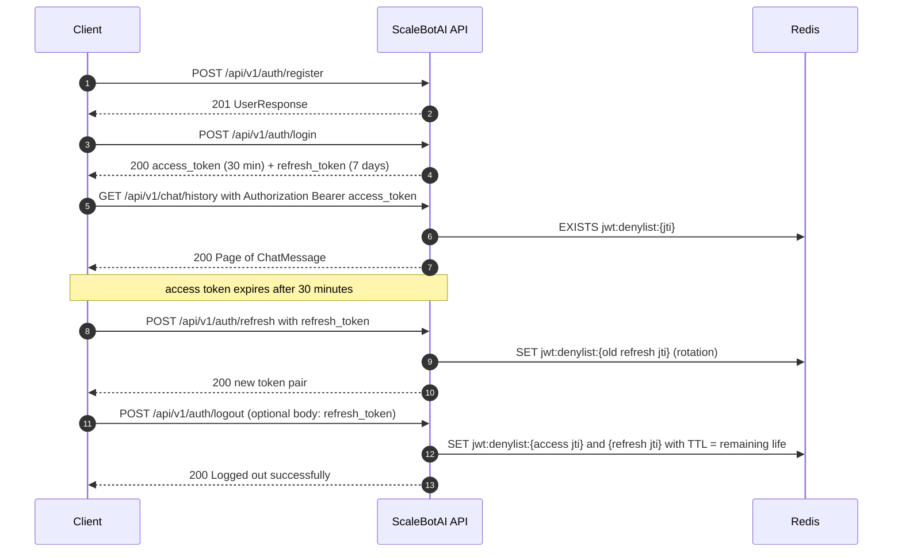

# 05 — API Design

> **Scope.** The complete REST contract of ScaleBotAI: conventions, authentication, the error model, all
> **32 endpoints** (4 operational + 28 business endpoints under `/api/v1`) with request/response schemas,
> examples and error cases, a validation summary and the mapping to the APIs required by the project brief.
>
> **Source of truth.** The FastAPI implementation in `src/app/api/routes/` (routers),
> `src/app/schemas/` (Pydantic v2 models), `src/app/api/deps.py` (auth, RBAC, rate limiting) and
> `src/app/core/errors.py` (error envelope).
>
> **Live documentation.** The running service publishes its OpenAPI 3 description at **`/openapi.json`**,
> interactive **Swagger UI at `/docs`** (click **Authorize**, paste the access token) and **ReDoc at `/redoc`**.
> `GET /` returns `{"name", "version", "docs": "/docs"}` and is not part of the schema.

---

## 1. Conventions

### 1.1 Base URLs and versioning

| Environment | Base URL | Notes |
|---|---|---|
| Kubernetes | `https://api.scalebotai.local` | ingress-nginx, TLS secret `scalebotai-tls` (add the host to `/etc/hosts`) |
| Docker Compose | `https://localhost` | NGINX container on ports 80/443, self-signed certificate (use `curl -k`) |
| Local development | `http://localhost:8000` | `uvicorn app.main:app --reload` from `src/` |

- **Business APIs** are versioned in the path: **`/api/v1/...`**. A breaking change ships as `/api/v2` alongside
  v1; additive changes (new optional fields, new endpoints) stay in v1. Clients must ignore unknown response fields.
- **Operational endpoints** (`/health`, `/health/live`, `/health/ready`, `/metrics`) are unversioned at the root
  because Kubernetes probes and Prometheus depend on fixed paths.

### 1.2 Format

- Requests and responses are **JSON** (`Content-Type: application/json`, UTF-8), except `GET /metrics`
  (Prometheus text format) and `204 No Content` responses (empty body).
- Field names are `snake_case`. Optional fields that have no value are returned as `null`, not omitted.
- **Timestamps** are ISO-8601 in **UTC** with a `Z` suffix, e.g. `2026-10-06T09:15:42.318000Z`.
- **Identifiers:** users and conversations use **UUIDs** (canonical hyphenated form); chat messages and feedback use
  **integers** (`chat_id`). A malformed UUID or integer in a path or query parameter returns `422 VALIDATION_ERROR`.
- Request bodies larger than **1 MB** are rejected at the edge by NGINX (`client_max_body_size 1m`).

### 1.3 Authentication

- Obtain tokens with `POST /api/v1/auth/login`, then send **`Authorization: Bearer <access_token>`** on every
  protected request. There are no cookies and no sessions.
- Tokens are HS256 JWTs with claims `sub` (user UUID), `role`, `type` (`access`/`refresh`), `jti`, `iss`
  (`scalebotai`), `iat`, `exp`. Access tokens live **30 minutes** (`expires_in: 1800`), refresh tokens **7 days**.
- On each request the server verifies signature, issuer, expiry and token type, checks the `jti` against the Redis
  denylist (`jwt:denylist:{jti}`), loads the user (Redis `user:{id}` cache, else PostgreSQL) and rejects disabled
  accounts with `403`.
- **Authorization:** `/api/v1/admin/*` requires `role = "admin"` in the user record (`403 FORBIDDEN` otherwise).
  Users can only access their own conversations, messages and feedback; other users' objects return **`404`**
  (existence is never confirmed).



### 1.4 Standard headers

| Header | Direction | Description |
|---|---|---|
| `Authorization: Bearer <token>` | request | Access token (all endpoints marked **JWT**). |
| `X-Request-ID` | request (optional) / response (always) | Correlation ID. A client value matching `^[A-Za-z0-9._-]{1,128}$` is echoed; otherwise a new UUID4 (32 hex characters) is generated. NGINX forwards or generates it too. It appears in every log line and in every error body as `request_id`. |
| `X-Process-Time-ms` | response | Server-side processing time of the request in milliseconds. |
| `X-RateLimit-Limit` | response | Requests allowed per minute for this identity (`RATE_LIMIT_PER_MINUTE`, default **120**). Present on rate-limited routes. |
| `X-RateLimit-Remaining` | response | Requests left in the current one-minute window. |
| `Retry-After` | response (429) | Seconds until the current window ends. |
| `WWW-Authenticate: Bearer` | response (401) | Standard challenge on authentication failures. |

### 1.5 Rate limiting

| Layer | Scope | Limit |
|---|---|---|
| Application (Redis, fixed window `ratelimit:{identity}:{epoch_minute}`) | **Per client IP** for `register`, `login`, `refresh`; **per user** for every other `/api/v1/*` endpoint | 120 requests/minute (`RATE_LIMIT_PER_MINUTE`), shared by all replicas |
| Edge — Docker Compose NGINX | Per client IP (`limit_req`) | `api_per_ip` 50 req/s (burst 100) on `/api/`; `auth_per_ip` 30 req/min (burst 20) additionally on login/register |
| Edge — Kubernetes ingress-nginx | Per client IP (`limit-rps`, burst multiplier) | 50 req/s, burst ×5 |

`/health*` and `/metrics` are never rate-limited by the application. Exceeding a limit returns
`429 RATE_LIMITED` with `Retry-After` (both the application and NGINX use the same error envelope). If Redis is
unreachable the application limiter **fails open** (requests are allowed and the error is logged).
For load tests, raise `RATE_LIMIT_PER_MINUTE` or distribute source IPs.

### 1.6 Pagination — `Page[T]`

List endpoints accept `?page=` (integer ≥ 1, default **1**) and `?size=` (integer 1–100, default **20**) and return:

```json
{
  "items": [ ],
  "page": 1,
  "size": 20,
  "total": 57,
  "pages": 3
}
```

`pages = ceil(total / size)` (0 when `total` is 0). A page beyond the last returns an empty `items` array, not an
error. Ordering is fixed per endpoint (documented below) so pages are stable.

### 1.7 Status-code conventions

| Code | Used for |
|---|---|
| `200 OK` | Reads, updates, actions that return a body (login, logout, refresh, send message, delete history with a count) |
| `201 Created` | A new resource was created: `register`, `POST /chat/conversations`, `POST /chat/{chat_id}/feedback` |
| `204 No Content` | Successful deletes without a body: `DELETE /users/me`, `DELETE /chat/conversations/{id}` |
| `4xx` / `5xx` | Uniform error envelope (§2) |

`POST /api/v1/chat` returns **200**, not 201: it is an action ("ask the bot") whose primary result is the answer;
it may or may not create a conversation.

---

## 2. Error model

### 2.1 Envelope

Every error response — from validation, authentication, business rules, unhandled exceptions, and even errors
generated by NGINX at the edge — has exactly this shape:

```json
{
  "error": {
    "code": "VALIDATION_ERROR",
    "message": "Request validation failed",
    "details": [
      {
        "loc": ["body", "password"],
        "msg": "Value error, password must contain at least one letter and one digit",
        "type": "value_error"
      }
    ],
    "request_id": "7d1f0a523c1e4b9a9f532b8e6c4d1a90"
  }
}
```

- `code` — stable, machine-readable; clients branch on it.
- `message` — human-readable; may change wording.
- `details` — a list for `VALIDATION_ERROR` (`loc` = location path, `msg`, `type` from Pydantic), otherwise `null`.
- `request_id` — the `X-Request-ID` of the request; quote it when reporting problems (it finds the log line in Kibana).

Unhandled exceptions are logged with their stack trace (`log_type: error`) but the client only receives
`INTERNAL_ERROR` — no internals leak.

### 2.2 Error codes

| HTTP | `code` | When it occurs | Typical `message` |
|---|---|---|---|
| 400 | `BAD_REQUEST` | A request that is syntactically valid but cannot be processed and is not a schema violation (generic application error). Malformed JSON is reported as `422` (`type: json_invalid`). | — |
| 401 | `UNAUTHORIZED` | Missing/invalid/expired/revoked token, wrong token type, user no longer exists, wrong credentials at login, wrong current password. Sent with `WWW-Authenticate: Bearer`. | `Not authenticated`, `Token has expired`, `Invalid token`, `Token has been revoked`, `User no longer exists`, `Invalid username or password`, `Current password is incorrect` |
| 403 | `FORBIDDEN` | Authenticated but not allowed: non-admin calling `/api/v1/admin/*`; account disabled by an admin. NGINX also returns it for `/metrics`. | `Admin privileges required`, `Account is disabled` |
| 404 | `NOT_FOUND` | Resource does not exist **or belongs to another user**; unknown route. | `Conversation not found`, `Chat message not found`, `User not found` |
| 409 | `CONFLICT` | Unique-constraint conflict: username or email already registered (including a lost race between two concurrent registrations). | `Username is already taken`, `Email is already registered` |
| 422 | `VALIDATION_ERROR` | Body, path or query parameter fails validation (Pydantic); `details` lists every failing field. | `Request validation failed` |
| 429 | `RATE_LIMITED` | Per-user/per-IP limit exceeded (app) or edge limit exceeded (NGINX). Includes `Retry-After`. | `Rate limit exceeded, retry later` |
| 500 | `INTERNAL_ERROR` | Unexpected server error (bug, dependency failure mid-request). | `Internal server error` |
| 503 | `SERVICE_UNAVAILABLE` | No healthy API upstream at the edge (NGINX during total outage/restarts). The health endpoints signal unavailability with `503` and their own status bodies (§4.1). | `The API is temporarily unavailable, please retry shortly` |

Framework-level: an unsupported HTTP method on an existing path returns `405` with code `METHOD_NOT_ALLOWED` in the
same envelope.

---

## 3. Endpoint summary (32)

Auth column: **—** = public, **JWT** = `Authorization: Bearer <access_token>`. Rate limit: **IP** / **user** = 120/min per identity.

| # | Method | Path | Auth | Role | Rate limit | Success | Description |
|---|---|---|---|---|---|---|---|
| 1 | GET | `/health` | — | — | — | 200 / 503 | Aggregate health: status, version, uptime, checks (database, redis, chatbot) |
| 2 | GET | `/health/live` | — | — | — | 200 | Liveness — process alive, no dependency checks |
| 3 | GET | `/health/ready` | — | — | — | 200 / 503 | Readiness — pings DB and Redis; 503 when not ready |
| 4 | GET | `/metrics` | — | — | — | 200 | Prometheus exposition (internal only, never exposed via NGINX/Ingress) |
| 5 | POST | `/api/v1/auth/register` | — | — | IP | **201** | Create a user account → `UserResponse` |
| 6 | POST | `/api/v1/auth/login` | — | — | IP | 200 | Username-or-email + password → `TokenResponse` |
| 7 | POST | `/api/v1/auth/logout` | JWT | user | user | 200 | Revoke the current access token (and optionally a refresh token) → `MessageResponse` |
| 8 | POST | `/api/v1/auth/refresh` | — (refresh token in body) | — | IP | 200 | Exchange a refresh token for a new pair (rotation) → `TokenResponse` |
| 9 | POST | `/api/v1/auth/change-password` | JWT | user | user | 200 | Change password → `MessageResponse` |
| 10 | GET | `/api/v1/users/me` | JWT | user | user | 200 | Current user's profile → `UserResponse` |
| 11 | PUT | `/api/v1/users/me` | JWT | user | user | 200 | Update `email` and/or `full_name` → `UserResponse` |
| 12 | DELETE | `/api/v1/users/me` | JWT | user | user | **204** | Delete the account; cascades conversations, chats, feedback |
| 13 | GET | `/api/v1/users/me/stats` | JWT | user | user | 200 | Per-user usage statistics → `UserStatsResponse` |
| 14 | POST | `/api/v1/chat` | JWT | user | user | 200 | Send a message; without `conversation_id` starts a new conversation → `ChatResponse` |
| 15 | POST | `/api/v1/chat/conversations` | JWT | user | user | **201** | Start a new, empty conversation → `ConversationResponse` |
| 16 | GET | `/api/v1/chat/conversations` | JWT | user | user | 200 | List conversations (paginated, most recent activity first) → `Page[ConversationResponse]` |
| 17 | GET | `/api/v1/chat/conversations/{conversation_id}` | JWT | user | user | 200 | Conversation with all messages (to continue it) → `ConversationDetail` |
| 18 | PATCH | `/api/v1/chat/conversations/{conversation_id}` | JWT | user | user | 200 | Rename → `ConversationResponse` |
| 19 | DELETE | `/api/v1/chat/conversations/{conversation_id}` | JWT | user | user | **204** | Delete one conversation and its messages |
| 20 | GET | `/api/v1/chat/history` | JWT | user | user | 200 | Paginated history, newest first, optional `?conversation_id=` → `Page[ChatMessage]` |
| 21 | DELETE | `/api/v1/chat/history` | JWT | user | user | 200 | Delete all of the user's history → `{"deleted": n}` |
| 22 | POST | `/api/v1/chat/{chat_id}/feedback` | JWT | user | user | **201** | Rate a bot answer 1–5 (+ comment); upsert → `FeedbackResponse` |
| 23 | GET | `/api/v1/bot/info` | JWT | user | user | 200 | Bot mode, model, number of intents, LLM availability → `BotInfo` |
| 24 | GET | `/api/v1/admin/analytics` | JWT | **admin** | user | 200 | Combined dashboard: users, chats, requests (7 d), feedback → `Analytics` |
| 25 | GET | `/api/v1/admin/stats/users` | JWT | **admin** | user | 200 | Total/active/admin users, new today, new 7 d → `UserStats` |
| 26 | GET | `/api/v1/admin/stats/chats` | JWT | **admin** | user | 200 | Totals, chats today, avg per user, avg bot latency → `ChatStats` |
| 27 | GET | `/api/v1/admin/stats/requests` | JWT | **admin** | user | 200 | Daily request counts for `?days=` 1–30 (default 7) → `DailyRequests` |
| 28 | GET | `/api/v1/admin/system` | JWT | **admin** | user | 200 | Pod/process/pool/Redis statistics → `SystemStats` |
| 29 | GET | `/api/v1/admin/health` | JWT | **admin** | user | 200 | Detailed dependency health with latencies → `HealthReport` |
| 30 | GET | `/api/v1/admin/users` | JWT | **admin** | user | 200 | List users (paginated, `?search=`) → `Page[UserResponse]` |
| 31 | PATCH | `/api/v1/admin/users/{user_id}` | JWT | **admin** | user | 200 | Set `is_active` and/or `role` → `UserResponse` |
| 32 | GET | `/api/v1/admin/feedback` | JWT | **admin** | user | 200 | Feedback summary: total, average, distribution 1..5 → `FeedbackSummary` |

**Errors common to every JWT endpoint:** `401 UNAUTHORIZED` (missing/invalid/expired/revoked token),
`403 FORBIDDEN` (account disabled; plus non-admin on admin routes), `429 RATE_LIMITED`, `500 INTERNAL_ERROR`.
They are repeated in each endpoint's error table for completeness.

---

## 4. Endpoint reference

All examples assume:

```bash
export BASE_URL=https://api.scalebotai.local          # Compose: https://localhost
# -s silent, -k accept the self-signed lab certificate
TOKEN=$(curl -sk -X POST "$BASE_URL/api/v1/auth/login" -H "Content-Type: application/json" \
  -d '{"username":"alice","password":"Str0ngPassw0rd"}' | jq -r .access_token)
```

Shared schemas used below:

```text
UserResponse         {id: UUID, username, email, full_name: str|null, role: "user"|"admin",
                      is_active: bool, created_at, last_login_at: datetime|null}
TokenResponse        {access_token, refresh_token, token_type: "bearer", expires_in: int (seconds), user: UserResponse}
MessageResponse      {message}
ConversationResponse {id: UUID, title, created_at, updated_at, message_count: int}
ChatMessage          {id: int, conversation_id: UUID, question, response, bot_mode, latency_ms: float|null,
                      timestamp, feedback: {rating, comment}|null}
```

### 4.1 Operations

#### 1. `GET /health` — aggregate health

Aggregated status for operators, load balancers and the smoke test. **Auth:** none. **Request:** no parameters.

Status logic: `ok` when everything is healthy; `degraded` (HTTP 200) when Redis is unreachable (the API keeps serving,
fail-open) or the LLM is unavailable (rule fallback active); `down` (**HTTP 503**) when PostgreSQL is unreachable.
The body is a `HealthReport` in both cases so the failing check is visible.

```bash
curl -sk "$BASE_URL/health"
```

```json
{
  "status": "ok",
  "version": "1.0.0",
  "uptime_seconds": 86412.3,
  "checks": {
    "database": {"status": "ok", "latency_ms": 1.84, "error": null},
    "redis": {"status": "ok", "latency_ms": 0.62, "error": null},
    "chatbot": {"status": "ok", "mode": "rule"}
  }
}
```

**503 example (database down):**

```json
{
  "status": "down",
  "version": "1.0.0",
  "uptime_seconds": 90311.7,
  "checks": {
    "database": {"status": "down", "latency_ms": null, "error": "ConnectionRefusedError"},
    "redis": {"status": "ok", "latency_ms": 0.58, "error": null},
    "chatbot": {"status": "ok", "mode": "rule"}
  }
}
```

| Status | Body | When |
|---|---|---|
| 200 | `HealthReport` (`ok` or `degraded`) | Database reachable |
| 503 | `HealthReport` (`down`) | Database unreachable |
| 429 | error envelope | Edge rate limit (NGINX) exceeded |

#### 2. `GET /health/live` — liveness

Used by the Kubernetes **startup** and **liveness** probes and the Docker `HEALTHCHECK`. Performs **no dependency
checks**, so a database outage never triggers container restarts. **Auth:** none.

```bash
curl -sk "$BASE_URL/health/live"
```

```json
{"status": "alive"}
```

| Status | When |
|---|---|
| 200 | The process and its event loop respond |
| (timeout / connection refused) | The process is hung or dead → kubelet restarts the container after 3 failures |

#### 3. `GET /health/ready` — readiness

Used by the Kubernetes **readiness** probe. Pings PostgreSQL and Redis; the pod is **ready only if the database
answers**. Redis status is reported but does not gate readiness, because Redis is fail-open — otherwise a Redis
outage would remove every pod from the Service. **Auth:** none.

```bash
curl -sk "$BASE_URL/health/ready"
```

```json
{"status": "ready", "database": "ok", "redis": "ok"}
```

| Status | Body | When |
|---|---|---|
| 200 | `{"status": "ready", "database": "ok", "redis": "ok" \| "down"}` | Database reachable |
| 503 | `{"status": "not_ready", "database": "down", "redis": "..."}` | Database unreachable → pod removed from endpoints (not restarted) |

#### 4. `GET /metrics` — Prometheus metrics

Prometheus text exposition format (`Content-Type: text/plain; version=1.0.0; charset=utf-8` as emitted by
`prometheus-client` 0.26; Prometheus also accepts the classic `version=0.0.4`). **Auth:** none, but
**not exposed publicly**: NGINX answers `403 FORBIDDEN` and the Ingress does not route it; Prometheus scrapes each
pod directly (pod annotations in Kubernetes, `dns_sd_configs` in Compose). `/metrics` and `/health*` requests are
excluded from the request metrics and from the daily request counter.

```bash
kubectl -n scalebotai port-forward deploy/scalebotai-api 8000:8000 &
curl -s http://localhost:8000/metrics | grep '^scalebot_'
```

```text
scalebot_http_requests_total{method="POST",route="/api/v1/chat",status="200"} 18234.0
scalebot_http_request_duration_seconds_bucket{le="0.3",method="POST",route="/api/v1/chat"} 18102.0
scalebot_http_requests_in_progress 3.0
scalebot_chat_messages_total{bot_mode="rule",cached="true"} 11872.0
scalebot_cache_hits_total{cache="bot_response"} 11872.0
scalebot_rate_limited_total 14.0
scalebot_auth_events_total{event="login_success"} 2311.0
scalebot_db_pool_checked_out 1.0
scalebot_db_pool_size 10.0
scalebot_app_info{bot_mode="rule",environment="production",version="1.0.0"} 1.0
```

Full metric catalogue: `docs/09-monitoring-logging.md`.

| Status | When |
|---|---|
| 200 | Always (inside the cluster / Compose `monitoring` network) |
| 403 | Requested through NGINX (edge denies `/metrics`) |

### 4.2 Authentication — `/api/v1/auth`

#### 5. `POST /api/v1/auth/register` — create an account

Creates a user with role `user`. The email is stored lowercase; the password is bcrypt-hashed (cost 12). Does not log
the user in. **Auth:** none. **Rate limit:** per IP.

| Field | Type | Required | Validation |
|---|---|---|---|
| `username` | string | yes | 3–50 chars, `^[a-zA-Z0-9_.-]+$`, unique |
| `email` | string | yes | valid email address, unique (case-insensitive — normalised to lowercase) |
| `password` | string | yes | 8–128 chars, at least one letter and one digit |
| `full_name` | string \| null | no | ≤ 100 chars |

```bash
curl -sk -X POST "$BASE_URL/api/v1/auth/register" \
  -H "Content-Type: application/json" \
  -d '{"username":"alice","email":"Alice@Example.com","password":"Str0ngPassw0rd","full_name":"Alice Sharma"}'
```

**201 Created**

```json
{
  "id": "3f6c2a9e-8b1d-4c57-9e2a-1d7b5f0c4a21",
  "username": "alice",
  "email": "alice@example.com",
  "full_name": "Alice Sharma",
  "role": "user",
  "is_active": true,
  "created_at": "2026-10-06T09:12:03.551000Z",
  "last_login_at": null
}
```

| Status | Code | When |
|---|---|---|
| 409 | `CONFLICT` | `Username is already taken` / `Email is already registered` (also on a lost concurrent-registration race) |
| 422 | `VALIDATION_ERROR` | Any field rule violated (e.g. weak password, bad username characters, invalid email) |
| 429 | `RATE_LIMITED` | More than 120 requests/minute from this IP (or edge limit) |

#### 6. `POST /api/v1/auth/login` — obtain tokens

Accepts the **username or the email** in the `username` field (JSON body, not form data). Updates `last_login_at`.
Failed logins return the same message for unknown users and wrong passwords, and take the same time (a dummy bcrypt
check), so usernames cannot be enumerated. **Auth:** none. **Rate limit:** per IP.

| Field | Type | Required | Validation |
|---|---|---|---|
| `username` | string | yes | 3–255 chars; username or email |
| `password` | string | yes | 1–128 chars |

```bash
curl -sk -X POST "$BASE_URL/api/v1/auth/login" \
  -H "Content-Type: application/json" \
  -d '{"username":"alice","password":"Str0ngPassw0rd"}'
```

**200 OK** — `TokenResponse`

```json
{
  "access_token": "eyJhbGciOiJIUzI1NiIsInR5cCI6IkpXVCJ9.eyJzdWIiOiIzZjZjMmE5ZS4uLiIsInR5cGUiOiJhY2Nlc3MifQ.4mS0...",
  "refresh_token": "eyJhbGciOiJIUzI1NiIsInR5cCI6IkpXVCJ9.eyJzdWIiOiIzZjZjMmE5ZS4uLiIsInR5cGUiOiJyZWZyZXNoIn0.Qp9x...",
  "token_type": "bearer",
  "expires_in": 1800,
  "user": {
    "id": "3f6c2a9e-8b1d-4c57-9e2a-1d7b5f0c4a21",
    "username": "alice",
    "email": "alice@example.com",
    "full_name": "Alice Sharma",
    "role": "user",
    "is_active": true,
    "created_at": "2026-10-06T09:12:03.551000Z",
    "last_login_at": "2026-10-06T09:14:10.027000Z"
  }
}
```

| Status | Code | When |
|---|---|---|
| 401 | `UNAUTHORIZED` | `Invalid username or password` |
| 403 | `FORBIDDEN` | `Account is disabled` (deactivated by an admin) |
| 422 | `VALIDATION_ERROR` | Missing/too short/too long fields |
| 429 | `RATE_LIMITED` | Per-IP limit or edge limit (NGINX applies a stricter burst on login) |

#### 7. `POST /api/v1/auth/logout` — revoke tokens

Adds the current access token's `jti` to the Redis denylist until it expires. If the optional body contains the
user's `refresh_token`, that token is revoked too (an invalid refresh token is ignored). Clients should discard both
tokens. **Auth:** JWT. **Rate limit:** per user.

| Field | Type | Required | Validation |
|---|---|---|---|
| `refresh_token` | string | no (whole body optional) | ≥ 10 chars when the body is sent |

```bash
curl -sk -X POST "$BASE_URL/api/v1/auth/logout" \
  -H "Authorization: Bearer $TOKEN" \
  -H "Content-Type: application/json" \
  -d '{"refresh_token":"eyJhbGciOiJIUzI1NiIsInR5cCI6IkpXVCJ9..."}'
```

**200 OK** — `MessageResponse`

```json
{"message": "Logged out successfully"}
```

| Status | Code | When |
|---|---|---|
| 401 | `UNAUTHORIZED` | Missing/invalid/expired/already revoked access token |
| 403 | `FORBIDDEN` | Account disabled |
| 422 | `VALIDATION_ERROR` | Body sent with a malformed `refresh_token` |
| 429 | `RATE_LIMITED` | Per-user limit exceeded |

#### 8. `POST /api/v1/auth/refresh` — rotate tokens

Exchanges a valid refresh token for a **new access + refresh token pair**. The presented refresh token is revoked
(rotation): each refresh token works once, so a replayed token is rejected. **Auth:** none (the refresh token in the
body is the credential). **Rate limit:** per IP.

| Field | Type | Required | Validation |
|---|---|---|---|
| `refresh_token` | string | yes | ≥ 10 chars; must be a valid, unexpired, unrevoked token of type `refresh` |

```bash
curl -sk -X POST "$BASE_URL/api/v1/auth/refresh" \
  -H "Content-Type: application/json" \
  -d '{"refresh_token":"eyJhbGciOiJIUzI1NiIsInR5cCI6IkpXVCJ9..."}'
```

**200 OK** — `TokenResponse` (same shape as login, new tokens, `expires_in: 1800`).

| Status | Code | When |
|---|---|---|
| 401 | `UNAUTHORIZED` | Invalid/expired token, an access token sent instead of a refresh token, token already used or revoked, `User no longer exists` |
| 403 | `FORBIDDEN` | Account disabled |
| 422 | `VALIDATION_ERROR` | Missing or too-short `refresh_token` |
| 429 | `RATE_LIMITED` | Per-IP limit exceeded |

#### 9. `POST /api/v1/auth/change-password`

Verifies the current password and stores a new bcrypt hash; the profile cache is evicted. Tokens already issued
remain valid until they expire. **Auth:** JWT. **Rate limit:** per user.

| Field | Type | Required | Validation |
|---|---|---|---|
| `current_password` | string | yes | 1–128 chars; must match the stored password |
| `new_password` | string | yes | 8–128 chars, at least one letter and one digit |

```bash
curl -sk -X POST "$BASE_URL/api/v1/auth/change-password" \
  -H "Authorization: Bearer $TOKEN" -H "Content-Type: application/json" \
  -d '{"current_password":"Str0ngPassw0rd","new_password":"N3wer-Passw0rd"}'
```

**200 OK**

```json
{"message": "Password changed successfully"}
```

| Status | Code | When |
|---|---|---|
| 401 | `UNAUTHORIZED` | `Current password is incorrect`, or token problems |
| 403 | `FORBIDDEN` | Account disabled |
| 422 | `VALIDATION_ERROR` | New password violates the policy |
| 429 | `RATE_LIMITED` | Per-user limit exceeded |

### 4.3 Users — `/api/v1/users`

#### 10. `GET /api/v1/users/me` — current profile

Returns the authenticated user (served from the `user:{id}` Redis cache when warm). **Auth:** JWT.

```bash
curl -sk "$BASE_URL/api/v1/users/me" -H "Authorization: Bearer $TOKEN"
```

**200 OK** — `UserResponse` (see register example, with `last_login_at` set).

| Status | Code | When |
|---|---|---|
| 401 | `UNAUTHORIZED` | Token problems |
| 403 | `FORBIDDEN` | Account disabled |
| 429 | `RATE_LIMITED` | Per-user limit exceeded |

#### 11. `PUT /api/v1/users/me` — update profile

Updates `email` and/or `full_name`. Fields that are omitted (or `null`) are left unchanged; at least one must be
provided. The new email is lowercased and must not belong to another account. Evicts the profile cache.
**Auth:** JWT.

| Field | Type | Required | Validation |
|---|---|---|---|
| `email` | string | no* | valid email, unique |
| `full_name` | string | no* | ≤ 100 chars |

\* at least one of the two.

```bash
curl -sk -X PUT "$BASE_URL/api/v1/users/me" \
  -H "Authorization: Bearer $TOKEN" -H "Content-Type: application/json" \
  -d '{"full_name":"Alice S. Sharma"}'
```

**200 OK** — updated `UserResponse`

```json
{
  "id": "3f6c2a9e-8b1d-4c57-9e2a-1d7b5f0c4a21",
  "username": "alice",
  "email": "alice@example.com",
  "full_name": "Alice S. Sharma",
  "role": "user",
  "is_active": true,
  "created_at": "2026-10-06T09:12:03.551000Z",
  "last_login_at": "2026-10-06T09:14:10.027000Z"
}
```

| Status | Code | When |
|---|---|---|
| 401 | `UNAUTHORIZED` | Token problems |
| 403 | `FORBIDDEN` | Account disabled |
| 409 | `CONFLICT` | `Email is already registered` |
| 422 | `VALIDATION_ERROR` | Neither field provided (`provide at least one of: email, full_name`), invalid email, name too long |
| 429 | `RATE_LIMITED` | Per-user limit exceeded |

#### 12. `DELETE /api/v1/users/me` — delete account

Permanently deletes the account; `ON DELETE CASCADE` removes all conversations, chats and feedback in the same
transaction (right to erasure). The current access token is revoked and the profile cache evicted. **Auth:** JWT.

```bash
curl -sk -X DELETE "$BASE_URL/api/v1/users/me" -H "Authorization: Bearer $TOKEN" -o /dev/null -w "%{http_code}\n"
# 204
```

**204 No Content** — empty body.

| Status | Code | When |
|---|---|---|
| 401 | `UNAUTHORIZED` | Token problems |
| 403 | `FORBIDDEN` | Account disabled |
| 404 | `NOT_FOUND` | `User not found` (already deleted by a concurrent request) |
| 429 | `RATE_LIMITED` | Per-user limit exceeded |

#### 13. `GET /api/v1/users/me/stats` — usage statistics

**Auth:** JWT.

```bash
curl -sk "$BASE_URL/api/v1/users/me/stats" -H "Authorization: Bearer $TOKEN"
```

**200 OK** — `UserStatsResponse`

```json
{
  "total_conversations": 4,
  "total_messages": 27,
  "feedback_given": 6,
  "first_chat_at": "2026-10-01T17:40:12.004000Z",
  "last_chat_at": "2026-10-06T09:15:42.318000Z"
}
```

`first_chat_at` / `last_chat_at` are `null` for a user without messages.

| Status | Code | When |
|---|---|---|
| 401 | `UNAUTHORIZED` | Token problems |
| 403 | `FORBIDDEN` | Account disabled |
| 429 | `RATE_LIMITED` | Per-user limit exceeded |

### 4.4 Chat — `/api/v1/chat`

#### 14. `POST /api/v1/chat` — send a message

Asks the bot a question. Without `conversation_id` a **new conversation** is created and titled after the first
message (whitespace-collapsed, truncated to 60 characters); with `conversation_id` the message is appended to that
conversation (in `llm` mode its last 5 exchanges are sent as context). Answers are served from the Redis cache when
possible (`cached: true`). `bot_mode` is `rule`, `llm`, or `rule-fallback` (LLM timed out or unavailable).
`latency_ms` is the server-side processing time of the exchange. **Auth:** JWT.

| Field | Type | Required | Validation |
|---|---|---|---|
| `message` | string | yes | 1–2000 chars; leading/trailing whitespace stripped; blank rejected |
| `conversation_id` | UUID \| null | no | must be one of the caller's conversations |

```bash
curl -sk -X POST "$BASE_URL/api/v1/chat" \
  -H "Authorization: Bearer $TOKEN" -H "Content-Type: application/json" \
  -d '{"message":"What is a Kubernetes pod?"}'
```

**200 OK** — `ChatResponse`

```json
{
  "chat_id": 1042,
  "conversation_id": "9b2e7c4d-1f3a-4e8b-a6d5-0c9f8e7d6b5a",
  "question": "What is a Kubernetes pod?",
  "response": "A Pod is the smallest deployable unit in Kubernetes: one or more containers that share a network namespace (one IP address) and storage volumes and are always scheduled together on the same node. Deployments and StatefulSets manage Pods for you.",
  "bot_mode": "rule",
  "cached": false,
  "latency_ms": 6.41,
  "timestamp": "2026-10-06T09:15:42.318000Z"
}
```

Continue the same conversation:

```bash
curl -sk -X POST "$BASE_URL/api/v1/chat" \
  -H "Authorization: Bearer $TOKEN" -H "Content-Type: application/json" \
  -d '{"message":"How is it different from a Deployment?","conversation_id":"9b2e7c4d-1f3a-4e8b-a6d5-0c9f8e7d6b5a"}'
```

| Status | Code | When |
|---|---|---|
| 401 | `UNAUTHORIZED` | Token problems |
| 403 | `FORBIDDEN` | Account disabled |
| 404 | `NOT_FOUND` | `Conversation not found` (does not exist or belongs to another user) |
| 422 | `VALIDATION_ERROR` | Missing/blank/too long `message`, malformed `conversation_id` |
| 429 | `RATE_LIMITED` | Per-user limit exceeded |

An LLM failure is **never** an error: the rule engine answers and `bot_mode` is `rule-fallback`.

#### 15. `POST /api/v1/chat/conversations` — start an empty conversation

Creates a conversation without messages (e.g. a "New chat" button). The body is optional. **Auth:** JWT.

| Field | Type | Required | Validation |
|---|---|---|---|
| `title` | string \| null | no | ≤ 200 chars; omitted/empty ⇒ `"New chat"` |

```bash
curl -sk -X POST "$BASE_URL/api/v1/chat/conversations" \
  -H "Authorization: Bearer $TOKEN" -H "Content-Type: application/json" \
  -d '{"title":"Jenkins pipeline questions"}'
```

**201 Created** — `ConversationResponse`

```json
{
  "id": "5d1a3e7f-2b4c-4d6e-8f9a-1b2c3d4e5f60",
  "title": "Jenkins pipeline questions",
  "created_at": "2026-10-06T09:20:00.112000Z",
  "updated_at": "2026-10-06T09:20:00.112000Z",
  "message_count": 0
}
```

| Status | Code | When |
|---|---|---|
| 401 | `UNAUTHORIZED` | Token problems |
| 403 | `FORBIDDEN` | Account disabled |
| 422 | `VALIDATION_ERROR` | Title longer than 200 chars |
| 429 | `RATE_LIMITED` | Per-user limit exceeded |

#### 16. `GET /api/v1/chat/conversations` — list conversations

The caller's conversations ordered by `updated_at` descending (most recent activity first). **Auth:** JWT.

| Query | Type | Default | Validation |
|---|---|---|---|
| `page` | integer | 1 | ≥ 1 |
| `size` | integer | 20 | 1–100 |

```bash
curl -sk "$BASE_URL/api/v1/chat/conversations?page=1&size=2" -H "Authorization: Bearer $TOKEN"
```

**200 OK** — `Page[ConversationResponse]`

```json
{
  "items": [
    {
      "id": "9b2e7c4d-1f3a-4e8b-a6d5-0c9f8e7d6b5a",
      "title": "What is a Kubernetes pod?",
      "created_at": "2026-10-06T09:15:42.318000Z",
      "updated_at": "2026-10-06T09:16:05.902000Z",
      "message_count": 2
    },
    {
      "id": "5d1a3e7f-2b4c-4d6e-8f9a-1b2c3d4e5f60",
      "title": "Jenkins pipeline questions",
      "created_at": "2026-10-06T09:20:00.112000Z",
      "updated_at": "2026-10-06T09:20:00.112000Z",
      "message_count": 0
    }
  ],
  "page": 1,
  "size": 2,
  "total": 4,
  "pages": 2
}
```

| Status | Code | When |
|---|---|---|
| 401 | `UNAUTHORIZED` | Token problems |
| 403 | `FORBIDDEN` | Account disabled |
| 422 | `VALIDATION_ERROR` | `page` < 1, `size` outside 1–100 |
| 429 | `RATE_LIMITED` | Per-user limit exceeded |

#### 17. `GET /api/v1/chat/conversations/{conversation_id}` — conversation with messages

Returns the conversation and **all** its messages in chronological order, each with its feedback if rated — used to
display and continue a chat. **Auth:** JWT.

| Path | Type | Validation |
|---|---|---|
| `conversation_id` | UUID | must belong to the caller |

```bash
curl -sk "$BASE_URL/api/v1/chat/conversations/9b2e7c4d-1f3a-4e8b-a6d5-0c9f8e7d6b5a" -H "Authorization: Bearer $TOKEN"
```

**200 OK** — `ConversationDetail`

```json
{
  "id": "9b2e7c4d-1f3a-4e8b-a6d5-0c9f8e7d6b5a",
  "title": "What is a Kubernetes pod?",
  "created_at": "2026-10-06T09:15:42.318000Z",
  "updated_at": "2026-10-06T09:16:05.902000Z",
  "messages": [
    {
      "id": 1042,
      "conversation_id": "9b2e7c4d-1f3a-4e8b-a6d5-0c9f8e7d6b5a",
      "question": "What is a Kubernetes pod?",
      "response": "A Pod is the smallest deployable unit in Kubernetes: ...",
      "bot_mode": "rule",
      "latency_ms": 6.41,
      "timestamp": "2026-10-06T09:15:42.318000Z",
      "feedback": {"rating": 5, "comment": "Clear and short"}
    },
    {
      "id": 1043,
      "conversation_id": "9b2e7c4d-1f3a-4e8b-a6d5-0c9f8e7d6b5a",
      "question": "How is it different from a Deployment?",
      "response": "A Deployment manages a ReplicaSet that keeps the desired number of identical Pods running ...",
      "bot_mode": "rule",
      "latency_ms": 4.97,
      "timestamp": "2026-10-06T09:16:05.902000Z",
      "feedback": null
    }
  ]
}
```

| Status | Code | When |
|---|---|---|
| 401 | `UNAUTHORIZED` | Token problems |
| 403 | `FORBIDDEN` | Account disabled |
| 404 | `NOT_FOUND` | `Conversation not found` (missing or another user's) |
| 422 | `VALIDATION_ERROR` | Malformed UUID |
| 429 | `RATE_LIMITED` | Per-user limit exceeded |

#### 18. `PATCH /api/v1/chat/conversations/{conversation_id}` — rename

**Auth:** JWT.

| Field | Type | Required | Validation |
|---|---|---|---|
| `title` | string | yes | 1–200 chars |

```bash
curl -sk -X PATCH "$BASE_URL/api/v1/chat/conversations/9b2e7c4d-1f3a-4e8b-a6d5-0c9f8e7d6b5a" \
  -H "Authorization: Bearer $TOKEN" -H "Content-Type: application/json" \
  -d '{"title":"Kubernetes basics"}'
```

**200 OK** — `ConversationResponse`

```json
{
  "id": "9b2e7c4d-1f3a-4e8b-a6d5-0c9f8e7d6b5a",
  "title": "Kubernetes basics",
  "created_at": "2026-10-06T09:15:42.318000Z",
  "updated_at": "2026-10-06T09:16:05.902000Z",
  "message_count": 2
}
```

(`updated_at` tracks message activity, so renaming does not change it.)

| Status | Code | When |
|---|---|---|
| 401 | `UNAUTHORIZED` | Token problems |
| 403 | `FORBIDDEN` | Account disabled |
| 404 | `NOT_FOUND` | `Conversation not found` |
| 422 | `VALIDATION_ERROR` | Missing/empty/too long title, malformed UUID |
| 429 | `RATE_LIMITED` | Per-user limit exceeded |

#### 19. `DELETE /api/v1/chat/conversations/{conversation_id}` — delete one conversation

Deletes the conversation; its messages and their feedback cascade. **Auth:** JWT.

```bash
curl -sk -X DELETE "$BASE_URL/api/v1/chat/conversations/5d1a3e7f-2b4c-4d6e-8f9a-1b2c3d4e5f60" \
  -H "Authorization: Bearer $TOKEN" -o /dev/null -w "%{http_code}\n"
# 204
```

**204 No Content** — empty body.

| Status | Code | When |
|---|---|---|
| 401 | `UNAUTHORIZED` | Token problems |
| 403 | `FORBIDDEN` | Account disabled |
| 404 | `NOT_FOUND` | `Conversation not found` (missing, already deleted, or another user's) |
| 422 | `VALIDATION_ERROR` | Malformed UUID |
| 429 | `RATE_LIMITED` | Per-user limit exceeded |

#### 20. `GET /api/v1/chat/history` — paginated history

All of the caller's exchanges across conversations, **newest first** (ties broken by `id`), optionally restricted to
one conversation. A `conversation_id` that is not the caller's simply yields an empty page. **Auth:** JWT.

| Query | Type | Default | Validation |
|---|---|---|---|
| `page` | integer | 1 | ≥ 1 |
| `size` | integer | 20 | 1–100 |
| `conversation_id` | UUID | — | optional filter |

```bash
curl -sk "$BASE_URL/api/v1/chat/history?page=1&size=1" -H "Authorization: Bearer $TOKEN"
```

**200 OK** — `Page[ChatMessage]`

```json
{
  "items": [
    {
      "id": 1043,
      "conversation_id": "9b2e7c4d-1f3a-4e8b-a6d5-0c9f8e7d6b5a",
      "question": "How is it different from a Deployment?",
      "response": "A Deployment manages a ReplicaSet that keeps the desired number of identical Pods running ...",
      "bot_mode": "rule",
      "latency_ms": 4.97,
      "timestamp": "2026-10-06T09:16:05.902000Z",
      "feedback": null
    }
  ],
  "page": 1,
  "size": 1,
  "total": 27,
  "pages": 27
}
```

| Status | Code | When |
|---|---|---|
| 401 | `UNAUTHORIZED` | Token problems |
| 403 | `FORBIDDEN` | Account disabled |
| 422 | `VALIDATION_ERROR` | Bad `page`/`size`, malformed `conversation_id` |
| 429 | `RATE_LIMITED` | Per-user limit exceeded |

#### 21. `DELETE /api/v1/chat/history` — delete all history

Deletes **all** of the caller's exchanges (and their feedback) and all their conversations in one transaction.
Returns the number of deleted exchanges (`0` if there was nothing to delete). **Auth:** JWT.

```bash
curl -sk -X DELETE "$BASE_URL/api/v1/chat/history" -H "Authorization: Bearer $TOKEN"
```

**200 OK**

```json
{"deleted": 27}
```

| Status | Code | When |
|---|---|---|
| 401 | `UNAUTHORIZED` | Token problems |
| 403 | `FORBIDDEN` | Account disabled |
| 429 | `RATE_LIMITED` | Per-user limit exceeded |

#### 22. `POST /api/v1/chat/{chat_id}/feedback` — rate an answer (upsert)

Rates one of the caller's bot answers. **Re-rating replaces the previous rating and comment** (the same feedback row
is updated; `created_at` keeps the time of the first rating). Always returns **201**. **Auth:** JWT.

| Path / Field | Type | Required | Validation |
|---|---|---|---|
| `chat_id` (path) | integer | yes | an exchange owned by the caller |
| `rating` | integer | yes | 1–5 |
| `comment` | string \| null | no | ≤ 1000 chars |

```bash
curl -sk -X POST "$BASE_URL/api/v1/chat/1042/feedback" \
  -H "Authorization: Bearer $TOKEN" -H "Content-Type: application/json" \
  -d '{"rating":5,"comment":"Clear and short"}'
```

**201 Created** — `FeedbackResponse`

```json
{
  "id": 311,
  "chat_id": 1042,
  "rating": 5,
  "comment": "Clear and short",
  "created_at": "2026-10-06T09:17:30.640000Z"
}
```

| Status | Code | When |
|---|---|---|
| 401 | `UNAUTHORIZED` | Token problems |
| 403 | `FORBIDDEN` | Account disabled |
| 404 | `NOT_FOUND` | `Chat message not found` (missing or another user's) |
| 422 | `VALIDATION_ERROR` | `rating` outside 1–5 or not an integer, comment too long, non-integer `chat_id` |
| 429 | `RATE_LIMITED` | Per-user limit exceeded |

### 4.5 Bot — `/api/v1/bot`

#### 23. `GET /api/v1/bot/info` — chatbot engine

Reports the active engine (`CHATBOT_MODE`), the LLM model (`null` in rule mode), the number of rule intents (also the
fallback engine in LLM mode) and whether the LLM is reachable with its model pulled (always `false` in rule mode).
**Auth:** JWT.

```bash
curl -sk "$BASE_URL/api/v1/bot/info" -H "Authorization: Bearer $TOKEN"
```

**200 OK** — `BotInfo`

```json
{"mode": "rule", "model": null, "intents": 34, "llm_available": false}
```

In LLM mode: `{"mode": "llm", "model": "tinyllama", "intents": 34, "llm_available": true}`.

| Status | Code | When |
|---|---|---|
| 401 | `UNAUTHORIZED` | Token problems |
| 403 | `FORBIDDEN` | Account disabled |
| 429 | `RATE_LIMITED` | Per-user limit exceeded |

### 4.6 Admin — `/api/v1/admin` (role `admin`)

Every admin endpoint requires a valid access token **and** `role = "admin"` on the user record; a regular user
receives **`403 FORBIDDEN` (`Admin privileges required`)**. The bootstrap admin is created at startup from
`ADMIN_USERNAME` / `ADMIN_EMAIL` / `ADMIN_PASSWORD`. Common errors for all admin endpoints:

| Status | Code | When |
|---|---|---|
| 401 | `UNAUTHORIZED` | Token problems |
| 403 | `FORBIDDEN` | Caller is not an admin, or account disabled |
| 429 | `RATE_LIMITED` | Per-user limit exceeded |
| 500 | `INTERNAL_ERROR` | Unexpected error (e.g. database failure during an aggregate) |

```bash
ADMIN_TOKEN=$(curl -sk -X POST "$BASE_URL/api/v1/auth/login" -H "Content-Type: application/json" \
  -d '{"username":"admin","password":"<ADMIN_PASSWORD>"}' | jq -r .access_token)
```

#### 24. `GET /api/v1/admin/analytics` — dashboard summary

All aggregates in one call; `requests` covers the last 7 days. The payload is cached in Redis for **30 s**
(`analytics:summary`), so `generated_at` shows when it was computed.

```bash
curl -sk "$BASE_URL/api/v1/admin/analytics" -H "Authorization: Bearer $ADMIN_TOKEN"
```

**200 OK** — `Analytics`

```json
{
  "users": {"total_users": 1284, "active_users": 1279, "admin_users": 2, "new_users_today": 37, "new_users_7d": 412},
  "chats": {
    "total_chats": 58213,
    "total_conversations": 9120,
    "chats_today": 4381,
    "avg_chats_per_user": 45.34,
    "avg_bot_latency_ms": 7.82
  },
  "requests": {
    "days": 7,
    "total": 486230,
    "series": [
      {"date": "2026-09-30", "requests": 61204},
      {"date": "2026-10-01", "requests": 70388},
      {"date": "2026-10-02", "requests": 72951},
      {"date": "2026-10-03", "requests": 68110},
      {"date": "2026-10-04", "requests": 66472},
      {"date": "2026-10-05", "requests": 79935},
      {"date": "2026-10-06", "requests": 67170}
    ]
  },
  "feedback": {
    "total": 2140,
    "average_rating": 4.21,
    "distribution": {"1": 61, "2": 98, "3": 255, "4": 640, "5": 1086}
  },
  "generated_at": "2026-10-06T10:02:11.904000Z"
}
```

Errors: common admin errors (above).

#### 25. `GET /api/v1/admin/stats/users` — user statistics

"Today" is the current UTC day; "7d" is the last 7 × 24 hours.

```bash
curl -sk "$BASE_URL/api/v1/admin/stats/users" -H "Authorization: Bearer $ADMIN_TOKEN"
```

**200 OK** — `UserStats`

```json
{"total_users": 1284, "active_users": 1279, "admin_users": 2, "new_users_today": 37, "new_users_7d": 412}
```

Errors: common admin errors.

#### 26. `GET /api/v1/admin/stats/chats` — chat statistics

`avg_chats_per_user` = total chats ÷ total users; `avg_bot_latency_ms` is `null` when there are no chats.

```bash
curl -sk "$BASE_URL/api/v1/admin/stats/chats" -H "Authorization: Bearer $ADMIN_TOKEN"
```

**200 OK** — `ChatStats`

```json
{
  "total_chats": 58213,
  "total_conversations": 9120,
  "chats_today": 4381,
  "avg_chats_per_user": 45.34,
  "avg_bot_latency_ms": 7.82
}
```

Errors: common admin errors.

#### 27. `GET /api/v1/admin/stats/requests` — daily request counts

Reads the Redis counters `stats:requests:{YYYY-MM-DD}` (kept 35 days) incremented by the request middleware for
every API request except `/health*` and `/metrics`. Series is ordered oldest → newest and includes today; missing
days (or a Redis outage) count as `0`.

| Query | Type | Default | Validation |
|---|---|---|---|
| `days` | integer | 7 | 1–30 |

```bash
curl -sk "$BASE_URL/api/v1/admin/stats/requests?days=3" -H "Authorization: Bearer $ADMIN_TOKEN"
```

**200 OK** — `DailyRequests`

```json
{
  "days": 3,
  "total": 213577,
  "series": [
    {"date": "2026-10-04", "requests": 66472},
    {"date": "2026-10-05", "requests": 79935},
    {"date": "2026-10-06", "requests": 67170}
  ]
}
```

Errors: common admin errors, plus `422 VALIDATION_ERROR` when `days` is outside 1–30.

#### 28. `GET /api/v1/admin/system` — process and dependency statistics

Statistics of **the pod that answered** (`hostname` = pod name via the downward API): process CPU and memory, the
SQLAlchemy pool and Redis server info. Call repeatedly to sample different pods.

```bash
curl -sk "$BASE_URL/api/v1/admin/system" -H "Authorization: Bearer $ADMIN_TOKEN"
```

**200 OK** — `SystemStats`

```json
{
  "hostname": "scalebotai-api-7c9d8f6b5-x2kqp",
  "app_version": "1.0.0",
  "python_version": "3.12.7",
  "environment": "production",
  "bot_mode": "rule",
  "uptime_seconds": 86412.3,
  "process": {"cpu_percent": 12.5, "memory_rss_mb": 118.42, "threads": 7},
  "db_pool": {"size": 10, "checked_out": 2, "overflow": 0},
  "redis": {"connected": true, "used_memory_human": "2.31M", "connected_clients": 14, "keyspace_hit_ratio": 0.8731}
}
```

When Redis is unreachable: `"redis": {"connected": false, "used_memory_human": null, "connected_clients": null, "keyspace_hit_ratio": null}`.

Errors: common admin errors.

#### 29. `GET /api/v1/admin/health` — detailed dependency health

Same `HealthReport` as `GET /health`, including per-dependency latency and error type, but returned with **HTTP 200**
even when `status` is `down` (it is a diagnostic view for admins, not a probe).

```bash
curl -sk "$BASE_URL/api/v1/admin/health" -H "Authorization: Bearer $ADMIN_TOKEN"
```

**200 OK** — `HealthReport`

```json
{
  "status": "degraded",
  "version": "1.0.0",
  "uptime_seconds": 86500.9,
  "checks": {
    "database": {"status": "ok", "latency_ms": 1.91, "error": null},
    "redis": {"status": "down", "latency_ms": null, "error": "ConnectionError"},
    "chatbot": {"status": "ok", "mode": "rule"}
  }
}
```

Errors: common admin errors.

#### 30. `GET /api/v1/admin/users` — list users

Newest accounts first. `search` is a case-insensitive substring match on username or email.

| Query | Type | Default | Validation |
|---|---|---|---|
| `page` | integer | 1 | ≥ 1 |
| `size` | integer | 20 | 1–100 |
| `search` | string | — | ≤ 100 chars |

```bash
curl -sk "$BASE_URL/api/v1/admin/users?search=ali&size=10" -H "Authorization: Bearer $ADMIN_TOKEN"
```

**200 OK** — `Page[UserResponse]`

```json
{
  "items": [
    {
      "id": "3f6c2a9e-8b1d-4c57-9e2a-1d7b5f0c4a21",
      "username": "alice",
      "email": "alice@example.com",
      "full_name": "Alice S. Sharma",
      "role": "user",
      "is_active": true,
      "created_at": "2026-10-06T09:12:03.551000Z",
      "last_login_at": "2026-10-06T09:14:10.027000Z"
    }
  ],
  "page": 1,
  "size": 10,
  "total": 1,
  "pages": 1
}
```

Errors: common admin errors, plus `422 VALIDATION_ERROR` for bad `page`/`size`/`search`.

#### 31. `PATCH /api/v1/admin/users/{user_id}` — activate/deactivate or change role

Sets `is_active` and/or `role`; at least one is required. The user's profile cache is evicted, so the change takes
effect on their **next request** (a deactivated user's existing tokens are rejected with `403`). The change is
audit-logged (`log_type: user`, `event: admin_user_update`, with the acting admin's ID).

| Path / Field | Type | Required | Validation |
|---|---|---|---|
| `user_id` (path) | UUID | yes | existing user |
| `is_active` | boolean | no* | — |
| `role` | string | no* | `"user"` or `"admin"` |

\* at least one of the two.

```bash
curl -sk -X PATCH "$BASE_URL/api/v1/admin/users/3f6c2a9e-8b1d-4c57-9e2a-1d7b5f0c4a21" \
  -H "Authorization: Bearer $ADMIN_TOKEN" -H "Content-Type: application/json" \
  -d '{"is_active":false}'
```

**200 OK** — updated `UserResponse` (`"is_active": false`).

Errors: common admin errors, plus `404 NOT_FOUND` (`User not found`) and `422 VALIDATION_ERROR` (no field given,
invalid role, malformed UUID).

#### 32. `GET /api/v1/admin/feedback` — feedback summary

Distribution always contains the keys `"1"`–`"5"` (zero-filled); `average_rating` is `null` when there is no feedback.

```bash
curl -sk "$BASE_URL/api/v1/admin/feedback" -H "Authorization: Bearer $ADMIN_TOKEN"
```

**200 OK** — `FeedbackSummary`

```json
{
  "total": 2140,
  "average_rating": 4.21,
  "distribution": {"1": 61, "2": 98, "3": 255, "4": 640, "5": 1086}
}
```

Errors: common admin errors.

---

## 5. Validation rules summary

| Where | Field | Rule | On failure |
|---|---|---|---|
| Register | `username` | 3–50 chars, `^[a-zA-Z0-9_.-]+$`, unique | 422 / 409 |
| Register, `PUT /users/me` | `email` | valid email address, stored lowercase, unique | 422 / 409 |
| Register | `password` | 8–128 chars, ≥ 1 letter and ≥ 1 digit | 422 |
| Register, `PUT /users/me` | `full_name` | ≤ 100 chars, optional | 422 |
| `PUT /users/me` | body | at least one of `email`, `full_name` | 422 |
| Login | `username` | 3–255 chars (username or email) | 422 |
| Login | `password` | 1–128 chars | 422 |
| Refresh, logout | `refresh_token` | ≥ 10 chars; valid unexpired, unrevoked `refresh` JWT | 422 / 401 |
| Change password | `current_password` | 1–128 chars, must match | 422 / 401 |
| Change password | `new_password` | same policy as `password` | 422 |
| Send message | `message` | 1–2000 chars, stripped, not blank | 422 |
| Send message | `conversation_id` | UUID owned by the caller | 422 / 404 |
| Create conversation | `title` | ≤ 200 chars, optional (default `New chat`) | 422 |
| Rename conversation | `title` | 1–200 chars | 422 |
| Feedback | `rating` | integer 1–5 (also a DB CHECK) | 422 |
| Feedback | `comment` | ≤ 1000 chars, optional | 422 |
| Pagination | `page`, `size` | `page` ≥ 1; `size` 1–100 | 422 |
| Admin requests | `days` | 1–30 | 422 |
| Admin users | `search` | ≤ 100 chars | 422 |
| Admin user update | body | at least one of `is_active`, `role`; `role` ∈ {`user`, `admin`} | 422 |
| Path parameters | `conversation_id`, `user_id` / `chat_id` | UUID / integer | 422 |
| Edge (NGINX) | request body | ≤ 1 MB | 413 |

---

## 6. Mapping to the required APIs

The project brief lists a minimal API set; ScaleBotAI implements each one under a versioned, resource-oriented path
and adds the operations a production service needs.

| Required API | ScaleBotAI endpoint | Notes |
|---|---|---|
| `POST /register` | `POST /api/v1/auth/register` | 201 `UserResponse` |
| `POST /login` | `POST /api/v1/auth/login` | 200 `TokenResponse` (access + refresh JWT) |
| `POST /logout` | `POST /api/v1/auth/logout` | 200 `MessageResponse`; Redis denylist |
| `POST /chat` | `POST /api/v1/chat` | 200 `ChatResponse`; creates or continues a conversation |
| `GET /history` | `GET /api/v1/chat/history` | `Page[ChatMessage]`, optional `?conversation_id=` |
| `DELETE /history` | `DELETE /api/v1/chat/history` | 200 `{"deleted": n}` |
| `GET /user` | `GET /api/v1/users/me` | 200 `UserResponse` |
| `PUT /user` | `PUT /api/v1/users/me` | 200 `UserResponse` |
| `DELETE /user` | `DELETE /api/v1/users/me` | 204, cascading erasure |
| `GET /analytics` | `GET /api/v1/admin/analytics` | admin only, cached 30 s |
| `GET /metrics` | `GET /metrics` | Prometheus format, internal only |
| `GET /health` | `GET /health` | plus `/health/live` and `/health/ready` for Kubernetes probes |
| (feedback) | `POST /api/v1/chat/{chat_id}/feedback` | 201, upsert |
| (admin user management) | `GET /api/v1/admin/users`, `PATCH /api/v1/admin/users/{user_id}` | admin only |

---

## 7. Design notes

- **Resource-oriented paths, RPC where natural.** Conversations and history are resources (`GET`, `PATCH`,
  `DELETE`); "send a message" and "log out" are actions modelled as `POST`.
- **Idempotency.** `GET`, `PUT`, `PATCH` and `DELETE` are idempotent (a repeated `DELETE` of a conversation returns
  `404`, the state is unchanged). Feedback is an upsert, so retrying `POST /chat/{chat_id}/feedback` is safe.
  `POST /api/v1/chat` is not idempotent — a retried request stores a second exchange.
- **No data leakage.** Response models are explicit (`password_hash` does not exist in any response schema); other
  users' resources return `404`; error messages never include stack traces.
- **Observability built into the contract.** `X-Request-ID` ties client reports, NGINX access logs, application logs
  and error bodies together; `route` labels in metrics use the templated paths listed in §3.
- **Backward compatibility.** New optional request fields and new response fields are additive; removing or renaming
  fields, changing types or status codes requires `/api/v2`.
