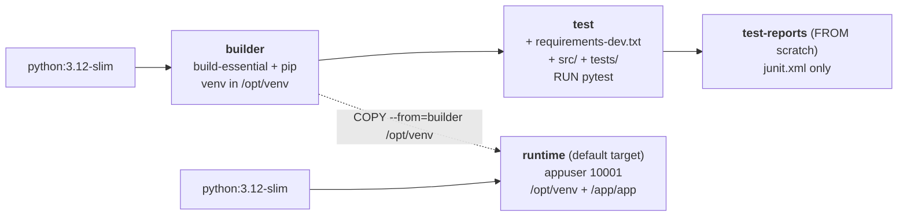
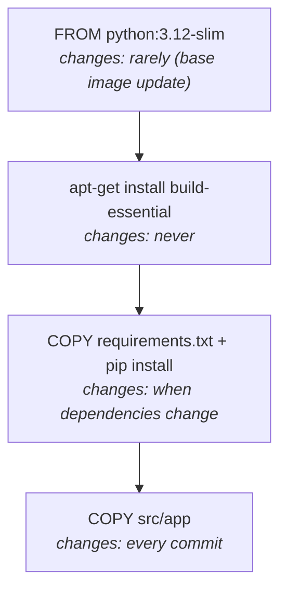
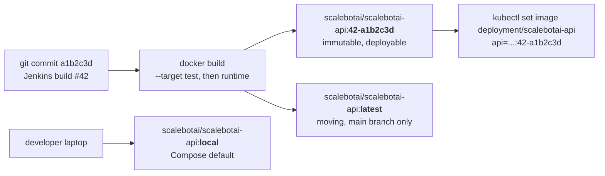
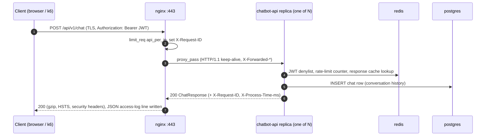
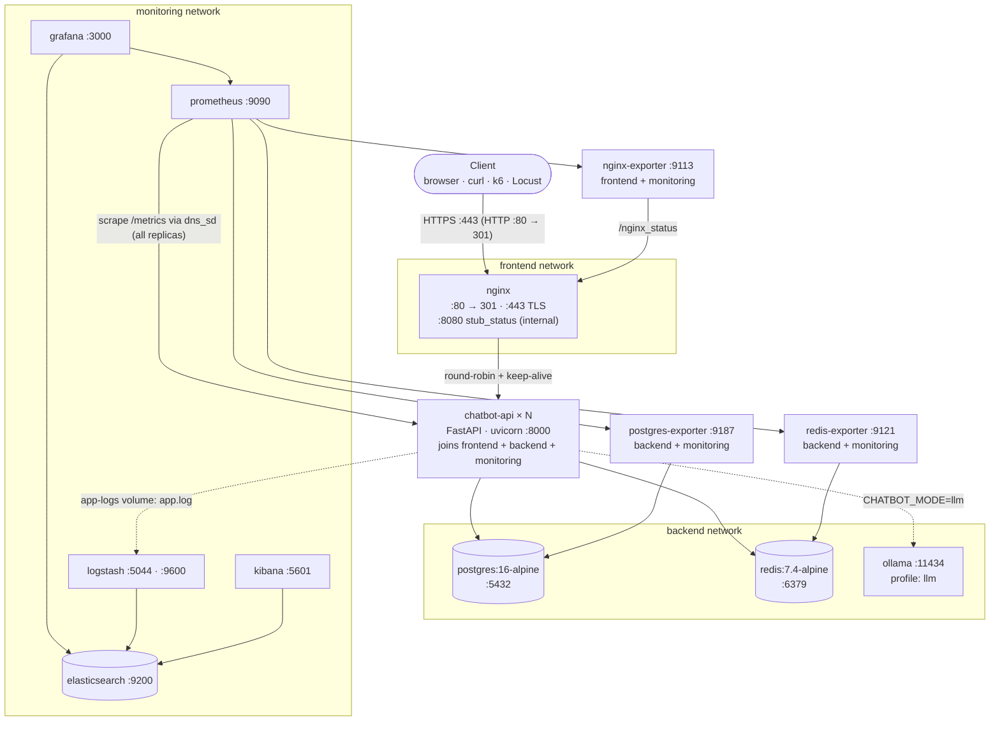
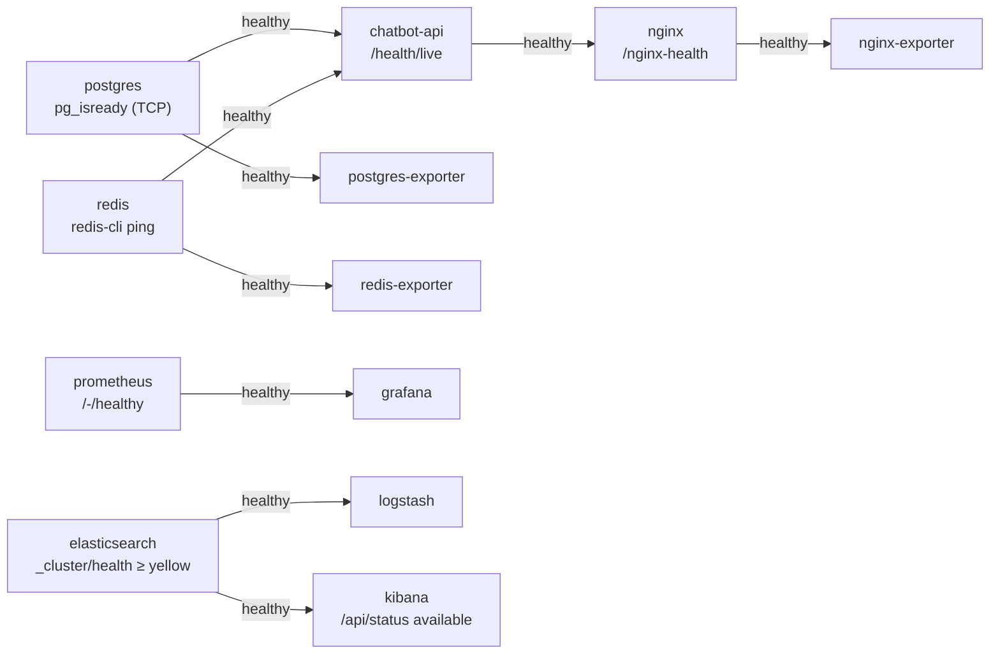
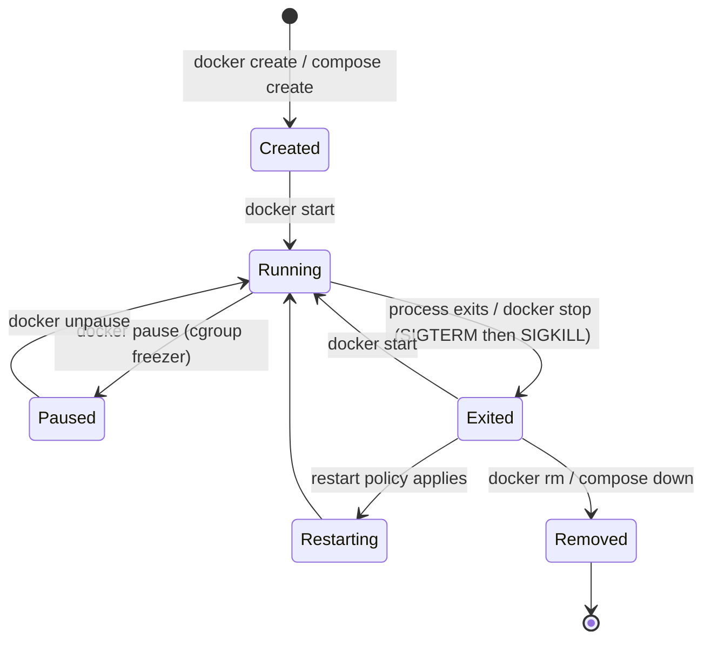

# Chapter 6 — Docker Implementation

> **Scope.** This chapter covers how ScaleBotAI is containerised and run as a multi-service stack with
> Docker Compose: the production API image, the NGINX edge image, PostgreSQL first-boot initialisation,
> the Compose architecture (networks, volumes, health-gated start-up, resource limits), and hands-on
> demonstrations of **Docker storage, networking, images and containers**. It ends with a
> step-by-step lab, a troubleshooting guide and Windows-specific notes.
>
> **Files covered:** `docker/api/Dockerfile`, `docker/nginx/{Dockerfile,nginx.conf,conf.d/scalebotai.conf,10-generate-self-signed-cert.sh}`,
> `docker/postgres/init/01-init.sql`, `docker-compose.yml`, `docker-compose.dev.yml`.

---

## 6.1 Objectives and how Docker meets them

| Requirement (from the problem statement) | Docker / Compose mechanism used |
|---|---|
| Identical runtime on laptop, CI and Kubernetes | One immutable image `scalebotai/scalebotai-api:<tag>` built once by CI and promoted unchanged |
| Fast, reproducible builds | Multi-stage Dockerfile, dependency-first layer ordering, BuildKit pip cache mount, pinned base images and requirements |
| Small attack surface | `python:3.12-slim` runtime with no compilers, non-root UID 10001, read-only root filesystem, `cap_drop: ALL`, `no-new-privileges` |
| Horizontal scale (100–500 concurrent requests) | Stateless API, one uvicorn process per container, `docker compose up --scale chatbot-api=N`, NGINX round-robin with runtime DNS re-resolution |
| 99.9 % availability | Health checks on every stateful service, `depends_on: condition: service_healthy`, restart policies, NGINX retry to the next replica |
| Observability | Prometheus + exporters, Grafana, ELK; the API log file is shared with Logstash through a named volume |
| Security in transit | NGINX TLS 1.2/1.3 termination, HTTP→HTTPS redirect, HSTS, rate limiting, `/metrics` blocked at the edge |
| Network least privilege | Three isolated user-defined bridge networks (`frontend`, `backend`, `monitoring`) |

---

## 6.2 Container inventory at a glance

```text
ROOT/
├── docker-compose.yml              # full stack (13 services, 3 networks, 7 named volumes)
├── docker-compose.dev.yml          # dev override: hot reload, DEBUG logs, API on 127.0.0.1:8000
└── docker/
    ├── api/Dockerfile              # multi-stage: builder → test → test-reports → runtime
    ├── nginx/
    │   ├── Dockerfile              # nginx:1.27.5-alpine + openssl + configs
    │   ├── nginx.conf              # workers, JSON log, gzip, rate-limit zones, security headers
    │   ├── conf.d/scalebotai.conf  # upstream, :80 redirect, :443 TLS, :8080 stub_status
    │   └── 10-generate-self-signed-cert.sh
    └── postgres/init/01-init.sql   # pg_stat_statements + read-only "monitoring" role
```

---

## 6.3 The API image — `docker/api/Dockerfile`

### 6.3.1 Stage graph



The build context is the repository root:

```bash
docker build -f docker/api/Dockerfile -t scalebotai/scalebotai-api:local .            # runtime (default)
docker build -f docker/api/Dockerfile --target test .                                 # CI: fails if tests fail
docker build -f docker/api/Dockerfile --target test-reports --output type=local,dest=reports .   # export junit.xml
```

BuildKit builds **only the stages the requested target depends on**, so a normal build never runs the
test stage, and the `test` build never produces a deployable image.

### 6.3.2 Walkthrough

| # | Instruction (abridged) | Stage | Why it is there |
|---|---|---|---|
| 1 | `# syntax=docker/dockerfile:1.7` | all | Pins the Dockerfile frontend so `RUN --mount=type=cache` and `COPY --chmod` work the same everywhere |
| 2 | `ARG PYTHON_IMAGE=python:3.12-slim` | global | Both stages **must** use the same base: the venv stores absolute paths to `/usr/local/bin/python3.12` |
| 3 | `apt-get install build-essential` (with apt cache mounts) | builder | Compilers for any package without a pre-built wheel. Exists only in the builder → 0 bytes in the final image |
| 4 | `python -m venv /opt/venv` | builder | One self-contained directory to copy into the runtime stage |
| 5 | `COPY requirements.txt .` **before** the source | builder | Layer-cache rule: editing `.py` files does not invalidate the slow `pip install` layer |
| 6 | `RUN --mount=type=cache,target=/root/.cache/pip pip install -r requirements.txt` | builder | Wheel cache persists between builds on the build host but is never stored in an image layer |
| 7 | `pip install -r requirements-dev.txt`, `COPY src tests pyproject.toml`, `RUN pytest` | test | Tests run inside the exact dependency set that ships; a red test aborts the build |
| 8 | `groupadd/useradd --uid 10001` + `mkdir /var/log/scalebotai` | runtime | Fixed numeric non-root identity (Kubernetes `runAsUser: 10001`); log dir owned by the app user |
| 9 | `COPY --from=builder /opt/venv /opt/venv` | runtime | Only installed packages cross the stage boundary — no gcc, pip cache, apt lists |
| 10 | `COPY src/app /app/app` | runtime | Code last (changes most often). Root-owned → the app cannot modify its own code |
| 11 | `ENV PYTHONDONTWRITEBYTECODE=1 PYTHONUNBUFFERED=1 PATH=/opt/venv/bin:$PATH` | runtime | No `.pyc` writes on a read-only FS; logs are flushed immediately to stdout; `uvicorn` on PATH |
| 12 | `EXPOSE 8000` | runtime | Documentation of the listening port (publishing is decided by Compose/k8s) |
| 13 | `HEALTHCHECK ... urllib ... /health/live` | runtime | Docker-level liveness without installing curl |
| 14 | `ARG VERSION VCS_REF BUILD_DATE` + `LABEL org.opencontainers.image.*` | runtime | Traceability (which commit is running?). Placed late so per-build values do not bust earlier layers |
| 15 | `USER 10001:10001` | runtime | Drop root; numeric so Kubernetes can verify `runAsNonRoot` |
| 16 | `CMD ["uvicorn","app.main:app","--host","0.0.0.0","--port","8000","--proxy-headers","--forwarded-allow-ips=*","--workers","1"]` | runtime | Exec form → uvicorn is PID 1 and receives SIGTERM for graceful shutdown |

### 6.3.3 Why multi-stage?

A single-stage image must contain everything needed to **build** the application (compilers, headers,
pip and its cache) in addition to what is needed to **run** it. Multi-stage builds separate those
concerns: the builder is thrown away and only `/opt/venv` and the source are copied into a fresh slim
base. Benefits:

1. **Size** — smaller images pull faster (faster scale-out and rollouts under HPA) and cost less to store.
2. **Security** — no compiler or package-manager cache for an attacker to use; fewer packages → fewer CVEs reported by Trivy.
3. **CI integration** — the `test` stage reuses the builder's cached dependency layer, so testing adds only seconds.
4. **Cache efficiency** — each stage caches independently.

### 6.3.4 Layer caching in practice



Docker reuses a cached layer only if that instruction **and every instruction before it** are
unchanged. Ordering from "rarely changes" to "changes on every commit" means a typical code-only commit
rebuilds just the final `COPY` (a few seconds). Proof:

```bash
docker build -f docker/api/Dockerfile -t scalebotai/scalebotai-api:local .     # first build: minutes
echo "# touch" >> src/app/__init__.py
docker build -f docker/api/Dockerfile -t scalebotai/scalebotai-api:local .     # pip layer shows CACHED
git checkout src/app/__init__.py
```

The `--mount=type=cache` mounts add a second level of caching: even when `requirements.txt` changes,
pip only downloads the wheels that are new. The cache lives in BuildKit's storage (`docker buildx du`),
not in any image layer.

### 6.3.5 Image size comparison

Approximate uncompressed sizes for `linux/amd64` as reported by `docker images` (exact numbers vary with
package versions and architecture — measure your own build with the commands in §6.10):

| Variant | What the final image contains | Approx. size |
|---|---|---|
| Single-stage on `python:3.12` (full Debian) | Full OS toolchain + headers + pip cache + deps + app | **≈ 1.1–1.2 GB** |
| Single-stage on `python:3.12-slim` + `build-essential` | Slim OS + gcc/make (~250 MB) + pip cache + deps + app | **≈ 450–550 MB** |
| **Multi-stage runtime (this project)** | Slim OS (~125 MB) + `/opt/venv` (~100 MB) + app (< 1 MB) | **≈ 230 MB** |
| Same, compressed on Docker Hub | — | **≈ 75–90 MB** |

The multi-stage image is roughly **55 % smaller than the slim single-stage build and about 80 % smaller
than the full-Debian build**, with identical runtime behaviour.

### 6.3.6 Running as non-root, with an immutable filesystem

* The process runs as `appuser` (UID/GID **10001**). A container escape or RCE starts unprivileged.
* Code under `/app/app` is owned by root and therefore read-only to the app.
* In Compose the container also gets `read_only: true`, `cap_drop: [ALL]` and `no-new-privileges`. The
  **only** writable paths are `/tmp` (a 64 MB tmpfs) and `/var/log/scalebotai` (the `app-logs` volume).
* `/var/log/scalebotai` is created in the image owned by 10001. When Compose mounts the **empty** named
  volume `app-logs` there, Docker copies the directory's ownership into the volume, so the non-root
  process can write `app.log` without any `chown` at start-up.

### 6.3.7 HEALTHCHECK vs. Kubernetes probes

`HEALTHCHECK` calls `GET http://127.0.0.1:8000/health/live` with Python's `urllib` (no curl in the
image). It checks **liveness only**: a database outage must not make Docker or Kubernetes restart
healthy API processes. Readiness (DB + Redis) lives at `/health/ready` and is used by Kubernetes'
`readinessProbe`. Kubernetes ignores `HEALTHCHECK` and uses the probes in `k8s/` instead.

### 6.3.8 PID 1, signals and graceful shutdown

With the exec-form `CMD [...]`, uvicorn **is** PID 1 and receives `SIGTERM` directly from
`docker stop`/kubelet. Uvicorn stops accepting connections, finishes in-flight requests and exits.
Compose sets `stop_grace_period: 30s` before escalating to `SIGKILL`. The shell form
(`CMD uvicorn ...`) would make `/bin/sh` PID 1, which does not forward signals — every stop would
hang for the full grace period and then kill requests mid-flight.

**One worker per container** (`--workers 1`) is deliberate: scaling is done by adding containers/pods,
which keeps Prometheus metrics single-process and lets the HPA make the scaling decisions.

### 6.3.9 Build arguments and OCI labels

| Build arg | Label | Example |
|---|---|---|
| `VERSION` | `org.opencontainers.image.version` | `1.0.0` |
| `VCS_REF` | `org.opencontainers.image.revision` | `a1b2c3d` |
| `BUILD_DATE` | `org.opencontainers.image.created` | `2026-10-06T10:15:00Z` |
| `VCS_URL` | `org.opencontainers.image.source` | repository URL |

```bash
docker image inspect scalebotai/scalebotai-api:local --format '{{json .Config.Labels}}'
```

### 6.3.10 Build context and `.dockerignore`

The context is the repository root, so the root `.dockerignore` keeps `.git`, virtualenvs, caches,
`.env`, `k8s/`, `docs/` and similar out of the context (faster uploads to the daemon, no secrets
baked in by accident). It must **not** exclude `src/`, `tests/`, `requirements*.txt` or
`pyproject.toml`, which the `test` stage needs. The NGINX image uses `docker/nginx/` as its own
context, so it is not affected by the root `.dockerignore`.

---

## 6.4 Image tagging strategy



| Tag | Produced by | Mutable? | Used for |
|---|---|---|---|
| `<BUILD_NUMBER>-<git-short-sha>` e.g. `42-a1b2c3d` | Jenkins, every build | **Never re-pushed** | Kubernetes deployments, rollbacks, audit ("what is running?") |
| `latest` | Jenkins, `main` branch only | Yes | Convenience pulls; **never** referenced by manifests |
| `local` | `docker compose build` (`IMAGE_TAG` unset) | Yes | Local development |
| `@sha256:<digest>` | Registry | Content-addressed | Strongest pinning (supply-chain hardening) |

* The repository prefix comes from `DOCKERHUB_USER` (default `scalebotai`); Compose uses
  `${DOCKERHUB_USER:-scalebotai}/scalebotai-api:${IMAGE_TAG:-local}`.
* The build number gives human ordering; the git SHA gives exact traceability back to the source.
* Rollback = redeploy an older immutable tag (or `kubectl rollout undo`) — no rebuild required.
* To run a CI-built image locally: `IMAGE_TAG=42-a1b2c3d docker compose up -d --no-build`.

---

## 6.5 The NGINX edge image

### 6.5.1 Responsibilities

| Feature | Where | Detail |
|---|---|---|
| HTTP → HTTPS | `:80` server | `301` to `https://$host$request_uri`; `/nginx-health` stays on HTTP for probes |
| TLS termination | `:443` server | TLS 1.2/1.3, Mozilla-intermediate ciphers, session cache, HTTP/2, HSTS (HTTPS only) |
| Self-signed cert | `10-generate-self-signed-cert.sh` | Created at first start if `/etc/nginx/certs/tls.{crt,key}` are missing; SANs `api.scalebotai.local`, `localhost`, `127.0.0.1` |
| Load balancing | `upstream scalebotai_api` | `server chatbot-api:8000 resolve` + `resolver 127.0.0.11 valid=10s`: every replica found via Docker DNS, re-resolved at runtime |
| Upstream keep-alive | `keepalive 64; keepalive_timeout 4s` | Re-uses TCP connections; 4 s < uvicorn's 5 s keep-alive to avoid races that cause 502s |
| Rate limiting | `limit_req_zone` | `api_per_ip` 50 r/s (burst 100), `auth_per_ip` 30 r/min (burst 20) for `/api/v1/auth/login` and `/register`, `limit_conn` per IP |
| Long LLM requests | `location = /api/v1/chat` | `proxy_read_timeout 60s` (the API falls back to rule mode after 20 s) |
| Correlation ID | `map $http_x_request_id $req_id` | Re-uses a valid incoming `X-Request-ID` or generates one; forwarded, logged and returned |
| Client IP | `X-Forwarded-For $remote_addr` | **Overwritten** at the edge so clients cannot spoof their IP to dodge the API's rate limit |
| Metrics protection | `location ^~ /metrics { deny all; }` | Prometheus scrapes the API directly over the `monitoring` network |
| JSON errors | `@rate_limited`, `@upstream_unavailable`, `@forbidden`, `location /` | NGINX-generated 403/404/429/503 use the API's error envelope |
| Structured logs | `log_format json_combined` | One JSON object per request including `upstream_addr`, `upstream_response_time`, `request_id` |
| Internal status | `:8080/nginx_status` | `stub_status` for nginx-prometheus-exporter; private IP ranges only; port never published |
| Hardening | `nginx.conf` | `server_tokens off`, nosniff, `X-Frame-Options DENY`, `Referrer-Policy`, `Permissions-Policy`, body-size and timeout limits |

### 6.5.2 Request flow



### 6.5.3 Why `resolve` matters for scaling

Plain `server chatbot-api:8000;` is resolved **once**, when NGINX starts. Replicas added later by
`--scale` would be ignored until a reload, and NGINX would refuse to start if the API container did
not exist yet. With `resolve` (open-source NGINX ≥ 1.27.3, hence the pinned `nginx:1.27.5-alpine`),
NGINX re-queries Docker's DNS every 10 s and updates the pool automatically.

---

## 6.6 PostgreSQL first-boot initialisation

`docker/postgres/init/` is bind-mounted read-only at `/docker-entrypoint-initdb.d`. The official image
runs those scripts **once**, only when the data directory (the `postgres-data` volume) is empty.
`01-init.sql`:

1. `CREATE EXTENSION pg_stat_statements` — per-query statistics. The library is preloaded by the server
   command (`-c shared_preload_libraries=pg_stat_statements`).
2. Creates a **read-only `monitoring` role** for postgres-exporter: member of `pg_monitor` (can read
   statistics views, not application data), `CONNECTION LIMIT 5`, `default_transaction_read_only = on`,
   `statement_timeout = 15s`. Its password comes from `POSTGRES_MONITORING_PASSWORD`; when that variable
   is not set, the documented placeholder `change-me-monitoring-password` is used.
3. Sets the database time zone to UTC.

It deliberately does **not** create the application tables. The API creates them at start-up
(`AUTO_CREATE_TABLES=true`) under a Postgres advisory lock, so several replicas starting together do
not race (see Chapter 4).

The server is tuned on the command line for a container with about 1 GB of memory: `max_connections=200`
(3 replicas × (pool 10 + overflow 20) = 90, plus headroom), `shared_buffers=256MB`,
`effective_cache_size=768MB`, `work_mem=4MB`, `random_page_cost=1.1` (SSD),
`log_min_duration_statement=500` (logs slow queries). `shm_size: 256mb` enlarges `/dev/shm` for
parallel-query workers.

---

## 6.7 Compose architecture

### 6.7.1 Architecture diagram (grouped by network)



### 6.7.2 Service catalogue

| Service | Image (pinned) | Host ports | Volumes | Networks | Purpose |
|---|---|---|---|---|---|
| `nginx` | built: `scalebotai/scalebotai-nginx:local` (from `nginx:1.27.5-alpine`) | `80`, `443` | tmpfs `/var/cache/nginx` | frontend | TLS edge, redirect, rate limit, load balancer |
| `chatbot-api` | built: `scalebotai/scalebotai-api:${IMAGE_TAG:-local}` | **none** | `app-logs` (rw), tmpfs `/tmp` | frontend, backend, monitoring | FastAPI chatbot (scalable) |
| `postgres` | `postgres:16-alpine` | none | `postgres-data`, bind `docker/postgres/init` (ro) | backend | System of record |
| `redis` | `redis:7.4-alpine` | none | `redis-data` | backend | Cache, rate limits, JWT denylist (AOF, 256 MB LRU) |
| `ollama` *(profile `llm`)* | `ollama/ollama:0.3.14` | none | `ollama-data` | backend | Local LLM (`tinyllama`) |
| `postgres-exporter` | `prometheuscommunity/postgres-exporter:v0.15.0` | none | — | backend, monitoring | `pg_*` metrics as the `monitoring` role |
| `redis-exporter` | `oliver006/redis_exporter:v1.62.0` | none | — | backend, monitoring | `redis_*` metrics |
| `nginx-exporter` | `nginx/nginx-prometheus-exporter:1.3.0` | none | — | frontend, monitoring | `nginx_*` metrics from stub_status |
| `prometheus` | `prom/prometheus:v2.55.1` | `127.0.0.1:9090` | `prometheus-data`, bind `monitoring/prometheus` (ro) | monitoring | Metrics TSDB (15 d), alert rules, lifecycle API |
| `grafana` | `grafana/grafana:11.3.1` | `127.0.0.1:3000` | `grafana-data`, bind provisioning + dashboards (ro) | monitoring | Dashboards |
| `elasticsearch` | `docker.elastic.co/elasticsearch/elasticsearch:8.15.3` | `127.0.0.1:9200` | `es-data` | monitoring | Log storage (single node, **security off, local only**) |
| `logstash` | `docker.elastic.co/logstash/logstash:8.15.3` | none | `app-logs` (**ro**), bind pipeline + `logstash.yml` (ro) | monitoring | Ships `app.log` (and Beats in k8s) into `scalebot-*-logs-*` |
| `kibana` | `docker.elastic.co/kibana/kibana:8.15.3` | `127.0.0.1:5601` | — | monitoring | Log search and visualisation |

Monitoring UIs bind to `127.0.0.1` by default (`MONITORING_BIND_ADDR`) because Prometheus (lifecycle
API) and Kibana/Elasticsearch (no authentication locally) must not be reachable from the LAN. Set
`MONITORING_BIND_ADDR=0.0.0.0` in `.env` only on a trusted network.

### 6.7.3 Network membership matrix

| Service | frontend | backend | monitoring |
|---|:-:|:-:|:-:|
| nginx | ✓ | | |
| chatbot-api | ✓ | ✓ | ✓ |
| postgres | | ✓ | |
| redis | | ✓ | |
| ollama | | ✓ | |
| postgres-exporter | | ✓ | ✓ |
| redis-exporter | | ✓ | ✓ |
| nginx-exporter | ✓ | | ✓ |
| prometheus, grafana, elasticsearch, logstash, kibana | | | ✓ |

Design choice: the **exporter joins `frontend`** rather than NGINX joining `monitoring`. The
internet-facing proxy therefore has no route to Prometheus' lifecycle API or to the unauthenticated
Elasticsearch.

### 6.7.4 Health-gated start-up order



`depends_on: {condition: service_healthy}` waits for the dependency's **health check**, not just for
the process to start. Example: `pg_isready -h 127.0.0.1` uses TCP on purpose, because during first-boot
initialisation the entrypoint runs a temporary socket-only server and a socket check would report
"ready" too early. Use `docker compose up -d --wait` to block until everything is healthy.

### 6.7.5 Resource limits and restart policies

| Service | CPU limit | Memory limit | Reservation | Notes |
|---|---|---|---|---|
| chatbot-api (each replica) | 1.0 | 512 MB | 0.25 CPU / 256 MB | Mirrors the k8s requests/limits |
| postgres | 2.0 | 1 GB | 256 MB | `shared_buffers=256MB`, `shm_size=256mb` |
| redis | 0.5 | 384 MB | 64 MB | 256 MB dataset + fork headroom for AOF rewrite |
| nginx | 0.5 | 128 MB | — | |
| elasticsearch | 2.0 | 1 GB | 512 MB | heap fixed at 512 MB (`ES_JAVA_OPTS`) |
| logstash | 1.0 | 1 GB | 512 MB | heap 512 MB (`LS_JAVA_OPTS`) |
| kibana | 1.0 | 1 GB | 512 MB | |
| prometheus | 1.0 | 1 GB | 256 MB | retention 15 d / 5 GB |
| grafana | 0.5 | 512 MB | — | |
| exporters | 0.25 | 64 MB | — | |
| ollama | 2.0 | 3 GB | — | optional GPU reservation (commented) |

Compose v2 enforces `deploy.resources` on plain `docker compose up` (no Swarm needed). Every service
uses `restart: unless-stopped` (see §6.11.4).

### 6.7.6 Compose techniques used

| Technique | Where | Benefit |
|---|---|---|
| `x-` extension fields + YAML anchors (`&service-defaults`, `<<: *service-defaults`) | `x-logging`, `x-service-defaults`, `x-healthcheck-defaults` | Restart policy, log rotation, `no-new-privileges` and health-check timings defined once |
| `name: scalebotai` | top level | Predictable names: `scalebotai-chatbot-api-1`, `scalebotai_backend`, `scalebotai_postgres-data` |
| `${VAR:?message}` interpolation | secrets (`POSTGRES_PASSWORD`, `REDIS_PASSWORD`, `GRAFANA_ADMIN_PASSWORD`) | Fails fast with a clear message if `.env` is missing |
| `${VAR:-default}` | image tags, `ELASTIC_VERSION`, bind address | Overridable without editing the file |
| `env_file: .env` + `environment:` | chatbot-api | App settings from `.env`; topology values (`POSTGRES_HOST=postgres`, `LOG_FILE`) forced by Compose |
| `profiles: ["llm"]` | ollama | Heavy optional service only starts with `--profile llm` |
| `read_only`, `tmpfs`, `cap_drop`, `security_opt` | chatbot-api, nginx | Container hardening |
| `ulimits`, `shm_size` | elasticsearch, nginx, postgres | Kernel-level limits that these servers need |
| `stop_grace_period` | chatbot-api (30 s), postgres (60 s) | Graceful shutdown and a clean database checkpoint |
| JSON-file log rotation (`max-size 10m`, `max-file 3`) | all | `docker logs` cannot fill the disk |
| Override file | `docker-compose.dev.yml` | Dev ergonomics without touching the production-like definition |

### 6.7.7 Compose ↔ Kubernetes mapping

| Compose concept | Kubernetes equivalent (Chapter 7) |
|---|---|
| service `chatbot-api` + `--scale` | Deployment `scalebotai-api` (`replicas: 3`) + HPA (3–20) |
| `nginx` container | ingress-nginx + Ingress `scalebotai-ingress` |
| healthcheck / `depends_on: service_healthy` | startup/liveness/readiness probes |
| `deploy.resources` | `resources.requests` / `resources.limits` |
| named volume `postgres-data` | PVC `postgres-data` (StatefulSet) |
| user-defined networks | Namespaces + NetworkPolicies |
| `.env` / `env_file` | ConfigMap `scalebotai-config` + Secret `scalebotai-secrets` |
| `app-logs` volume → Logstash | stdout → Filebeat DaemonSet → Logstash :5044 |
| `restart: unless-stopped` | `restartPolicy: Always` + controller reconciliation |

---

## 6.8 Demonstration — Docker storage

### 6.8.1 The three mount types

| Type | Lives in | Survives `down`? | Managed by | Used in ScaleBotAI for |
|---|---|---|---|---|
| **Named volume** | Docker's storage area (`/var/lib/docker/volumes/...`, inside the Docker Desktop VM on Windows/macOS) | Yes (only `down -v` deletes it) | Docker | Databases and any state that must persist or be shared |
| **Bind mount** | A host path (`./monitoring/prometheus`) | It is your host file | You | Configuration files kept in Git; live source code in dev |
| **tmpfs** | RAM | No (gone when the container stops) | Kernel | Scratch space, caches, read-only-root helpers |

### 6.8.2 What uses what, and why

| Mount | Type | Container path | Mode | Why this type |
|---|---|---|---|---|
| `postgres-data` | named | postgres `/var/lib/postgresql/data` | rw | Durable, Docker-managed, correct ownership; faster than a bind mount on Windows |
| `redis-data` | named | redis `/data` | rw | AOF file so the JWT denylist and counters survive restarts |
| `es-data` | named | elasticsearch `/usr/share/elasticsearch/data` | rw | Log indices |
| `prometheus-data` | named | prometheus `/prometheus` | rw | 15 days of metrics |
| `grafana-data` | named | grafana `/var/lib/grafana` | rw | Grafana DB, users, preferences |
| `app-logs` | named, **shared** | chatbot-api `/var/log/scalebotai` (rw) · logstash same path (**ro**) | rw / ro | Producer/consumer hand-off between containers; Logstash cannot tamper with logs |
| `ollama-data` | named | ollama `/root/.ollama` | rw | Models are large (~640 MB) — download once |
| `./docker/postgres/init` | bind | postgres `/docker-entrypoint-initdb.d` | ro | SQL versioned in Git |
| `./monitoring/prometheus` | bind | prometheus `/etc/prometheus` | ro | Edit + `POST /-/reload`, no rebuild |
| `./monitoring/grafana/provisioning`, `./monitoring/grafana/dashboards` | bind | grafana `/etc/grafana/provisioning`, `/var/lib/grafana/dashboards` | ro | Dashboards as code |
| `./monitoring/logstash/pipeline`, `.../config/logstash.yml` | bind (dir + single file) | logstash | ro | Pipeline as code (auto-reloaded) |
| `./src/app` *(dev override only)* | bind | chatbot-api `/app/app` | ro | Hot reload while coding |
| `/tmp` 64 MB | tmpfs | chatbot-api | rw | The only scratch space on a read-only root FS |
| `/var/cache/nginx` 64 MB | tmpfs | nginx | rw | Proxy temp files in RAM |
| `/dev/shm` 256 MB (`shm_size`) | tmpfs (IPC) | postgres | rw | Shared memory for parallel queries |

### 6.8.3 Commands

```bash
# List and inspect the project's volumes
docker volume ls --filter label=com.docker.compose.project=scalebotai
docker volume inspect scalebotai_postgres-data          # Mountpoint, labels, driver
docker system df -v | sed -n '/VOLUME NAME/,/^$/p'      # size per volume

# Persistence proof: data survives container removal
INSECURE=1 bash scripts/smoke_test.sh https://localhost         # creates data
docker compose down                                             # containers + networks removed
docker compose up -d --wait
docker compose exec postgres psql -U scalebot -d scalebotai -c "SELECT count(*) FROM users;"   # still there
# docker compose down -v   <- would ALSO delete the volumes (all data)

# Shared volume: written by the API, read (read-only) by Logstash
docker compose exec chatbot-api sh -c 'ls -ln /var/log/scalebotai && tail -n 1 /var/log/scalebotai/app.log'
docker compose exec logstash tail -n 1 /var/log/scalebotai/app.log
docker compose exec logstash touch /var/log/scalebotai/x        # -> Read-only file system

# tmpfs and the read-only root filesystem
docker compose exec chatbot-api df -h /tmp                      # Filesystem: tmpfs, Size 64M
docker compose exec chatbot-api touch /app/hack.txt             # -> Read-only file system
docker compose exec postgres df -h /dev/shm                     # 256M

# Bind mount: edit config on the host, reload without restarting
curl -X POST http://localhost:9090/-/reload
```

### 6.8.4 Backing up and restoring volumes

**Logical backup (recommended for PostgreSQL)** — consistent and works while the database is running:

```bash
mkdir -p backups
docker compose exec -T postgres pg_dump -U scalebot -d scalebotai -Fc > backups/scalebotai-$(date +%F).dump
# restore
docker compose exec -T postgres pg_restore -U scalebot -d scalebotai --clean --if-exists < backups/scalebotai-YYYY-MM-DD.dump
```

**Raw volume backup with a throwaway container** — works for any volume. Stop the writer first so the
files are consistent:

```bash
docker compose stop postgres
docker run --rm \
  -v scalebotai_postgres-data:/source:ro \
  -v "$(pwd)/backups":/backup \
  alpine:3.20 tar czf /backup/postgres-data-$(date +%Y%m%d-%H%M).tar.gz -C /source .
docker compose start postgres

# restore into the (stopped) volume
docker compose stop postgres
docker run --rm \
  -v scalebotai_postgres-data:/target \
  -v "$(pwd)/backups":/backup \
  alpine:3.20 sh -c "rm -rf /target/* && tar xzf /backup/postgres-data-YYYYMMDD-HHMM.tar.gz -C /target"
docker compose start postgres
```

The `alpine` container exists only to mount both the volume and a host folder, then it is removed
(`--rm`). The same pattern backs up `grafana-data`, `redis-data` and others. On Git Bash for Windows,
prefix these commands with `MSYS_NO_PATHCONV=1` (see §6.15).

---

## 6.9 Demonstration — Docker networking

### 6.9.1 Concepts

* **User-defined bridge networks** (`frontend`, `backend`, `monitoring`) give each container a private
  IP on a virtual switch, plus **automatic service discovery**. The legacy default `bridge` network has
  no DNS.
* **Embedded DNS at `127.0.0.11`**: every container's `/etc/resolv.conf` points to it. It answers
  service names (`postgres`), container names and aliases. For a scaled service it returns **one A
  record per replica** — this is what both NGINX (`resolve`) and Prometheus (`dns_sd_configs`) rely on.
* **Isolation**: containers on different networks cannot resolve or reach each other. A multi-homed
  container (chatbot-api) is the only bridge between tiers, and it does not route packets between them.
* **Published ports** (`ports:`) are the only way in from the host. The API has none: it is reachable
  only through NGINX.

### 6.9.2 Commands — inspect the topology

```bash
docker network ls --filter label=com.docker.compose.project=scalebotai
docker network inspect scalebotai_backend \
  --format '{{range .Containers}}{{.Name}}  {{.IPv4Address}}{{"\n"}}{{end}}'
docker compose exec chatbot-api cat /etc/resolv.conf            # nameserver 127.0.0.11
docker compose exec nginx nslookup chatbot-api 127.0.0.11        # one address per replica
```

### 6.9.3 Proof of isolation

```bash
# 1) The API (backend member) CAN reach postgres
docker compose exec chatbot-api python -c \
  "import socket; socket.create_connection(('postgres', 5432), 3); print('chatbot-api -> postgres:5432 OK')"

# 2) NGINX (frontend only) cannot even RESOLVE postgres
docker compose exec nginx nslookup postgres 127.0.0.11           # ** server can't find postgres: NXDOMAIN
docker compose exec nginx nc -zv -w 3 postgres 5432               # nc: bad address 'postgres'

# 3) ... and cannot reach it even when given the IP address directly
PG_IP=$(docker inspect -f '{{range .NetworkSettings.Networks}}{{.IPAddress}}{{end}}' scalebotai-postgres-1)
docker compose exec nginx nc -zv -w 3 "$PG_IP" 5432               # times out: no route between bridges

# 4) Prometheus (monitoring only) cannot reach redis directly - only via redis-exporter
docker compose exec prometheus wget -q -T 3 -O- http://redis:6379 # wget: bad address 'redis'
docker compose exec prometheus wget -q -T 3 -O- http://redis-exporter:9121/metrics | head -3   # works

# 5) The internal stub_status port is NOT published to the host ...
curl -m 3 http://localhost:8080/nginx_status                      # connection refused
#    ... but the exporter (frontend + monitoring) reads it and Prometheus scrapes the exporter
docker compose exec prometheus wget -q -O- http://nginx-exporter:9113/metrics | grep '^nginx_up'   # nginx_up 1
```

| From \ To | nginx | chatbot-api | postgres | redis | prometheus | elasticsearch |
|---|:-:|:-:|:-:|:-:|:-:|:-:|
| **host** | 80/443 | ✗ | ✗ | ✗ | 127.0.0.1:9090 | 127.0.0.1:9200 |
| **nginx** | — | ✓ | ✗ | ✗ | ✗ | ✗ |
| **chatbot-api** | ✓ | ✓ | ✓ | ✓ | ✓ | ✓ |
| **prometheus** | ✗ | ✓ | ✗ | ✗ | — | ✓ |
| **postgres** | ✗ | ✓ | — | ✓ | ✗ | ✗ |

Hardening option: mark `backend` as `internal: true` to remove its outbound internet access. It is not
enabled by default because `ollama pull` needs to download models over that network.

---

## 6.10 Demonstration — Docker images

```bash
# Build with traceability metadata
docker build -f docker/api/Dockerfile \
  --build-arg VERSION=1.0.0 \
  --build-arg VCS_REF="$(git rev-parse --short HEAD)" \
  --build-arg BUILD_DATE="$(date -u +%Y-%m-%dT%H:%M:%SZ)" \
  -t scalebotai/scalebotai-api:local .

# Same via Compose (builds both custom images: api + nginx); --pull refreshes base images
docker compose build --pull

# CI-style test build and report export
docker build -f docker/api/Dockerfile --target test .
docker build -f docker/api/Dockerfile --target test-reports --output type=local,dest=reports .

# Inspect
docker images scalebotai/scalebotai-api                       # size
docker history scalebotai/scalebotai-api:local                # one row per layer, with size
docker image inspect scalebotai/scalebotai-api:local \
  --format 'User={{.Config.User}}  Cmd={{json .Config.Cmd}}  Ports={{json .Config.ExposedPorts}}'
docker image inspect scalebotai/scalebotai-api:local --format '{{json .Config.Labels}}'
docker image inspect scalebotai/scalebotai-api:local --format '{{json .Config.Healthcheck}}'

# Prove the security properties
docker run --rm scalebotai/scalebotai-api:local id                       # uid=10001(appuser) gid=10001(appuser)
docker run --rm scalebotai/scalebotai-api:local sh -c 'command -v gcc || echo "no compiler in runtime image"'

# Tag and push to Docker Hub (Jenkins does exactly this)
export DOCKERHUB_USER=your-dockerhub-user
TAG="${BUILD_NUMBER:-1}-$(git rev-parse --short HEAD)"
docker login -u "$DOCKERHUB_USER"
docker tag scalebotai/scalebotai-api:local "$DOCKERHUB_USER/scalebotai-api:$TAG"
docker tag scalebotai/scalebotai-api:local "$DOCKERHUB_USER/scalebotai-api:latest"
docker push "$DOCKERHUB_USER/scalebotai-api:$TAG"
docker push "$DOCKERHUB_USER/scalebotai-api:latest"
docker image inspect "$DOCKERHUB_USER/scalebotai-api:$TAG" --format '{{index .RepoDigests 0}}'   # immutable digest

# Multi-architecture build (Apple Silicon / ARM cloud nodes)
docker buildx build --platform linux/amd64,linux/arm64 -f docker/api/Dockerfile \
  -t "$DOCKERHUB_USER/scalebotai-api:$TAG" --push .

# Vulnerability scan (the CI "Security Scan" stage)
trivy image --severity HIGH,CRITICAL "$DOCKERHUB_USER/scalebotai-api:$TAG"

# Housekeeping
docker system df                      # images / containers / volumes / build cache usage
docker image prune -f                 # dangling (untagged) images
docker image prune -a --filter "until=168h"   # unused images older than 7 days
docker builder prune --filter "until=168h"    # old build cache
```

---

## 6.11 Demonstration — Docker containers

### 6.11.1 Lifecycle



### 6.11.2 Everyday commands

```bash
docker compose ps                                   # state + health of every service
docker compose ps --format 'table {{.Name}}\t{{.Status}}\t{{.Ports}}'
docker compose logs -f --tail=50 chatbot-api        # JSON log lines from stdout
docker compose logs nginx --since 5m --no-log-prefix
docker compose exec chatbot-api id                  # uid=10001(appuser)
docker compose exec chatbot-api sh                  # interactive shell (exit with Ctrl-D)
docker compose top chatbot-api                      # processes inside
docker stats --no-stream --format 'table {{.Name}}\t{{.CPUPerc}}\t{{.MemUsage}}\t{{.MemPerc}}\t{{.PIDs}}'
docker inspect --format '{{json .State.Health}}' scalebotai-chatbot-api-1      # last health-check results

# Pause a dependency and watch the API degrade gracefully, then recover
docker compose pause redis
curl -sk https://localhost/health                   # HTTP 200, "status":"degraded" - Redis is fail-open, API still serves
docker compose unpause redis

docker compose stop chatbot-api      # graceful stop (SIGTERM, 30 s grace)
docker compose start chatbot-api
docker compose restart nginx
docker compose down                  # remove containers + networks (volumes kept)
```

### 6.11.3 Resource limits in action

```bash
docker inspect scalebotai-chatbot-api-1 --format 'CPU={{.HostConfig.NanoCpus}} Mem={{.HostConfig.Memory}}'
# CPU=1000000000 Mem=536870912   (1 CPU, 512 MiB) - exceeding memory -> OOM-kill (exit code 137) -> restart
```

### 6.11.4 Restart policies

| Policy | Restarts on crash | Restarts after Docker/host reboot | Restarts after manual `stop` | Typical use |
|---|:-:|:-:|:-:|---|
| `no` (default) | ✗ | ✗ | ✗ | One-off jobs |
| `on-failure[:N]` | only non-zero exit | ✓ | ✗ | Batch workers |
| `always` | ✓ | ✓ | ✓ (after a daemon restart) | Rarely: surprising after manual stops |
| **`unless-stopped`** (all ScaleBotAI services) | ✓ | ✓ | ✗ | Long-running services |

Demonstration — make the API process exit from the inside and watch Docker restart it:

```bash
docker inspect -f 'policy={{.HostConfig.RestartPolicy.Name}} restarts={{.RestartCount}}' scalebotai-chatbot-api-1
docker compose exec chatbot-api python -c "import os, signal; os.kill(1, signal.SIGTERM)"
sleep 5
docker inspect -f 'policy={{.HostConfig.RestartPolicy.Name}} restarts={{.RestartCount}}' scalebotai-chatbot-api-1   # restarts +1
docker events --filter container=scalebotai-chatbot-api-1 --since 2m --until "$(date +%s)"                 # die -> start
```

`docker stop`/`docker kill` count as a *manual* stop, so they do **not** trigger the policy. That is why
the demo terminates PID 1 from inside the container.

### 6.11.5 Horizontal scaling with NGINX round-robin

`chatbot-api` has no `container_name` and no host port, so Compose can run several identical replicas:

```bash
docker compose up -d --scale chatbot-api=3 --no-recreate
docker compose ps chatbot-api                         # scalebotai-chatbot-api-1, -2, -3 (healthy)
docker compose exec nginx nslookup chatbot-api 127.0.0.11   # three addresses
```

NGINX picks up the new addresses within 10 s (`resolve`), and Prometheus' DNS discovery adds three
`scalebotai-api` targets (http://localhost:9090/targets). There is no reload or configuration change.

**Proof 1 — the API reports which container served each request** (`/api/v1/admin/system` returns the
container hostname, which defaults to the short container ID):

```bash
ADMIN_PASSWORD=$(grep '^ADMIN_PASSWORD=' .env | cut -d= -f2-)
TOKEN=$(curl -sk https://localhost/api/v1/auth/login \
  -H 'Content-Type: application/json' \
  -d "{\"username\":\"admin\",\"password\":\"${ADMIN_PASSWORD}\"}" \
  | sed -E 's/.*"access_token":"([^"]+)".*/\1/')

for i in $(seq 1 9); do
  curl -sk https://localhost/api/v1/admin/system -H "Authorization: Bearer $TOKEN" \
    | grep -o '"hostname":"[^"]*"'
done | sort | uniq -c
#   3 "hostname":"0c9f5a1e2b3d"
#   3 "hostname":"5e7d1c2a9f40"
#   3 "hostname":"a41b8e6f0d12"

docker compose ps -q chatbot-api | cut -c1-12         # the same three IDs
```

The same JWT works on every replica. The API is **stateless**: the token is verified with the shared
`JWT_SECRET_KEY`, and the logout denylist lives in Redis. That is what makes horizontal scaling safe.

**Proof 2 — no authentication needed: count `upstream_addr` in NGINX's JSON access log**

```bash
for i in $(seq 1 30); do curl -sk -o /dev/null https://localhost/health; done
docker compose logs nginx --since 1m --no-log-prefix | grep -o '"upstream_addr":"[^"]*"' | sort | uniq -c
#  10 "upstream_addr":"172.20.0.5:8000"
#  10 "upstream_addr":"172.20.0.6:8000"
#  10 "upstream_addr":"172.20.0.7:8000"
docker network inspect scalebotai_frontend --format '{{range .Containers}}{{.Name}} {{.IPv4Address}}{{"\n"}}{{end}}'
```

**Proof 3 — zero-downtime resilience**: while a load loop runs, stop one replica.
`proxy_next_upstream` retries idempotent requests on another replica, and `max_fails` takes the dead
peer out of rotation:

```bash
( for i in $(seq 1 200); do curl -sk -o /dev/null -w '%{http_code}\n' https://localhost/health; sleep 0.05; done ) | sort | uniq -c &
docker stop scalebotai-chatbot-api-2 && sleep 5 && docker start scalebotai-chatbot-api-2
wait                                                    # expect (almost) only 200s
```

Scale back with `docker compose up -d --scale chatbot-api=1`. Do not combine `--scale` with the dev
override, which publishes the fixed host port 8000.

---

## 6.12 Lab — run ScaleBotAI locally (step by step)

**Prerequisites:** Docker Desktop (Windows/macOS) or Docker Engine (Linux) with Compose v2
(`docker compose version`), at least **8 GB RAM assigned to Docker** for the full stack (about 4 GB
without ELK), ports 80/443/3000/5601/9090/9200 free, and Git.

1. **Clone and configure**
   ```bash
   git clone <repo-url> scalebotai && cd scalebotai
   cp .env.example .env              # PowerShell: Copy-Item .env.example .env
   ```
   Edit `.env` and replace every `change-me-...` value: `POSTGRES_PASSWORD`, `REDIS_PASSWORD`,
   `JWT_SECRET_KEY` (e.g. `python -c "import secrets; print(secrets.token_urlsafe(48))"`),
   `ADMIN_PASSWORD`, `GRAFANA_ADMIN_PASSWORD`. Optionally set `POSTGRES_MONITORING_PASSWORD`.

2. **Windows only:** set `vm.max_map_count` for Elasticsearch (§6.15).

3. **Build and start**
   ```bash
   docker compose up -d --build
   docker compose ps                 # wait for (healthy); Kibana takes 1-2 minutes
   # or block until healthy:  docker compose up -d --build --wait
   ```
   On a low-memory laptop, start only the core path: `docker compose up -d --build nginx`
   (this also starts chatbot-api, postgres and redis through `depends_on`).

4. **Smoke test**
   ```bash
   curl -k https://localhost/health
   INSECURE=1 bash scripts/smoke_test.sh https://localhost
   ```
   Manual chat:
   ```bash
   curl -sk https://localhost/api/v1/auth/register -H 'Content-Type: application/json' \
     -d '{"username":"student1","email":"student1@example.com","password":"Passw0rd123"}'
   TOKEN=$(curl -sk https://localhost/api/v1/auth/login -H 'Content-Type: application/json' \
     -d '{"username":"student1","password":"Passw0rd123"}' | sed -E 's/.*"access_token":"([^"]+)".*/\1/')
   curl -sk https://localhost/api/v1/chat -H "Authorization: Bearer $TOKEN" \
     -H 'Content-Type: application/json' -d '{"message":"How do Docker volumes work?"}'
   ```

5. **Open the dashboards**

   | UI | URL | Login |
   |---|---|---|
   | API through NGINX | https://localhost/health · https://localhost/docs (if enabled by the app) | JWT for `/api/v1/*` |
   | Grafana | http://localhost:3000 → folder *ScaleBotAI* | `admin` / `GRAFANA_ADMIN_PASSWORD` |
   | Prometheus | http://localhost:9090/targets | none (localhost only) |
   | Kibana | http://localhost:5601 → Discover | none (security disabled locally) |
   | Elasticsearch | http://localhost:9200/_cat/indices?v | none |

   Create the Kibana data views once: `bash monitoring/kibana/create-data-views.sh`.

6. **Optional — LLM mode with Ollama + tinyllama**
   ```bash
   docker compose --profile llm up -d ollama
   docker compose exec ollama ollama pull tinyllama        # ~640 MB, stored in the ollama-data volume
   docker compose exec ollama ollama list
   # set CHATBOT_MODE=llm in .env (optionally COMPOSE_PROFILES=llm so later commands include ollama)
   docker compose --profile llm up -d                       # recreates chatbot-api with the new env
   curl -sk https://localhost/api/v1/bot/info -H "Authorization: Bearer $TOKEN"   # "mode":"llm","llm_available":true
   ```
   On CPU, tinyllama answers in a few seconds. If Ollama exceeds `OLLAMA_TIMEOUT_SECONDS` (20 s), the
   reply comes from the rule engine with `bot_mode: "rule-fallback"`.

7. **Scale out** (§6.11.5): `docker compose up -d --scale chatbot-api=3`.

8. **Tear down**
   ```bash
   docker compose --profile llm down        # keep data (volumes)
   docker compose --profile llm down -v     # ALSO delete all data volumes (fresh start)
   ```

### 6.12.1 Development workflow (hot reload)

```bash
docker compose -f docker-compose.yml -f docker-compose.dev.yml up -d --build
docker compose -f docker-compose.yml -f docker-compose.dev.yml logs -f chatbot-api
# edit src/app/...py -> "WatchFiles detected changes ... Reloading" -> test at http://127.0.0.1:8000/docs
```

The override bind-mounts `./src/app` over the baked-in code, runs `uvicorn --reload` with
`WATCHFILES_FORCE_POLLING=true` (file events do not cross from the Windows filesystem into the Linux
VM), sets `LOG_LEVEL=DEBUG`/`APP_ENV=development`, and publishes the API on `127.0.0.1:8000`. Only a
change to `requirements.txt` needs a rebuild.

---

## 6.13 Troubleshooting

| Symptom | Likely cause | Fix |
|---|---|---|
| `required variable POSTGRES_PASSWORD is missing a value` / `env file .env not found` | `.env` not created | `cp .env.example .env` and fill in the secrets |
| `Bind for 0.0.0.0:80 failed: port is already allocated` | IIS/W3SVC, Skype, another web server or another stack on 80/443 | Stop it (§6.15) or change the mapping, e.g. `"8443:443"`, and browse `https://localhost:8443` |
| elasticsearch exits; log says `max virtual memory areas vm.max_map_count [65530] is too low` | Kernel setting in the Docker VM | `docker run --rm --privileged alpine sysctl -w vm.max_map_count=262144` (persistent fix in §6.15) |
| elasticsearch/logstash/kibana `Exited (137)` | OOM — Docker has too little memory | Give Docker ≥ 8 GB, or run without ELK (`docker compose up -d nginx prometheus grafana`) |
| `/usr/bin/env: 'bash\r': No such file or directory` | Script checked out with CRLF line endings | `git config --global core.autocrlf input`, re-clone; the NGINX Dockerfile already strips CR from its script |
| Browser shows `NET::ERR_CERT_AUTHORITY_INVALID` | Self-signed certificate | Expected locally: use `curl -k`, click through, or trust the cert (§6.15) |
| Only one `chatbot-api` replica left after starting a service that depends on it (e.g. `docker compose up -d nginx-exporter`) | `up` also reconciles the dependencies it starts (nginx-exporter → nginx → chatbot-api) to their default scale of 1 | Name the API and repeat the scale: `docker compose up -d --scale chatbot-api=3 chatbot-api nginx-exporter` (`--scale` without `chatbot-api` in the list fails with `no such service: chatbot-api: disabled`). Prometheus re-discovers replicas within 30 s |
| `502`/`503 SERVICE_UNAVAILABLE` JSON from NGINX | No healthy API replica | `docker compose ps`, `docker compose logs chatbot-api` (DB credentials? Redis password?) |
| chatbot-api unhealthy: `password authentication failed for user "scalebot"` | `postgres-data` was initialised with an older password; changing `.env` does not change an existing DB | `docker compose exec postgres psql -U scalebot -c "ALTER USER scalebot PASSWORD '...'"`, or `docker compose down -v` (deletes data) |
| postgres-exporter: `password authentication failed for user "monitoring"` | Init script ran with a different `POSTGRES_MONITORING_PASSWORD` (it only runs on first boot) | `ALTER ROLE monitoring PASSWORD '...'` to match, then `docker compose restart postgres-exporter` |
| `429 RATE_LIMITED` during k6/Locust runs | Every request from the host shares one source IP (the Docker gateway) | Add the gateway/CIDR to the `geo $rate_limit_exempt` block in `nginx.conf` and raise `RATE_LIMIT_PER_MINUTE` in `.env` |
| Kibana: "Kibana server is not ready yet" | Still starting, or ES not healthy | Wait 1–2 min; `docker compose logs elasticsearch kibana` |
| No logs in Kibana | `app.log` not written, data view missing | `docker compose exec logstash ls -l /var/log/scalebotai`; check `LOG_FILE`; run `create-data-views.sh`; `curl localhost:9200/_cat/indices/scalebot-*` |
| Duplicate log events after recreating logstash | Logstash's read position (sincedb) lives in the container's writable layer | Expected after `docker compose up` recreates logstash; avoid recreating it during demos |
| Prometheus shows only 1 API target after scaling | DNS refresh interval not yet elapsed | Wait ~15 s, refresh `/targets` |
| Hot reload does nothing (dev override) | File-change events do not reach the container | Keep `WATCHFILES_FORCE_POLLING=true`; move the repo out of OneDrive / into WSL |
| `ports are not available` for 8000 with the dev override and `--scale` | Fixed host port cannot be shared | Do not scale with the dev override |
| `docker compose exec ollama ollama pull` hangs | No internet from the VM, proxy, or low disk space | Check `docker compose logs ollama`; set `HTTPS_PROXY` for the ollama service if behind a proxy |
| Disk filling up | Images, build cache, logs, volumes | `docker system df`; `docker image prune -a`, `docker builder prune`; compact the Docker Desktop VHDX |

---

## 6.14 Security checklist (Docker layer)

| Control | Implementation |
|---|---|
| Minimal base, no build tools in runtime | Multi-stage `python:3.12-slim`; compilers only in `builder` |
| Non-root | `USER 10001:10001`; NGINX workers run as `nginx` |
| Immutable container FS | `read_only: true` + tmpfs `/tmp` (chatbot-api) |
| No privilege escalation / capabilities | `security_opt: no-new-privileges:true` (all), `cap_drop: [ALL]` (API) |
| Secrets not baked into images | `.env` excluded by `.dockerignore`; injected at runtime via `env_file`/`environment` (k8s: Secret) |
| Fail fast on missing secrets | `${VAR:?message}` interpolation |
| Least-privilege networking | 3 isolated networks; API and DBs have no published ports; monitoring UIs bound to 127.0.0.1 |
| TLS + headers + rate limiting | NGINX edge (§6.5) |
| Read-only DB monitoring | `monitoring` role (`pg_monitor`, read-only transactions) |
| Pinned versions | Every image pinned to a specific version; Python deps pinned in `requirements.txt` |
| Vulnerability scanning | `trivy image` in the CI pipeline (Chapter 8) |
| Log hygiene | JSON-file rotation 3 × 10 MB per container |
| Local-only shortcuts clearly marked | Elasticsearch/Kibana security disabled **for local development only** |

---

## 6.15 Windows notes

1. **Docker Desktop with the WSL 2 backend** is required. Limit or raise its resources in
   `%UserProfile%\.wslconfig`:
   ```ini
   [wsl2]
   memory=8GB
   processors=4
   # persistent fix for Elasticsearch
   kernelCommandLine = "sysctl.vm.max_map_count=262144"
   ```
   Then run `wsl --shutdown` in PowerShell and restart Docker Desktop.
2. **`vm.max_map_count=262144` for Elasticsearch.** A one-off fix that lasts until Docker Desktop
   restarts (`vm.*` is not namespaced, so this changes the VM kernel):
   ```powershell
   docker run --rm --privileged alpine sysctl -w vm.max_map_count=262144
   docker run --rm alpine sysctl vm.max_map_count          # verify
   # alternative: wsl -d docker-desktop -u root sysctl -w vm.max_map_count=262144
   ```
3. **Line endings.** Shell scripts and configs must be LF. Use `git config --global core.autocrlf input`
   before cloning, or add `*.sh text eol=lf` to `.gitattributes`. Files bind-mounted into containers
   (SQL, Prometheus and Logstash configs) are used as-is.
4. **OneDrive and paths with spaces.** A repository under `OneDrive\Desktop` works, but OneDrive
   "Files On-Demand" can lock or offload files, and bind mounts from the Windows filesystem are slow.
   For daily work, clone into `C:\dev\scalebotai` or, faster, into the WSL filesystem
   (`\\wsl$\Ubuntu\home\<you>\scalebotai`). Always quote paths that contain spaces
   (`"C:\Users\Lokesh Deshwal\..."`).
5. **Git Bash path conversion.** Git Bash rewrites arguments such as `/backup` into Windows paths.
   Prefix Docker commands that contain container paths with `MSYS_NO_PATHCONV=1`, e.g.
   `MSYS_NO_PATHCONV=1 docker run --rm -v scalebotai_postgres-data:/source:ro ...`, or run them in
   WSL/PowerShell.
6. **PowerShell differences.** In Windows PowerShell 5.1, `curl` is an alias for `Invoke-WebRequest`;
   use `curl.exe -k https://localhost/health`. Use `${PWD}` instead of `$(pwd)` and
   `Copy-Item .env.example .env` instead of `cp`.
7. **Port 80/443 conflicts.** Find the owner with `netstat -ano | findstr ":80 "` and then
   `tasklist /FI "PID eq <pid>"`. PID 4 ("System") means HTTP.sys/IIS: stop `W3SVC` (`net stop w3svc`
   as Administrator) or remap the ports in `docker-compose.yml`.
8. **Friendly hostname.** Add `127.0.0.1 api.scalebotai.local` to
   `C:\Windows\System32\drivers\etc\hosts` (Notepad as Administrator) and browse
   `https://api.scalebotai.local` (the certificate's SAN already includes it).
9. **Trusting the self-signed certificate (optional, dev only):**
   ```powershell
   docker compose cp nginx:/etc/nginx/certs/tls.crt .\scalebotai-local.crt
   Import-Certificate -FilePath .\scalebotai-local.crt -CertStoreLocation Cert:\CurrentUser\Root
   ```
   The certificate is regenerated when the nginx container is re-created; remove the old one from
   `certmgr.msc` when you are done.
10. **Firewall prompt.** Allow "Docker Desktop Backend" on private networks when Windows asks.

---

## 6.16 Summary

* The API ships as a **≈ 230 MB multi-stage, non-root, read-only** image whose tests run inside the
  build, tagged immutably as `<build>-<sha>` and promoted unchanged from CI to Kubernetes.
* NGINX provides a production-style edge: TLS, redirect, rate limiting, JSON logs, security headers and
  **runtime DNS-based load balancing**, so `--scale chatbot-api=N` works without configuration changes.
* Compose wires 13 services across **three isolated networks** and **seven named volumes**, with
  health-gated start-up, resource limits, restart policies and an optional LLM profile.
* The demonstrations in §6.8–§6.11 show storage persistence, backup and restore, network isolation,
  image inspection and publishing, container lifecycle, restart policies and round-robin scaling with
  real commands.
