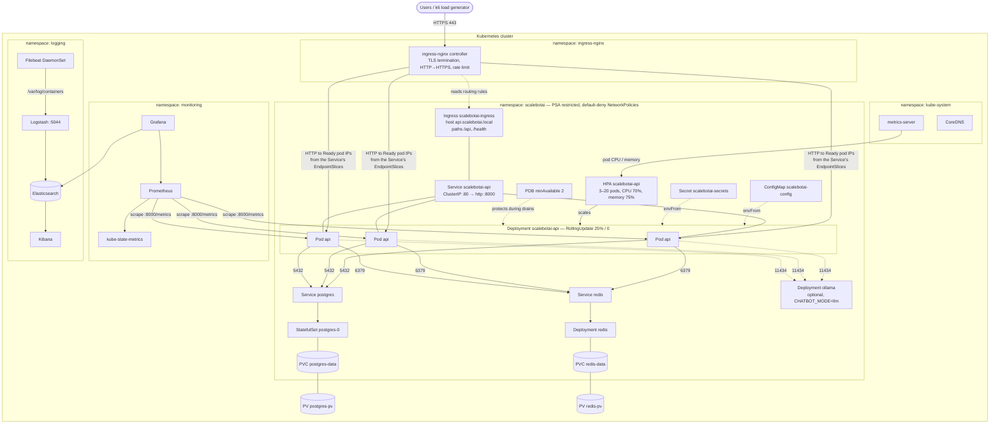
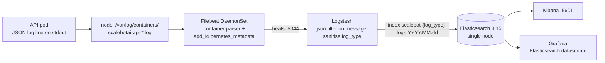
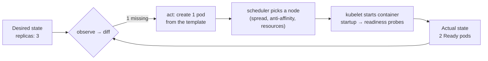
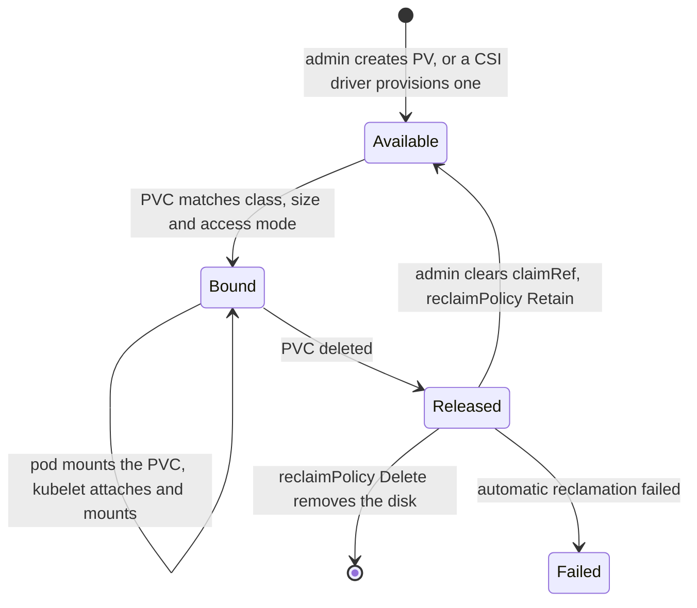
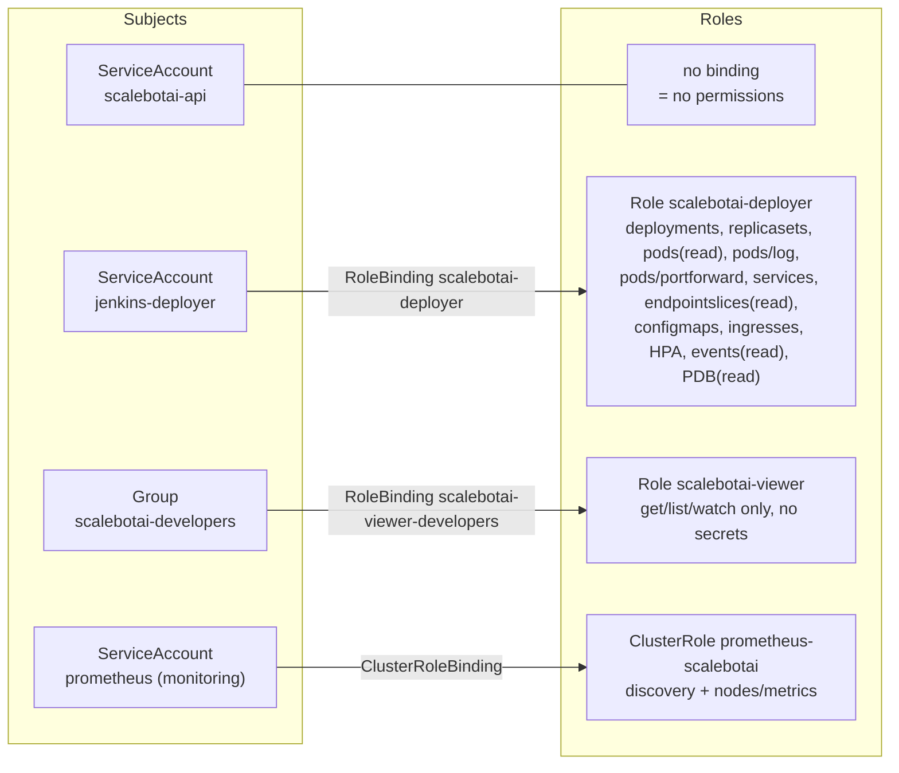

# 07 — Kubernetes Implementation

This document explains how ScaleBotAI runs on Kubernetes: every manifest under `k8s/`, the reason for each
important field, how the platform heals itself and scales, and a complete hands-on lab on minikube. It is
written so that you can defend each line of YAML in a viva.

> **Related documents:** [06 Docker](06-docker-implementation.md) (the image these manifests run) ·
> [08 CI/CD](08-cicd-jenkins.md) (how Jenkins deploys) · [09 Monitoring & Logging](09-monitoring-logging.md) ·
> [10 Security](10-security-architecture.md) · [12 Deployment Strategies](12-deployment-strategies.md) (rolling,
> blue-green, canary).

---

## Contents

1. [Goals and how Kubernetes meets them](#1-goals-and-how-kubernetes-meets-them)
2. [Architecture](#2-architecture)
3. [Repository layout](#3-repository-layout)
4. [Manifest walkthrough: `k8s/base`](#4-manifest-walkthrough-k8sbase)
5. [Optional components, examples, TLS](#5-optional-components-examples-tls)
6. [Monitoring and logging stacks on Kubernetes](#6-monitoring-and-logging-stacks-on-kubernetes)
7. [Self-healing and fault tolerance](#7-self-healing-and-fault-tolerance)
8. [Autoscaling: how the HPA computes replicas](#8-autoscaling-how-the-hpa-computes-replicas)
9. [Secrets vs ConfigMaps](#9-secrets-vs-configmaps)
10. [Storage: PV/PVC binding lifecycle](#10-storage-pvpvc-binding-lifecycle)
11. [RBAC model](#11-rbac-model)
12. [NetworkPolicy matrix](#12-networkpolicy-matrix)
13. [Hands-on lab on minikube](#13-hands-on-lab-on-minikube)
14. [Troubleshooting](#14-troubleshooting)
15. [kubectl cheat sheet](#15-kubectl-cheat-sheet)
16. [Production hardening and future work](#16-production-hardening-and-future-work)

---

## 1. Goals and how Kubernetes meets them

| Requirement | Kubernetes mechanism | Where |
|---|---|---|
| 1,000,000+ requests/day, peaks of 100–500 concurrent requests | Stateless API pods behind a Service, horizontally scaled from 3 to 20 by the HPA | `06`, `07`, `09` |
| 99.9 % uptime (≈ 43 min downtime/month) | 3+ replicas, liveness/readiness/startup probes, PodDisruptionBudget, anti-affinity and topology spread, 30 s node-failure eviction | `06`, `10` |
| Zero-downtime deploys | RollingUpdate `maxSurge 25%` / `maxUnavailable 0`, `minReadySeconds`, `preStop` drain, readiness gating; blue-green and canary alternatives | `06`, `k8s/strategies` |
| Average latency < 300 ms | Guaranteed CPU/memory requests, scale-up within ~15 s, Redis cache, HPA target at 70 % CPU to leave headroom | `06`, `09`, `05` |
| Security | Pod Security `restricted`, non-root uid 10001, read-only root FS, no capabilities, default-deny NetworkPolicies, least-privilege RBAC, TLS at the Ingress, Secrets out of the image | `00`, `06`, `11`, `12`, `08` |
| Observability | Prometheus pod discovery via annotations, kube-state-metrics, cAdvisor; Filebeat → Logstash → Elasticsearch → Kibana | `k8s/monitoring`, `k8s/logging` |
| Reproducibility | Declarative YAML in Git, one command `kubectl apply -k k8s/base` | `kustomization.yaml` |

---

## 2. Architecture



**Request path:** client → ingress-nginx (TLS terminated with Secret `scalebotai-tls`) → one Ready API pod on
port 8000. The controller load-balances directly over the pod IPs that the Service's EndpointSlices list. The
pod then calls `postgres:5432` and `redis:6379` by Service DNS name.

**Namespaces**

| Namespace | Contents | Pod Security (enforce) | Why |
|---|---|---|---|
| `scalebotai` | API, PostgreSQL, Redis, optional Ollama and exporters | `restricted` | All pods run non-root with no capabilities. This is the strongest built-in level |
| `monitoring` | Prometheus, Grafana, kube-state-metrics | `restricted` | Nothing in it needs host access (kubelets are scraped over HTTPS) |
| `logging` | Elasticsearch, Logstash, Kibana, Filebeat | `privileged` (audit/warn `baseline`) | Filebeat mounts node log directories (hostPath); Elasticsearch needs a privileged `sysctl` init container |

---

## 3. Repository layout

```text
k8s/
├── base/                         # the application tier — kubectl apply -k k8s/base
│   ├── 00-namespaces.yaml        # scalebotai, monitoring, logging + Pod Security labels
│   ├── 01-configmap.yaml         # scalebotai-config  (non-secret env)
│   ├── 02-secret.yaml            # scalebotai-secrets (placeholders!)
│   ├── 03-storage.yaml           # StorageClass manual, PVs, PVCs, lab hostPath Job
│   ├── 04-postgres.yaml          # StatefulSet postgres + Services postgres / postgres-headless
│   ├── 05-redis.yaml             # Deployment redis + Service redis
│   ├── 06-api-deployment.yaml    # Deployment scalebotai-api
│   ├── 07-api-service.yaml       # Service scalebotai-api
│   ├── 08-ingress.yaml           # Ingress scalebotai-ingress
│   ├── 09-hpa.yaml               # HorizontalPodAutoscaler
│   ├── 10-pdb.yaml               # PodDisruptionBudget
│   ├── 11-rbac.yaml              # ServiceAccounts, Roles, RoleBindings
│   ├── 12-network-policies.yaml  # default-deny + allow rules
│   └── kustomization.yaml
├── optional/                     # ollama.yaml, postgres-exporter.yaml, redis-exporter.yaml
├── examples/                     # pod.yaml, replicaset.yaml (teaching only)
├── monitoring/                   # Prometheus, Grafana, kube-state-metrics (own kustomization)
├── logging/                      # Elasticsearch, Logstash, Kibana, Filebeat (own kustomization)
├── tls/                          # create-tls-secret.sh, cert-manager-issuer.yaml
└── strategies/
    ├── rolling-update/           # deployment-patch.yaml, README.md
    ├── blue-green/               # deployment-blue/green, service-active/preview, ingress, switch.sh
    └── canary/                   # deployment-canary, service-canary, ingress-canary, set-weight/promote/abort.sh
```

---

## 4. Manifest walkthrough: `k8s/base`

Every file is heavily commented. The tables below summarise the fields an examiner is most likely to ask about.

### 4.1 `00-namespaces.yaml` — Namespaces and Pod Security Admission

A Namespace is a virtual cluster. It scopes names, RBAC Roles, NetworkPolicies, ResourceQuotas and Pod Security
levels.

| Field | Value | Why |
|---|---|---|
| `pod-security.kubernetes.io/enforce` | `restricted` (scalebotai, monitoring), `privileged` (logging) | The built-in Pod Security Admission controller rejects pods that run as root, keep capabilities, allow privilege escalation, lack a seccomp profile or mount hostPath. It replaced PodSecurityPolicy, which was removed in v1.25 |
| `…/audit`, `…/warn` | `restricted` / `baseline` | `audit` records violations in the audit log and `warn` prints them on `kubectl apply`. Both are useful on `logging`, which must enforce `privileged` |
| `…-version: latest` | | Evaluate against the cluster's current rule set |

`k8s/monitoring/namespace.yaml` and `k8s/logging/namespace.yaml` duplicate their Namespace objects so that
those stacks can be applied on their own. The copies are identical because `kubectl apply` removes labels that
are missing from the last applied manifest.

### 4.2 `01-configmap.yaml` — `scalebotai-config`

It holds every non-secret setting from `.env.example` (`APP_ENV`, `LOG_FORMAT=json`, `CHATBOT_MODE=rule`,
`POSTGRES_HOST=postgres`, `REDIS_HOST=redis`, DB pool sizes, rate limits, and so on). The Deployment loads all
of it with `envFrom.configMapRef`.

- **`LOG_FILE: ""`.** In Kubernetes the app logs **only to stdout**. The container runtime writes stdout to
  `/var/log/containers/*.log`, which Filebeat ships. No shared log volume is needed, unlike in docker-compose.
- **Env vars are read once at start.** Changing the ConfigMap does not affect running pods. Apply the change,
  then run `kubectl rollout restart deployment/scalebotai-api`, which is itself a zero-downtime rolling update.
- **Fixed name vs `configMapGenerator`.** Kustomize can append a content hash to the name so that every change
  triggers a rollout automatically. We keep the fixed name `scalebotai-config` because Jenkins and the docs patch
  it by name.
- **DB pool math.** The pool is per pod, so the ConfigMap overrides the code defaults (10 + 20) with
  `DB_POOL_SIZE=5` and `DB_MAX_OVERFLOW=3`: at most 8 connections per pod, 160 at the HPA maximum of 20
  pods, well under Postgres' `max_connections=300`. With the defaults, 20 pods could open 600. A pod only
  keeps about one connection busy (Little's law, `docs/04-database-design.md` §9.1); beyond ~35 pods add
  PgBouncer (see §16).

### 4.3 `02-secret.yaml` — `scalebotai-secrets`

`type: Opaque` with `stringData` placeholders (`change-me-…`) for `POSTGRES_USER`, `POSTGRES_PASSWORD`,
`REDIS_PASSWORD`, `JWT_SECRET_KEY` and `ADMIN_PASSWORD`. See [§9](#9-secrets-vs-configmaps) for why base64 is
not encryption and how production handles this (encryption at rest, Sealed Secrets, External Secrets). Create
the real Secret imperatively:

```bash
kubectl -n scalebotai create secret generic scalebotai-secrets \
  --from-literal=POSTGRES_USER=scalebot \
  --from-literal=POSTGRES_PASSWORD="$(openssl rand -base64 24)" \
  --from-literal=REDIS_PASSWORD="$(openssl rand -hex 24)" \
  --from-literal=JWT_SECRET_KEY="$(openssl rand -hex 32)" \
  --from-literal=ADMIN_PASSWORD="Adm1n-$(openssl rand -hex 8)" \
  --dry-run=client -o yaml | kubectl apply -f -
```

`GRAFANA_ADMIN_PASSWORD` lives in Secret `grafana-admin` in the `monitoring` namespace, because a pod can only
read Secrets from its own namespace.

### 4.4 `03-storage.yaml` — StorageClass, PersistentVolumes, PersistentVolumeClaims

| Object | Key fields | Why |
|---|---|---|
| StorageClass `manual` | `provisioner: kubernetes.io/no-provisioner`, `reclaimPolicy: Retain`, `volumeBindingMode: Immediate` | Nothing is created dynamically: only the hand-made PVs below can satisfy claims of this class, so the PVCs can never accidentally get a disk from minikube's default class |
| PV `postgres-pv` (5Gi), `redis-pv` (1Gi) | `hostPath: /data/scalebotai/{postgres,redis}`, `type: DirectoryOrCreate`, `accessModes: [ReadWriteOnce]`, `persistentVolumeReclaimPolicy: Retain` | A directory on the node, for the lab only. RWO means one node mounts it read-write, which is correct for a database. Retain means deleting the PVC never deletes data |
| PVC `postgres-data`, `redis-data` | `storageClassName: manual`, `volumeName: <pv>` | `volumeName` pre-binds each claim to *its* PV. Without it, the binder may give `postgres-data` the Redis disk |
| Job `scalebotai-hostpath-permissions` (namespace `kube-system`) | busybox, `runAsUser: 0`, `capabilities: drop ALL, add CHOWN+FOWNER`, mounts only `/data/scalebotai` | Kubelet creates hostPath directories as `root:root 0755`, and `fsGroup` is **not** applied to hostPath volumes. Postgres (uid 70) and Redis (uid 999) run non-root, so someone with root must hand the directories over once. A restricted pod cannot chown, so this lab-only Job runs in `kube-system`, which has no Pod Security enforcement, instead of weakening the app namespace |

Postgres and Redis each have a `wait-for-writable-volume` init container. It is restricted-compliant and loops
until the volume is writable, so the pod waits in `Init:0/1` instead of crash-looping while the Job runs.

**Cloud / production:** use dynamic provisioning. Delete the PVs, the StorageClass and the Job, and point the
PVCs at a CSI class, e.g. EKS `gp3` (`ebs.csi.aws.com`, `type: gp3`, `encrypted: "true"`,
`volumeBindingMode: WaitForFirstConsumer`, `allowVolumeExpansion: true`) or GKE `pd-ssd`. `fsGroup` then makes
the volume writable for the non-root user with no Job.

### 4.5 `04-postgres.yaml` — PostgreSQL 16 StatefulSet

| Field | Value | Why |
|---|---|---|
| `kind: StatefulSet` | | Stable pod name `postgres-0`, stable storage, ordered start/stop and at-most-one semantics. Two pods must never write one data directory |
| `serviceName: postgres-headless` + headless Service (`clusterIP: None`) | | Per-pod DNS `postgres-0.postgres-headless.scalebotai.svc`, required by StatefulSets and needed for replication setups |
| Service `postgres` (ClusterIP) | port 5432 | Stable name for the app (`POSTGRES_HOST=postgres`); only Ready pods are behind it |
| `replicas: 1` | | A lab database. HA means an operator (CloudNativePG) or a managed DB (RDS / Cloud SQL) |
| `args: -c max_connections=300 -c shared_buffers=256MB` | | Sized for the API's connection pools and the 1 GiB limit |
| `env` from Secret/ConfigMap, `PGDATA=/var/lib/postgresql/data/pgdata` | | initdb creates the user and DB on first start. The subdirectory avoids `lost+found` on cloud disks |
| `securityContext` | `runAsUser/Group 70`, `fsGroup 70`, `readOnlyRootFilesystem`, drop ALL, seccomp RuntimeDefault | Satisfies `restricted`. Writable paths are explicit volumes: data PVC, `/var/run/postgresql` (socket), `/tmp`, and `/dev/shm` (a memory emptyDir, because the default 64 MiB is too small for parallel queries) |
| `startupProbe` `pg_isready` ×30 at 5 s | | Gives initdb and crash recovery up to 150 s before liveness can kill the container |
| `livenessProbe` / `readinessProbe` `pg_isready -h 127.0.0.1` | | Restart a hung server; take the server out of the Service while it isn't accepting connections |
| `terminationGracePeriodSeconds: 60` | | Time for a clean shutdown checkpoint |
| `volumes.data.persistentVolumeClaim.claimName: postgres-data` | | Uses the pre-bound PVC. With more than one replica you would use `volumeClaimTemplates` (as Elasticsearch does in `k8s/logging`) |

### 4.6 `05-redis.yaml` — Redis 7

| Field | Value | Why |
|---|---|---|
| `strategy: Recreate` | | RWO volume plus an append-only file: two Redis processes must never share it. The few seconds of downtime are tolerated because the API fails open without Redis |
| `args: --requirepass $(REDIS_PASSWORD)` | | Kubernetes expands `$(VAR)` from the container's env, so the password comes from the Secret without a shell |
| `--appendonly yes --appendfsync everysec` | | Durability with at most ~1 s of writes lost (rate-limit counters, denylist, stats) |
| `--maxmemory 256mb --maxmemory-policy allkeys-lru` | | Cache semantics; stays below the 384 Mi container limit. Trade-off: JWT denylist keys can also be evicted under pressure (fix: a separate Redis with `noeviction`) |
| `REDISCLI_AUTH` env | | `redis-cli` reads it, so probes never put the password on the command line |
| Liveness `tcpSocket`, readiness `redis-cli ping \| grep PONG` | | A Redis that is still loading its AOF must not be killed, but must not receive traffic either |
| `runAsUser 999 / runAsGroup 1000`, read-only root FS | | The `redis` user of the alpine image; it writes only to `/data` |

### 4.7 `06-api-deployment.yaml` — the API Deployment (most important file)

**Deployment → ReplicaSet → Pods.** The ReplicaSet keeps N pods alive. The Deployment versions the pod template:
every template change creates a new ReplicaSet and shifts pods across gradually.

| Field | Value | Why (viva answer) |
|---|---|---|
| `metadata.labels` | `app.kubernetes.io/name`, `part-of`, `app: scalebotai-api`, `tier: backend`, `track: stable` | Standard labels shared by the Service, strategies and scripts. `app` is what the Service, PDB, NetworkPolicies and Prometheus select on. `track` separates stable from canary |
| `kubernetes.io/change-cause` annotation | | Shown by `kubectl rollout history`; Jenkins overwrites it per build |
| `replicas: 3` | | Survives the loss of one pod or node and still satisfies PDB `minAvailable: 2`. The HPA owns this number at runtime |
| `revisionHistoryLimit: 10` | | Keeps 10 old ReplicaSets for `kubectl rollout undo --to-revision=N` |
| `minReadySeconds: 10` | | A new pod must stay Ready for 10 s before it counts as available, which slows a flapping release |
| `progressDeadlineSeconds: 600` | | A stuck rollout becomes `ProgressDeadlineExceeded`, `rollout status` fails and Jenkins rolls back |
| `strategy.rollingUpdate.maxSurge: 25%` | | At most 1 extra pod (`ceil(3 × 0.25)`) during an update |
| `strategy.rollingUpdate.maxUnavailable: 0` | | Never below 3 Ready pods: an old pod is killed only after its replacement is Ready. **This gives zero downtime** |
| `selector.matchLabels: {app, track: stable}` | | Immutable. Including `track: stable` stops this Deployment from adopting the canary pods, which share `app: scalebotai-api` |
| Pod annotations `prometheus.io/scrape/port/path` | `"true"`, `"8000"`, `/metrics` | Prometheus pod discovery keeps annotated pods and scrapes `podIP:8000/metrics` |
| `serviceAccountName: scalebotai-api`, `automountServiceAccountToken: false` | | A dedicated identity with zero permissions and no API token in the pod |
| `enableServiceLinks: false` | | Otherwise the kubelet injects Docker-link variables such as `REDIS_PORT=tcp://10.96.x.x:6379`, which collide with our config names |
| `terminationGracePeriodSeconds: 30` + `preStop: sleep 5` | | Connection draining (see below) |
| Pod `securityContext` | `runAsNonRoot`, uid/gid `10001`, `fsGroup 10001`, seccomp `RuntimeDefault` | Matches `appuser` in `docker/api/Dockerfile`; required by `restricted` |
| `topologySpreadConstraints` (hostname, zone; `ScheduleAnyway`) | | Spreads replicas across nodes and availability zones. Soft, so single-node minikube still schedules |
| `podAntiAffinity` preferred, weight 100 | | "Avoid two API pods on one node". A hard rule would leave pods Pending when replicas exceed nodes |
| `tolerations` not-ready/unreachable `NoExecute` 30 s | | By default, pods on a dead node are evicted after 300 s. A stateless API can move after 30 s, which matters for 99.9 % |
| `image: scalebotai/scalebotai-api:latest`, `imagePullPolicy: IfNotPresent` | | Placeholder; CI sets an immutable tag. `IfNotPresent` makes `minikube image load` work |
| `envFrom` ConfigMap + Secret | | All config as env vars (12-factor) |
| `env` from the downward API | `APP_VERSION` ← label `app.kubernetes.io/version`; `POD_NAME`, `POD_NAMESPACE`, `POD_IP`, `NODE_NAME` | Pod identity shows up in logs and in `/api/v1/admin/system`. Explicit `env` overrides `envFrom` |
| `resources.requests` | `cpu 250m`, `memory 256Mi` | Reserved by the scheduler; the 100 % reference for HPA utilisation |
| `resources.limits` | `cpu 1`, `memory 512Mi` | CPU above the limit is throttled; memory above it means OOMKilled. Requests < limits gives QoS class **Burstable** |
| `startupProbe` `GET /health/live` ×24 at 5 s | | Up to 120 s for start-up (DB connect, table creation). Liveness is paused until it passes |
| `livenessProbe` `GET /health/live` | period 10 s, 3 failures | "Is the process alive?" with no dependency checks, so a DB outage doesn't cause a restart storm |
| `readinessProbe` `GET /health/ready` | period 5 s, 3 failures | 200 only if the database answers. Failing pods are removed from the Service, not restarted. Redis doesn't gate readiness because the app fails open without it |
| Container `securityContext` | `allowPrivilegeEscalation: false`, `readOnlyRootFilesystem: true`, `capabilities.drop: [ALL]` | An attacker can't escalate, modify the app or install tools. `/tmp` is the only writable path (emptyDir, 64 Mi) |

**Connection draining on shutdown:** the pod is marked Terminating and removed from the EndpointSlices.
The `preStop: sleep 5` runs, and during it the pod keeps serving requests that arrive while ingress-nginx and
kube-proxy catch up. Then SIGTERM is sent; uvicorn stops accepting, finishes in-flight requests and exits. Any
process still running after 30 s gets SIGKILL. Without the sleep, a few requests per rollout would hit a closed
socket and fail with 502.

### 4.8 `07-api-service.yaml` — Service `scalebotai-api`

`type: ClusterIP`, `port: 80 → targetPort: http` (the named container port 8000), `selector: app: scalebotai-api`,
`sessionAffinity: None`.

- **Why ClusterIP?** Only the Ingress controller needs to reach it. NodePort or LoadBalancer would expose pods
  without TLS or rate limiting.
- **Why a named targetPort?** If the container port ever changes, only the pod spec changes.
- **No sticky sessions:** the API is stateless (JWT, with state in Postgres/Redis). This is the property that
  makes horizontal scaling trivial.
- **The selector is only `app`.** Stable (`track: stable`) and canary (`track: canary`) pods are both behind it,
  so 1 canary + 3 stable gives about 25 % canary traffic.

### 4.9 `08-ingress.yaml` — Ingress `scalebotai-ingress`

| Field / annotation | Value | Why |
|---|---|---|
| `ingressClassName` | `nginx` | Which controller implements the rules |
| `tls[].secretName` | `scalebotai-tls` | Certificate for `api.scalebotai.local` (`k8s/tls`) |
| `rules[].host` | `api.scalebotai.local` | Name-based virtual hosting |
| paths `/api`, `/health` (`Prefix`) | | **Allow-list routing.** `/metrics` and `/docs` match no rule and get a 404, so `/metrics` is never public. Snippet annotations are disabled by default since ingress-nginx v1.9 for security, so there's no `server-snippet` deny |
| `ssl-redirect`, `force-ssl-redirect` | `"true"` | HTTP → HTTPS |
| `limit-rps: "50"`, `limit-burst-multiplier: "5"` | | Per-client-IP rate limit inside NGINX, before the app (abuse/DoS protection). Load tests must allow-list the generator with `limit-whitelist` |
| `proxy-connect-timeout: 5`, `proxy-read/send-timeout: 60` | | Fail fast on a dead pod; allow slow LLM answers |
| `proxy-next-upstream: error timeout http_502 http_503 http_504`, tries 3 | | Retries idempotent requests on another pod, smoothing over a pod that is shutting down |
| `proxy-body-size: 1m` | | Messages are ≤ 2000 characters; larger bodies are rejected |

> The community ingress-nginx project was retired in March 2026 (no further releases). It still works for this
> lab via the minikube addon. New production clusters should move these rules to the **Gateway API**
> (`Gateway` + `HTTPRoute`); see §16.

### 4.10 `09-hpa.yaml` — HorizontalPodAutoscaler

`autoscaling/v2`, target `Deployment/scalebotai-api`, `minReplicas: 3`, `maxReplicas: 20`, CPU 70 %, memory 75 %.
The `behavior` block scales up fast and down slowly:

| | Stabilisation window | Policies | Effect |
|---|---|---|---|
| `scaleUp` | 0 s | +100 % per 15 s **or** +4 pods per 15 s, `selectPolicy: Max` | React to a spike at once: 3 → 7 → 14 → 20 within ~45 s |
| `scaleDown` | 300 s | −10 % per 60 s | Use the highest recommendation of the last 5 minutes, then remove pods gradually. This prevents flapping between bursts |

The maths is in [§8](#8-autoscaling-how-the-hpa-computes-replicas).

### 4.11 `10-pdb.yaml` — PodDisruptionBudget

`minAvailable: 2`, `selector: app: scalebotai-api`, `unhealthyPodEvictionPolicy: AlwaysAllow`.

- PDBs govern **voluntary** disruptions that use the Eviction API: `kubectl drain`, node upgrades, the cluster
  autoscaler. With 3 replicas a drain evicts one pod, waits for its replacement to become Ready, then evicts the
  next.
- They don't stop **involuntary** disruptions (node crash, OOM); replicas and anti-affinity cover those.
- `minAvailable: 3` with 3 replicas would block every drain forever. `AlwaysAllow` lets a crash-looping pod be
  evicted, so a broken pod never blocks maintenance.
- Selecting only `app` keeps the budget working in blue-green and canary modes too.

### 4.12 `11-rbac.yaml` — ServiceAccounts, Roles, RoleBindings

See [§11](#11-rbac-model). In short: `scalebotai-api` has no rights and no token; `jenkins-deployer` can roll out
and manage canary/blue-green objects but can't read Secrets or exec into pods; `scalebotai-viewer` is read-only
for the group `scalebotai-developers`.

### 4.13 `12-network-policies.yaml` — zero-trust networking

A default deny for ingress and egress, then explicit allows: DNS, ingress-nginx → API, monitoring → API, API →
Postgres/Redis/Ollama, and exporters → databases. The full matrix is in [§12](#12-networkpolicy-matrix).
**Enforcement needs a policy-capable CNI.** Start minikube with `--cni=calico`; with the default CNI the
policies are silently ignored.

### 4.14 `kustomization.yaml`

| Field | Why |
|---|---|
| `resources:` (00 … 12) | One command deploys the tier: `kubectl apply -k k8s/base`; `kubectl kustomize k8s/base` renders for review or CI |
| No top-level `namespace:` | The base contains 3 Namespace objects and cluster-scoped PVs/StorageClass. A global namespace would rename every Namespace object. Each file sets `metadata.namespace` explicitly instead, so each file also works with `kubectl apply -f` |
| `labels:` with `includeSelectors: false`, `includeTemplates: false` | Adds `app.kubernetes.io/part-of` and `managed-by` to metadata only. Selectors are immutable and changing pod templates would trigger rollouts |
| `images:` (`scalebotai/scalebotai-api` → `newTag`) | CI hook: `kustomize edit set image scalebotai/scalebotai-api=<repo>:<tag>` rewrites the tag at render time. Jenkins' default path uses `kubectl set image` instead (`scripts/deploy.sh`) |

---

## 5. Optional components, examples, TLS

| File | What | Notes |
|---|---|---|
| `optional/ollama.yaml` | Deployment + Service `ollama:11434` + PVC `ollama-data` (5 Gi) + egress NetworkPolicy (HTTPS to the internet for model download) | An **init container** starts a temporary `ollama serve`, runs `ollama pull tinyllama` into the PVC, then stops. It runs non-root with `HOME`/`OLLAMA_MODELS` on the volume. Requests 1 CPU / 2 Gi, limit 3 Gi. GPU notes: `nvidia.com/gpu: 1`, device plugin, tolerations. Enable with `CHATBOT_MODE=llm` + `rollout restart` |
| `optional/postgres-exporter.yaml` | `:9187` metrics (`pg_up`, connections, transactions, DB size) | Credentials from `scalebotai-secrets`; its own NetworkPolicy (monitoring → 9187, exporter → postgres 5432) |
| `optional/redis-exporter.yaml` | `:9121` metrics (memory, hit ratio, evictions) | Same pattern |
| `examples/pod.yaml` | A bare Pod | Delete it and it's gone for good: no self-healing, scaling or rollout |
| `examples/replicaset.yaml` | A standalone ReplicaSet (3 replicas) | Shows reconciliation (delete a pod and it comes back), and why Deployments manage ReplicaSets (changing the image in a ReplicaSet doesn't update existing pods) |
| `tls/create-tls-secret.sh` | Self-signed cert (SANs: api, preview.api, kibana, grafana `.scalebotai.local`) → `kubectl create secret tls scalebotai-tls` | Idempotent (`--dry-run=client -o yaml \| kubectl apply -f -`); works in Git Bash on Windows |
| `tls/cert-manager-issuer.yaml` | Let's Encrypt staging/prod `ClusterIssuer` (HTTP-01 via nginx) + `Certificate` writing `scalebotai-tls` | Needs a real public DNS name, because Let's Encrypt can't issue for `.local`. cert-manager renews 30 days before expiry |

---

## 6. Monitoring and logging stacks on Kubernetes

### 6.1 `k8s/monitoring` (`kubectl apply -k k8s/monitoring`)

| Object | Details |
|---|---|
| ServiceAccount + ClusterRole `prometheus-scalebotai` | `get/list/watch` on pods, nodes, services, endpoints, endpointslices; `get` on `nodes/metrics`. Deliberately **no `nodes/proxy`**, which would effectively grant kubelet API access |
| ConfigMap `prometheus-config` | Job `kubernetes-pods`: `kubernetes_sd_configs role: pod` keeps pods with `prometheus.io/scrape: "true"`, rewrites the address to `podIP:<prometheus.io/port>`, uses `prometheus.io/path`, and copies `namespace`, `pod`, `node`, `app`, `track`, `color`. It sets **`job` = the pod's `app` label**, giving the same job names as docker-compose (`scalebotai-api`, `postgres-exporter`, `redis-exporter`) so the shared Grafana dashboards work unchanged. Job `kubernetes-cadvisor`: kubelet `:10250/metrics/cadvisor` with the SA token (container CPU, memory, throttling, network). Job `kubernetes-kubelet`: PVC usage. Job `kube-state-metrics` with `honor_labels: true` |
| ConfigMap `prometheus-rules` | Inlined rules: `HighErrorRate` (> 1 % 5xx, per `track`), `HighP95Latency` (> 300 ms), `PodCrashLooping`, `HPAMaxedOut`, `HighCPU` (> 80 % of limit), `HighMemory` (> 80 % of limit), `InstanceDown`. Kustomize can't read `monitoring/prometheus/alert-rules.yml` from outside its directory, so they are inlined |
| Deployment `prometheus` (`prom/prometheus:v3.5.0`) + PVC 10 Gi + Service `:9090` | `Recreate` because of the RWO TSDB volume; retention 15 d / 8 GB; `--web.enable-lifecycle` for `POST /-/reload`; uid 65534; read-only root FS. Config is mounted as a directory (not `subPath`) so edits propagate |
| kube-state-metrics `v2.15.0` | Trimmed to the resources we alert on (`--resources=…`), so its ClusterRole is small |
| Grafana `12.0.0` + Secret `grafana-admin` + datasources ConfigMap | Datasources `prometheus` (uid `prometheus`, `http://prometheus.monitoring.svc:9090`) and `elasticsearch` (uid `elasticsearch`, `http://elasticsearch.logging.svc:9200`, index `scalebot-*`). Dashboards come from an optional ConfigMap: `kubectl -n monitoring create configmap grafana-dashboards --from-file=monitoring/grafana/dashboards/ --dry-run=client -o yaml \| kubectl apply -f -` |

Both Prometheus config files were checked with `promtool check config` and `promtool check rules`.

### 6.2 `k8s/logging` (`kubectl apply -k k8s/logging`)



| Object | Details |
|---|---|
| StatefulSet `elasticsearch` 8.15.3 + `volumeClaimTemplates` 10 Gi + Services `elasticsearch` / `elasticsearch-headless` | `discovery.type=single-node`, `xpack.security.enabled=false` (**lab only**), heap 1 g, limit 2 Gi. A **privileged init container** runs `sysctl -w vm.max_map_count=262144`, a node-wide kernel setting that ES checks at boot and that can't be namespaced. This is why `logging` enforces `privileged` |
| Deployment `logstash` + Service `:5044` + ConfigMap `logstash-pipeline` | `beats` input → `json { source => "message" }` → default/sanitise `log_type` ∈ {api,user,error,system} → `elasticsearch { index => "scalebot-%{[log_type]}-logs-%{+YYYY.MM.dd}" }`. Validated with `logstash -t` |
| Deployment `kibana` + Service `:5601` (+ optional `kibana-ingress.yaml` with basic auth and an IP allow-list) | Data view `scalebot-*`, time field `@timestamp` |
| DaemonSet `filebeat` + ServiceAccount + ClusterRole (pods, namespaces, nodes: get/list/watch) + ConfigMap | `filestream` input on `/var/log/containers/*scalebotai-api*.log`, which matches stable, canary, blue and green pods. The `container` parser strips the runtime wrapper; `add_kubernetes_metadata` adds `kubernetes.labels.track` and others; output `logstash.logging.svc:5044`. It runs as root with read-only hostPath mounts, and keeps its registry on the node so a restart doesn't re-ship logs |

**Why a DaemonSet?** Exactly one shipper per node, automatically on new nodes. The app just writes to stdout:
no sidecar, no shared volume, no log library talking to Logstash.

---

## 7. Self-healing and fault tolerance

Kubernetes is a set of **control loops**. Each controller continuously compares *desired state* (YAML in etcd)
with *actual state* and acts on the difference.



| Failure | What notices | What happens | User impact |
|---|---|---|---|
| Container process crashes / OOMKilled | kubelet | Restarts the container in place (`restartPolicy: Always`), with exponential back-off (10 s, 20 s, … up to 5 min = `CrashLoopBackOff`) | None: the readiness probe fails and the Service routes to the other 2+ pods. `PodCrashLooping` alert fires |
| App hangs (deadlock, event loop blocked) | `livenessProbe` `/health/live` fails 3× | kubelet kills and restarts the container | None (same reason) |
| Database unreachable | `readinessProbe` `/health/ready` → 503 | Pod removed from the endpoints, **not** restarted, and added back automatically | Requests fail fast only if *all* pods lose the DB; liveness stays green, so there's no restart storm |
| Pod deleted / evicted | ReplicaSet controller | Creates a replacement within seconds | None (3 replicas) |
| Node dies | node-lifecycle controller marks it `NotReady` and taints it | After the 30 s toleration the pods are evicted and recreated on healthy nodes; anti-affinity and spread mean the dead node held at most ~⅓ of them | Remaining replicas carry the load; the HPA scales up if CPU rises |
| Node drain (upgrade) | Eviction API + PDB | Evicts one pod at a time and never drops below 2 Ready | None |
| Bad release | readiness never passes, `progressDeadlineSeconds` | `maxUnavailable: 0` means old pods keep serving; `rollout status` fails and Jenkins runs `rollout undo` | None |
| Traffic spike | HPA | +100 % or +4 pods per 15 s, up to 20 | Brief latency rise until new pods are Ready |
| Redis down | app health checks | App fails open (no cache, no rate limit); readiness still passes | Slower responses, still available |
| Postgres pod dies | StatefulSet controller | Recreates `postgres-0` with the **same PVC**, so the data is intact | Writes fail for ~10–30 s. This is the single point of failure in the lab (→ HA operator or managed DB, §16) |

**Hands-on:** `kubectl -n scalebotai delete pod -l app=scalebotai-api --wait=false` while
`kubectl -n scalebotai get pods -w` runs in another terminal. Pods are replaced within seconds and
`curl -k https://api.scalebotai.local/health` keeps answering.

---

## 8. Autoscaling: how the HPA computes replicas

### 8.1 Why metrics-server is required

The HPA controller (in `kube-controller-manager`, every **15 s**) reads per-pod CPU and memory from the
**Resource Metrics API** `metrics.k8s.io`. That API is served by **metrics-server**, which scrapes each kubelet's
`/metrics/resource` and keeps the latest values in memory. Without metrics-server, `kubectl get hpa` shows
`<unknown>` targets and nothing scales. `kubectl top pods` uses the same API. (Prometheus is separate: it stores
history for dashboards and alerts, but the HPA doesn't read it unless you install a custom-metrics adapter.)

### 8.2 The formula

For each metric:

```text
desiredReplicas = ceil( currentReplicas × currentMetricValue / desiredMetricValue )
```

- Utilisation is measured against the **request**: CPU 70 % of 250m = **175m per pod** on average.
- **Tolerance:** if `currentMetricValue / desiredMetricValue` is within 0.9–1.1, nothing changes. This avoids
  jitter.
- With several metrics, the HPA computes each one and takes the **maximum**.
- The result is clamped to `[minReplicas, maxReplicas]` and rate-limited by `behavior`.
- Pods that are not yet Ready, or have no metrics, are treated conservatively: they count as 0 % when scaling
  up and 100 % when scaling down, so start-up spikes don't cause over-scaling.

### 8.3 Worked example

Peak traffic arrives and 3 pods each use ~350m CPU and ~150 Mi memory.

```text
CPU:     utilisation = 350m / 250m = 140 %   → ceil(3 × 140 / 70) = ceil(6.0)  = 6
Memory:  utilisation = 150Mi / 256Mi ≈ 59 % → ceil(3 × 59 / 75)  = ceil(2.36) = 3
max(6, 3) = 6 desired
scaleUp policies (15 s): +100 % → 6, +4 pods → 7; selectPolicy Max → up to 7 allowed → 6 pods
```

After the new pods become Ready, load per pod drops to ~175m (exactly the target), so the ratio is 1.0, within
the tolerance, and the count holds at 6.

Scale-down when traffic falls to 20 % CPU with 10 pods: `ceil(10 × 20 / 70) = 3`. However, the 300 s
stabilisation window keeps the highest recommendation from the last 5 minutes, and then the
`Percent 10 / 60 s` policy allows only `floor(10 × 0.9) = 9`, then 8, 7 … one pod per minute. A new burst during
that time is absorbed by pods that still exist.

**Capacity sanity check:** docs/11 estimates ~150–300 req/s per pod in cached rule mode. The 500 req/s design
peak therefore needs about 2–4 pods at 100 % CPU, or ~3–6 pods at the 70 % target. `maxReplicas: 20` leaves
more than 3× headroom before `HPAMaxedOut` fires.

---

## 9. Secrets vs ConfigMaps

| | ConfigMap `scalebotai-config` | Secret `scalebotai-secrets` |
|---|---|---|
| Content | Non-sensitive settings (hosts, ports, pool sizes, log level, feature flags) | Passwords, JWT signing key, admin bootstrap password |
| Storage in etcd | Plain text | base64 (**encoding, not encryption**) — encrypted only if the API server has an `EncryptionConfiguration` (aescbc/aesgcm/KMS v2) |
| Size limit | 1 MiB | 1 MiB |
| RBAC | `scalebotai-viewer` can read it | No role except cluster-admin can read it. `jenkins-deployer` and viewers have **no** secret access |
| Consumption | `envFrom`, `env.valueFrom.configMapKeyRef`, volume | `envFrom`, `secretKeyRef`, volume (tmpfs, never written to node disk) |
| Kubelet handling | | Delivered only to nodes running a pod that uses it |
| In Git | Yes | **Placeholders only**. Real values come from `kubectl create secret`, **Sealed Secrets** (encrypted with the controller's public key, safe to commit) or the **External Secrets Operator** (synced from AWS Secrets Manager, Vault, GCP/Azure) |
| On change | Restart the pods (env vars are read at start) | Same; mounted files refresh after ~1 min, env vars never do |

`echo -n 'change-me' | base64` gives `Y2hhbmdlLW1l`, and anyone can decode that. Protection comes from RBAC,
encryption at rest, audit logging and keeping secrets out of Git.

---

## 10. Storage: PV/PVC binding lifecycle



1. **Provisioning.** *Static* (our lab): the admin writes `postgres-pv`/`redis-pv`. *Dynamic* (cloud): a PVC
   names a StorageClass and its CSI provisioner creates the disk (Prometheus, Elasticsearch and Ollama use the
   default class this way).
2. **Binding.** The PV controller matches a PVC to a PV with the same `storageClassName`, sufficient capacity
   and compatible `accessModes`. `volumeName` on our PVCs pre-binds deterministically. Binding is 1:1 and
   exclusive.
3. **Using.** A pod references the **PVC**, never the PV. The scheduler respects the volume's topology; the
   kubelet attaches and mounts it, and applies `fsGroup` where the volume type supports it (CSI yes, hostPath
   no).
4. **Releasing.** Deleting the PVC (not the pod!) releases the PV. With `Retain` the data and PV remain
   (`Released`) until an admin reuses or deletes them, which is the safe default for databases.
5. **StatefulSet `volumeClaimTemplates`** (Elasticsearch) create one PVC per ordinal (`data-elasticsearch-0`).
   It survives pod deletion and even StatefulSet deletion.

Commands: `kubectl get sc,pv`, `kubectl -n scalebotai get pvc`, `kubectl describe pvc postgres-data`.

---

## 11. RBAC model



- RBAC is **additive and deny-by-default**. There are no deny rules; anything not granted is forbidden.
- **`scalebotai-api`:** no RoleBinding and `automountServiceAccountToken: false`. A compromised app has no
  credential to attack the cluster with.
- **`jenkins-deployer`** can do what the pipeline and strategy scripts need: `set image`, `rollout
  status/undo/history`, create and delete the canary Deployment/Service/Ingress, patch the blue-green Service
  selectors, `port-forward` for smoke tests, and read logs and events. It **cannot** read Secrets, exec into
  pods, or touch StatefulSets, PVCs, NetworkPolicies, RBAC or other namespaces. Cluster bootstrap
  (`kubectl apply -k k8s/base`, which creates namespaces and PVs) is a one-time cluster-admin task.
- **Kubeconfig for Jenkins** (credential `kubeconfig-scalebotai`). Since v1.24 tokens are short-lived and not
  auto-created:

```bash
TOKEN=$(kubectl -n scalebotai create token jenkins-deployer --duration=720h)
APISERVER=$(kubectl config view --minify -o jsonpath='{.clusters[0].cluster.server}')
kubectl config view --raw --minify -o jsonpath='{.clusters[0].cluster.certificate-authority-data}' | base64 -d > ca.crt
kubectl config set-cluster scalebotai --server="$APISERVER" --certificate-authority=ca.crt --embed-certs=true --kubeconfig=jenkins.kubeconfig
kubectl config set-credentials jenkins-deployer --token="$TOKEN" --kubeconfig=jenkins.kubeconfig
kubectl config set-context jenkins --cluster=scalebotai --user=jenkins-deployer --namespace=scalebotai --kubeconfig=jenkins.kubeconfig
kubectl config use-context jenkins --kubeconfig=jenkins.kubeconfig
```

- **Verify** without logging in as them:

```bash
kubectl auth can-i patch deployments -n scalebotai --as=system:serviceaccount:scalebotai:jenkins-deployer  # yes
kubectl auth can-i get secrets      -n scalebotai --as=system:serviceaccount:scalebotai:jenkins-deployer  # no
kubectl auth can-i create pods/exec -n scalebotai --as=system:serviceaccount:scalebotai:jenkins-deployer  # no
kubectl auth can-i list pods        -n scalebotai --as=alice --as-group=scalebotai-developers               # yes
```

---

## 12. NetworkPolicy matrix

Namespace `scalebotai` starts from `default-deny-all` (ingress **and** egress), and these rules add allows.
Policies match **pods by label** and see traffic **after** Service DNAT, so the ports are container ports.

| # | Source | Destination | Port | Allowed? | Policy |
|---|---|---|---|---|---|
| 1 | any pod in `scalebotai` | CoreDNS (`kube-system`, `k8s-app=kube-dns`) | 53 UDP/TCP | ✅ | `allow-dns-egress` |
| 2 | ingress-nginx controller (namespace `ingress-nginx`) | `app=scalebotai-api` | 8000 | ✅ | `allow-api-ingress` |
| 3 | Prometheus (namespace `monitoring`) | `app=scalebotai-api` | 8000 | ✅ | `allow-api-ingress` |
| 4 | `app=scalebotai-api` | `app=postgres` | 5432 | ✅ | `allow-api-egress` + `allow-postgres-ingress` |
| 5 | `app=scalebotai-api` | `app=redis` | 6379 | ✅ | `allow-api-egress` + `allow-redis-ingress` |
| 6 | `app=scalebotai-api` | `app=ollama` | 11434 | ✅ | `allow-api-egress` + `allow-ollama-ingress` |
| 7 | `app=postgres-exporter` | `app=postgres` | 5432 | ✅ (optional) | `allow-postgres-exporter` + `allow-postgres-ingress` |
| 8 | `app=redis-exporter` | `app=redis` | 6379 | ✅ (optional) | `allow-redis-exporter` + `allow-redis-ingress` |
| 9 | `monitoring` namespace | exporters | 9187 / 9121 | ✅ (optional) | exporter policies |
| 10 | `app=ollama` | internet (not RFC 1918) | 443 | ✅ (optional) | `allow-ollama-model-download` |
| 11 | any pod in another namespace (e.g. `default`) | `app=scalebotai-api` | 8000 | ❌ | default deny |
| 12 | ingress-nginx | `app=postgres` / `app=redis` | any | ❌ | default deny |
| 13 | `monitoring` namespace | `app=postgres` / `app=redis` directly | any | ❌ | only via exporters |
| 14 | `app=scalebotai-api` | internet | any | ❌ | default deny (no data exfiltration path) |
| 15 | `app=postgres` / `app=redis` | anything except DNS | any | ❌ | default deny |
| 16 | kubelet (node) | any pod | probe ports | ✅ | node traffic is always allowed |

Test enforcement (with Calico):

```bash
kubectl run np-test -n default --rm -it --restart=Never --image=busybox:1.36 -- \
  wget -qO- -T 3 http://scalebotai-api.scalebotai.svc/health/live      # times out = blocked (row 11)
```

---

## 13. Hands-on lab on minikube

Tested flow for Windows (Git Bash + PowerShell), macOS and Linux. Use **Git Bash** on Windows for the `.sh`
scripts.

> **Shortcut:** `scripts/bootstrap-minikube.sh` (from the CI/CD part) automates steps 1–7. It reuses a cluster
> that is already running, so run **step 1 yourself first** if you want Calico-enforced NetworkPolicies.

### Step 0 — prerequisites

Docker Desktop (or another driver), [minikube](https://minikube.sigs.k8s.io/), kubectl ≥ 1.28, Git Bash
(Windows), plus optionally [`hey`](https://github.com/rakyll/hey) or [k6](https://k6.io/) for load.

### Step 1 — start a cluster that enforces NetworkPolicies

```bash
minikube start --cpus 4 --memory 8g --cni=calico --driver=docker
kubectl get nodes                        # minikube   Ready
kubectl -n kube-system get pods -l k8s-app=calico-node
```

8 GiB fits `k8s/base` + `k8s/monitoring`. The full ELK stack needs about 3.7 GiB more; use `--memory 12g` or
deploy `k8s/logging` separately.

### Step 2 — addons: Ingress controller and metrics-server

```bash
minikube addons enable ingress
minikube addons enable metrics-server
kubectl -n ingress-nginx wait --for=condition=ready pod -l app.kubernetes.io/component=controller --timeout=180s
kubectl top nodes                        # works after ~1 minute = metrics-server OK (HPA needs it)
```

### Step 3 — build the API image inside minikube (no registry needed)

```bash
# from the repository root
minikube image build -t scalebotai/scalebotai-api:latest -f docker/api/Dockerfile .
#   alternatives: docker build ... && minikube image load scalebotai/scalebotai-api:latest
#   PowerShell:   & minikube -p minikube docker-env --shell powershell | Invoke-Expression; docker build ...
minikube image ls | grep scalebotai-api
```

`imagePullPolicy: IfNotPresent` makes the pods use this local image.

### Step 4 — namespaces and the TLS secret

```bash
kubectl apply -f k8s/base/00-namespaces.yaml
./k8s/tls/create-tls-secret.sh                       # creates secret scalebotai-tls in scalebotai
kubectl -n scalebotai get secret scalebotai-tls      # TYPE kubernetes.io/tls
```

### Step 5 — (recommended) replace the placeholder secrets

Run the `kubectl create secret generic scalebotai-secrets …` command from §4.3. Then remove `02-secret.yaml`
from `k8s/base/kustomization.yaml`, or `kubectl apply -k` will overwrite your values with the placeholders again.
For a quick lab run you can keep the placeholders.

### Step 6 — deploy the application tier

```bash
kubectl apply -k k8s/base
kubectl -n kube-system get job scalebotai-hostpath-permissions    # COMPLETIONS 1/1 (prepares hostPath dirs)
kubectl -n scalebotai get pods -w
# postgres-0 and redis-* show Init:0/1 until the Job has run, then Running.
# scalebotai-api-* become 1/1 Ready once Postgres answers (readiness probe).
kubectl -n scalebotai rollout status statefulset/postgres --timeout=300s
kubectl -n scalebotai rollout status deployment/scalebotai-api --timeout=300s
```

### Step 7 — verify every object

```bash
kubectl -n scalebotai get deploy,sts,rs,pods,svc,ingress,hpa,pdb,pvc,networkpolicy
kubectl get pv                                    # postgres-pv / redis-pv  Bound
kubectl -n scalebotai get endpointslices -l kubernetes.io/service-name=scalebotai-api   # 3 pod IPs
kubectl -n scalebotai describe hpa scalebotai-api # targets show numbers, not <unknown>
kubectl -n scalebotai logs deploy/scalebotai-api --tail=5   # JSON log lines
```

### Step 8 — reach the Ingress from your machine (hosts file)

| OS / driver | How | Hosts-file line |
|---|---|---|
| Linux (any driver), or a VM driver (Hyper-V/VirtualBox) on any OS | node IP is routable | `<output of minikube ip>  api.scalebotai.local` |
| **Windows / macOS with the Docker driver** | run `minikube tunnel` in a separate terminal (as Administrator on Windows) and leave it running | `127.0.0.1  api.scalebotai.local` |

Hosts file: **Windows `C:\Windows\System32\drivers\etc\hosts`** (open Notepad *as Administrator*), Linux/macOS
`/etc/hosts` (`sudo`). Add `preview.api.scalebotai.local` and `kibana.scalebotai.local` on the same line if you
use them.

```bash
curl -k https://api.scalebotai.local/health                 # 200 {"status":"ok",...}
curl -k -o /dev/null -w "%{http_code}\n" https://api.scalebotai.local/metrics   # 404 = not public
curl -s -o /dev/null -w "%{http_code}\n" http://api.scalebotai.local/health     # 308 = HTTP→HTTPS
INSECURE=1 ./scripts/smoke_test.sh https://api.scalebotai.local                # register, login, chat, history
```

(`-k` accepts the self-signed certificate.)

### Step 9 — monitoring (optional logging)

```bash
kubectl apply -k k8s/monitoring
kubectl -n monitoring create configmap grafana-dashboards --from-file=monitoring/grafana/dashboards/ \
  --dry-run=client -o yaml | kubectl apply -f -
kubectl -n monitoring rollout restart deployment/grafana
kubectl -n monitoring port-forward svc/prometheus 9090:9090    # http://localhost:9090/targets → all UP
kubectl -n monitoring port-forward svc/grafana 3000:3000       # admin / change-me-grafana-password
# optional: kubectl apply -k k8s/logging ; kubectl -n logging port-forward svc/kibana 5601:5601
```

### Step 10 — generate load and watch the HPA scale

The Ingress rate-limits each client IP to 50 req/s (burst 250). For the lab, allow-list private ranges so the
load generator isn't throttled:

```bash
kubectl -n scalebotai annotate ingress scalebotai-ingress --overwrite \
  nginx.ingress.kubernetes.io/limit-whitelist="10.0.0.0/8,172.16.0.0/12,192.168.0.0/16,127.0.0.1/32"
```

Open three terminals:

```bash
# Terminal 1 — the autoscaler's view
kubectl -n scalebotai get hpa scalebotai-api -w

# Terminal 2 — pods appearing
kubectl -n scalebotai get pods -l app=scalebotai-api -w

# Terminal 3 — in-cluster load through the Ingress controller (5 minutes, 200 concurrent connections)
kubectl run hey -n default --rm -it --restart=Never --image=williamyeh/hey -- \
  -z 5m -c 200 -host api.scalebotai.local \
  https://ingress-nginx-controller.ingress-nginx.svc.cluster.local/health/live
#   alternative from your machine:  hey -z 5m -c 200 https://api.scalebotai.local/health/live
#   realistic user journeys:        k6 run -e BASE_URL=https://api.scalebotai.local tests/load/k6/<script>.js (docs/11)
```

Expected in terminal 1 (illustrative; numbers vary by machine):

```text
NAME             REFERENCE                   TARGETS                          MINPODS   MAXPODS   REPLICAS
scalebotai-api   Deployment/scalebotai-api   cpu: 4%/70%,   memory: 31%/75%   3         20        3
scalebotai-api   Deployment/scalebotai-api   cpu: 186%/70%, memory: 34%/75%   3         20        3
scalebotai-api   Deployment/scalebotai-api   cpu: 186%/70%, memory: 34%/75%   3         20        7
scalebotai-api   Deployment/scalebotai-api   cpu: 92%/70%,  memory: 36%/75%   3         20        9
scalebotai-api   Deployment/scalebotai-api   cpu: 68%/70%,  memory: 35%/75%   3         20        9
...  load stops ...  5 min stabilisation  ...  then about one pod removed per minute back to 3
```

`kubectl -n scalebotai describe hpa scalebotai-api` shows the `SuccessfulRescale` events and the reason
("cpu resource utilization (percentage of request) above target"). On a 4-CPU minikube, new pods may stay
`Pending` once the node is full. That is the cluster's capacity limit (a real cluster autoscaler would add
nodes), not an HPA problem.

Remove the allow-list afterwards:
`kubectl -n scalebotai annotate ingress scalebotai-ingress nginx.ingress.kubernetes.io/limit-whitelist-`

### Step 11 — try self-healing, a rolling update and a rollback

```bash
# self-healing
kubectl -n scalebotai delete pod -l app=scalebotai-api,track=stable --wait=false
kubectl -n scalebotai get pods -l app=scalebotai-api -w

# zero-downtime rolling restart while a request loop runs in another terminal:
#   while true; do curl -sk -o /dev/null -w "%{http_code} " https://api.scalebotai.local/health/ready; sleep 0.2; done
kubectl -n scalebotai rollout restart deployment/scalebotai-api
kubectl -n scalebotai rollout status deployment/scalebotai-api      # the loop prints only 200s
kubectl -n scalebotai rollout history deployment/scalebotai-api
kubectl -n scalebotai rollout undo deployment/scalebotai-api
```

Blue-green and canary labs: [docs/12](12-deployment-strategies.md).

### Step 12 — clean up

```bash
kubectl delete -k k8s/monitoring --ignore-not-found
kubectl delete -k k8s/base --ignore-not-found     # deletes the namespaces too; PVs are Retain → Released
kubectl delete pv postgres-pv redis-pv --ignore-not-found
minikube stop        # or: minikube delete  (removes everything incl. /data)
```

---

## 14. Troubleshooting

| Symptom | Likely cause | Check / fix |
|---|---|---|
| `postgres-0` stuck in `Init:0/1` | hostPath directories not yet owned by uid 70 | `kubectl -n kube-system logs job/scalebotai-hostpath-permissions`; or run the manual `minikube ssh … chown` from `03-storage.yaml` |
| `pods "…" is forbidden: violates PodSecurity "restricted"` | A pod spec misses `runAsNonRoot`, `drop: [ALL]`, seccomp or `allowPrivilegeEscalation: false` | Compare with `06-api-deployment.yaml`; `kubectl get events -n scalebotai` |
| API pods `0/1 Running` | Readiness 503 (DB not reachable or wrong password) | `kubectl logs`; then `kubectl -n scalebotai port-forward deploy/scalebotai-api 8000` and `curl localhost:8000/health/ready` (shows which dependency fails, no shell needed) |
| `CrashLoopBackOff` | App exits at start (bad env or secret) | `kubectl logs <pod> --previous`, `kubectl describe pod <pod>` |
| `ImagePullBackOff` / `ErrImageNeverPull` | Image not inside minikube, or wrong tag | `minikube image ls`; rebuild (step 3); keep `IfNotPresent` |
| HPA `<unknown>/70%` | metrics-server missing or not ready yet; or pods without `requests` | `minikube addons enable metrics-server`; wait 1–2 min; `kubectl top pods -n scalebotai` |
| HTTPS times out from the host | Docker driver on Windows/macOS | Run `minikube tunnel`, hosts line `127.0.0.1 api.scalebotai.local` |
| 404 from the Ingress for `/api/...` | Wrong Host header or the ingress controller isn't ready | `curl -k -H "Host: api.scalebotai.local" https://127.0.0.1/health`; `kubectl -n ingress-nginx logs deploy/ingress-nginx-controller` |
| 503 under load | Ingress `limit-rps` per IP | Add `limit-whitelist` for the load generator (step 10) |
| NetworkPolicies have no effect | CNI doesn't enforce them | `minikube start --cni=calico` (new cluster) |
| PVC `Pending` | No matching PV (class, size, access mode) or default StorageClass missing | `kubectl describe pvc`; `kubectl get sc` |
| Elasticsearch restarts with `max virtual memory areas` | sysctl init container blocked | `logging` must allow privileged pods (namespace label) |
| `kubectl apply -k` resets replicas to 3 | `replicas: 3` in the Deployment while the HPA manages it | Expected and harmless (the HPA reacts within 15 s); Jenkins uses `set image` instead |

---

## 15. kubectl cheat sheet

```bash
# ---- context & discovery
kubectl config get-contexts ; kubectl config use-context minikube
kubectl config set-context --current --namespace=scalebotai     # default namespace for the session
kubectl api-resources | grep -i hpa ; kubectl explain deployment.spec.strategy --recursive

# ---- deploy & inspect
kubectl apply -k k8s/base ; kubectl kustomize k8s/base ; kubectl diff -k k8s/base
kubectl get all -n scalebotai ; kubectl get pods -o wide -l app=scalebotai-api --show-labels
kubectl describe pod <pod> ; kubectl get events --sort-by=.lastTimestamp -n scalebotai
kubectl get pod <pod> -o yaml ; kubectl get deploy scalebotai-api -o jsonpath='{.spec.template.spec.containers[0].image}'

# ---- logs & debugging
kubectl logs -f deploy/scalebotai-api ; kubectl logs <pod> --previous ; kubectl logs -l app=scalebotai-api --tail=20
kubectl port-forward svc/scalebotai-api 8080:80 ; kubectl top pods -n scalebotai ; kubectl top nodes
kubectl debug -it <pod> --image=busybox:1.36 --target=api --profile=restricted   # ephemeral debug container
#   (--profile=restricted: PSA checks ephemeral containers too; a root busybox would be rejected)

# ---- rollouts (what Jenkins runs)
kubectl -n scalebotai set image deployment/scalebotai-api api=<image>:<tag>
kubectl -n scalebotai rollout status deployment/scalebotai-api --timeout=300s
kubectl -n scalebotai rollout history deployment/scalebotai-api
kubectl -n scalebotai rollout undo deployment/scalebotai-api [--to-revision=N]
kubectl -n scalebotai rollout pause|resume|restart deployment/scalebotai-api

# ---- scaling
kubectl -n scalebotai scale deployment/scalebotai-api --replicas=5   # HPA will override within 15 s
kubectl -n scalebotai get hpa -w ; kubectl -n scalebotai describe hpa scalebotai-api

# ---- config & secrets
kubectl -n scalebotai get cm scalebotai-config -o yaml
kubectl -n scalebotai patch configmap scalebotai-config --type merge -p '{"data":{"LOG_LEVEL":"DEBUG"}}'
kubectl -n scalebotai get secret scalebotai-secrets -o jsonpath='{.data.POSTGRES_USER}' | base64 -d

# ---- storage, network, security
kubectl get sc,pv ; kubectl -n scalebotai get pvc
kubectl -n scalebotai get networkpolicy ; kubectl -n scalebotai describe networkpolicy allow-api-ingress
kubectl auth can-i --list --as=system:serviceaccount:scalebotai:jenkins-deployer -n scalebotai
kubectl get ns --show-labels | grep pod-security

# ---- node maintenance (PDB in action)
kubectl cordon <node> ; kubectl drain <node> --ignore-daemonsets --delete-emptydir-data ; kubectl uncordon <node>
```

---

## 16. Production hardening and future work

| Area | Lab choice | Production choice |
|---|---|---|
| Ingress | community ingress-nginx (retired March 2026) | **Gateway API** (`Gateway` + `HTTPRoute`, weighted `backendRefs` for canaries) with a maintained implementation (e.g. Envoy Gateway, NGINX Gateway Fabric, cloud gateways), or a cloud L7 load balancer |
| TLS | self-signed via script | cert-manager + Let's Encrypt (`k8s/tls/cert-manager-issuer.yaml`) |
| Secrets | placeholder YAML | External Secrets Operator or Sealed Secrets; etcd encryption with KMS v2 |
| Database | single Postgres StatefulSet on hostPath | Managed (RDS / Cloud SQL) or an operator such as CloudNativePG with replicas, PITR backups and **PgBouncer** (20 pods × 30 connections = 600 > `max_connections`) |
| Redis | single instance | Managed (ElastiCache / Memorystore) or Sentinel; a separate `noeviction` instance for the JWT denylist |
| Storage | static hostPath PVs + permission Job | CSI dynamic provisioning (`gp3` / `pd-ssd`), `WaitForFirstConsumer`, volume snapshots |
| Scheduling | single node, soft spread | ≥ 3 nodes across 3 zones, `whenUnsatisfiable: DoNotSchedule`, PriorityClasses, **cluster autoscaler / Karpenter** so HPA pods never stay Pending |
| Autoscaling | CPU + memory HPA | Add RPS / latency custom metrics (Prometheus Adapter or KEDA); VPA in recommendation mode to right-size requests |
| Delivery | `kubectl` from Jenkins | GitOps (Argo CD / Flux) with Argo Rollouts or Flagger for automated canary analysis |
| Policy | Pod Security Admission | plus Kyverno/Gatekeeper (e.g. "images must come from our registry", "no `latest` tag") and image signing (cosign) |
| Logging | single-node ES without security | ECK operator or managed Elastic/OpenSearch with TLS, users and ILM retention |
| Mesh | none (plain HTTP inside the cluster, protected by NetworkPolicies) | Linkerd/Istio for mTLS between pods, retries and traffic splitting |
| Config | `replicas: 3` + HPA | drop `replicas` from the Deployment once the HPA owns scaling; configMapGenerator hashes for automatic rollouts |
