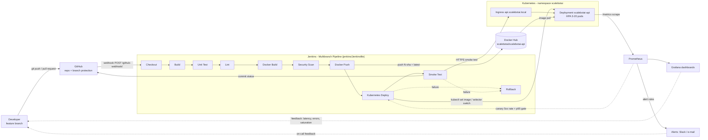
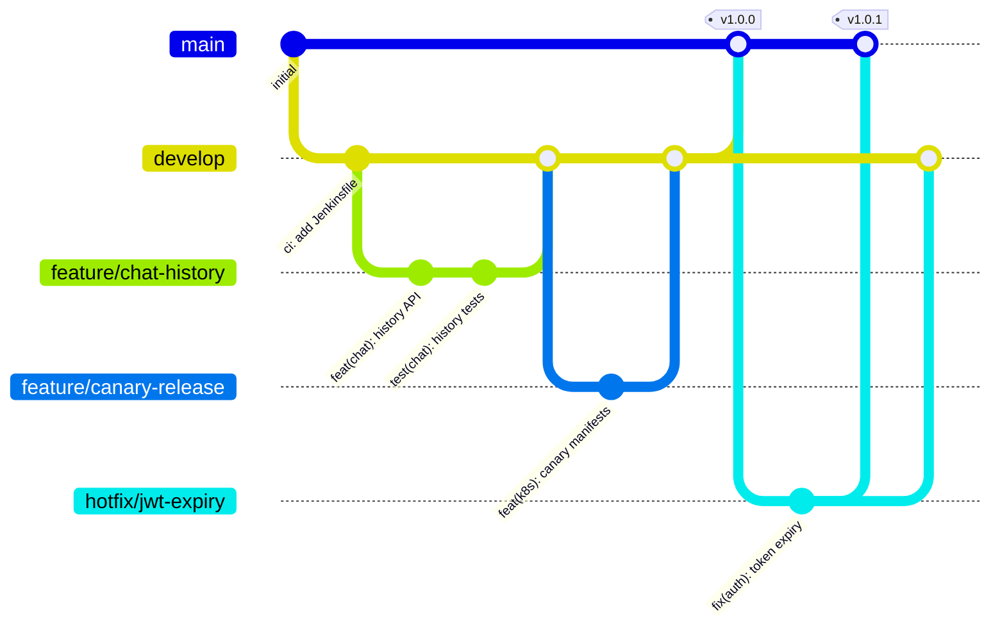
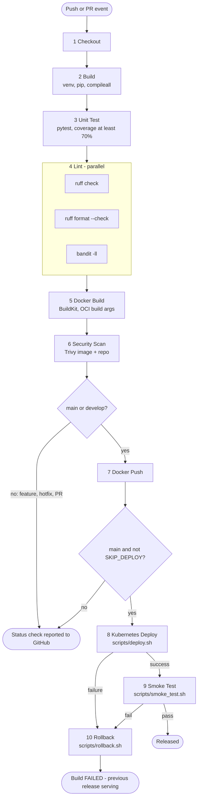
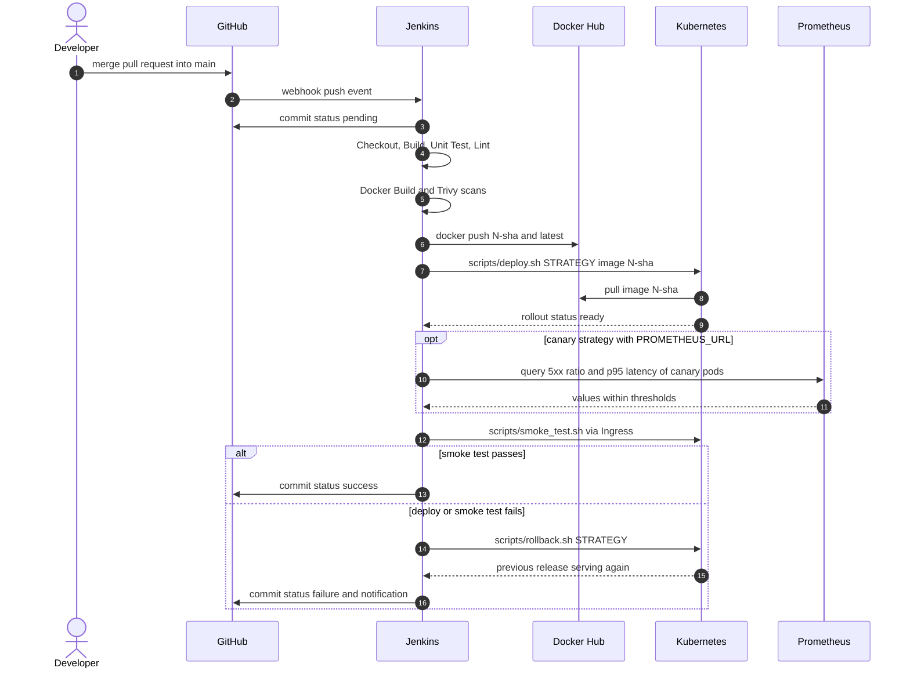
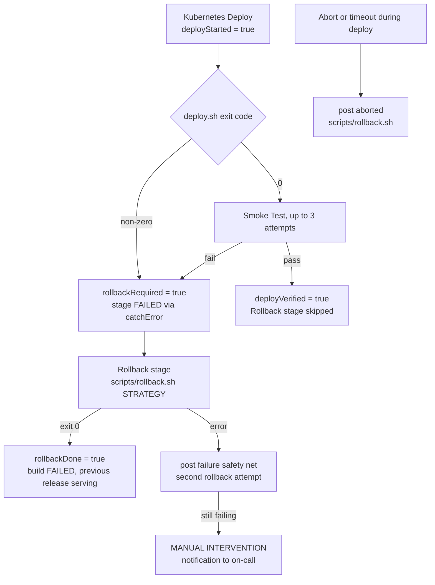

# 08 - CI/CD Pipeline with Jenkins

> **Scope:** how ScaleBotAI goes from a `git push` to a verified release on Kubernetes, and back
> again when something breaks.
> **Implementation:** [`jenkins/Jenkinsfile`](../jenkins/Jenkinsfile), [`scripts/deploy.sh`](../scripts/deploy.sh),
> [`scripts/rollback.sh`](../scripts/rollback.sh), [`scripts/smoke_test.sh`](../scripts/smoke_test.sh).
> **Setup guide:** [`jenkins/README.md`](../jenkins/README.md).
> **Related chapters:** [07 Kubernetes](07-kubernetes-implementation.md), [09 Monitoring & logging](09-monitoring-logging.md),
> [12 Deployment strategies](12-deployment-strategies.md).

---

## 8.1 Goals

| Goal | How the pipeline achieves it |
|---|---|
| Every change is verified before it can merge | Jenkins status check required by GitHub branch protection |
| Fast feedback | feature-branch pipeline finishes in about 5-7 minutes; lint runs in parallel |
| Build once, deploy the same artifact | the image is built, scanned and pushed once, then deployed by its immutable tag |
| Security built in | Bandit (SAST), Trivy image CVE gate, Trivy secret scan, IaC misconfiguration report |
| Zero-downtime releases | rolling (`maxUnavailable: 0`), canary or blue-green, selectable per build |
| Automatic recovery | failed deploy or smoke test triggers `scripts/rollback.sh`, plus a `post { failure }` safety net |
| Traceability | tag `<BUILD_NUMBER>-<git sha>`, OCI labels, `kubernetes.io/change-cause` on every revision |

---

## 8.2 CI/CD architecture



The loop is closed by observability: Prometheus metrics gate canary promotion automatically, and
Grafana dashboards plus alerts feed production behaviour back to the developer, who starts the next change.

---

## 8.3 GitHub repository structure

```text
scalebotai/
├── .github/                  PR template + CODEOWNERS (review routing, PR checklist)
├── src/app/                  FastAPI application package `app` (routers, services, models, chatbot engines)
├── tests/
│   ├── unit/                 fast isolated tests (SQLite + fakeredis) - Unit Test stage
│   ├── integration/          API-level tests through the ASGI app
│   └── load/                 k6, Locust and JMeter load-test plans
├── docker/
│   ├── api/Dockerfile        multi-stage API image, non-root uid 10001, port 8000
│   ├── nginx/                reverse proxy: TLS, rate limiting, JSON access logs
│   └── postgres/init/        database bootstrap scripts for docker compose
├── k8s/
│   ├── base/                 numbered manifests + kustomization.yaml (kubectl apply -k k8s/base)
│   ├── strategies/           canary/ and blue-green/ release manifests
│   └── tls/                  self-signed certificate helper for scalebotai-tls
├── jenkins/                  Jenkinsfile, controller Dockerfile, plugins.txt, compose file, setup README
├── monitoring/               Prometheus rules, Grafana dashboards, Logstash and Filebeat configs
├── scripts/                  deploy.sh, rollback.sh, smoke_test.sh, bootstrap-minikube.sh
├── docs/                     project documentation (this file is chapter 08)
├── docker-compose.yml        complete local stack (API, Postgres, Redis, NGINX, monitoring, ELK)
├── Makefile                  developer shortcuts (test, lint, up, deploy)
├── pyproject.toml            pytest, ruff and coverage configuration
└── requirements*.txt         runtime and development dependencies
```

---

## 8.4 Branching strategy

ScaleBotAI uses a lightweight **Git Flow**: `main` is always deployable, `develop` integrates finished
features, short-lived branches carry individual changes.

| Branch | Created from | Merges into | Pipeline behaviour | Protection |
|---|---|---|---|---|
| `main` | - | - | full pipeline + **deploy to Kubernetes** + smoke test + auto-rollback | PR + 1 approval + green Jenkins check, linear history, no force-push |
| `develop` | `main` | `main` (release PR) | CI + **push image** `<N>-<sha>` (staging candidate) | PR + green Jenkins check |
| `feature/*` | `develop` | `develop` | CI only: build, test, lint, image build + scan | none (short-lived) |
| `hotfix/*` | `main` | `main`, then back-merged into `develop` | CI only; deploys once merged to `main` | none (short-lived) |
| `PR-*` (Jenkins) | - | - | CI on the merge result of PR + target branch | - |



Rules of thumb: feature branches live less than 3 days, PRs stay small (under ~400 changed lines),
`main` is tagged `vMAJOR.MINOR.PATCH` for every release merge, and a hotfix is always back-merged into `develop`.

---

## 8.5 Commit conventions

Commits and PR titles follow **[Conventional Commits](https://www.conventionalcommits.org/)**:
`<type>(<scope>): <imperative summary, max 72 chars>`.

| Type | Use for | Example |
|---|---|---|
| `feat` | new user-visible behaviour | `feat(chat): add conversation rename endpoint` |
| `fix` | bug fix | `fix(auth): reject refresh tokens after logout` |
| `perf` | performance improvement | `perf(bot): cache rule-engine responses in Redis` |
| `refactor` | internal change, same behaviour | `refactor(admin): extract stats queries` |
| `test` | tests only | `test(chat): cover history pagination` |
| `ci` | Jenkins / pipeline | `ci: add trivy secret scan gate` |
| `build` | Docker, dependencies | `build(docker): pin python:3.12-slim digest` |
| `deploy` | Kubernetes manifests, release scripts | `deploy(k8s): raise HPA max replicas to 20` |
| `docs` / `chore` | documentation / housekeeping | `docs: add CI/CD chapter` |

Scopes: `api`, `auth`, `users`, `chat`, `bot`, `admin`, `db`, `cache`, `docker`, `k8s`, `ci`, `monitoring`, `docs`.
Breaking changes use `!` (`feat(api)!: rename /chat/history page params`) plus a `BREAKING CHANGE:` footer.
PRs are squash-merged, so the PR title becomes the commit on `main` - the PR template reminds authors of this.

---

## 8.6 Pipeline overview

| # | Stage | Branches | Main command(s) | Gate | Typical duration |
|---|---|---|---|---|---|
| 1 | Checkout | all | `checkout scm`, `git rev-parse --short=7 HEAD` | HEAD consistent with tag | 5-15 s |
| 2 | Build | all | `python3.12 -m venv .venv`, `pip install -r requirements.txt -r requirements-dev.txt`, `python -m compileall -q src` | dependencies resolve, sources compile | 30-90 s |
| 3 | Unit Test | all | `pytest --junitxml=reports/junit.xml --cov=app --cov-fail-under=70` | all tests pass, coverage >= 70 % | 20-60 s |
| 4 | Lint (parallel) | all | `ruff check src tests`, `ruff format --check src tests`, `bandit -r src/app -ll` | zero findings | 10-20 s |
| 5 | Docker Build | all | `docker build --pull -f docker/api/Dockerfile --build-arg VERSION/VCS_REF/BUILD_DATE` | image builds | 40-180 s |
| 6 | Security Scan | all | `trivy image` (HIGH report + CRITICAL gate), `trivy fs` (secrets gate, misconfig report) | 0 fixable CRITICAL, 0 secrets | 30-90 s |
| 7 | Docker Push | `main`, `develop` | `docker login --password-stdin`, `docker push` | push succeeds | 20-60 s |
| 8 | Kubernetes Deploy | `main` (unless `SKIP_DEPLOY`) | `scripts/deploy.sh "$DEPLOY_STRATEGY" "$IMAGE_NAME:$IMAGE_TAG"` | rollout ready in 300 s (+ canary gates) | 1-5 min (canary +2-4 min) |
| 9 | Smoke Test | `main` | `scripts/smoke_test.sh https://api.scalebotai.local` (3 attempts) | 6 functional checks pass | 10-60 s |
| 10 | Rollback | only after 8 or 9 failed | `scripts/rollback.sh "$DEPLOY_STRATEGY"` | previous release serving | 5 s - 2 min |

End-to-end: about **5-7 min** for a feature branch, **8-12 min** for a rolling release on `main`,
**12-16 min** for a canary release (bake + analysis).

### Stage flow



### Release sequence (main branch)



---

## 8.7 Stages in detail

Pipeline-wide settings (`options {}`): `timestamps()`, `buildDiscarder` (keep 30 builds / 10 with
artifacts), a 45-minute `timeout`, `disableConcurrentBuilds()` (never two deploys of the same branch at
once) and `skipDefaultCheckout(false)` so the implicit checkout has already populated the workspace when
`environment {}` computes `GIT_SHORT` and `IMAGE_TAG = "${BUILD_NUMBER}-${GIT_SHORT}"`.

### Stage 1 - Checkout

| | |
|---|---|
| **What** | `checkout scm` of the exact revision Jenkins was triggered for; re-computes the short SHA and fails if it differs from the one baked into `IMAGE_TAG`; prints commit, author, date and subject; sets the build name to `#N branch@sha`; restores the executable bit on `scripts/*.sh` (lost when committed from Windows). |
| **Why** | Every later artifact (image tag, deployment annotation, report) is tied to one commit. |
| **On failure** | Pipeline stops (`git` / credentials problem). Nothing was built or deployed. |
| **Duration** | 5-15 s |

### Stage 2 - Build

| | |
|---|---|
| **What** | Creates an isolated `python3.12 -m venv .venv`, installs `requirements.txt` + `requirements-dev.txt`, defensively installs `pytest-cov`, `ruff`, `bandit` if missing, and byte-compiles `src` with `python -m compileall -q src`. Saves `reports/pip-freeze.txt` (exact dependency set of this build). |
| **Why** | Catches dependency conflicts and syntax errors in seconds, before slower stages. The venv makes builds reproducible and independent of the agent's global Python. |
| **On failure** | Pipeline stops. Typical causes: unpinned dependency released a breaking version, PyPI outage. |
| **Duration** | 30-90 s (pip cache in `JENKINS_HOME` keeps repeat builds fast) |

### Stage 3 - Unit Test

| | |
|---|---|
| **What** | `pytest --junitxml=reports/junit.xml --cov=app --cov-report=xml:reports/coverage.xml --cov-fail-under=70`. Tests use SQLite (aiosqlite) and fakeredis - no external services. `post { always }` publishes JUnit results and the Cobertura coverage report (Coverage plugin) even when tests fail. |
| **Why** | Functional correctness of auth, chat, history, admin and bot logic; coverage trend visible per build. |
| **On failure** | Pipeline stops; failing tests are listed on the build page; coverage below 70 % fails with `Required test coverage of 70% not reached`. |
| **Duration** | 20-60 s |

### Stage 4 - Lint (parallel)

| | |
|---|---|
| **What** | Three parallel branches: `ruff check src tests` (pyflakes, pycodestyle, isort, bugbear rules from `pyproject.toml`), `ruff format --check src tests` (formatting drift), `bandit -r src/app -ll` (SAST, fails on MEDIUM/HIGH; JSON report archived as `reports/bandit.json`). |
| **Why** | Consistent style and early detection of insecure patterns (hard-coded secrets, `eval`, weak crypto, SQL string building). Parallelism keeps the stage as fast as the slowest tool. |
| **On failure** | Stage fails after all three branches finish (no fail-fast), so a developer sees every problem in one run. |
| **Duration** | 10-20 s |

### Stage 5 - Docker Build

| | |
|---|---|
| **What** | `docker build --pull -f docker/api/Dockerfile` with BuildKit, `--build-arg VERSION=$IMAGE_TAG VCS_REF=$GIT_COMMIT BUILD_DATE=<UTC>` (become OCI labels), inline cache from `:latest`, tagged `<user>/scalebotai-api:<N>-<sha>`; on `main` also tagged `latest`. |
| **Why** | Produces the single immutable artifact that will be scanned, pushed and deployed. `--pull` always picks up the latest patched base image. |
| **On failure** | Pipeline stops. Typical causes: Dockerfile error, base image pull failure, Docker socket permissions. |
| **Duration** | 40-180 s (20-40 s with a warm layer cache) |

### Stage 6 - Security Scan

| | |
|---|---|
| **What** | (a) `trivy image` HIGH+CRITICAL report, JSON + table, **non-blocking**, archived; (b) `trivy fs --scanners misconfig` IaC report for Dockerfiles and manifests, **non-blocking**; (c) `trivy fs --scanners secret` on the repository, **blocking**; (d) `trivy image --severity CRITICAL --ignore-unfixed --exit-code 1`, **blocking**. |
| **Why** | Shift-left security: vulnerable OS packages or Python libraries and leaked credentials never reach the registry. `--ignore-unfixed` blocks only on CVEs that can actually be fixed, keeping the gate actionable. |
| **On failure** | Pipeline stops before the push. Fix: bump the base image or package; accepted risks go to `.trivyignore` with a justification and review date; a leaked secret must be **rotated**, not just deleted. |
| **Duration** | 30-90 s (vulnerability DB cached in `JENKINS_HOME`) |

### Stage 7 - Docker Push

| | |
|---|---|
| **What** | Runs only on `main` and `develop` (`when { anyOf { branch 'main'; branch 'develop' } }`). `withCredentials(usernamePassword('dockerhub-credentials'))`, `docker login --password-stdin` into a per-build `DOCKER_CONFIG`, push `<N>-<sha>` (and `latest` on `main`), print the pushed digest, `docker logout` in `post { always }`. |
| **Why** | Publishes only reviewed, tested, scanned images. Feature branches never pollute the registry. |
| **On failure** | Pipeline stops; nothing deployed. Typical causes: wrong `DOCKERHUB_USER`, expired token, Docker Hub rate limit. |
| **Duration** | 20-60 s (only changed layers are uploaded) |

### Stage 8 - Kubernetes Deploy

| | |
|---|---|
| **What** | Runs on `main` unless `SKIP_DEPLOY=true`. With `withCredentials(file('kubeconfig-scalebotai'))` as `KUBECONFIG` it records the currently deployed image as `PREVIOUS_IMAGE` (rollback target), sets `deployStarted = true` and calls `scripts/deploy.sh "$DEPLOY_STRATEGY" "$IMAGE_NAME:$IMAGE_TAG"`: **rolling** = `kubectl set image deployment/scalebotai-api api=<image>` + change-cause + `rollout status --timeout=300s`; **canary** = canary Deployment, in-cluster smoke test, bake, Prometheus 5xx/p95 gate, promote; **blue-green** = deploy idle colour, smoke test via the preview Service, switch `scalebotai-api-active`. `deploy.sh` writes `.deploy-state` for the rollback script. |
| **Why** | Zero-downtime, strategy-selectable release with a recorded rollback target. |
| **On failure** | The exit code is captured (`returnStatus`), `rollbackRequired = true`, and `catchError` marks the stage and build **FAILED without aborting** - so the Rollback stage still runs. A canary that fails *before* promotion is already removed by `deploy.sh`; a blue-green failure *before* the switch never touched live traffic. |
| **Duration** | rolling 1-3 min, blue-green 1-3 min, canary 3-6 min |

### Stage 9 - Smoke Test

| | |
|---|---|
| **What** | `scripts/smoke_test.sh "$APP_URL"` against `https://api.scalebotai.local` (`INSECURE=1` for the self-signed certificate), up to 3 attempts with 15 s / 30 s pauses. The script checks `GET /health` (200, status `ok`/`degraded`, with exponential backoff), registers a random `smoke_*` user, logs in, sends `POST /api/v1/chat {"message": "What is Kubernetes?"}` (200 + non-empty response), reads `GET /api/v1/chat/history` (at least 1 item), logs out, verifies the revoked token is rejected and deletes the smoke user. Prints PASS/FAIL per check. |
| **Why** | A rollout can be "ready" while the release is functionally broken (bad config, DB auth, Redis password, routing). The smoke test exercises the real path: Ingress, NGINX, API, PostgreSQL, Redis, chatbot engine. |
| **On failure** | `rollbackRequired = true`, stage marked FAILED via `catchError`, Rollback stage runs. |
| **Duration** | 10-60 s |

### Stage 10 - Rollback

| | |
|---|---|
| **What** | `when { expression { rollbackRequired } }` - runs only if stage 8 or 9 failed. Calls `scripts/rollback.sh "$DEPLOY_STRATEGY"` with the kubeconfig credential; sets `rollbackDone = true` on success. |
| **Why** | Mean time to recovery measured in seconds to minutes, without a human in the loop. |
| **On failure** | Stage errors; `post { failure }` retries once (safety net) and the notification says **MANUAL INTERVENTION REQUIRED**. |
| **Duration** | blue-green < 10 s, canary (not promoted) < 10 s, rolling 30-120 s |

### `post {}` actions

| Condition | Action |
|---|---|
| `always` | archive `reports/**` (JUnit, coverage, Bandit, Trivy reports, pip freeze); remove this build's local image tag and dangling layers of this commit |
| `success` | success message (Slack / e-mail templates included as comments) |
| `failure` | **safety net**: if a deploy started but was neither verified nor rolled back, run `scripts/rollback.sh`; failure notification |
| `aborted` | same safety net when a user abort or the 45-minute timeout interrupts a deploy |
| `cleanup` | `cleanWs()` - runs last so `failure`/`aborted` can still use `scripts/` and `.deploy-state` |

---

## 8.8 Quality gates

| # | Gate | Tool | Threshold | Stage | Blocking |
|---|---|---|---|---|---|
| 1 | Peer review | GitHub branch protection | 1 approval + green Jenkins check | before merge | yes |
| 2 | Compilation | `compileall` | no syntax errors | Build | yes |
| 3 | Tests | pytest | 100 % pass | Unit Test | yes |
| 4 | Coverage | pytest-cov | >= 70 % of `app` | Unit Test | yes |
| 5 | Lint | `ruff check` | 0 findings | Lint | yes |
| 6 | Formatting | `ruff format --check` | 0 files to reformat | Lint | yes |
| 7 | SAST | `bandit -ll` | 0 MEDIUM/HIGH issues | Lint | yes |
| 8 | Image CVEs | Trivy | 0 fixable CRITICAL | Security Scan | yes |
| 9 | Image CVE report | Trivy | HIGH + CRITICAL listed | Security Scan | no (artifact) |
| 10 | Secrets in repo | Trivy secret scanner | 0 HIGH/CRITICAL | Security Scan | yes |
| 11 | IaC misconfiguration | Trivy misconfig scanner | report | Security Scan | no (artifact) |
| 12 | Rollout health | `kubectl rollout status` + readiness probes | all pods ready within 300 s | Kubernetes Deploy | yes, triggers rollback |
| 13 | Canary stability | `deploy.sh` bake loop | 0 restarts, at least 1 ready pod | Kubernetes Deploy (canary) | yes, canary removed |
| 14 | Canary SLO | Prometheus | 5xx ratio <= 1 %, p95 <= 500 ms | Kubernetes Deploy (canary) | yes, canary removed |
| 15 | Functional smoke | `smoke_test.sh` | all 6 checks PASS | Smoke Test | yes, triggers rollback |

The canary thresholds mirror the project SLOs (error rate < 1 %, average latency < 300 ms; p95 is given
more headroom). They are configurable through `CANARY_MAX_ERROR_RATE` and `CANARY_MAX_P95_SECONDS`.

---

## 8.9 Image tagging and promotion

| Tag | Example | Produced by | Mutable | Used for |
|---|---|---|---|---|
| `<BUILD_NUMBER>-<git short sha>` | `scalebotai/scalebotai-api:57-3f9c2ab` | `main` and `develop` builds | **no** | every Kubernetes deployment, rollback targets, audit trail |
| `latest` | `scalebotai/scalebotai-api:latest` | `main` builds only | yes | docker compose / local convenience, BuildKit cache source - never deployed by the pipeline |
| `local-<sha>` | `scalebotai/scalebotai-api:local-3f9c2ab` | `scripts/bootstrap-minikube.sh` | n/a | local minikube builds, never pushed |

- **Traceability:** the build args `VERSION`, `VCS_REF` and `BUILD_DATE` become OCI labels
  (`docker inspect` shows the source commit); each Deployment revision carries
  `kubernetes.io/change-cause = "<strategy> deploy of <image> (<BUILD_TAG> by <user>)"`, so
  `kubectl rollout history deployment/scalebotai-api` maps a revision to a Jenkins build and a commit.
- **Build once, deploy the same bytes:** within a pipeline run the image that passed the tests and the
  Trivy gate is exactly the one pushed and deployed (same tag, digest printed after the push).
- **Promotion path:** `feature/*` (verified, not published) → `develop` (published `<N>-<sha>`, staging
  candidate) → release PR to `main` (new merge commit, rebuilt, re-scanned, published, deployed).
  Rebuilding on `main` re-runs every gate on the exact merged code and picks up base-image patches.
  A future improvement is promotion by digest (`docker buildx imagetools create`) to a staging namespace
  fed by `develop`.

---

## 8.10 Secrets handling in Jenkins

| Secret | Stored in | Exposed to | Protection |
|---|---|---|---|
| Docker Hub access token | credential `dockerhub-credentials` (username/password) | Docker Push stage only | masked in logs, `--password-stdin`, per-build `DOCKER_CONFIG`, `docker logout`, token (not password) with Read & Write scope only |
| Cluster access | credential `kubeconfig-scalebotai` (secret file) | Kubernetes Deploy, Rollback, post safety net | temporary file deleted after each `withCredentials` block; ServiceAccount `jenkins-deployer` limited by a namespaced Role (no Secrets, no cluster-wide rights); token has an expiry |
| GitHub access | credential `github-credentials` | Multibranch branch source | fine-grained PAT scoped to one repository (or a GitHub App) |
| Application secrets (DB password, JWT key, admin password) | Kubernetes Secret `scalebotai-secrets` | API pods only | **never** pass through Jenkins - the pipeline changes only the image |

Practices enforced by the Jenkinsfile and repository:

1. **No secrets in Git** - `.env.example` holds `change-me-...` placeholders; the Trivy secret scan blocks
   accidental commits.
2. **No Groovy interpolation of secrets** - every `sh` step is single-quoted, so `$DOCKERHUB_TOKEN` is
   expanded by the shell from the masked environment, never embedded in the Groovy string.
3. **Least privilege and short scope** - each credential is bound only inside the stage that needs it.
4. **Fork PRs never get credentials** - "Discover pull requests from forks: trust nobody".
5. **Jenkins at rest** - credentials are encrypted with the controller master key in
   `JENKINS_HOME/secrets/`; the `jenkins_home` volume must be backed up and protected accordingly.
6. **Rotation** - Docker Hub token and ServiceAccount token are rotated at least every 90 days or
   immediately after any suspected leak.

Production evolution: HashiCorp Vault or the External Secrets Operator for application secrets, OIDC
workload identity instead of static kubeconfig tokens, and image signing with cosign.

---

## 8.11 Deployment strategies used by the pipeline

`DEPLOY_STRATEGY` selects how `scripts/deploy.sh` releases the image (details and trade-offs in
[chapter 12](12-deployment-strategies.md)):

| Strategy | What `deploy.sh` does | Extra resources | Rollback speed | Best for |
|---|---|---|---|---|
| `rolling` (default) | `kubectl set image` on `scalebotai-api`; RollingUpdate `maxSurge 25%`, `maxUnavailable 0`; waits for `rollout status` | +25 % pods during rollout | 30-120 s (`rollout undo`) | everyday releases |
| `canary` | applies `k8s/strategies/canary/deployment-canary.yaml`, sets the new image, smoke-tests the canary pod via port-forward, bakes 120 s under real traffic (restart watch), checks Prometheus 5xx ratio and p95 if `PROMETHEUS_URL` is set, then promotes to `scalebotai-api` and deletes the canary | +1 pod | < 10 s before promotion | risky changes, new bot logic |
| `blue-green` | reads the live colour from `scalebotai-api-active`, deploys the idle colour, smoke-tests it through `scalebotai-api-preview`, patches the active selector, keeps the old colour running | 2x pods while both colours run | < 10 s (selector switch) | schema-compatible big releases, demos |

Notes: the canary receives live traffic through the normal Service `scalebotai-api` by replica ratio
(1 canary next to 3 stable pods is about 25 %, "Variant A" in `k8s/strategies/canary/README.md`); any
leftover ingress-nginx canary Ingress is removed together with the canary. Blue-green *replaces* the base
Deployment rather than running beside it - switching a cluster into blue-green mode (applying
`k8s/strategies/blue-green/`, re-pointing the Ingress at `scalebotai-api-active`, scaling the base
Deployment away) is a one-time step documented in `k8s/strategies/blue-green/README.md`; `deploy.sh`
warns if the base Deployment is still running.

---

## 8.12 Rollback design

Rollback is layered so that a bad release is contained at the earliest possible point:

| Layer | Mechanism | What it protects against |
|---|---|---|
| 1. Kubernetes | readiness probe `/health/ready` + `maxUnavailable: 0` | a broken rolling update never receives traffic; old pods keep serving while the rollout stalls |
| 2. `deploy.sh` | canary deleted on any pre-promotion failure; blue-green never switches if the idle colour fails | most failures are absorbed before users see the new version |
| 3. Jenkins Rollback stage | `rollbackRequired` flag + `when { expression {...} }` → `scripts/rollback.sh` | rollout timeout, failed promotion, failed smoke test |
| 4. `post { failure }` / `post { aborted }` | safety net when `deployStarted && !deployVerified && !rollbackDone` | the Rollback stage failed, user abort or timeout during deploy |
| 5. Manual | `scripts/rollback.sh <strategy>` or kubectl commands below | problems found later (alerts, user reports) |



### What `rollback.sh` does per strategy

| Strategy | Automatic action | Safety check |
|---|---|---|
| rolling | `kubectl rollout undo deployment/scalebotai-api` + `rollout status` | skipped when the Deployment already runs `PREVIOUS_IMAGE` (deploy failed before changing anything), so a good release is never reverted by mistake |
| canary | delete `scalebotai-api-canary`; `rollout undo` the stable Deployment only if the image was promoted (`CANARY_PROMOTED` in `.deploy-state`, or inferred by comparing images) | stable untouched when the canary never got promoted |
| blue-green | patch `scalebotai-api-active` back to `PREVIOUS_COLOR` (or the opposite colour if no state), scale the standby up first if it had been scaled down, verify endpoints, scale the failed colour to 0 | no-op when traffic was never switched |

`deploy.sh` records `STRATEGY`, `IMAGE`, `PREVIOUS_IMAGE`, `PREVIOUS_REVISION`, `PREVIOUS_COLOR`,
`NEW_COLOR`, `SWITCHED`, `CANARY_PROMOTED` and `STATUS` in `.deploy-state` (workspace file, git-ignored);
Jenkins additionally exports `PREVIOUS_IMAGE`. Without the state file (e.g. manual rollback hours later)
`rollback.sh` falls back to safe cluster-side inference.

### Manual rollback cheat sheet

```bash
# Same logic as Jenkins (needs a kubeconfig with access to namespace scalebotai)
scripts/rollback.sh rolling            # or canary / blue-green

# Inspect and pick a revision
kubectl -n scalebotai rollout history deployment/scalebotai-api
TO_REVISION=12 scripts/rollback.sh rolling
kubectl -n scalebotai rollout undo deployment/scalebotai-api --to-revision=12

# Roll forward to a known-good immutable tag
scripts/deploy.sh rolling scalebotai/scalebotai-api:55-9ab12cd

# Blue-green: switch live traffic back instantly
kubectl -n scalebotai patch service scalebotai-api-active --type=merge \
  -p '{"spec":{"selector":{"color":"blue"}}}'

# Canary: remove it
kubectl -n scalebotai delete deployment scalebotai-api-canary
```

---

## 8.13 How CI/CD makes deployments faster - DORA metrics

The four **DORA** metrics (DevOps Research and Assessment) measure delivery performance: two for
speed, two for stability. The table compares a manual process (SSH, hand-run `docker build`,
`kubectl apply`, manual checks) with this pipeline. Values are **estimates** for a small team working on
this project.

| Metric | Definition | Before (manual) | After (Jenkins CI/CD) | DORA level after |
|---|---|---|---|---|
| Deployment frequency | how often code reaches production | about once every 1-2 weeks (batched, risky) | on every merge to `main`; several per day possible | Elite (on demand) |
| Lead time for changes | commit to running in production | 2-5 days (waiting for a release window) | about 30-60 min incl. review; pipeline itself 8-12 min | Elite (< 1 day) |
| Change failure rate | share of deployments causing a failure | about 20-30 % (skipped tests, config drift, "works on my machine") | about 5-10 % (15 automated gates, identical artifact everywhere) | Elite (0-15 %) |
| Time to restore service (MTTR) | time to recover from a failed deployment | 1-4 h (diagnose, rebuild old version, redeploy) | 10 s - 5 min (automatic rollback; blue-green switch in seconds) | Elite (< 1 h) |

Where the time goes in one release:

| Activity | Manual | Automated |
|---|---|---|
| Run tests, lint, security checks | 15-20 min, often skipped | 1-2 min, always, in parallel |
| Build and tag image | 10 min | 1-3 min (BuildKit cache) |
| Push and deploy | 20-30 min (SSH, hand-edited manifests) | 2-5 min (`deploy.sh`) |
| Verify release | 10-15 min of clicking through the API | < 1 min (`smoke_test.sh`) |
| Roll back a bad release | 30-60 min | 10 s - 2 min, automatic |
| **Engineer time per release** | **about 1.5-2 h** | **about 0 min** (review only) |

Why it is faster *and* safer: small batches (one PR per deploy) are easy to verify and roll back;
automated gates remove waiting time and human error; immutable tags plus recorded previous image make
rollback a single command; zero-downtime strategies remove the need for maintenance windows; and
Prometheus/Grafana feedback shortens detection time, which dominates MTTR.

How to measure them in this project: deployment frequency and lead time from Jenkins build history
(`main` builds with a successful Deploy stage, commit timestamp vs. build end), change failure rate from
builds where the Rollback stage ran, and MTTR from alert start to rollback completion in Grafana / the
build log.

---

## 8.14 Troubleshooting

| Symptom | Likely cause | Fix |
|---|---|---|
| Push does not start a build | webhook unreachable or wrong URL | GitHub → Webhooks → Recent Deliveries must show 200; URL ends with `/github-webhook/`; use ngrok/smee for a laptop; periodic scan is the fallback |
| `python3.12 not found on this agent` | build ran on an agent without the toolchain | use the `jenkins/Dockerfile` image or an agent label with python3.12 |
| `Required test coverage of 70% not reached` | new code without tests | add tests; see the `term-missing` coverage table in the log |
| `ruff format --check` fails | unformatted files | run `ruff format src tests` locally (or a pre-commit hook) |
| Bandit `B105 hardcoded_password_string` | literal secret-like string | move to configuration; justified false positives get `# nosec B105` |
| `permission denied ... docker.sock` | jenkins user not in the socket's group | set `DOCKER_GID` and recreate the Jenkins container |
| `BuildKit is enabled but the buildx component is missing` | docker CLI without buildx | rebuild the Jenkins image (`docker-buildx-plugin`) |
| Trivy CRITICAL gate fails | vulnerable base image or library | rebuild (`--pull`), bump the package; accepted risk goes into `.trivyignore` with a reason |
| Trivy `TOOMANYREQUESTS` / DB download error | vulnerability DB registry rate limit | retry; keep the cache in `JENKINS_HOME`; `--db-repository mirror.gcr.io/aquasec/trivy-db` |
| Trivy secret scan fails | credential committed | **rotate** the credential, remove it from history, re-run |
| `denied: requested access to the resource is denied` on push | wrong `DOCKERHUB_USER`, missing repo, token without write scope | create the repo, regenerate the token, check the parameter |
| `Forbidden ... cannot patch resource "deployments"` | Role of `jenkins-deployer` incomplete | compare `k8s/base/11-rbac.yaml` with the permission table in `jenkins/README.md` |
| `dial tcp 192.168.49.2:8443: i/o timeout` | Jenkins container not on the minikube network | `docker network connect minikube scalebotai-jenkins` |
| Rollout timeout, pods `ImagePullBackOff` | tag not pushed (Push skipped) or private repo | check Docker Hub; deploy only runs after a successful push on `main` |
| Rollout timeout, pods `CrashLoopBackOff` / not ready | bad config, DB/Redis unreachable, failing readiness | `kubectl -n scalebotai describe pod`, `kubectl logs`; Jenkins already rolled back |
| Smoke test `Could not resolve host: api.scalebotai.local` | no hosts entry in Jenkins | `MINIKUBE_IP` + `extra_hosts`, or `SMOKE_RESOLVE=api.scalebotai.local:443:<ip>` |
| Smoke test SSL certificate error | self-signed certificate | `INSECURE=1` (set by the Smoke Test stage) |
| Smoke test register returns 422 | e-mail on a reserved TLD rejected by EmailStr | the script uses `@scalebotai.dev`; keep custom changes off `.local`/`.test` |
| Smoke test 429 `RATE_LIMITED` | many runs from one IP within a minute | wait for `Retry-After` or raise `RATE_LIMIT_PER_MINUTE` |
| Canary aborted: "5xx error rate exceeds threshold" | real regression or noisy low-traffic sample | inspect Grafana for the canary pod; adjust `CANARY_MAX_ERROR_RATE` / bake time only with evidence |
| Blue-green: "no ready endpoints after the switch" | colour labels on pods do not match the Service selector | check `kubectl get pods --show-labels`; Jenkins switches back automatically |
| Rollback says "already runs the known-good image" | deploy failed before changing the Deployment | expected - nothing to undo |
| `/usr/bin/env: 'bash\r': No such file or directory` | scripts checked out with CRLF | `.gitattributes`: `*.sh text eol=lf`, re-checkout |
| `scripts/deploy.sh: Permission denied` | executable bit lost (Windows commit) | Checkout stage runs `chmod +x`; fix permanently with `git update-index --chmod=+x scripts/*.sh` |

---

## 8.15 Key takeaways

- One declarative `Jenkinsfile` encodes the whole path from commit to production: **10 stages, 15
  quality gates, 3 release strategies, 5 layers of rollback**.
- Only `main` deploys and only `main`/`develop` publish images; every branch gets the same verification.
- Images are immutable (`<BUILD_NUMBER>-<sha>`), scanned before they are pushed, and traceable to a commit.
- Secrets stay in the Jenkins credential store and Kubernetes Secrets - never in Git or Groovy strings.
- Automation moves every DORA metric into the elite band: deploy on demand, lead time in minutes,
  low change failure rate, and recovery in seconds to minutes.
