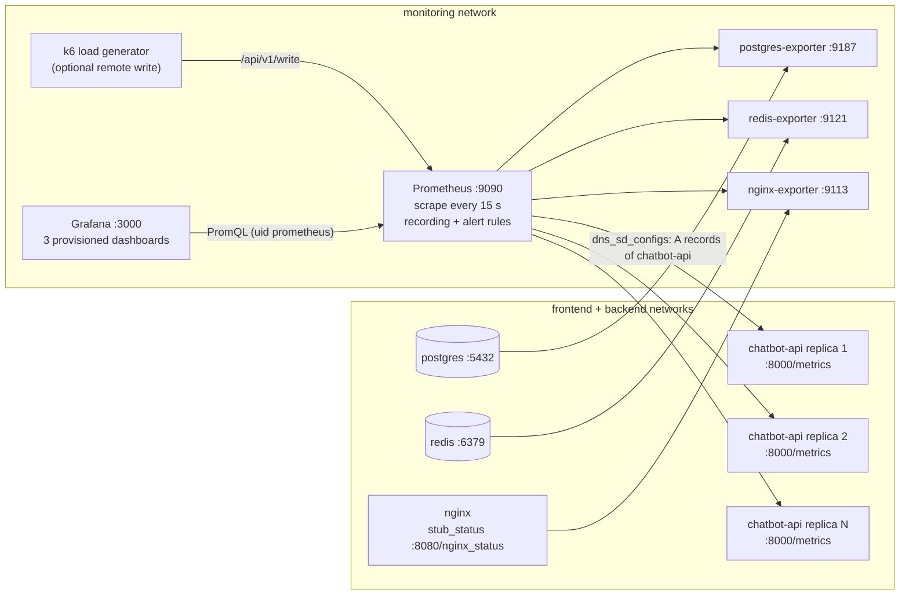
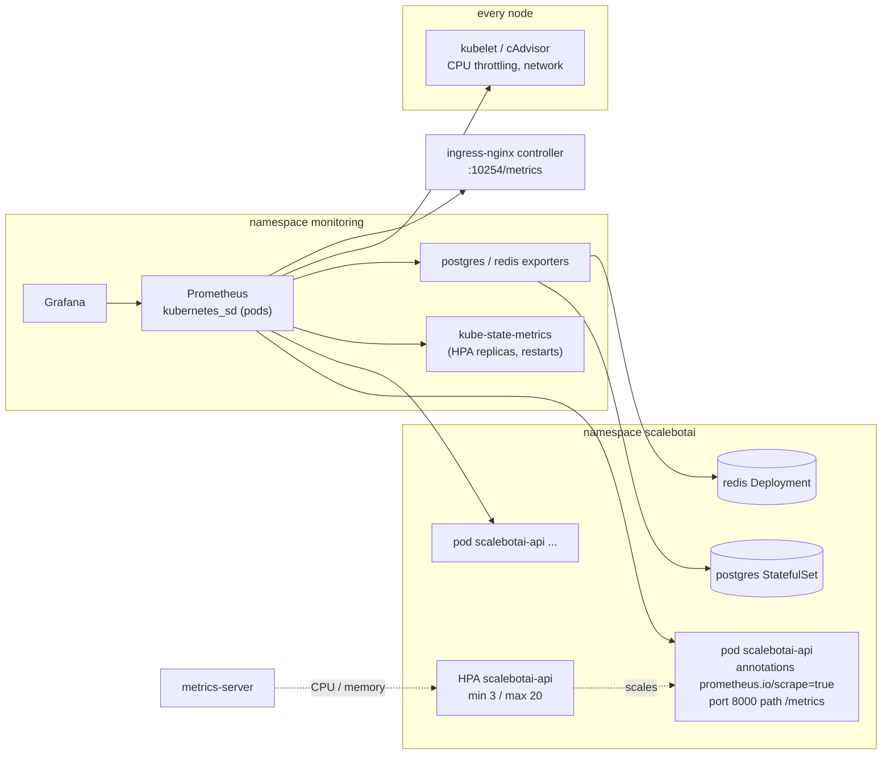
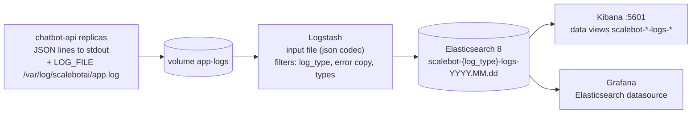
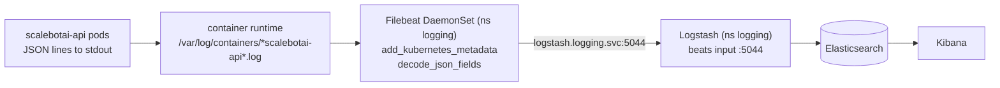

# 09 - Monitoring & Logging

ScaleBotAI promises **99.9 % availability, average latency < 300 ms and < 1 % errors** at
1,000,000+ requests/day. Promises like that only mean something if they are measured. This
chapter covers the observability stack:

- **Metrics:** Prometheus + exporters, with Grafana dashboards and Prometheus alert rules.
- **Logs:** structured JSON logs flow through Logstash into Elasticsearch, where Kibana
  searches them.

The same configuration serves Docker Compose and Kubernetes.

| Concern | Tool | Config in the repo |
|---|---|---|
| Metrics collection & alert evaluation | Prometheus | `monitoring/prometheus/prometheus.yml`, `alert-rules.yml` |
| Infrastructure metrics | postgres-exporter, redis-exporter, nginx-exporter | services in `docker-compose.yml` / `k8s/` |
| Visualisation | Grafana | `monitoring/grafana/provisioning/**`, `monitoring/grafana/dashboards/*.json` |
| Log processing | Logstash | `monitoring/logstash/config/logstash.yml`, `pipeline/logstash.conf` |
| Log shipping (k8s) | Filebeat DaemonSet | `monitoring/filebeat/filebeat.yml` |
| Log storage & search | Elasticsearch 8 + Kibana | `monitoring/kibana/create-data-views.sh`, `monitoring/kibana/README.md` |
| Load-test metrics | k6 remote write -> Prometheus | `tests/load/k6/README.md` |

---

## 1. Access

| UI | Docker Compose | Kubernetes |
|---|---|---|
| Grafana | http://localhost:3000 (user `admin`, password `GRAFANA_ADMIN_PASSWORD`) | `kubectl -n monitoring port-forward svc/grafana 3000:3000` |
| Prometheus | http://localhost:9090 (`/targets`, `/rules`, `/alerts`) | `kubectl -n monitoring port-forward svc/prometheus 9090:9090` |
| Kibana | http://localhost:5601 | `kubectl -n logging port-forward svc/kibana 5601:5601` |
| Elasticsearch | http://127.0.0.1:9200 (localhost only) | `kubectl -n logging port-forward svc/elasticsearch 9200:9200` |
| Raw app metrics | `docker compose exec chatbot-api curl -s localhost:8000/metrics` | `kubectl -n scalebotai port-forward deploy/scalebotai-api 8000:8000` then `curl localhost:8000/metrics` |

`/metrics` is **never exposed publicly**: NGINX denies it and the Ingress does not route it.
Prometheus scrapes the pods/containers directly on the internal network.

First-time setup of Kibana (data views, ILM policy, index template):
`bash monitoring/kibana/create-data-views.sh`.

---

## 2. Architecture

### 2.1 Metrics path - Docker Compose



`docker compose up -d --scale chatbot-api=3` needs no Prometheus change. Docker's embedded
DNS returns one A record per container, and `dns_sd_configs` turns each record into a
target (`instance=<container-ip>:8000`).

### 2.2 Metrics path - Kubernetes



The HPA uses **metrics-server** (resource metrics API), not Prometheus. Prometheus is the
system of record for dashboards and alerts. Keep the scrape job name `scalebotai-api`
in k8s too: the rules and dashboards filter on it, and the dashboards also have a `$job`
variable.

### 2.3 Logs path - Docker Compose



### 2.4 Logs path - Kubernetes



In k8s the app only writes to stdout (`LOG_FILE` empty), following the twelve-factor
pattern. The container runtime stores the lines on the node and Filebeat tails them. Pods
need no sidecars and no shared volumes.

---

## 3. Metrics catalog

All application metrics are exposed by the FastAPI app at `:8000/metrics` with
`prometheus_client`. Each container runs one uvicorn process, so there is no multiprocess
mode. `/metrics` and `/health*` are excluded from the request metrics.

| Metric | Type | Labels | Meaning | Example PromQL |
|---|---|---|---|---|
| `scalebot_http_requests_total` | counter | `method`, `route`, `status` | Completed HTTP requests. `route` is the **templated** path (`/api/v1/chat/conversations/{conversation_id}`), which keeps label cardinality bounded | `sum(rate(scalebot_http_requests_total[1m]))` |
| `scalebot_http_request_duration_seconds` | histogram (buckets .005 .01 .025 .05 .1 .2 .3 .5 .75 1 2.5 5 10) | `method`, `route` | End-to-end request latency inside the app | `histogram_quantile(0.95, sum by (le) (rate(scalebot_http_request_duration_seconds_bucket[5m])))` |
| `scalebot_http_requests_in_progress` | gauge | - | Requests being processed right now | `sum(scalebot_http_requests_in_progress)` |
| `scalebot_chat_messages_total` | counter | `bot_mode` (`rule`/`llm`/`rule-fallback`), `cached` | Chat messages answered | `sum by (bot_mode) (rate(scalebot_chat_messages_total[5m]))` |
| `scalebot_bot_response_seconds` | histogram | `bot_mode` | Time the chatbot engine needed for an answer (excludes HTTP/DB) | `histogram_quantile(0.95, sum by (le, bot_mode) (rate(scalebot_bot_response_seconds_bucket[5m])))` |
| `scalebot_cache_hits_total` | counter | `cache` (`bot_response`/`user`/`analytics`) | Redis cache hits | see hit ratio below |
| `scalebot_cache_misses_total` | counter | `cache` | Redis cache misses | `sum(rate(scalebot_cache_hits_total[5m])) / (sum(rate(scalebot_cache_hits_total[5m])) + sum(rate(scalebot_cache_misses_total[5m])))` |
| `scalebot_rate_limited_total` | counter | - | Requests rejected with 429 by the app limiter | `sum(rate(scalebot_rate_limited_total[5m]))` |
| `scalebot_auth_events_total` | counter | `event` (`register`/`login_success`/`login_failure`/`logout`/`refresh`) | Authentication activity | `sum by (event) (increase(scalebot_auth_events_total[1h]))` |
| `scalebot_db_pool_checked_out` | gauge | - | SQLAlchemy connections in use | `max(scalebot_db_pool_checked_out / scalebot_db_pool_size)` |
| `scalebot_db_pool_size` | gauge | - | Configured pool size (`DB_POOL_SIZE`) | `sum(scalebot_db_pool_size)` |
| `scalebot_app_info` | gauge (=1) | `version`, `bot_mode`, `environment` | Build/runtime info, for joins and version tracking | `count by (version) (scalebot_app_info)` - shows a rollout in progress |
| `process_cpu_seconds_total` | counter | - | CPU time of the uvicorn process | `rate(process_cpu_seconds_total{job="scalebotai-api"}[5m])` (cores) |
| `process_resident_memory_bytes` | gauge | - | RSS memory | `max(process_resident_memory_bytes{job="scalebotai-api"})` |
| `process_start_time_seconds` | gauge | - | Process start (uptime, restart detection) | `time() - process_start_time_seconds{job="scalebotai-api"}` |
| `python_gc_collections_total` | counter | `generation` | GC activity (leak investigations) | `rate(python_gc_collections_total[5m])` |

**Cardinality rules.**
- `user_id`, `request_id` and raw URLs are **never** labels. They belong in logs.
- Worst case at 20 replicas is about 32 routes x 16 histogram series x 20 pods, roughly 10k
  series for the histogram. Prometheus handles that easily.

**Exporter metrics used by dashboards and alerts:** `pg_up`, `pg_stat_database_numbackends`,
`pg_stat_activity_count`, `pg_stat_database_xact_commit/rollback`, `pg_stat_database_blks_hit/read`,
`pg_stat_database_deadlocks`, `pg_settings_max_connections`, `pg_database_size_bytes`;
`redis_up`, `redis_memory_used_bytes`, `redis_connected_clients`, `redis_commands_processed_total`,
`redis_keyspace_hits_total/misses_total`, `redis_evicted_keys_total`; `nginx_up`,
`nginx_connections_active/reading/writing/waiting`, `nginx_connections_accepted/handled`,
`nginx_http_requests_total`. k8s only: `kube_horizontalpodautoscaler_*`,
`kube_pod_container_status_restarts_total` (kube-state-metrics),
`container_cpu_cfs_throttled_periods_total` and `container_network_*_bytes_total` (cAdvisor).

---

## 4. Golden signals

| Golden signal | What we watch | Metric / PromQL | SLO / alert |
|---|---|---|---|
| **Latency** | P50/P95/P99 and average request time, per route | `job:scalebot_http_request_duration_seconds:p95_5m`, `...:avg_5m` | avg < 300 ms (`HighAvgLatency`), P95 < 300 ms warning (`HighLatencyP95`) |
| **Traffic** | Requests/s total, per route, per status; chat messages/s by mode | `job:scalebot_http_requests:rate1m` | design: 11.6 req/s avg, ~116 req/s peak, 500 req/s headroom |
| **Errors** | 5xx ratio (server), 4xx incl. 429 (client), login failures | `job:scalebot_http_requests_errors:ratio_rate5m` | < 1 % (`HighErrorRate`) |
| **Saturation** | CPU cores per pod, RSS vs 512Mi, in-flight requests, DB pool, PG connections, Redis memory, NGINX connections | `rate(process_cpu_seconds_total[5m])`, `process_resident_memory_bytes`, `scalebot_db_pool_checked_out / scalebot_db_pool_size` | CPU < 80 % (`HighCPU`), memory < 80 % (`HighMemory`), `DBPoolSaturation`, `TooManyPostgresConnections` |

Availability (99.9 %) is measured as the share of non-5xx responses plus the `up` series:

```promql
# availability over 30 days (request-based SLI)
1 - (sum(increase(scalebot_http_requests_total{status=~"5.."}[30d]))
     / sum(increase(scalebot_http_requests_total[30d])))
# error budget for 99.9 %: 0.1 % of requests, or 43.8 minutes of full downtime per month
```

---

## 5. Key PromQL queries

| Question | PromQL |
|---|---|
| Requests per second (RPS) | `sum(rate(scalebot_http_requests_total[1m]))` |
| RPS by route | `sum by (route) (rate(scalebot_http_requests_total[1m]))` |
| P50 / P95 / P99 latency | `histogram_quantile(0.50 \| 0.95 \| 0.99, sum by (le) (rate(scalebot_http_request_duration_seconds_bucket[5m])))` |
| Average latency | `sum(rate(scalebot_http_request_duration_seconds_sum[5m])) / sum(rate(scalebot_http_request_duration_seconds_count[5m]))` |
| Slowest routes (P95) | `topk(5, histogram_quantile(0.95, sum by (le, route) (rate(scalebot_http_request_duration_seconds_bucket[5m]))))` |
| Error rate (5xx) | `sum(rate(scalebot_http_requests_total{status=~"5.."}[5m])) / sum(rate(scalebot_http_requests_total[5m]))` |
| CPU per pod (cores) | `rate(process_cpu_seconds_total{job="scalebotai-api"}[5m])` |
| Memory per pod | `process_resident_memory_bytes{job="scalebotai-api"}` |
| Memory as % of limit | `process_resident_memory_bytes{job="scalebotai-api"} / (512*1024*1024)` |
| App cache hit ratio | `sum(rate(scalebot_cache_hits_total[5m])) / (sum(rate(scalebot_cache_hits_total[5m])) + sum(rate(scalebot_cache_misses_total[5m])))` |
| Redis hit ratio | `sum(rate(redis_keyspace_hits_total[5m])) / (sum(rate(redis_keyspace_hits_total[5m])) + sum(rate(redis_keyspace_misses_total[5m])))` |
| Replicas serving | `count(up{job="scalebotai-api"} == 1)` |
| Chat throughput by engine | `sum by (bot_mode) (rate(scalebot_chat_messages_total[5m]))` |
| Little's Law check | `sum(scalebot_http_requests_in_progress)` vs `RPS x avg latency` |
| Version rollout progress | `count by (version) (scalebot_app_info)` |

### Recording rules (`alert-rules.yml`, group `scalebotai-recording-rules`)

| Record | Expression (summary) |
|---|---|
| `job:scalebot_http_requests:rate1m` / `:rate5m` | total RPS per job |
| `job_route:scalebot_http_requests:rate1m` | RPS per route |
| `job:scalebot_http_requests_errors:ratio_rate5m` | 5xx / all |
| `job:scalebot_http_request_duration_seconds:p50_5m`, `:p95_5m`, `:p99_5m`, `:avg_5m` | latency |
| `job_route:scalebot_http_request_duration_seconds:p95_5m` | P95 per route |
| `job:scalebot_cache_hit_ratio:rate5m`, `job_cache:scalebot_cache_hit_ratio:rate5m` | cache hit ratio |
| `instance:scalebot_cpu_cores:rate5m`, `instance:scalebot_db_pool_utilisation:ratio` | saturation |

---

## 6. Dashboards

Grafana provisions three dashboards into the **ScaleBotAI** folder. The file provider
re-reads `/var/lib/grafana/dashboards` every 30 s. All panels use the datasource
`{type: prometheus, uid: prometheus}`, and every dashboard links to the other two.

### 6.1 ScaleBotAI - API Overview (`uid: scalebotai-api-overview`)

Variables: `$job` (from `scalebot_app_info`), `$instance` (multi-select, *All*). Annotation:
"Replica (re)starts" marks deploys, crashes and scale-ups.

| Row | Panel | Shows |
|---|---|---|
| Overview | Replicas up | `count(up == 1)` for the API job |
| | Requests / sec | total RPS |
| | Avg latency (SLO < 300 ms) | 5-min mean; orange > 200 ms, red > 300 ms |
| | P95 latency | 5-min P95; red > 500 ms |
| | Error rate (5xx) | ratio; red > 1 % |
| | Cache hit ratio | app-level hits / (hits + misses) |
| | Uptime (youngest replica) | `time() - process_start_time_seconds` |
| | App info | version / bot mode / environment from `scalebot_app_info` |
| | In-flight requests, Rate-limited / sec | concurrency and 429s |
| | DB pool usage (gauge) | busiest replica's `checked_out / size` |
| Traffic | Requests / sec - total and by status | `2xx` should dominate |
| | Requests / sec by route | method + templated route |
| Latency | Response time P50 / P95 / P99 / average | dashed red line at 300 ms |
| | P95 latency by route | finds the slow endpoint (login is slow by design: bcrypt) |
| Errors | Error rate % | 5xx and 4xx ratios with the 1 % line |
| | Non-2xx responses by route and status | stacked |
| Saturation | CPU usage (cores) | per replica, line at 0.8 core |
| | Memory (RSS) | per replica, 400Mi alert and 512Mi limit lines |
| | Requests in progress | per replica |
| | DB pool - checked out vs size | dashed line = pool size |
| | Python GC collections / sec | leak investigations |
| Chatbot & cache | Chat messages / sec by bot_mode | plus "served from cache" |
| | Bot engine response time (P95) by mode | rule vs llm vs fallback |
| | Cache hit ratio by cache | bot_response / user / analytics |
| Security & auth | Auth events / sec | login_failure in red |
| | Rate-limited requests / sec | app limiter vs 429 responses |

### 6.2 ScaleBotAI - Load Testing War Room (`uid: scalebotai-load-testing`)

The one screen to keep open during smoke/baseline/load/stress/spike/soak tests. It refreshes
every 5 s and defaults to the last 30 minutes. Variables: `$job`, `$namespace` (k8s, default
`scalebotai`).

| Row | Panels |
|---|---|
| Test KPIs vs success criteria | Server RPS, Avg latency, P95, P99, Error rate, Replicas serving, Max CPU / replica (% of 1 core), Max memory / replica (% of 512Mi) |
| Load generator (k6 remote write) | k6 virtual users, k6 request rate vs API throughput (a gap = requests rejected before the app), k6 client-side P95/P99 |
| Throughput, latency & errors | RPS total + per route, latency P50/P95/P99/avg vs the 300 ms line, Error % (5xx, 4xx, 429), Edge throughput (NGINX / ingress-nginx requests/s, k6 bytes received/s) |
| Saturation | CPU per replica, Memory per replica, Network I/O (*k8s/cAdvisor only*), CPU throttling % (*k8s/cAdvisor only*), In-flight requests, DB pool |
| Database | `pg_stat_database_numbackends` vs `max_connections`, connections by state (`pg_stat_activity_count`), transactions/s |
| Cache | Redis keyspace hit ratio, app-level cache hit ratio, Redis ops/s and clients |
| Edge (NGINX) | active/reading/writing/waiting connections, requests and dropped connections/s |
| Kubernetes autoscaling (*needs kube-state-metrics*) | HPA current/desired/min/max replicas, pod restarts and OOMKills |

### 6.3 ScaleBotAI - Infrastructure (`uid: scalebotai-infrastructure`)

| Row | Panels |
|---|---|
| PostgreSQL | up, connections, max_connections, connection usage gauge, DB size, deadlocks (1 h); connections by database/state, transactions/s, buffer cache hit ratio (> 99 % healthy), deadlocks & conflicts, row operations/s |
| Redis | up, memory used, clients, keyspace hit ratio gauge, evicted keys (1 h), keys; commands/s, memory vs maxmemory, clients, hits vs misses, evictions vs expirations, network I/O |
| NGINX | up, active connections, requests/s, waiting, dropped connections/s, exporters up; connection states, requests vs accepted/handled connections |
| Scrape targets | `up` of every target (green/red) |

---

## 7. Alerting rules

File: `monitoring/prometheus/alert-rules.yml`. Prometheus evaluates the rules every 15 s.
Firing alerts appear at `http://localhost:9090/alerts` and in Grafana. The compose stack has
no Alertmanager. Adding one (Slack/e-mail routing) means adding an `alertmanager` service
and uncommenting the `alerting:` block in `prometheus.yml`.

| Alert | Expression (summary) | For | Severity | First response (runbook) |
|---|---|---|---|---|
| `ScaleBotAPIDown` | `up{job="scalebotai-api"} == 0` | 1m | critical | `docker compose ps` / `kubectl get pods`, container logs, `/health/ready` (fails only when PostgreSQL is unreachable) |
| `ScaleBotAPINoTargets` | `absent(up{job="scalebotai-api"})` | 2m | critical | every replica gone or service discovery broken |
| `HighErrorRate` | 5xx ratio > 1 % | 5m | critical | Kibana `scalebot-error-logs-*`, recent deploy -> `kubectl rollout undo` |
| `HighLatencyP95` | P95 > 300 ms | 5m | warning | P95 by route, DB pool, cache hit ratio, CPU throttling |
| `HighAvgLatency` | avg > 300 ms | 5m | critical | SLO breach: check shared dependencies, scale out |
| `HighCPU` | `rate(process_cpu_seconds_total[5m]) > 0.8` per replica | 5m | warning | is the HPA scaling? throttling? bcrypt-heavy traffic? |
| `HighMemory` | RSS > 400Mi (~80 % of 512Mi) | 5m | warning | leak vs load: flat traffic + rising RSS = leak; soak test |
| `LowCacheHitRatio` | hit ratio < 50 % (with traffic) | 15m | warning | Redis health/evictions, TTL, unique-question traffic |
| `DBPoolSaturation` | `checked_out / size > 0.9` | 5m | warning | slow queries (`pg_stat_statements`), pool sizing, PgBouncer |
| `RateLimitingSpike` | > 1 req/s rejected with 429 | 5m | warning | abuse vs load test; raise limit only in test envs |
| `PostgresDown` | `pg_up == 0` | 1m | critical | postgres logs, disk/PVC, credentials |
| `RedisDown` | `redis_up == 0` | 1m | critical | app fails open (readiness stays green, `/health` = degraded, no cache/rate limit) |
| `NginxDown` | `nginx_up == 0` | 1m | critical | `nginx -t`, TLS cert generation |
| `ExporterDown` | exporter `up == 0` | 2m | warning | restart exporter, check DSN/address |
| `TooManyPostgresConnections` | `sum(pg_stat_database_numbackends) > 150` | 5m | warning | The Kubernetes pool (5 + 3 per pod) caps 20 pods at 160 connections; above 150 means the API is near its ceiling or other clients hold connections: check `pg_stat_activity`, add PgBouncer before scaling further |

Every alert has `severity` and `team` labels and `summary`, `description` and `runbook`
annotations. The `for:` clauses keep a single slow scrape from paging anyone.

Validate after editing:

```bash
docker run --rm -v "$PWD/monitoring/prometheus:/etc/prometheus" --entrypoint promtool \
  prom/prometheus:latest check config /etc/prometheus/prometheus.yml
```

---

## 8. Logging (ELK)

### 8.1 Log format

The app writes **one JSON object per line** to stdout. When `LOG_FILE` is set (compose:
`/var/log/scalebotai/app.log`) it also appends to that file. Common fields: `@timestamp`
(ISO-8601 UTC), `level`, `logger`, `message`, `service` (`scalebotai-api`), `environment`,
`hostname`, `log_type`. Optional fields: `request_id`, `user_id`, `method`, `path`, `route`,
`status_code`, `latency_ms`, `client_ip`, `user_agent`, `event`, `exc_info`. Every response
carries an `X-Request-ID` header, and the same `request_id` appears in the logs. That lets
you trace a user complaint to the exact log lines.

### 8.2 Log types -> indices

| `log_type` | Written when | Elasticsearch index | Typical volume at 1M req/day |
|---|---|---|---|
| `api` | one access-log line per HTTP request (excluding `/metrics`, `/health*`) | `scalebot-api-logs-YYYY.MM.dd` | ~1,000,000 docs/day (largest) |
| `user` | register, login success/failure, logout, refresh, password change, account deletion | `scalebot-user-logs-YYYY.MM.dd` | ~10-50k docs/day |
| `error` | level >= ERROR, any 5xx, unhandled exceptions (with `exc_info`) | `scalebot-error-logs-YYYY.MM.dd` | ideally < 1 % of api |
| `system` | startup/shutdown, DB/Redis/Ollama connectivity, table creation, config warnings | `scalebot-system-logs-YYYY.MM.dd` | small |

### 8.3 Example log lines

```json
{"@timestamp": "2026-10-06T10:15:32.481Z", "level": "INFO", "logger": "app.access", "message": "POST /api/v1/chat 200 42.7ms", "service": "scalebotai-api", "environment": "production", "hostname": "scalebotai-api-7c9f8d6b5-x2k4p", "log_type": "api", "request_id": "b8f1e3d2-6a4c-4c9e-8f0a-1d2e3f4a5b6c", "user_id": "3f1c2a9e-0b7d-4c1e-9a55-2f0e8d1b6c11", "method": "POST", "path": "/api/v1/chat", "route": "/api/v1/chat", "status_code": 200, "latency_ms": 42.7, "client_ip": "10.244.1.17", "user_agent": "Mozilla/5.0"}
{"@timestamp": "2026-10-06T10:14:05.112Z", "level": "WARNING", "logger": "app.auth", "message": "Login failed for user 'alice'", "service": "scalebotai-api", "environment": "production", "hostname": "scalebotai-api-7c9f8d6b5-x2k4p", "log_type": "user", "request_id": "0d6c2f9a-1b3e-4f5a-9c8d-7e6f5a4b3c2d", "event": "login_failure", "client_ip": "10.244.2.33", "user_agent": "curl/8.5.0"}
{"@timestamp": "2026-10-06T10:16:44.903Z", "level": "ERROR", "logger": "app.errors", "message": "Unhandled exception while processing request", "service": "scalebotai-api", "environment": "production", "hostname": "scalebotai-api-7c9f8d6b5-q8r2m", "log_type": "error", "request_id": "5e4d3c2b-1a0f-4e9d-8c7b-6a5f4e3d2c1b", "user_id": "3f1c2a9e-0b7d-4c1e-9a55-2f0e8d1b6c11", "method": "GET", "path": "/api/v1/chat/history", "route": "/api/v1/chat/history", "status_code": 500, "latency_ms": 10012.4, "exc_info": "Traceback (most recent call last): ... sqlalchemy.exc.TimeoutError: QueuePool limit of size 10 overflow 20 reached"}
{"@timestamp": "2026-10-06T10:00:01.007Z", "level": "INFO", "logger": "app.main", "message": "Application startup complete: database=ok redis=ok chatbot=rule", "service": "scalebotai-api", "environment": "production", "hostname": "scalebotai-api-7c9f8d6b5-x2k4p", "log_type": "system", "event": "startup"}
```

### 8.4 Logstash pipeline (`monitoring/logstash/pipeline/logstash.conf`)

1. **Inputs.**
   - `file`: `/var/log/scalebotai/*.log`, json codec, `start_position => beginning`, sincedb
     in `/usr/share/logstash/data`. This is the compose input.
   - `beats`: port 5044, used by Filebeat in k8s.
   - Each event is tagged with `[@metadata][source]`.
2. **Beats JSON fallback.** If `message` still holds a JSON object, the pipeline parses it into
   the event root, then drops Filebeat bookkeeping fields (`agent.ephemeral_id`, `ecs`,
   `input`, `log.offset`).
3. **`log_type`.** The default is `system` when the field is missing. Unknown values are
   forced to `system` and tagged `unknown_log_type`, because `log_type` is part of the index
   name and must stay one of four values.
4. **Error copy.** When `level` is `ERROR`/`CRITICAL` but `log_type` is not `error`, the
   event is cloned. The original stays in its own index. The copy gets
   `log_type: error`, `original_log_type` and the tag `error_copy`.
5. **Timestamp.**
   - The app's ISO-8601 `@timestamp` becomes the event time.
   - Values Logstash cannot parse land in `_@timestamp`, and a `date` filter recovers them.
6. **Types and noise.**
   - `status_code` is converted to integer and `latency_ms` to float.
   - `@version` and `event.original` are removed, so each line is not stored twice.
   - GeoIP is skipped deliberately: client IPs are private in this lab.
7. **Output.** Elasticsearch with
   `index => "scalebot-%{[log_type]}-logs-%{+YYYY.MM.dd}"` and `data_stream => false`.

Debug: uncomment `stdout { codec => rubydebug }` and watch `docker compose logs -f logstash`.
Node stats: `curl localhost:9600/_node/stats/pipelines?pretty` from inside the container.

### 8.5 Kibana usage

See `monitoring/kibana/README.md` for the full list. Frequently used KQL:

| Goal | KQL (data view) |
|---|---|
| Errors in the last 15 minutes | `log_type:error` (All logs, time picker "Last 15 minutes") |
| Slow requests | `latency_ms > 300` (API logs) |
| Failed logins | `event:login_failure` (User logs) |
| One user's activity | `user_id:"<uuid>"` (All logs) |
| 5xx by route | `status_code >= 500`, then visualise `route` (API logs) |
| Trace a request | `request_id:"<X-Request-ID>"` |

Suggested Lens visualisations: log volume by `log_type`, status-code donut, latency P95 of
`latency_ms` with a 300 ms reference line, slowest routes table, login success vs failure,
top failing client IPs, requests per `hostname` (load-balancing check).

Grafana can also query the logs through the Elasticsearch datasource (uid `elasticsearch`,
index `scalebot-*-logs-*`). Use Explore -> Elasticsearch -> Logs to view metrics and logs
side by side.

---

## 9. Retention, ILM and sizing

| Data | Recommendation | Rationale |
|---|---|---|
| Prometheus TSDB | `--storage.tsdb.retention.time=15d` plus `--storage.tsdb.retention.size=10GB` | ~15-20k active series at 20 pods x 15 s scrape is about 0.2 GB/day compressed. Use Thanos/Mimir or remote write for long-term trends |
| Recording rules | keep; dashboards over 7-30 days use them | cheap long-range queries |
| `scalebot-api-logs-*` | ILM: hot 0-3 d, warm (force-merge) 3-14 d, **delete at 14 d** | ~1M docs/day, about 0.5-1 GB/day with mappings, so ~7-14 GB at 14 days |
| `scalebot-error-logs-*` | 30-90 d (separate policy) | small and valuable for post-mortems |
| `scalebot-user-logs-*` | 90 d+ if audit needs it | security investigations (failed logins) |
| `scalebot-system-logs-*` | 30 d | small |
| Shards | 1 primary per daily index (0 replicas on single-node dev, 1 in prod) | daily indices stay far below the 10-50 GB/shard guideline |

`create-data-views.sh` installs the policy `scalebot-logs-policy` (hot, then warm at 3 d,
then delete after `RETENTION_DAYS`, default 14) and the index template `scalebot-logs`
(pattern `scalebot-*-logs-*`) with explicit mappings: `keyword` for `level`/`log_type`/`route`,
`integer` for `status_code`, `float` for `latency_ms`, `ip` for `client_ip`.

At much higher volumes, three options:
- sample successful `api` lines (keep all errors),
- move to data streams with rollover by size,
- add more Elasticsearch nodes.

**Security note.** Elasticsearch and Kibana run with xpack security **disabled for local
development only**, and Elasticsearch is bound to `127.0.0.1`. Production needs TLS, users
and roles, plus Filebeat -> Logstash TLS (`ssl.certificate_authorities`).

---

## 10. Troubleshooting

| Symptom | Check |
|---|---|
| Grafana panels "No data" | Prometheus `/targets`: is `scalebotai-api` UP? Is the `$job` variable set? k8s-only panels stay empty in compose |
| Only one replica scraped after `--scale` | wait one `refresh_interval` (15 s); `docker compose exec prometheus nslookup chatbot-api` |
| k6 panels empty | Prometheus started without `--web.enable-remote-write-receiver`, or k6 run without `-o experimental-prometheus-rw` |
| No indices in Elasticsearch | `docker compose logs logstash`; does `/var/log/scalebotai/app.log` exist in the `app-logs` volume? Is `LOG_FILE` set? |
| `_jsonparsefailure` tags | non-JSON lines (e.g. uvicorn boot messages); harmless, they land in `scalebot-system-logs-*` |
| Kibana data views missing | `bash monitoring/kibana/create-data-views.sh` |
| Mapping conflicts after field type changes | delete the day's index or wait for the next daily index (template applies to new indices) |
