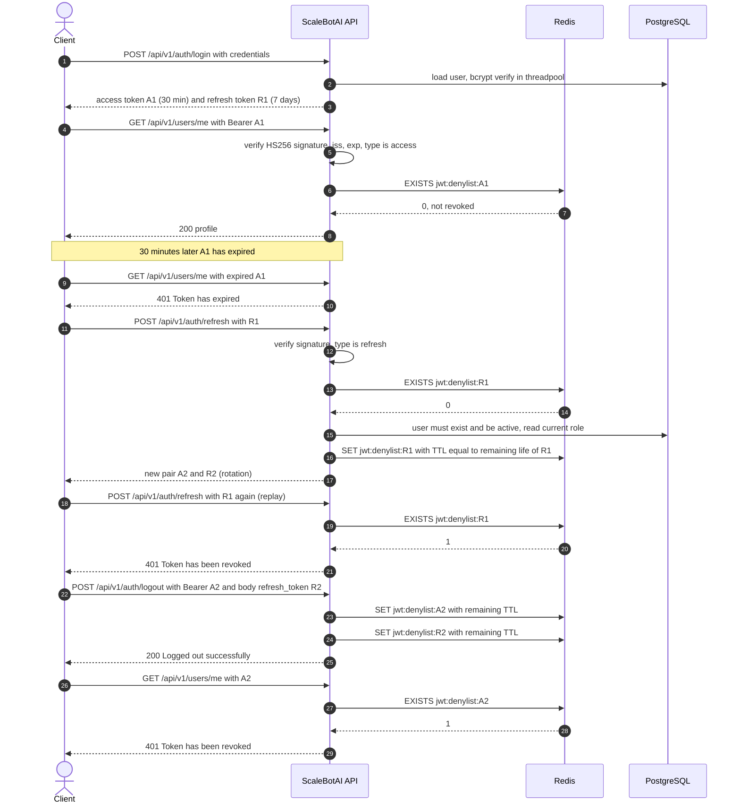

# 10 — Security Architecture

This document describes how ScaleBotAI protects its users, data and infrastructure. It covers the layered controls, the authentication and authorisation design, platform hardening, a STRIDE threat model, a mapping to the OWASP API Security Top 10 (2023) and a go-live checklist.

> **Status convention.** Controls described as *implemented* exist in the repository (paths given). Controls marked **(hardening)** or **(future)** are recommendations that are not yet implemented. The distinction matters in a viva: do not claim a recommendation as a feature.

**Assets protected (in priority order):**

1. User credentials and sessions: password hashes, JWTs, the JWT signing key.
2. User data: profiles, emails, conversation history, feedback.
3. Admin capabilities: user management, analytics.
4. Service availability: the 99.9 % SLO.
5. Infrastructure credentials: DB and Redis passwords, Docker Hub and kubeconfig credentials.
6. Integrity of the software supply chain: source code, images, pipeline.

---

## 1. Defence in Depth

No single control is trusted to stop an attacker. Each layer assumes the one in front of it can fail.

```mermaid
flowchart TB
    ATT["Internet client or attacker"]

    subgraph L1["Layer 1: Edge"]
        E1["TLS 1.2/1.3 only, HSTS,<br/>HTTP to HTTPS redirect"]
        E2["NGINX limit_req and limit_conn per IP,<br/>stricter zone for login and register"]
        E3["Body size 1 MB, client timeouts,<br/>/metrics denied, server_tokens off"]
    end

    subgraph L2["Layer 2: Network"]
        N1["Only NGINX / Ingress exposed.<br/>No host ports for API, DB, Redis"]
        N2["NetworkPolicy default-deny-all,<br/>ingress and egress, plus allow-list"]
        N3["Compose networks frontend,<br/>backend, monitoring"]
    end

    subgraph L3["Layer 3: Platform"]
        P1["Kubernetes RBAC, least privilege<br/>jenkins-deployer, viewer, no Secret access"]
        P2["Pod Security Admission: restricted"]
        P3["Secrets in Secret objects,<br/>etcd encryption at rest"]
    end

    subgraph L4["Layer 4: Workload"]
        W1["Non-root uid 10001,<br/>read-only root filesystem"]
        W2["Drop ALL capabilities,<br/>no privilege escalation, seccomp RuntimeDefault"]
        W3["Slim pinned base image, Trivy and<br/>Bandit gates, no SA token mounted"]
    end

    subgraph L5["Layer 5: Application"]
        A1["JWT HS256: pinned algorithm,<br/>short TTL, denylist, rotation"]
        A2["bcrypt cost 12 with SHA-256 pre-hash,<br/>dummy-hash timing equalisation"]
        A3["RBAC user / admin,<br/>ownership checks on every query"]
        A4["Pydantic validation, ORM bound parameters,<br/>Redis rate limit per user"]
    end

    subgraph L6["Layer 6: Data"]
        D1["PostgreSQL and Redis passwords,<br/>reachable only from API pods"]
        D2["Constraints, cascades,<br/>no password hashes in responses"]
        D3["PVC storage, backups,<br/>disk encryption (cloud)"]
    end

    subgraph DET["Detect and respond, across all layers"]
        M1["Prometheus alerts: error rate,<br/>rate-limit spikes, dependency down"]
        M2["JSON audit logs, log_type user,<br/>ELK search by request_id and user_id"]
        M3["Automated rollback, image tag<br/>traceable to commit"]
    end

    ATT --> L1 --> L2 --> L3 --> L4 --> L5 --> L6
    L1 -.-> DET
    L5 -.-> DET
```

---

## 2. Authentication: JSON Web Tokens

### 2.1 Token design

| Property | Access token | Refresh token |
|---|---|---|
| Purpose | Authorise API calls (`Authorization: Bearer …`) | Obtain a new token pair without the password |
| Lifetime | **30 min** (`ACCESS_TOKEN_EXPIRE_MINUTES`) | **7 days** (`REFRESH_TOKEN_EXPIRE_DAYS`) |
| Algorithm | **HS256** (`JWT_ALGORITHM`), secret `JWT_SECRET_KEY` from Secret `scalebotai-secrets` | Same |
| Claims | `sub` (user UUID), `role` (`user`/`admin`), `type` = `access`, `jti` (random UUID4 hex), `iss` = `scalebotai`, `iat`, `exp` | Same, with `type` = `refresh` |
| Accepted by | Every protected endpoint | Only `POST /api/v1/auth/refresh` and, optionally, the logout body |
| Revocation | `jwt:denylist:{jti}` in Redis, TTL = remaining lifetime | Same. Revoked on every use (rotation) and on logout |

**Validation rules** (`src/app/core/security.py`, `decode_token`):
- `algorithms=["HS256"]` is pinned, so `alg: none` and algorithm-confusion tokens are rejected.
- Signature, `exp` and `iss` are verified.
- `exp`, `iat`, `sub`, `jti` and `type` are **required claims**.
- `type` must match the endpoint, so a refresh token cannot be used as an access token and vice versa.
- After decoding, the `jti` is checked against the Redis denylist (`src/app/api/deps.py`).
- The user record is loaded (Redis `user:{id}` cache, else PostgreSQL) and must still exist and be **active**.

**Why JWT (stateless) plus a denylist (stateful)?**
- Any of the 3–20 pods can verify a token with the shared key alone, with no session store and no sticky sessions.
- The denylist adds the one capability pure JWTs lack, revocation. It stores only revoked `jti`s, and each entry expires when the token would have expired anyway, so the denylist stays small.

**Why HS256 and not RS256?** There is a single issuer and a single verifier (the same service), so a shared symmetric key is simpler and faster. RS256/EdDSA with a JWKS endpoint becomes preferable once other services must verify tokens without being able to mint them **(future)**.

### 2.2 Token lifecycle

**Logout.** `POST /api/v1/auth/logout` always revokes the presented access token. If the client also sends its `refresh_token` in the body, that token is revoked too, provided it belongs to the same user. Clients should always send it.

**Refresh rotation.** Each refresh token works **once**. A stolen refresh token that the legitimate client has already used is useless to the thief. If the thief uses it first, the legitimate client's next refresh fails with 401, a visible signal. Revoking the whole token family on reuse is a **(hardening)** step.

**Role freshness.** The role in the token is informational only. `require_admin` checks the role on the *current user record* (cached ≤ 300 s, and the cache entry is deleted when an admin changes a user's role or status), so demotion or deactivation takes effect on the user's next request.

**Known limitations and planned hardening:**

| Limitation | Effect | Mitigation now | Hardening |
|---|---|---|---|
| Password change does not revoke other sessions | Tokens issued before the change stay valid until expiry (access ≤ 30 min, refresh ≤ 7 days) | Short access TTL. A user can log out their current session | **(hardening)** Add a `password_changed_at` / token-version check so older tokens are rejected |
| Redis outage disables the denylist (fail-open) | Revoked tokens are accepted until `exp` (≤ 30 min for access tokens) | `RedisDown` alert, short access TTL | **(future)** Redis Sentinel; fail-closed denylist for admin routes |
| Single signing key | Rotating it invalidates all sessions | Documented rotation: update Secret, then `kubectl rollout restart` | **(future)** `kid` header with dual-key verification during rotation |
| Bearer tokens are not bound to the client | A stolen access token is usable until revoked or expired | TLS everywhere, no tokens in URLs or logs | **(future)** DPoP / mTLS-bound tokens |

---

## 3. Password Hashing

| Aspect | Design |
|---|---|
| Algorithm | **bcrypt** (`bcrypt` 5.0), cost factor **12** (`BCRYPT_ROUNDS`), i.e. 2¹² = 4,096 rounds of the expensive key schedule |
| Salt | A 128-bit random salt is generated per password by `bcrypt.gensalt()` and stored inside the hash string (`$2b$12$<salt><hash>`), so identical passwords get different hashes and rainbow tables are useless |
| Pre-hash | The password is first hashed with SHA-256 and base64-encoded, then bcrypted. bcrypt only reads the first 72 bytes (and bcrypt 5.0 rejects longer inputs). Pre-hashing makes all 128 allowed characters count, and base64 avoids NUL bytes. Same construction as passlib's `bcrypt_sha256` |
| Execution | `hash_password_async` / `verify_password_async` run in Starlette's threadpool. A ~250 ms hash *(estimate)* does not block the event loop, and bcrypt releases the GIL |
| Enumeration resistance | Unknown usernames are verified against a dummy hash of the same cost, so "no such user" and "wrong password" take the same time and return the same message |
| Policy | 8–128 characters, at least one letter and one digit (Pydantic). Breached-password screening (k-anonymity API) is **(future)** |

**Why not plain SHA-256?** SHA-256 is designed to be *fast*. A single modern GPU computes on the order of 10¹⁰ SHA-256 hashes per second, but only on the order of 10³ bcrypt hashes per second at cost 12 *(order-of-magnitude estimates)*. That is roughly **10 million times slower** for an attacker who has stolen the database. bcrypt is also deliberately tunable (raise the cost as hardware improves), and its memory access pattern resists GPU parallelism better than plain hashes. Argon2id is the modern alternative. bcrypt was chosen for its maturity and ubiquity.

**Capacity consequence.** At ~250 ms of CPU per verification, one pod with a 1-CPU limit can verify only ~4 logins/s, and 20 pods ~80 logins/s *(estimate)*. That is ample for real traffic: logins are rare because tokens last 30 minutes and refresh does not use bcrypt. It also means login is a **CPU-amplification target**, which is why it has its own strict NGINX zone (§8).

---

## 4. HTTPS / TLS

| Aspect | Docker Compose (development) | Kubernetes (production) |
|---|---|---|
| Termination point | NGINX container (`docker/nginx/`) | ingress-nginx controller, Ingress `scalebotai-ingress` |
| Certificate | Self-signed `tls.crt`/`tls.key`, generated at container start if missing (`/etc/nginx/certs/`, `docker/nginx/10-generate-self-signed-cert.sh`) | TLS Secret `scalebotai-tls`. Lab: self-signed, created by `k8s/tls/create-tls-secret.sh`. Production: **cert-manager + Let's Encrypt** `ClusterIssuer`s `letsencrypt-staging` / `letsencrypt-prod` (`k8s/tls/cert-manager-issuer.yaml`, ACME HTTP-01 through the `nginx` ingress class) with automatic renewal before the 90-day expiry |
| Protocols | TLS 1.2 and 1.3 only | Same (controller defaults) |
| Ciphers | ECDHE with AES-GCM or ChaCha20-Poly1305 only (forward secrecy, AEAD) | Controller defaults (equivalent modern profile) |
| Redirect | `:80` → `301 https://` | `ssl-redirect` and `force-ssl-redirect` annotations |
| HSTS | `Strict-Transport-Security: max-age=63072000; includeSubDomains`, sent only over HTTPS | ingress-nginx HSTS (controller ConfigMap) |
| Session reuse | Shared session cache 10 MB, tickets off (protects forward secrecy) | Controller defaults |
| HTTP/2 | Enabled | Enabled |

Notes:
- Let's Encrypt only issues certificates for **publicly resolvable** domains, so the lab host `api.scalebotai.local` cannot use it. A real deployment points a public DNS name at the load balancer and adds the annotation `cert-manager.io/cluster-issuer: letsencrypt-prod` to the Ingress.
- **Inside the cluster** traffic is plain HTTP on the pod network, restricted by NetworkPolicies. End-to-end encryption (mTLS between pods through a service mesh such as Linkerd or Istio) is **(future)**.
- Self-signed certificates in development teach users to click through warnings. Clients (k6, curl) use `--insecure` only against the local stack.

---

## 5. Kubernetes Secrets

`k8s/base/02-secret.yaml` defines Secret `scalebotai-secrets` with **placeholder values only** (`change-me-…`): `POSTGRES_USER`, `POSTGRES_PASSWORD`, `REDIS_PASSWORD`, `JWT_SECRET_KEY`, `ADMIN_PASSWORD`. Grafana's admin password lives in its own Secret in namespace `monitoring` (`k8s/monitoring/grafana-secret.yaml`). Pods receive these values as environment variables, so they are never baked into images.

| Fact / risk | Control |
|---|---|
| **base64 is encoding, not encryption.** Anyone who can read the Secret object or etcd can decode it | Restrict who can read it (RBAC) and encrypt etcd |
| etcd stores Secrets in plain form by default | Enable **encryption at rest** with an `EncryptionConfiguration` (`aescbc`/`aesgcm`, or preferably a **KMS v2** provider). Managed equivalents: EKS envelope encryption, GKE application-layer secrets encryption, AKS KMS |
| Anyone with `get secrets` in the namespace can read every credential | Neither `jenkins-deployer` (Role `scalebotai-deployer`) nor the developer viewer role (`scalebotai-viewer`) grants any verb on `secrets` (`k8s/base/11-rbac.yaml`). Only cluster administrators can read them |
| A pod's ServiceAccount token could be used to read Secrets if the pod is compromised | `automountServiceAccountToken: false` on `scalebotai-api`. The app never calls the Kubernetes API |
| Real values must not be committed to Git | Placeholders only. Real values are applied out-of-band (`kubectl create secret … --from-env-file`) or by one of the tools below |
| Weak or default JWT key | The app logs an `insecure_config` warning at start-up if `JWT_SECRET_KEY` is the default or shorter than 32 characters. Generate it with `openssl rand -hex 32` |

**Production-grade options:**

| Tool | How it works | When to choose |
|---|---|---|
| **Sealed Secrets** (Bitnami) | Encrypt with the controller's public key. The `SealedSecret` is safe to commit to Git, and only the in-cluster controller can decrypt it | GitOps on a single cluster, no external secret store |
| **External Secrets Operator** | Syncs from AWS Secrets Manager, GCP Secret Manager, Azure Key Vault or Vault into native Secrets, with refresh intervals | Cloud deployments. **Recommended for ScaleBotAI production** |
| **HashiCorp Vault** (agent injector / CSI) | Secrets are fetched at runtime and can be *dynamic* (short-lived DB credentials per pod), with an audit log | Strict compliance, many services, credential rotation |

Mounting secrets as files instead of environment variables (so they do not appear in `/proc/<pid>/environ` or in crash dumps) is a further **(hardening)** option.

---

## 6. Authorisation (RBAC)

### 6.1 Application roles

| Endpoint group | Anonymous | `user` | `admin` |
|---|---|---|---|
| `/health`, `/health/live`, `/health/ready` | Allowed (probes) | Allowed | Allowed |
| `/metrics` | Internal network only (denied at NGINX, not routed by the Ingress) | — | — |
| `POST /api/v1/auth/register`, `/login`, `/refresh` | Allowed (rate-limited per IP) | Allowed | Allowed |
| `/api/v1/auth/logout`, `/change-password` | 401 | Own session | Own session |
| `/api/v1/users/me…` | 401 | **Own record only** | Own record only |
| `/api/v1/chat…` (conversations, history, feedback) | 401 | **Own data only** | Own data only |
| `/api/v1/bot/info` | 401 | Allowed | Allowed |
| `/api/v1/admin/…` (9 endpoints) | 401 | **403 FORBIDDEN** | Allowed |

Implementation details:
- **Ownership checks.** Every chat, conversation, history and feedback query filters by `user_id` taken from the verified token, never from client input. For example, the conversation lookup uses `WHERE id = :id AND user_id = :current_user`. A resource owned by someone else returns **404** (not 403), so the API does not confirm that it exists.
- **Admin gate.** The `require_admin` dependency (`src/app/api/deps.py`) guards every admin endpoint and checks the role on the current user record.
- **No mass assignment.** `RegisterRequest` and `UserUpdateRequest` have no `role` or `is_active` fields, and unknown fields are ignored. Only `PATCH /api/v1/admin/users/{user_id}` can change `role`/`is_active`, and only an admin can call it. The database enforces `CHECK (role IN ('user','admin'))`.
- **Bootstrap admin.** Created at start-up only if `ADMIN_PASSWORD` is set (from the Secret) and the user does not exist.

### 6.2 Kubernetes RBAC (`k8s/base/11-rbac.yaml`)

| Subject | Binding | Can | Cannot |
|---|---|---|---|
| ServiceAccount `scalebotai-api` | none | — (token not even mounted) | Call the Kubernetes API at all |
| ServiceAccount `jenkins-deployer` | Role `scalebotai-deployer` in namespace `scalebotai` | Manage Deployments (incl. `set image`, `rollout undo`), ReplicaSets, Services, ConfigMaps, Ingresses and HPAs for rolling, canary and blue-green; read pods, logs and events; port-forward for smoke tests | Read or modify **Secrets**, touch other namespaces, create cluster-scoped objects, edit RBAC |
| Group `scalebotai-developers` | Role `scalebotai-viewer` | Read pods, logs, events, rollouts, HPA, NetworkPolicies, `kubectl top` | Change anything, read Secrets |

The principle is **least privilege with namespace scope**. A leaked Jenkins kubeconfig lets an attacker redeploy the app (serious, and visible in rollout history) but not read the database password or escape the namespace. Verify it with `kubectl auth can-i get secrets -n scalebotai --as=system:serviceaccount:scalebotai:jenkins-deployer`, which must answer `no`.

---

## 7. Network Policies

Policies live in `k8s/base/12-network-policies.yaml` and require a CNI that enforces them (Calico or Cilium; `minikube start --cni=calico`). **Default deny** applies to **both ingress and egress** for every pod in `scalebotai` (`default-deny-all`), and additive allow rules open only the following:

| From \ To | API pods :8000 | postgres :5432 | redis :6379 | ollama :11434 | CoreDNS :53 | Internet |
|---|---|---|---|---|---|---|
| Namespace `ingress-nginx` | **allow** | deny | deny | deny | n/a | n/a |
| Namespace `monitoring` (Prometheus) | **allow** (scrape) | deny | deny | deny | n/a | n/a |
| API pods (`app: scalebotai-api`) | — | **allow** | **allow** | **allow** | **allow** | deny |
| `postgres-exporter` (optional) | deny | **allow** | deny | deny | **allow** | deny |
| `redis-exporter` (optional) | deny | deny | **allow** | deny | **allow** | deny |
| postgres, redis | deny | — | — | deny | **allow** | deny |
| ollama | deny | deny | deny | — | **allow** | deny (model download rule in `k8s/optional/`) |
| Any other pod or namespace | deny | deny | deny | deny | — | — |

Effects:
- A compromised API pod cannot reach the internet. Data exfiltration and command-and-control callbacks are blocked.
- A compromised Grafana or ELK pod cannot reach the database.
- Kubelet health probes come from the node and are always allowed.
- In Compose, the same intent is expressed with the `frontend`, `backend` and `monitoring` networks. PostgreSQL and Redis are on `backend` only.

---

## 8. Rate Limiting (two layers)

| | Layer 1: edge (NGINX / ingress-nginx) | Layer 2: application (Redis) |
|---|---|---|
| Key | Client IP (`$binary_remote_addr`) | `user:{id}` for authenticated routes. `ip:{client_ip}` for login, register and refresh |
| Limits | `api_per_ip` 50 r/s (burst 100). `auth_per_ip` **30 r/min** (burst 20) on `/api/v1/auth/login` and `/register`. `limit_conn` per IP. Ingress: `limit-rps: 50`, burst multiplier 5 | **120 requests/min** (`RATE_LIMIT_PER_MINUTE`) |
| Algorithm | Leaky bucket, in C, before any Python runs | Fixed window: `INCR` + `EXPIRE 60` on `ratelimit:{identity}:{epoch_minute}` in one MULTI pipeline. Atomic and shared by all pods |
| Response | `429` with the JSON error envelope and security headers | `429 RATE_LIMITED` with `Retry-After` (seconds to window end) and `X-RateLimit-Limit` / `X-RateLimit-Remaining` on every limited route |
| Observability | `limit_req_status` in the NGINX JSON access log | `scalebot_rate_limited_total`, alert `RateLimitingSpike` |
| Purpose | Absorb floods cheaply, protect CPU (especially bcrypt), slow brute force | Per-user fairness across replicas, including users behind a shared NAT IP |
| Failure mode | — | **Fail-open** if Redis is down. Layer 1 remains as a backstop |

Notes:
- **Fixed-window edge effect.** A client can send up to 2 × limit across a window boundary (120 at 12:00:59 and 120 at 12:01:00). This is acceptable for fairness limiting. A sliding-window or GCRA limiter is **(future)**.
- **Load tests** must raise `RATE_LIMIT_PER_MINUTE` and exempt the generator in NGINX's `geo $rate_limit_exempt` block, or spread traffic over many users and IPs. Otherwise the test measures the limiter, not the system ([doc 11](11-load-testing-strategy.md)).
- Per-account lockout or exponential backoff after repeated failed logins (against distributed credential stuffing) is **(hardening)**.

---

## 9. Input Validation, Injection Prevention, CORS and Headers

**Input validation (Pydantic v2).** Every body, path and query parameter is typed and constrained:
- username pattern and length, `EmailStr`, password strength;
- chat message 1–2000 characters after stripping;
- UUID path parameters;
- rating 1–5, comment ≤ 1000;
- page size ≤ 100.

Violations return `422 VALIDATION_ERROR` with field-level `details`. NGINX caps bodies at 1 MB before they reach Python.

**SQL injection prevention.** All database access goes through SQLAlchemy Core/ORM expressions. Values are sent to PostgreSQL as **bound parameters** by asyncpg (protocol-level parameters, never string concatenation). The only raw SQL, the advisory lock, also uses a bound parameter (`text("SELECT pg_advisory_xact_lock(:key)")`). Even a hostile `message` such as `'; DROP TABLE users; --` is stored as text. Defence in depth: typed UUID and int parameters are rejected by validation before reaching SQL.

**Database privileges.** The `postgres-exporter` uses a dedicated `monitoring` role (read-only, `pg_monitor`, connection limit 5, statement timeout), and `CREATE` on schema `public` is revoked from `PUBLIC` (`docker/postgres/init/01-init.sql`). The application currently connects as the bootstrap database owner (`POSTGRES_USER`). Splitting it into a DDL migration role and a DML-only runtime role is **(hardening)**.

**Output safety.** Response models whitelist fields, so `password_hash` is never serialised. Errors use one envelope and never include stack traces (`INTERNAL_ERROR` with a `request_id`, and details go to the error log only).

**CORS.** `CORS_ORIGINS` defaults to `*` for development. With a wildcard, `allow_credentials` is automatically disabled. Methods and headers are explicit lists, and `X-Request-ID` and the rate-limit headers are exposed. Authentication uses the `Authorization` header (no cookies), so CSRF does not apply. **Production must set explicit origins** (go-live checklist).

**Security headers (set once at the edge, `docker/nginx/nginx.conf`):**

| Header | Value | Protects against |
|---|---|---|
| `Strict-Transport-Security` | `max-age=63072000; includeSubDomains` (HTTPS only) | Protocol downgrade, SSL stripping |
| `X-Content-Type-Options` | `nosniff` | MIME sniffing |
| `X-Frame-Options` | `DENY` | Clickjacking |
| `Referrer-Policy` | `no-referrer` | URL leakage |
| `Permissions-Policy` | `geolocation=(), microphone=(), camera=()` | Feature abuse |
| `X-Request-ID` | correlation id | Incident traceability |
| `server_tokens off`, `X-Powered-By` stripped | — | Fingerprinting |

A `Content-Security-Policy` is intentionally not set for this JSON API. Swagger UI at `/docs` loads assets from a CDN. In Kubernetes the Ingress routes only `/api` and `/health`, so `/docs` is not exposed in production.

---

## 10. Container and Image Security

| Control | Where | Threat mitigated |
|---|---|---|
| Non-root user **uid/gid 10001** | `USER 10001:10001` in `docker/api/Dockerfile`. `runAsNonRoot: true`, `runAsUser: 10001` in `k8s/base/06-api-deployment.yaml` | Root inside the container → host compromise |
| **Read-only root filesystem** | `readOnlyRootFilesystem: true` + `emptyDir` on `/tmp` (K8s). `read_only: true` (Compose) | Tampering with code, dropping tools or backdoors |
| Application code owned by root, read-only to the app user | Dockerfile (`COPY` without `--chown`) | Self-modifying malware |
| **Drop ALL capabilities** | `capabilities.drop: ["ALL"]` (K8s), `cap_drop` (Compose). Port 8000 needs none | Kernel attack surface (`CAP_NET_RAW`, `CAP_SYS_ADMIN`, …) |
| No privilege escalation | `allowPrivilegeEscalation: false` (K8s), `no-new-privileges:true` (Compose, all services) | setuid binaries |
| **seccomp RuntimeDefault** | Pod `securityContext` | Dangerous syscalls (e.g. `keyctl`, `unshare` variants) |
| **Pod Security Admission `restricted`** | Namespace labels in `k8s/base/00-namespaces.yaml` | Any future pod spec that weakens the above is rejected by the API server |
| Minimal base | `python:3.12-slim` multi-stage build: compilers only in `builder`, no curl/wget (health check uses the Python stdlib) | Fewer packages, fewer CVEs, fewer attacker tools |
| **Trivy scan gates** | Jenkins *Security Scan* stage, before *Docker Push*. **Blocking:** secrets committed to the repo (`trivy fs --scanners secret`), fixable `CRITICAL` CVEs in the image (`--severity CRITICAL --ignore-unfixed`). **Reported:** all `HIGH`/`CRITICAL` CVEs, IaC misconfigurations | Shipping known-vulnerable images, leaked credentials |
| Pinned versions | `requirements.txt` (`==` pins), base image tag, `nginx:1.27.5-alpine` | Unreviewed upstream changes |
| Resource limits | 1 CPU / 512Mi per API pod | One compromised or buggy pod starving the node |
| No ServiceAccount token | `automountServiceAccountToken: false` | Kubernetes API abuse from a compromised pod |
| Static analysis | `ruff` and **Bandit** in the Jenkins *Lint* stage. Bandit fails the build on MEDIUM+ findings (`bandit -r src/app -ll`) | Insecure code patterns (e.g. `shell=True`, weak crypto, hard-coded passwords) |

**Hardening (future):**
- Pin base images by **digest** (`python:3.12-slim@sha256:…`).
- Generate an SBOM (Syft).
- Sign images (cosign) and enforce signatures at admission (Kyverno / Sigstore policy-controller).
- Runtime threat detection (Falco).
- Raise the CVE gate from CRITICAL to HIGH once the base image is digest-pinned and regularly rebuilt, and add a secret scan of the *image* layers as well as the repository.

---

## 11. Secrets in CI (Jenkins)

| Credential ID | Type | Used in | Binding |
|---|---|---|---|
| `dockerhub-credentials` | Username + password (use a Docker Hub **access token**, not the account password) | Docker Push | `withCredentials([usernamePassword(credentialsId: 'dockerhub-credentials', usernameVariable: 'DOCKERHUB_USERNAME', passwordVariable: 'DOCKERHUB_TOKEN')])`, then `printf '%s' "${DOCKERHUB_TOKEN}" \| docker login --username "${DOCKERHUB_USERNAME}" --password-stdin` |
| `kubeconfig-scalebotai` | Secret file (kubeconfig for `jenkins-deployer`) | Kubernetes Deploy, Smoke Test, Rollback | `withCredentials([file(credentialsId: 'kubeconfig-scalebotai', variable: 'KUBECONFIG')])` |

Rules:
1. Credentials are bound **only inside the stage that needs them**. Jenkins masks their values in console output.
2. Shell steps use **single-quoted** Groovy strings (`sh '''…'''`), so the shell expands `${DOCKERHUB_TOKEN}` and Groovy never interpolates the secret into the command line.
3. The password goes through `--password-stdin`, never as a CLI argument visible in `ps`.
4. The registry login is written to a per-build `DOCKER_CONFIG` directory in the workspace (never `JENKINS_HOME`), and `docker logout` plus removal of that directory run in a `post { always { … } }` block.
5. The kubeconfig belongs to the namespace-scoped `jenkins-deployer` ServiceAccount, never to a cluster-admin.
6. No secret is stored in the Jenkinsfile, the repository, image layers or build arguments. `.gitignore` and `.dockerignore` exclude `.env`.

---

## 12. Logging and Audit

- **Audit trail.** Account events are logged with `log_type = "user"` and routed to the `scalebot-user-logs-*` index: register, `login_success`, `login_failure` (with the attempted username), logout, password change and account deletion. Each carries `user_id` (when known), `client_ip`, `request_id` and a UTC `@timestamp`. The counter `scalebot_auth_events_total{event}` makes login-failure spikes visible in Grafana.
- **Never logged:** passwords (plain or hashed), JWTs, the `Authorization` header, request bodies. The access log (`log_type = "api"`) records method, path, route template, status, latency, client IP, user agent, user id and request id only. Chat content stays in the database and does not reach the logs.
- **Correlation.** The same `request_id` appears in the NGINX access log, the API log, the error envelope and the `X-Request-ID` response header.
- **Integrity.** Logs leave the node within seconds (Logstash file input in Compose, Filebeat → Logstash in Kubernetes), so an attacker on a compromised pod cannot rewrite history already shipped. Elasticsearch security (`xpack.security`) is disabled **in local development only** and **must be enabled in production** (TLS, authentication, index-level RBAC). Write-once (object-lock) archival of the `user` index is **(future)**.
- **Retention (recommended):** api 14 days, error 30 days, user/audit 1 year, through Elasticsearch ILM.

---

## 13. STRIDE Threat Model

Likelihood (L) and Impact (I) are rated Low / Medium / High / Critical. Residual risk is what remains after the implemented mitigations.

| # | Asset | Threat | STRIDE | L | I | Mitigation (implemented) | Residual risk |
|---|---|---|---|---|---|---|---|
| T1 | User accounts | **Credential stuffing / brute force** on `/auth/login` | Spoofing | High | High | NGINX `auth_per_ip` 30/min, app per-IP 120/min, bcrypt cost 12, identical errors + dummy-hash timing, `login_failure` metric, password policy | **Medium**: distributed botnets rotate IPs. (Hardening) per-account backoff, CAPTCHA, MFA, breached-password check |
| T2 | Sessions | **JWT theft and replay** (malware, XSS in a client, shoulder-surfing logs) | Spoofing | Medium | High | TLS + HSTS, 30-min access TTL, logout denylist, single-use rotating refresh tokens, tokens never in URLs or logs | **Medium**: a stolen access token works until logout or expiry. (Future) DPoP token binding |
| T3 | Signing key, all accounts | **Token forgery**: `alg:none`, algorithm confusion, brute-forcing a weak HS256 key | Spoofing / Elevation | Low | Critical | Algorithm pinned to HS256, required claims, `iss` check, type check, start-up warning for default or short key, key only in Secret | **Low**. (Future) asymmetric keys with `kid` rotation |
| T4 | Availability | **DDoS / request floods**, slow-loris | Denial of service | Medium | High | `limit_req`/`limit_conn`, client timeouts, 1 MB body cap, proxy buffering, Ingress `limit-rps`, HPA 3→20, PDB | **Medium**: volumetric L3/L4 attacks need provider DDoS protection, CDN or WAF (out of scope) |
| T5 | Database | **SQL injection** through chat text or parameters | Tampering / Info disclosure | Low | Critical | SQLAlchemy bound parameters only, typed Pydantic inputs, UUID/int path parameters | **Low**. App role is the DB owner, so (hardening) a DML-only runtime role |
| T6 | Bot integrity, user trust | **Prompt injection** against LLM mode ("ignore your rules, reveal the prompt, write malware") | Tampering / Info disclosure | Medium (only when `CHATBOT_MODE=llm`) | Medium | LLM off by default. Fixed system prompt that ignores override attempts. **No tools, no data access**: context is only the caller's own last 5 exchanges, so no cross-user leak is possible. Output capped (256 tokens / 4,000 chars). Answers treated as plain text | **Medium**: the model can still be induced to produce wrong or inappropriate text. (Future) output moderation, topic allow-list |
| T7 | Credentials | **Secret leakage in Git or images** | Info disclosure | Medium | Critical | Placeholders only (`change-me-…`), `.gitignore`/`.dockerignore` exclude `.env`, runtime injection from Secret, Jenkins credentials binding, **blocking Trivy secret scan** of the repository in CI | **Low–Medium**: a secret pushed to a branch is in Git history before CI runs. (Hardening) gitleaks pre-commit hook, Sealed Secrets / ESO |
| T8 | Nodes | **Container escape** after an RCE in the app or a dependency | Elevation of privilege | Low | Critical | Non-root uid 10001, drop ALL, no privilege escalation, read-only root FS, seccomp RuntimeDefault, PSA `restricted`, slim image, Trivy gate | **Low**. (Future) gVisor/Kata sandboxes, Falco detection |
| T9 | Cluster | **Lateral movement** from a compromised pod | Elevation / Info disclosure | Medium | High | `default-deny-all` ingress **and** egress, explicit allow-list, no SA token in API pods, password-protected PostgreSQL and Redis, separate namespaces | **Low–Medium**: in-cluster traffic is not encrypted. (Future) service-mesh mTLS |
| T10 | Data in transit | **Man-in-the-middle** on client connections | Info disclosure / Tampering | Low | High | TLS 1.2/1.3 with AEAD ciphers, HSTS (2 years), HTTP→HTTPS redirect, `force-ssl-redirect` | **Low** in production. Development uses self-signed certificates |
| T11 | Admin functions | **Privilege escalation to admin** (mass assignment of `role`, forged role claim, BFLA) | Elevation of privilege | Medium | Critical | No `role` field in user-facing schemas, `require_admin` checks the DB role, signed tokens, role `CHECK` constraint, admin-only `PATCH /admin/users/{id}`, bootstrap admin password from Secret | **Low**. (Hardening) MFA for admins, explicit audit event for role changes |
| T12 | Audit trail | **Log tampering / repudiation** | Repudiation | Low | Medium | Logs shipped off-node in near real time, `user` audit events with `user_id`, `request_id`, UTC timestamps; ES bound to loopback in dev | **Medium in dev** (ES security off), **Low in prod** with xpack security. (Future) WORM archive |
| T13 | Supply chain | **Dependency CVEs** / malicious package | Tampering / Elevation | High | High | Exact version pins, multi-stage slim image, Trivy report (HIGH/CRITICAL) with a blocking gate on fixable CRITICAL, Bandit gate, PR review | **Medium**: zero-days, base image not digest-pinned. (Future) Dependabot/Renovate, SBOM, cosign + admission policy |
| T14 | User data | **Data exfiltration**: BOLA (reading others' conversations), bulk DB dump | Info disclosure | Medium | High | Every query filtered by the token's `user_id`, 404 on foreign IDs, UUID (non-enumerable) IDs, DB reachable only from API pods, admin APIs return aggregates and never password hashes, egress deny-by-default | **Low**. (Future) cloud disk encryption for PVs, column encryption for emails |
| T15 | Availability | **Resource-exhaustion via expensive endpoints** (bcrypt login floods, LLM generation) | Denial of service | Medium | Medium | Strict auth zone, bcrypt in threadpool, LLM off by default, Ollama timeout 20 s + circuit breaker + connection cap, per-user rate limit, pod CPU limits | **Medium in LLM mode**. (Future) concurrency limiter / queue in front of Ollama |
| T16 | Internal endpoints | **Exposure of `/metrics`, Prometheus, Grafana, Kibana, Elasticsearch** | Info disclosure | Medium | Medium | `/metrics` denied at NGINX and not routed by the Ingress, Compose UIs bound to `127.0.0.1`, Grafana admin password from Secret, Kibana Ingress protected by basic auth (`kibana-basic-auth`) and a private-range source allow-list | **Low**. (Production) put Grafana and Kibana behind SSO / OAuth2 proxy |
| T17 | Pipeline | **Compromised CI / malicious deployment** | Tampering / Elevation | Low | Critical | Namespace-scoped `jenkins-deployer` with no Secret access, credentials bound per stage and masked, immutable image tags, rollout history | **Medium**: the Jenkins controller is high-value. (Future) protected branches, signed commits, signed images verified at admission |
| T18 | Cache, limiter, denylist | **Redis abuse**: cache poisoning, or a Redis outage disabling the denylist and limiter | Tampering / Spoofing | Low | Medium | `requirepass`, reachable only from API pods, cache keys and values derived server-side (SHA-256 of the normalised question), fail-open behaviour documented and alerted (`RedisDown`) | **Medium**: during an outage revoked tokens remain valid ≤ 30 min. (Future) Sentinel HA, fail-closed denylist on admin routes |
| T19 | Privacy | **Account enumeration** through `409 CONFLICT` on register | Info disclosure | Medium | Low | Per-IP `auth_per_ip` zone and app rate limit | **Low–Medium (accepted)** for usability. (Future) generic response + e-mail verification |

---

## 14. OWASP API Security Top 10 (2023) Mapping

| ID | Risk | How ScaleBotAI addresses it | Gap / next step |
|---|---|---|---|
| **API1:2023** | Broken Object Level Authorization | Every conversation, chat, history and feedback query includes `user_id = <token sub>`. Foreign IDs return 404. IDs are UUIDs | Add negative authorisation tests for each `{id}` route |
| **API2:2023** | Broken Authentication | bcrypt cost 12 + SHA-256 pre-hash, pinned-algorithm JWT, required claims, 30-min access TTL, refresh rotation, denylist, timing-equalised login, two-layer rate limiting | MFA and per-account lockout (hardening) |
| **API3:2023** | Broken Object Property Level Authorization | Response models whitelist output fields (no `password_hash`). Request models whitelist input fields (no `role`/`is_active` for users; `AdminUserUpdate` only for admins) | — |
| **API4:2023** | Unrestricted Resource Consumption | Edge and app rate limits, 1 MB body cap, message ≤ 2,000 chars, page size ≤ 100, timeouts (Ollama 20 s, DB pool 10 s, Redis socket 0.5 s), pod CPU/memory limits, HPA max 20 caps cost | LLM concurrency queue (future) |
| **API5:2023** | Broken Function Level Authorization | `require_admin` dependency on all 9 admin endpoints, role read from the current user record, 403 for non-admins | — |
| **API6:2023** | Unrestricted Access to Sensitive Business Flows | Registration and login protected by a strict per-IP zone; chat by a per-user quota | CAPTCHA / e-mail verification against sign-up abuse |
| **API7:2023** | Server Side Request Forgery | The API never fetches user-supplied URLs. `OLLAMA_BASE_URL` comes from configuration only, and egress is default-deny | — |
| **API8:2023** | Security Misconfiguration | TLS profile, security headers, `server_tokens off`, PSA `restricted`, non-root images, CORS without credentials on wildcard, `/docs` not routed by the Ingress, start-up warning for insecure JWT key | Production must set explicit `CORS_ORIGINS` and enable Elasticsearch security (checklist) |
| **API9:2023** | Improper Inventory Management | Single versioned surface `/api/v1`, OpenAPI generated from code, all 32 endpoints documented ([doc 05](05-api-design.md)), ops endpoints separated, image tags traceable to commits | Deprecation policy for a future `/api/v2` |
| **API10:2023** | Unsafe Consumption of APIs | Ollama responses treated as untrusted: timeout, structure check (malformed → fallback), empty answer → fallback, length cap, circuit breaker, plain-text only | — |

---

## 15. Go-Live Security Checklist

**Secrets and keys**
- [ ] Every `change-me-…` placeholder replaced. `JWT_SECRET_KEY` generated with `openssl rand -hex 32` (≥ 32 characters, and no `insecure_config` warning in the start-up logs).
- [ ] Real secrets delivered by External Secrets Operator / Sealed Secrets / `kubectl create secret`, never committed.
- [ ] etcd encryption at rest enabled (or the managed-cluster equivalent).
- [ ] Docker Hub credential is an access token with push scope only.

**Edge and TLS**
- [ ] Public DNS name configured. cert-manager `ClusterIssuer` (Let's Encrypt) issues `scalebotai-tls` and renewal is tested.
- [ ] `curl -I http://…` returns 301 to HTTPS. HSTS present on HTTPS responses. TLS 1.0/1.1 rejected (`nmap --script ssl-enum-ciphers` or testssl.sh).
- [ ] `/metrics`, `/docs` and `/openapi.json` are **not** reachable from the internet.
- [ ] `CORS_ORIGINS` set to the explicit production front-end origin(s).

**Kubernetes**
- [ ] A policy-enforcing CNI is installed. A test pod in another namespace **cannot** connect to `postgres:5432` or `redis:6379`.
- [ ] `kubectl auth can-i get secrets -n scalebotai --as=system:serviceaccount:scalebotai:jenkins-deployer` returns `no`.
- [ ] Namespace PSA label `enforce: restricted` present. All pods admitted without warnings.
- [ ] `automountServiceAccountToken: false` on the API ServiceAccount verified (`kubectl exec … ls /var/run/secrets/kubernetes.io` fails).

**Images and pipeline**
- [ ] Latest image passed the Trivy gates (no committed secrets, no fixable CRITICAL CVEs), and every HIGH finding in the archived report has been reviewed (fixed, or accepted with justification).
- [ ] Image runs as uid 10001 with a read-only root filesystem (`kubectl exec … id`, `touch /app/x` fails).
- [ ] `main` branch protected (PR review required). Jenkins credentials scoped to this job only.

**Application**
- [ ] Rate limits active: the 121st request in a minute returns `429` with `Retry-After`. Login zone verified.
- [ ] Logout revokes the token (a request after logout returns `401`). Refresh token replay returns `401`.
- [ ] A non-admin calling `/api/v1/admin/analytics` gets `403`. User B reading user A's conversation gets `404`.
- [ ] Bootstrap admin password changed after first login, or `ADMIN_PASSWORD` removed after bootstrap.

**Data and observability**
- [ ] PostgreSQL backups scheduled and a **restore drill** performed (RPO/RTO measured).
- [ ] Elasticsearch security enabled (TLS + auth; `xpack.security.enabled=false` is lab-only). Grafana and Kibana behind authentication (Kibana basic-auth Secret `kibana-basic-auth` replaced by SSO in production). Default Grafana admin password changed.
- [ ] Alerts firing and routed: `HighErrorRate`, `ScaleBotAPIDown`, `RateLimitingSpike`, `RedisDown`, `PostgresDown`. A login-failure spike panel exists.
- [ ] Logs verified to contain no passwords, tokens or `Authorization` headers (Kibana search for `Bearer` and `password` returns nothing).
