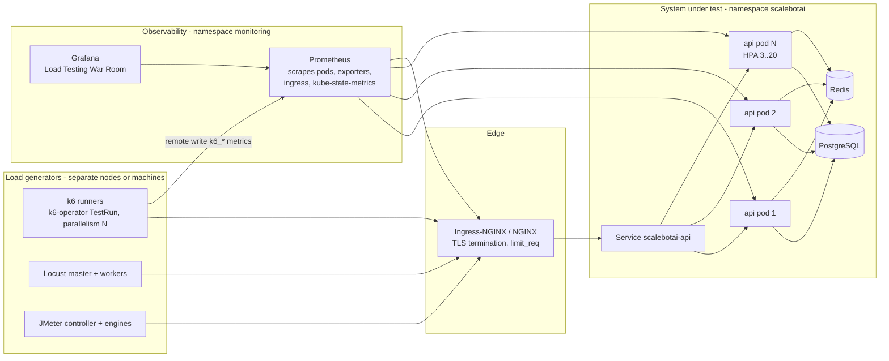

# 11 - Load Testing Strategy

This chapter covers how we prove, rather than assume, that ScaleBotAI meets its
non-functional requirements:

| Requirement | Target |
|---|---|
| Volume | 1,000,000+ requests/day |
| Availability | 99.9 % |
| Latency | average < 300 ms |
| Concurrency | 100-500 concurrent requests at peak |
| Elasticity | HPA on CPU + memory |
| Releases | zero-downtime deploys |

It covers traffic maths, tool choice, test architecture, the six test phases, the metrics
watched, bottleneck analysis and how results are reported. The scripts live in
`tests/load/` (k6: `tests/load/k6/`, Locust: `tests/load/locust/`, JMeter: `tests/load/jmeter/`).
The Grafana dashboard for test runs is **ScaleBotAI - Load Testing War Room**; see
[09-monitoring-logging.md](09-monitoring-logging.md).

---

## 1. Traffic analysis

### 1.1 From requests/day to requests/second

| Step | Calculation | Result |
|---|---|---|
| Average rate | 1,000,000 req / 86,400 s | **11.57 req/s** |
| Diurnal shape | Chat/learning traffic is not flat. Assume ~65 % of daily traffic (60-70 %) lands in ~8 busy hours (daytime/evening) | 650,000 req in 8 h |
| Busy-hour average | 650,000 / (8 x 3,600 s) = 650,000 / 28,800 | **~22.6 req/s** (about 2x the daily average) |
| Off-peak average | 350,000 / (16 x 3,600 s) | ~6.1 req/s |
| Peak (short bursts within busy hours) | peak factor 10x the daily average: 11.57 x 10 | **~116 req/s** |
| Design capacity | ~4.3x the peak | **500 req/s** |

Why plan for 500 req/s when the peak is 116 req/s? The headroom covers:
- growth (about 4x the user base with the same traffic shape),
- losing a node or pod during a burst,
- client retries,
- cache-miss-heavy traffic (new questions),
- the slower `llm` chatbot mode.

### 1.2 Concurrency - Little's Law

Little's Law: **L = λ x W**, where L = requests in flight, λ = arrival rate and W = time each
request spends in the system.

| Scenario | λ (req/s) | W (s) | L = in-flight requests |
|---|---|---|---|
| Normal peak | 116 | 0.3 (the latency SLO) | 116 x 0.3 = **~35** |
| Design capacity | 500 | 0.3 | 500 x 0.3 = **150** |
| Design capacity, degraded latency | 500 | 1.0 (worst case) | **500** |

The requirement "100-500 concurrent requests at peak" is exactly the design-capacity band:
- 150 in flight at 500 req/s when latency is healthy,
- 500 in flight if latency degrades to 1 s.

The system must stay stable across this range. Dashboards check the same identity live:
`scalebot_http_requests_in_progress` should equal `RPS x avg latency`.

### 1.3 Virtual users vs requests

Load tools simulate **users** (VUs), not requests. A VU sends a request, waits W for the
answer, then "thinks" for Z seconds (reading the answer). This is the closed-model form of
Little's Law (interactive response time law):

**N (VUs) = λ x (W + Z)** and **λ = N / (W + Z)**

Our scripts use think time Z = uniform 1-3 s (mean 2 s) and W ≈ 0.3 s, so one VU generates
1 / 2.3 ≈ **0.43 req/s**.

| Phase | VUs (N) | Offered load λ = N / 2.3 s | In flight L = λ x 0.3 s | vs 1M/day design |
|---|---|---|---|---|
| Smoke | 100 | ~43 req/s | ~13 | 0.4x peak |
| Normal peak | ~270 | 116 req/s | ~35 | = peak |
| Baseline | 1,000 | ~435 req/s | ~130 | ≈ design capacity (500) |
| Load | 10,000 | ~4,350 req/s | ~1,300 | 37x peak, 8.7x capacity |
| Stress | 25,000 | ~10,900 req/s | ~3,260 | 22x capacity |
| Spike | 50,000 | ~21,700 req/s | ~6,500 | 43x capacity |
| Soak | 500 (Z = 3-10 s) | 500 / 6.8 ≈ ~74 req/s | ~22 | 0.64x peak |

Two lessons:

1. **VUs are not concurrent requests.** Only W / (W + Z) ≈ 13 % of VUs have a request in
   flight at any moment.
2. **When latency rises, a closed-model test automatically sends less load.** That is why
   k6 also offers arrival-rate executors (open model). The stress/spike phases also watch
   *server* RPS, not just VU counts.

### 1.4 Per-pod capacity and replica count

| Item | Value | Note |
|---|---|---|
| Process model | 1 uvicorn worker per container, async I/O | scaling is done by pods, not workers |
| Work per chat request | JWT verify, rate-limit `INCR` in Redis, cache `GET`, `INSERT` into `chats`, conversation update, JSON (de)serialisation, metrics + JSON access log | |
| **Estimated capacity of one process at 1 full core** | **~150-300 req/s** for cached rule-mode chats | **estimate, to be validated by the baseline test** |
| Login / register | bcrypt at 12 rounds ≈ 0.2-0.3 s of CPU per hash, so **~4-5 logins/s per core** | logins are CPU-heavy by design (brute-force protection) |
| Container resources | requests 250m CPU / 256Mi; limits 1 CPU / 512Mi | |
| HPA targets | CPU 70 %, memory 75 % **of the requests** | |

Important detail: the HPA measures utilisation **relative to the request**, so 70 % of 250m =
**0.175 core per pod** before it adds pods. At 150-300 req/s per core, one pod carries about
**26-52 req/s at the HPA target**. A pod can still burst to its 1-core limit while new pods
start.

| Load | Pods = λ / (26 to 52 req/s) | Decision |
|---|---|---|
| Average 11.6 req/s | 1 | high availability still needs more |
| Peak 116 req/s | 116 / 52 = 2.2 up to 116 / 26 = 4.5, so **3-5 pods** | **minReplicas = 3**: covers peak, survives one pod/node loss, and RollingUpdate with `maxUnavailable: 0` always keeps 3 serving |
| Design 500 req/s | 500 / 52 = 9.6 up to 500 / 26 = 19.2, so **10-20 pods** | **maxReplicas = 20**: covers the design capacity even at the pessimistic estimate |
| Hard ceiling at 20 pods, every pod at its 1-core limit | 20 x 150-300 | **~3,000-6,000 req/s** |

The ceiling also bounds the database. With 20 pods x (`DB_POOL_SIZE` 10 + `DB_MAX_OVERFLOW`
20), the API could open up to **600 PostgreSQL connections**. PostgreSQL defaults to
`max_connections = 100`, so the test environment needs one of:
- `max_connections ≈ 200` with smaller per-pod pools, or
- **PgBouncer** in transaction mode (with asyncpg: `statement_cache_size=0`).

The `TooManyPostgresConnections` alert fires at 150.

The cluster must also have room for 20 pods (5 CPU of requests, up to 20 CPU of limits) plus
the load generators, which run on **separate** nodes.

### 1.5 Daily data volume (at 1,000,000 requests/day)

| Data | Assumption | Per day | Per 30 days |
|---|---|---|---|
| `chats` rows | ~50 % of requests are chat messages, ~1.1 KB per row incl. 3 indexes | ~500k rows, ~0.55 GB | ~16 GB: partition `chats` by month, archive old data |
| `conversations` | ~1 per 5 chats | ~100k rows, ~20 MB | ~0.6 GB |
| API logs in Elasticsearch | 1 line per request, ~0.5-1 KB indexed | ~0.5-1 GB | ILM deletes after 14 d (~7-14 GB) |
| Prometheus | ~15-20k series, 15 s scrape | ~0.2 GB | 15 d retention (~3 GB) |
| Redis | response cache (unique questions x TTL 1 h), rate-limit keys (1 per active user per minute), token denylist | tens of MB | bounded by TTLs |
| Network | ~2 KB per request + response | ~2 GB (avg 0.2 Mbit/s; ~8 Mbit/s at 500 req/s) | ~60 GB |

---

## 2. Tool comparison and choice

| Criterion | **k6** | **Locust** | **Apache JMeter** |
|---|---|---|---|
| Test language | JavaScript (ES modules) | Python | XML test plan built in a GUI (+ Groovy/JSR223) |
| Engine | Go; VUs are lightweight goroutines | Python + gevent; one process per CPU core | Java; one OS thread per virtual user |
| Resource efficiency | **High** (~1-3 MB RAM per VU) | Medium (one core per worker; `FastHttpUser` helps) | Low-medium (thread stacks, GC, listeners) |
| Realistic VUs per generator (this workload) | **~5,000-10,000** | ~2,000-5,000 per worker process (one per core) | ~1,000-2,000 threads per JVM |
| Protocols | HTTP/1.1, HTTP/2, WebSocket, gRPC, browser | HTTP(S) built in; anything with a Python client | Widest: HTTP, JDBC, JMS, LDAP, FTP, SMTP, TCP ... |
| SLOs as code | **Built-in thresholds**, exit code 99 on failure | Custom via event hooks (our locustfile exits 1 when avg > 300 ms or errors > 1 %) | Assertions per sample; no global SLO gate without plugins |
| CI integration | Excellent: single binary or Docker image, thresholds gate the pipeline | Good: `--headless`, CSV/HTML, exit code | OK: `-n` non-GUI, JTL + HTML report, needs a JVM |
| Reporting | End-of-test summary, `handleSummary` JSON, outputs to Prometheus remote write, InfluxDB, JSON, Grafana Cloud | Live web UI, CSV, HTML report | Rich HTML dashboard (APDEX, percentiles, over-time charts) |
| Load models | Closed (VUs) **and** open (arrival-rate executors) | Closed + custom `LoadTestShape` | Closed (thread groups); throughput timers/plugins for open-ish |
| Learning curve | Low for developers | Low for Python developers | Medium-high (GUI, scoping rules, element order) |
| Distributed mode | k6-operator on Kubernetes, execution segments, Grafana Cloud k6 | Built-in master/worker | Built-in RMI controller/engines (`-R`) |

**Recommendation.**

- **k6 is the primary tool.** It drives the most load per generator, encodes the success
  criteria as thresholds (pass/fail in Jenkins), streams metrics into the same
  Prometheus/Grafana as the application, and scales to 25k-50k VUs with the k6-operator.
- **Locust** is the choice when user behaviour is easier to express in Python: complex
  stateful flows, reuse of the project's Python code, or a Python-only team. Its live web UI
  is also handy for exploratory testing.
- **JMeter** is the choice for GUI-driven work, enterprise QA teams that already standardise
  on it, non-HTTP protocols, and its HTML dashboard report.

All three implement the same journey (register -> login -> chat / history), so their results
can be cross-checked.

---

## 3. Load-test architecture



Principles:
- **Generators never share nodes with the system under test.** They would steal CPU and
  distort the result. Monitor generator CPU too and keep it below 80 %.
- **Test through the real entry point** (TLS + NGINX/Ingress). One optional extra run against
  the Service directly isolates edge overhead.
- **One pane of glass.**
  - k6 metrics (`k6_vus`, `k6_http_reqs_total`, client-side P95/P99) and server metrics sit
    on the same Grafana dashboard.
  - A gap between "sent by k6" and "served by API" shows requests dropped or rejected
    before the app.
- **Isolated environment.** Use a dedicated namespace/cluster or a staging copy, never
  production. Use synthetic users (`loadtest_*` / `lt_*` / `jm_*` at `@scalebotai.dev`).

---

## 4. Test phases

| # | Phase | Peak VUs | Duration | Offered load | Question answered |
|---|---|---|---|---|---|
| 1 | Smoke | 100 | 2 min | ~43 req/s | Does the system and the script work at all? |
| 2 | Baseline | 1,000 | 10 min hold (13 min total) | ~435 req/s | What are the reference numbers? What is the real per-pod capacity? |
| 3 | Load | 10,000 | 30 min | ~4,350 req/s | Do we meet the SLOs at high load while the HPA scales? |
| 4 | Stress | 25,000 (steps) | 35 min | up to ~10,900 req/s | Where is the breaking point and what breaks first? |
| 5 | Spike | 1,000 -> 50,000 -> 1,000 | 13 min (2 min at peak) | up to ~21,700 req/s | Do we degrade gracefully and recover? |
| 6 | Soak | 500 | 24 h | ~74 req/s | Do leaks, drift or exhaustion appear over time? |

> **Honest scope note.**
> - The 1M requests/day requirement needs only ~116 req/s at peak, which is about 270
>   VUs. Baseline (1,000 VUs) already exercises the full 500 req/s design capacity.
> - **Load, stress and spike (10k-50k VUs) deliberately exceed the design point by one to
>   two orders of magnitude.** That is their purpose: find limits, verify autoscaling, and
>   prove graceful degradation and recovery.
> - The 20-pod ceiling (~3,000-6,000 req/s, section 1.4) means the load test runs close to
>   the cluster's maximum. Stress and spike are **expected to break the SLOs**.
> - These phases need **distributed load generators**: k6-operator with 10-50 runner pods,
>   Locust with 5-40 workers, or JMeter with 5-50 engines. They also need a test cluster big
>   enough for 20 API pods.

Common rules for all phases:
- Raise the rate limits first (section 8).
- Start Grafana before the test.
- Run k6 from the repository root.
- Fill in the report template (section 9) after each run.

### 4.1 Smoke test - 100 VUs, 2 minutes

- **Objective.**
  - Validate scripts, credentials, TLS, routing, data creation and dashboards.
  - Catch functional errors before expensive runs.
  - Run after every deployment; it can gate CI.
- **Profile.** 0:00-0:30 ramp 0 -> 100 VUs, 0:30-1:30 hold 100, 1:30-2:00 ramp down.
- **Expected results.** ~40-45 req/s, avg well below 100 ms for cached chats, no errors,
  3 pods at low CPU, cache hit ratio rising as questions repeat.
- **Pass/fail.** avg < 300 ms, p95 < 500 ms, `http_req_failed` < 1 %, `checks` > 99 %, zero 5xx.

```bash
k6 run tests/load/k6/smoke.js
LOCUST_SHAPE=smoke locust -f tests/load/locust/locustfile.py --headless --host https://api.scalebotai.local \
  --csv tests/load/locust/results/smoke --html tests/load/locust/results/smoke.html
jmeter -n -t tests/load/jmeter/scalebotai-load-test.jmx -JUSERS=100 -JRAMP_UP=30 -JDURATION=120 \
  -l tests/load/jmeter/results/smoke.jtl -e -o tests/load/jmeter/results/smoke-report/
```

### 4.2 Baseline test - 1,000 VUs, 10 minutes

- **Objective.**
  - Record the reference performance at roughly the design capacity (~435 req/s):
    P50/P95/P99, CPU per pod, memory per pod, DB connections and cache hit ratio.
  - **Measure real per-pod capacity:** RPS / pods while pods sit near the HPA target.
    This replaces the 150-300 req/s estimate in section 1.4.
- **Profile.** 0:00-2:00 ramp to 1,000, 2:00-12:00 hold, 12:00-13:00 ramp down.
- **Expected results.**
  - The HPA settles at roughly 9-17 pods if the estimate holds.
  - avg < 150 ms, P95 < 300 ms after warm-up.
  - Chat cache hit ratio ~70-80 % (`UNIQUE_QUESTION_RATIO=0.2`).
  - PG connections stable.
- **Pass/fail.**
  - All SLO thresholds, plus chat P99 < 1 s.
  - CPU and memory per pod < 80 % of the limit, zero restarts.

```bash
k6 run -o experimental-prometheus-rw tests/load/k6/baseline.js
LOCUST_SHAPE=baseline locust -f tests/load/locust/locustfile.py --headless --host https://api.scalebotai.local \
  --csv tests/load/locust/results/baseline --html tests/load/locust/results/baseline.html
jmeter -n -t tests/load/jmeter/scalebotai-load-test.jmx -JUSERS=1000 -JRAMP_UP=120 -JDURATION=600 \
  -l tests/load/jmeter/results/baseline.jtl -e -o tests/load/jmeter/results/baseline-report/
```

### 4.3 Load test - ramp to 10,000 VUs, 30 minutes

- **Objective.**
  - Verify the SLOs at high sustained load.
  - Watch the HPA scale from 3 towards 20 pods without errors during scale-out.
  - Confirm that new pods become Ready and take traffic (readiness probe) and that
    PostgreSQL connections stay within limits.
- **Profile.**
  - 0-5 min: ramp to 2,500.
  - 5-10 min: ramp to 5,000.
  - 10-15 min: ramp to 10,000.
  - 15-25 min: hold 10,000.
  - 25-30 min: ramp down.
  - The `phase:hold` tag isolates the steady state.
- **Expected results.**
  - Offered ~4,350 req/s; the HPA reaches its maximum (20).
  - If the measured per-pod capacity is at least ~220 req/s at the 1-core limit, the SLOs
    hold. Otherwise latency climbs during the hold, and the report states the highest
    VU/RPS level that met the SLO (that is a valid result).
  - Likely first bottlenecks: PostgreSQL connections/INSERT rate, then pod CPU.
- **Pass/fail.**
  - `phase:hold` avg < 300 ms, p95 < 500 ms, errors < 1 %.
  - The HPA scales out within ~1-2 min of the CPU rising.
  - No pod restarts or OOMKills.

```bash
k6 run -e SCALE=0.1 tests/load/k6/load.js          # rehearsal with 1,000 VUs from one machine
kubectl apply -f tests/load/k6/k6-operator-testrun.yaml   # distributed (adapt a TestRun to load.js, parallelism 10)
LOCUST_SHAPE=load locust -f tests/load/locust/locustfile.py --master --headless --expect-workers 8 \
  --host https://api.scalebotai.local --csv tests/load/locust/results/load --html tests/load/locust/results/load.html
jmeter -n -t tests/load/jmeter/scalebotai-load-test.jmx -R gen1,gen2,gen3,gen4,gen5 \
  -GUSERS=2000 -GRAMP_UP=600 -GDURATION=1800 -l tests/load/jmeter/results/load.jtl -e -o tests/load/jmeter/results/load-report/
```

### 4.4 Stress test - steps up to 25,000 VUs

- **Objective.**
  - Find the **breaking point**: the first step where an SLO fails.
  - Find **the first bottleneck**: DB, cache, NGINX, CPU or memory.
  - Observe the failure mode: slow responses vs errors vs crashes, then recovery after the
    ramp-down.
- **Profile.**
  - Six steps of "2 min ramp + 3 min hold": 2,500 -> 5,000 -> 10,000 -> 15,000 -> 20,000
    -> 25,000 VUs.
  - Then 5 min ramp down (`phase:recovery`).
  - Per-step thresholds (`phase:step-N`) mark the breaking step in the k6 summary.
  - The run aborts automatically when more than 10 % of all requests fail
    (`ABORT_ON_BREAK=false` disables this).
- **Expected results.**
  - SLOs hold for the first steps.
  - Latency then rises sharply once the 20-pod ceiling and/or the DB limits are reached,
    followed by 5xx/timeouts at the highest steps.
  - After the ramp-down the system must recover by itself without restarts.
- **Pass/fail.** A stress test "passes" when:
  - the breaking point is identified, and the bottleneck is explained with metrics,
  - there are no data corruption and no crash-loops,
  - latency/errors return to baseline after load is removed.
  - The breaking point should be above 500 req/s (design capacity).

```bash
k6 run -e SCALE=0.04 tests/load/k6/stress.js        # rehearsal (100 -> 1,000 VUs)
kubectl apply -f tests/load/k6/k6-operator-testrun.yaml   # TestRun scalebotai-stress, parallelism 25
LOCUST_SHAPE=step locust -f tests/load/locust/locustfile.py --master --headless --expect-workers 16 \
  --host https://api.scalebotai.local --csv tests/load/locust/results/stress --html tests/load/locust/results/stress.html
jmeter -n -t tests/load/jmeter/scalebotai-load-test.jmx -R gen1,...,gen15 \
  -GUSERS=1700 -GRAMP_UP=1800 -GDURATION=2100 -l tests/load/jmeter/results/stress.jtl -e -o tests/load/jmeter/results/stress-report/
```

### 4.5 Spike test - 1,000 -> 50,000 -> 1,000 VUs

- **Objective.**
  - Model a sudden burst (viral post, exam night).
  - Verify graceful degradation: fast 429/503 rather than timeouts and crashes, no
    crash-loops, no data loss.
  - Measure the HPA reaction time and the **recovery time** back to SLO latency.
- **Profile.**
  - 0-2 min: ramp to 1,000.
  - 2-4 min: hold 1,000 (`baseline`).
  - 4:00-4:30: jump to 50,000.
  - 4:30-6:30: hold 50,000 (`spike`).
  - 6:30-7:00: drop to 1,000.
  - 7-12 min: hold 1,000 (`recovery`).
  - 12-13 min: ramp down.
- **Expected results.**
  - During the spike, latency and errors rise because the HPA needs 1-3 minutes to
    schedule and warm pods.
  - New VUs also cause a bcrypt **login storm** (2 hashes per new VU). Use
    `AUTH_MODE=pool` to separate the chat path from authentication.
  - Recovery to SLO within a few minutes after the spike.
- **Pass/fail.**
  - `phase:baseline` and `phase:recovery` meet the SLOs.
  - Errors during `phase:spike` < 10 %.
  - Zero OOMKills/restarts.
  - The HPA scaled up during the spike and back down (slowly) afterwards.

```bash
k6 run -e SCALE=0.02 -e AUTH_MODE=pool tests/load/k6/spike.js   # rehearsal (20 -> 1,000 VUs)
kubectl apply -f tests/load/k6/k6-operator-testrun.yaml          # TestRun scalebotai-spike, parallelism 50
LOCUST_SHAPE=spike locust -f tests/load/locust/locustfile.py --master --headless --expect-workers 30 \
  --host https://api.scalebotai.local --csv tests/load/locust/results/spike --html tests/load/locust/results/spike.html
# JMeter: two processes (baseline + delayed burst), see tests/load/jmeter/README.md
jmeter -n -t tests/load/jmeter/scalebotai-load-test.jmx -JUSERS=1000 -JRAMP_UP=60 -JDURATION=780 -l tests/load/jmeter/results/spike-base.jtl
jmeter -n -t tests/load/jmeter/scalebotai-load-test.jmx -R gen1,...,gen25 -GUSERS=1960 -GRAMP_UP=60 -GDURATION=180 -GSTART_DELAY=300 \
  -l tests/load/jmeter/results/spike-burst.jtl
```

### 4.6 Soak (endurance) test - 500 VUs, 24 hours

- **Objective.** Find what only time reveals:
  - memory leaks (RSS creeping towards 512Mi),
  - connection leaks (DB pool, `idle in transaction`),
  - Redis growth/evictions,
  - log and disk growth (Elasticsearch, PostgreSQL, the `chats` table),
  - token expiry handling (30-min access tokens),
  - slow latency drift,
  - scheduled jobs/backups colliding with traffic.
- **Why realistic, not peak, load.**
  - A soak must run long enough for slow leaks to show, at a load the system handles
    *comfortably*. Then any degradation can be blamed on **time** (leaks, exhaustion,
    fragmentation) and not on **overload**, which the stress test already covers.
  - Running at peak for 24 h would mix the two effects and mostly re-test capacity.
  - With 500 VUs and a realistic 3-10 s think time we offer ~74 req/s. That sits between
    the busy-hour average (~23 req/s) and the peak (116 req/s).
  - Over 24 h that is **~6.4 million requests, about six days of production traffic
    compressed into one**, which accelerates leak discovery.
- **Profile.** 5 min ramp to 500, 23 h 50 min hold, 5 min ramp down.
- **Expected results.** Flat RSS (after warm-up), flat DB connections, latency without
  upward drift, `chats` table growing linearly, ES indices rolling daily, zero restarts.
- **Pass/fail.**
  - SLOs hold for the whole run.
  - `predict_linear(process_resident_memory_bytes[6h], 24*3600)` stays below 400Mi.
  - No upward trend in `pg_stat_database_numbackends`, zero restarts, no Redis evictions.

```bash
k6 run -o experimental-prometheus-rw tests/load/k6/soak.js             # 500 VUs, think 3-10 s, 24 h
LOCUST_SHAPE=soak LOCUST_WAIT_MIN=3 LOCUST_WAIT_MAX=10 locust -f tests/load/locust/locustfile.py --headless \
  --host https://api.scalebotai.local --csv tests/load/locust/results/soak --html tests/load/locust/results/soak.html
jmeter -n -t tests/load/jmeter/scalebotai-load-test.jmx -JUSERS=500 -JRAMP_UP=300 -JDURATION=86400 \
  -JTHINK_MIN_MS=3000 -JTHINK_RANGE_MS=7000 -l tests/load/jmeter/results/soak.jtl -e -o tests/load/jmeter/results/soak-report/
```

Optional open-model check of the exact design capacity (independent of think time): a k6
`constant-arrival-rate` scenario at `rate: 500, timeUnit: '1s'` for 10 minutes should meet
all SLOs.

---

## 5. Success criteria

| Criterion | Target | How it is measured | Where enforced |
|---|---|---|---|
| Average latency | **< 300 ms** | k6 `http_req_duration` avg (client-side, includes TLS + NGINX); server `job:scalebot_http_request_duration_seconds:avg_5m` | k6 threshold `avg<300`; alert `HighAvgLatency` |
| Tail latency | P95 < 500 ms (P95 > 300 ms = warning) | k6 `p(95)`; `histogram_quantile(0.95, ...)` | k6 threshold `p(95)<500`; alert `HighLatencyP95` |
| Error rate | **< 1 %** | k6 `http_req_failed`; server 5xx ratio | k6 threshold `rate<0.01`; alert `HighErrorRate` |
| Availability | **99.9 %** | `1 - 5xx/total` and `up` over the window | error budget: **86.4 s of downtime per day** (0.1 % of 86,400 s), **≈ 43.8 min per month** (0.1 % of 30.4 days), ≈ 8.76 h per year |
| CPU | **< 80 %** of the pod limit at target load | `rate(process_cpu_seconds_total[5m])` (1 core = 100 %) | alert `HighCPU` (> 0.8 core) |
| Memory | **< 80 %** of the pod limit | `process_resident_memory_bytes / 512Mi` | alert `HighMemory` (> 400Mi) |
| Functional correctness | > 99 % of checks pass | k6 `checks` | k6 threshold `rate>0.99` |
| Stability | 0 restarts, 0 OOMKills | `kube_pod_container_status_restarts_total` | war-room panel |

---

## 6. Testing metrics and dashboards

Keep **Grafana -> ScaleBotAI -> Load Testing War Room** open. Its first row turns the
success criteria into traffic lights. The key queries are below; replace `[1m]` with
`[5m]` for smoother curves.

| Metric | PromQL |
|---|---|
| Requests per second (server) | `sum(rate(scalebot_http_requests_total{job="scalebotai-api"}[1m]))` |
| Requests per second (k6) | `sum(rate(k6_http_reqs_total[1m]))` |
| P50 / P95 / P99 latency | `histogram_quantile(0.5 \| 0.95 \| 0.99, sum by (le) (rate(scalebot_http_request_duration_seconds_bucket[1m])))` |
| Average latency | `sum(rate(scalebot_http_request_duration_seconds_sum[1m])) / sum(rate(scalebot_http_request_duration_seconds_count[1m]))` |
| Error % | `sum(rate(scalebot_http_requests_total{status=~"5.."}[1m])) / sum(rate(scalebot_http_requests_total[1m]))` |
| Throughput (edge) | `sum(rate(nginx_http_requests_total[1m]))` (compose), `sum(rate(nginx_ingress_controller_requests[1m]))` (k8s) |
| Throughput (bytes, k6) | `sum(rate(k6_data_received_total[1m]))` |
| CPU per pod | `rate(process_cpu_seconds_total{job="scalebotai-api"}[1m])` |
| Memory per pod | `process_resident_memory_bytes{job="scalebotai-api"}` |
| Network (k8s/cAdvisor) | `sum(rate(container_network_receive_bytes_total{namespace="scalebotai",pod=~"scalebotai-api-.*"}[1m]))` / `..._transmit_...` |
| DB connections | `sum by (datname) (pg_stat_database_numbackends)`, `sum by (state) (pg_stat_activity_count{datname="scalebotai"})` |
| DB pool | `sum(scalebot_db_pool_checked_out) / sum(scalebot_db_pool_size)` |
| Redis hit ratio | `sum(rate(redis_keyspace_hits_total[5m])) / (sum(rate(redis_keyspace_hits_total[5m])) + sum(rate(redis_keyspace_misses_total[5m])))` |
| App cache hit ratio | `sum(rate(scalebot_cache_hits_total[5m])) / (sum(rate(scalebot_cache_hits_total[5m])) + sum(rate(scalebot_cache_misses_total[5m])))` |
| HPA replicas (kube-state-metrics) | `kube_horizontalpodautoscaler_status_current_replicas{namespace="scalebotai",horizontalpodautoscaler="scalebotai-api"}` |
| CPU throttling | `sum by (pod) (rate(container_cpu_cfs_throttled_periods_total{namespace="scalebotai",container="api"}[5m])) / sum by (pod) (rate(container_cpu_cfs_periods_total{namespace="scalebotai",container="api"}[5m]))` |

Also watch:
- `kubectl -n scalebotai get hpa scalebotai-api -w`
- `kubectl -n scalebotai get pods -w`
- `kubectl top pods -n scalebotai`
- Kibana `scalebot-error-logs-*` for the first error messages.

---

## 7. Bottleneck analysis

Order of investigation:
1. Is the **load generator** healthy (CPU < 80 %, no `dial` errors)?
2. Is traffic reaching the app (k6 sent vs API served)?
3. Then look at the app's saturation signals from the outside in: edge -> pods -> cache ->
   database.

### 7.1 Database bottlenecks

- **Symptoms.**
  - Latency rises on every DB-touching route (chat, history) while `/health/live` stays fast.
  - 500s with `QueuePool limit of size 10 overflow 20 reached, connection timed out` after
    `DB_POOL_TIMEOUT`.
  - PostgreSQL errors such as `FATAL: sorry, too many clients already`.
- **Detection.**
  - `DBPoolSaturation` alert / `scalebot_db_pool_checked_out / scalebot_db_pool_size > 0.9`.
  - `sum(pg_stat_database_numbackends)` approaching `pg_settings_max_connections`.
  - Many `active` or `idle in transaction` sessions.
  - Low buffer cache hit ratio and deadlocks on the Infrastructure dashboard.

  ```sql
  -- what are the connections doing?
  SELECT state, wait_event_type, wait_event, count(*)
  FROM pg_stat_activity WHERE datname = 'scalebotai'
  GROUP BY 1, 2, 3 ORDER BY 4 DESC;

  -- longest running statements
  SELECT pid, now() - query_start AS runtime, state, left(query, 120) AS query
  FROM pg_stat_activity WHERE state <> 'idle' ORDER BY runtime DESC LIMIT 10;

  -- most expensive statements (needs shared_preload_libraries = 'pg_stat_statements')
  SELECT calls, round(mean_exec_time::numeric, 2) AS mean_ms,
         round(total_exec_time::numeric) AS total_ms, rows, left(query, 100) AS query
  FROM pg_stat_statements ORDER BY total_exec_time DESC LIMIT 10;

  -- is the history query using ix_chats_user_timestamp?
  EXPLAIN (ANALYZE, BUFFERS)
  SELECT * FROM chats WHERE user_id = '<uuid>' ORDER BY "timestamp" DESC LIMIT 20;
  ```
- **Root causes.**
  - Too many pods x pool size for `max_connections` (the code defaults 10 + 20 would allow 20 x 30 = 600; the Kubernetes ConfigMap uses 5 + 3 = 160).
  - Slow queries: missing index, `COUNT(*)` for pagination totals on a large `chats` table.
  - Long transactions holding connections.
  - Lock contention on hot rows.
  - Autovacuum falling behind on the insert-heavy `chats` table.
  - The disk IOPS limit.
- **Fixes.**
  - PgBouncer in transaction mode (asyncpg: `statement_cache_size=0`).
  - Size pools so that `pods x (pool + overflow) < max_connections - reserved`.
  - Keep transactions short.
  - Verify the planned indexes (`ix_chats_user_timestamp`, `ix_chats_conversation_timestamp`).
  - Cache `analytics:summary` and profiles (already done).
  - Estimate counts or use keyset pagination.
  - Partition `chats` by month.
  - Tune `shared_buffers`/`work_mem` and autovacuum.
  - Add a read replica for history/analytics reads.
  - Give PostgreSQL faster storage.

### 7.2 Cache misses

- **Symptoms.**
  - Chat latency rises and `scalebot_bot_response_seconds` grows (especially with
    `CHATBOT_MODE=llm`).
  - More DB reads per request.
  - After a Redis restart or flush, a burst of slow requests (cold cache).
- **Detection.**
  - `LowCacheHitRatio` alert; app cache hit ratio per `cache` label.
  - Redis keyspace hit ratio.
  - `redis_evicted_keys_total` increasing, or `redis_memory_used_bytes` near `redis_memory_max_bytes`.
  - `RedisDown`: the app fails open with no caching at all.
  - `redis-cli INFO stats | grep -E 'keyspace_(hits|misses)|evicted_keys'`, `redis-cli --bigkeys`.
- **Root causes.**
  - TTL too short.
  - `maxmemory` too small with a bad eviction policy.
  - Mostly unique questions (synthetic tests with a high `UNIQUE_QUESTION_RATIO`).
  - Cache keys not normalised.
  - Cache stampede after a deploy/flush (many identical misses at once).
  - Redis CPU saturation (single-threaded).
- **Fixes.**
  - Tune `CACHE_TTL_SECONDS` and set `maxmemory` + `maxmemory-policy allkeys-lru`.
  - Warm the cache before tests (top FAQ questions).
  - Add jitter to TTLs; request coalescing / single-flight for identical misses.
  - Keep rate-limit and denylist keys small.
  - Scale Redis vertically, or use Redis Cluster / read replicas.

### 7.3 NGINX / Ingress saturation

- **Symptoms.**
  - k6 sees errors or timeouts that never reach the app: "sent by k6" > "served by API".
  - 502/503/504 from NGINX.
  - Connection resets; TLS handshake latency.
  - `limit_req` rejections, which are 503 by default unless `limit_req_status 429` is set.
- **Detection.**
  - War-room *Edge* row: `nginx_connections_active`, `writing`, and `waiting`.
  - Dropped connections = `rate(nginx_connections_accepted) - rate(nginx_connections_handled)` > 0.
  - Ingress `nginx_ingress_controller_requests` by status.
  - The NGINX JSON access log: `upstream_response_time` vs `request_time`.
  - `NginxDown` alert.
  - `kubectl -n ingress-nginx top pods`.
- **Root causes.**
  - `worker_connections` / `worker_rlimit_nofile` too low.
  - No upstream keepalive, so a new TCP connection per request and ephemeral-port
    exhaustion (`TIME_WAIT`).
  - TLS CPU cost on too few NGINX workers/replicas.
  - Rate limits sized for production during a load test.
  - Proxy timeouts shorter than the app's worst case.
- **Fixes.**
  - `worker_processes auto`, `worker_connections 4096+`.
  - `keepalive 64` in the upstream plus `proxy_http_version 1.1`.
  - Scale ingress-nginx replicas/HPA.
  - TLS session reuse; HTTP/2 to clients.
  - Allow-list the generator IPs or raise `limit_req` in test environments.
  - Align `proxy_read_timeout` with `OLLAMA_TIMEOUT_SECONDS`.

### 7.4 Container failures

- **Symptoms.**
  - Pods restarting, `CrashLoopBackOff`, `Ready` flapping.
  - Short error bursts each time a pod leaves the Service.
  - Capacity shrinks exactly when it is needed: a cascading failure.
- **Detection.**
  - War-room "Pod restarts and OOMKills".
  - `increase(kube_pod_container_status_restarts_total{namespace="scalebotai"}[15m]) > 0`.
  - `kubectl -n scalebotai get pods -w`.
  - `kubectl -n scalebotai describe pod <pod>`: look at `Last State: Terminated, Reason:
    OOMKilled / Error, Exit Code: 137 / 143` and events such as `Liveness probe failed`
    or `Readiness probe failed`.
  - `kubectl -n scalebotai logs <pod> --previous`.
  - `kubectl get events -n scalebotai --sort-by=.lastTimestamp`.
  - Annotation "Replica (re)starts" on the dashboards.
- **Root causes.**
  - Liveness probe timing out under load: the event loop is busy (e.g. bcrypt storms
    blocking the loop), so the kubelet kills healthy-but-busy pods.
  - Readiness depending on the database: a DB hiccup removes *all* pods at once.
  - OOMKill at the 512Mi limit.
  - Startup slower than the probes allow.
  - Node pressure evictions.
  - Image pull failures during scale-out.
- **Fixes.**
  - Keep liveness trivial (`/health/live`, no dependencies) with generous
    `timeoutSeconds`/`failureThreshold`, and use the startup probe for slow boots.
  - Run bcrypt in a thread pool so it never blocks the event loop.
  - Add a PodDisruptionBudget.
  - Graceful shutdown (preStop sleep + uvicorn graceful timeout).
  - Right-size memory.
  - Pre-pull images / use `IfNotPresent`.
  - Over-provision nodes, or use the cluster autoscaler.

### 7.5 Memory leaks

- **Symptoms.**
  - RSS rises steadily at **constant** load (soak test) and never returns after GC.
  - Eventually OOMKill and restart.
  - Latency drift as GC works harder.
- **Detection.**
  - `deriv(process_resident_memory_bytes{job="scalebotai-api"}[1h]) > 0` for hours at flat RPS.
  - `predict_linear(process_resident_memory_bytes{job="scalebotai-api"}[6h], 24*3600) > 400*1024*1024`.
  - `HighMemory` alert.
  - `rate(python_gc_collections_total[5m])` rising.
  - OOMKilled in `kubectl describe pod`.
  - Locally: `tracemalloc` snapshots, `memray`, or `py-spy dump`.
- **Root causes.**
  - Unbounded in-process caches or dicts (e.g. per-user state).
  - Accumulating SQLAlchemy sessions or objects that are never closed.
  - High-cardinality Prometheus labels (a new series per user or URL).
  - Large chat histories loaded fully into memory.
  - httpx clients created per request.
- **Fixes.**
  - Bound caches (LRU) or keep them in Redis.
  - Always close sessions (`async with`).
  - Use templated `route` labels only.
  - Paginate history.
  - Reuse a single httpx client.
  - As a safety net, rely on the memory limit with restarts (and alerting) rather than
    unlimited growth.

  Caveat: CPython rarely returns freed memory to the OS. That makes the **memory-based HPA
  (75 % of the request)** prone to scaling up and never scaling back down. Watch the
  replica count after the soak/spike tests.

### 7.6 CPU starvation

- **Symptoms.**
  - Latency rises across *all* routes together with CPU close to the limit.
  - High P99 while P50 stays fine.
  - Login/register especially slow.
  - The HPA at max replicas.
- **Detection.**
  - `rate(process_cpu_seconds_total[5m])` near 1.0 (the limit); `HighCPU` alert.
  - **CFS throttling:** `rate(container_cpu_cfs_throttled_periods_total{container="api"}[5m])
    / rate(container_cpu_cfs_periods_total{container="api"}[5m]) > 0.25`.
  - `kubectl top pods`; `kubectl describe hpa scalebotai-api` (current vs target, events).
  - Node CPU saturation: `kubectl top nodes`.
  - Generator CPU (a starved generator reports false latency).
- **Root causes.**
  - CPU-heavy work on the request path (bcrypt at 12 rounds, regex rule matching, JSON
    serialisation, JSON logging per request).
  - A single uvicorn worker per pod at its 1-core limit.
  - The HPA reacting too late (scale-up lag + pod start time).
  - Requests (250m) far below actual use, so the scheduler packs too many pods per node
    (noisy neighbours).
  - Generator and SUT on the same nodes.
- **Fixes.**
  - Scale out earlier: lower the CPU target or use an aggressive `behavior.scaleUp` policy.
  - Raise `minReplicas` before known events (pre-scaling).
  - Right-size requests to the observed P90 usage.
  - Move bcrypt to a thread pool and keep rounds at a secure minimum (OWASP: >= 10).
  - Cache more; make logging cheaper.
  - Add nodes (cluster autoscaler).
  - Keep the generators separate.

---

## 8. Pre-test checklist

| # | Item | How |
|---|---|---|
| 1 | **Isolated environment** | Dedicated namespace/cluster or staging. Never production. Same image tag as the release candidate; note the tag |
| 2 | **Rate limits raised for the test** | `RATE_LIMIT_PER_MINUTE=100000` or `RATE_LIMIT_ENABLED=false` in `scalebotai-config` (k8s) / `.env` (compose); relax NGINX/Ingress `limit_req` or allow-list generator IPs; roll the pods |
| 3 | DB ready | `max_connections` sized for 20 pods (or PgBouncer); `pg_stat_statements` enabled; disk space checked |
| 4 | **Seed data** | Create users/conversations for history-heavy tests (or `AUTH_MODE=pool`); a realistic `chats` table size (history queries are slower on big tables) |
| 5 | **Warm caches** | Run the smoke test once (fills the Redis response cache with the FAQ questions); note whether a test starts cold or warm |
| 6 | HPA / cluster capacity | `kubectl get hpa` shows min 3 / max 20; nodes can host 20 API pods; metrics-server works; kube-state-metrics installed for HPA panels |
| 7 | Monitoring on | Grafana war room open; Prometheus `--web.enable-remote-write-receiver` for k6; alerts visible; Kibana data views created |
| 8 | Generators ready | Separate nodes/machines; `ulimit -n` raised; NTP-synced clocks; generator CPU < 80 % during the test; k6/Locust/JMeter versions recorded |
| 9 | DNS/TLS | `api.scalebotai.local` resolves to the Ingress/NGINX from every generator; self-signed TLS accepted (`insecureSkipTLSVerify`, `LOCUST_INSECURE`) |
| 10 | Stakeholders informed | Shared clusters: announce the window; disable paging alerts or mark the test window |
| 11 | Smoke test passed | Always run smoke before anything bigger |
| 12 | After the test | Restore rate limits; clean up test users (`DELETE FROM users WHERE email LIKE '%@scalebotai.dev'` in the test DB only); export results; annotate Grafana with the test window |

---

## 9. Results report template

Copy one column per test run into the project report.

| Metric | Target | Smoke | Baseline | Load | Stress | Spike | Soak |
|---|---|---|---|---|---|---|---|
| Date / image tag | - | | | | | | |
| Tool / generators | - | | | | | | |
| Peak VUs | phase plan | 100 | 1,000 | 10,000 | 25,000 | 50,000 | 500 |
| Peak server RPS | >= 116 (500 design) | | | | | | |
| Total requests | - | | | | | | |
| Avg latency | < 300 ms | | | | | | |
| P50 / P95 / P99 | P95 < 500 ms | | | | | | |
| Error rate (5xx / all failed) | < 1 % | | | | | | |
| Availability during test | >= 99.9 % | | | | | | |
| Pods min -> max (HPA) | 3 -> <= 20 | | | | | | |
| Max CPU per pod | < 80 % | | | | | | |
| Max memory per pod | < 80 % (409Mi) | | | | | | |
| Max PG connections | < 150 | | | | | | |
| DB pool max usage | < 90 % | | | | | | |
| App cache hit ratio | > 50 % | | | | | | |
| Redis hit ratio / evictions | - / 0 | | | | | | |
| Pod restarts / OOMKills | 0 | | | | | | |
| Breaking point (VUs / RPS) | > 500 req/s | n/a | n/a | | | | n/a |
| Recovery time after load | < 5 min | n/a | n/a | | | | n/a |
| First bottleneck observed | - | | | | | | |
| Result | pass / fail | | | | | | |
| Actions / follow-ups | - | | | | | | |

Attach for every run:
- the k6 summary (`tests/load/k6/results/<test>-<timestamp>.txt` / `.json`), or the Locust
  HTML / JMeter HTML report,
- Grafana screenshots of the war room for the test window,
- relevant Kibana error searches.
