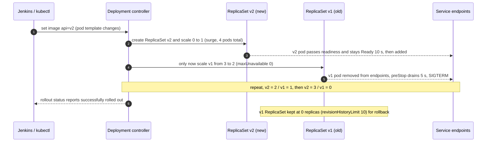
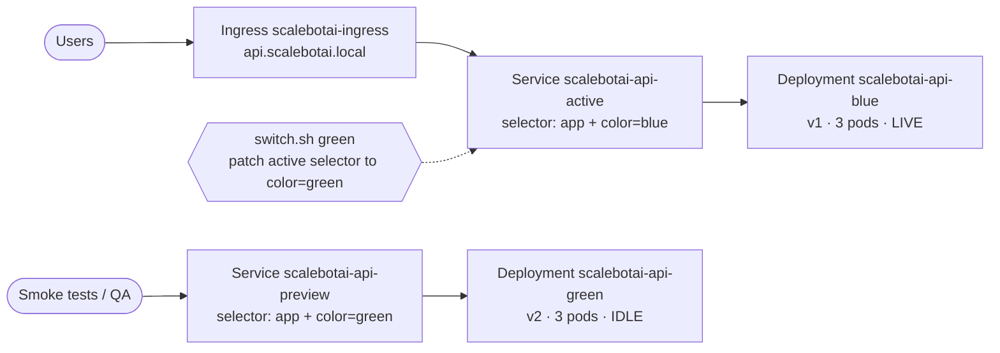
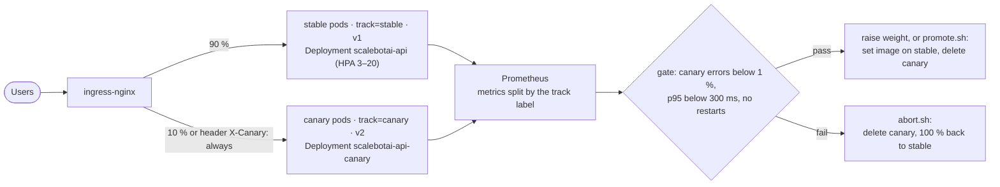
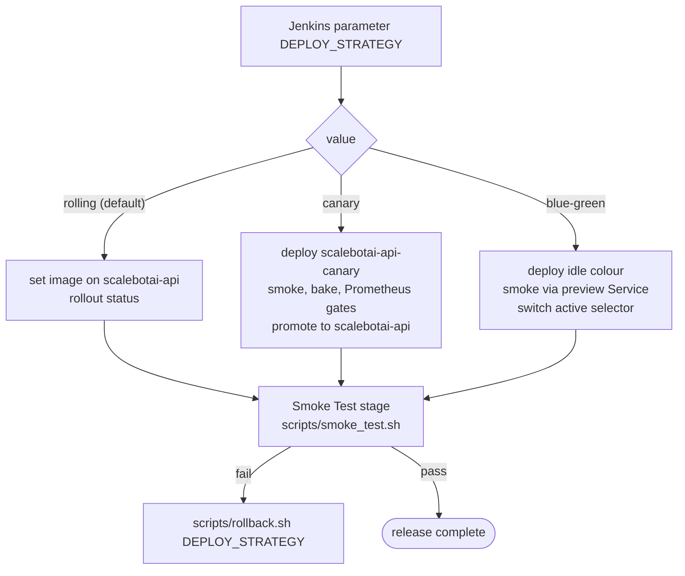

# 12 — Deployment Strategies: Rolling Update, Blue-Green, Canary

ScaleBotAI must ship new versions with **zero downtime** while keeping its 99.9 % availability target. This
document compares the three release strategies the project implements. For each one it covers how it works on
Kubernetes, the exact YAML and commands, how to roll back, and when to choose it.

| Strategy | Manifests / scripts | Jenkins `DEPLOY_STRATEGY` |
|---|---|---|
| **Rolling update** (default) | `k8s/base/06-api-deployment.yaml`, `k8s/strategies/rolling-update/` | `rolling` |
| **Blue-green** | `k8s/strategies/blue-green/` (`switch.sh`) | `blue-green` |
| **Canary** | `k8s/strategies/canary/` (`set-weight.sh`, `promote.sh`, `abort.sh`) | `canary` |

> Related: [07 Kubernetes Implementation](07-kubernetes-implementation.md) (all manifests) ·
> [08 CI/CD](08-cicd-jenkins.md) (the pipeline that calls `scripts/deploy.sh` / `scripts/rollback.sh`) ·
> [09 Monitoring](09-monitoring-logging.md) (the metrics used as release gates).

---

## 1. Shared building blocks

All three strategies rely on the same Kubernetes primitives:

- **Labels and selectors.** Every API pod has `app: scalebotai-api`, plus `track: stable|canary` or
  `color: blue|green`. A Service sends traffic to whichever pods its selector matches, so changing a selector
  or adding pods with matching labels **is** traffic management.
- **Readiness probes** (`GET /health/ready`). A pod receives traffic only after it reports Ready. Every strategy
  waits on this.
- **`kubectl rollout status`** blocks until a Deployment is fully available, and fails on timeout or
  `progressDeadlineSeconds`.
- **Graceful shutdown** (`preStop: sleep 5` + 30 s grace period). Pods being removed finish their in-flight
  requests.
- **Backward-compatible database changes.** In every strategy two versions run at the same time for a while,
  against the **same** Postgres. Schema changes use the *expand → migrate → contract* pattern: add the new
  column, deploy code that writes both, backfill, and only drop the old column in a later release. The app
  creates tables idempotently at start-up under an advisory lock.

---

## 2. Rolling update (default)

### 2.1 How it works

The Deployment replaces old pods with new ones in small batches. With `replicas: 3`, `maxSurge: 25%` (= 1 extra
pod) and `maxUnavailable: 0`, capacity **never drops below 3 Ready pods**:



During the rollout both versions serve traffic, so v1 and v2 must be API- and schema-compatible.

### 2.2 YAML (from `k8s/base/06-api-deployment.yaml`)

```yaml
spec:
  replicas: 3
  revisionHistoryLimit: 10        # old ReplicaSets kept for `rollout undo`
  minReadySeconds: 10             # new pod must stay Ready 10 s before it counts
  progressDeadlineSeconds: 600    # stuck rollout -> failed -> Jenkins rolls back
  strategy:
    type: RollingUpdate
    rollingUpdate:
      maxSurge: 25%               # +1 pod during the update
      maxUnavailable: 0           # never fewer than 3 Ready pods
  template:
    spec:
      terminationGracePeriodSeconds: 30
      containers:
        - name: api
          readinessProbe: { httpGet: { path: /health/ready, port: http }, periodSeconds: 5 }
          lifecycle: { preStop: { exec: { command: ["sleep", "5"] } } }
```

`k8s/strategies/rolling-update/deployment-patch.yaml` contains just these knobs, so you can re-apply them or
experiment (`kubectl patch --patch-file`).

| Setting choice | Effect |
|---|---|
| `maxSurge 25% / maxUnavailable 0` (ours) | Zero capacity loss and only +1 pod of extra cost; slower than a big surge |
| `maxSurge 100% / maxUnavailable 0` | Fastest: a whole new set starts at once. Needs 2× capacity briefly |
| `maxSurge 0 / maxUnavailable 1` | No extra resources, but runs at ⅔ capacity during the update, which is risky at peak |
| `type: Recreate` | Kill all, then start all: **downtime**. Used only where two copies must never run together (Redis, Prometheus with RWO volumes) |

### 2.3 Step-by-step

```bash
NS=scalebotai; IMAGE=docker.io/scalebotai/scalebotai-api:42-a1b2c3d
kubectl -n $NS set image deployment/scalebotai-api api=$IMAGE
kubectl -n $NS annotate deployment/scalebotai-api kubernetes.io/change-cause="build 42 (a1b2c3d)" --overwrite
kubectl -n $NS rollout status deployment/scalebotai-api --timeout=300s
kubectl -n $NS rollout history deployment/scalebotai-api
# watch it: kubectl -n $NS get rs -l app=scalebotai-api -w
# batch several changes into one rollout: rollout pause -> set image / set env / set resources -> rollout resume
```

**Proving zero downtime in the lab.** In a second terminal, run
`while true; do curl -sk -o /dev/null -w "%{http_code} " https://api.scalebotai.local/health/ready; sleep 0.2; done`
during `kubectl rollout restart deployment/scalebotai-api`. It prints only `200`.

### 2.4 Rollback

```bash
kubectl -n scalebotai rollout undo deployment/scalebotai-api                 # previous revision
kubectl -n scalebotai rollout undo deployment/scalebotai-api --to-revision=7 # specific revision
kubectl -n scalebotai rollout status deployment/scalebotai-api --timeout=300s
```

A rollback is a rolling update back to the old ReplicaSet's template, so it is also zero-downtime. It takes
about as long as a normal rollout (~1–2 min for 3 pods). If the new pods never become Ready, the old pods were
never removed (`maxUnavailable: 0`), so users were never affected.

### 2.5 Pros and cons

| Pros | Cons |
|---|---|
| Built into Kubernetes; no extra objects | Two versions serve traffic at the same time during the rollout |
| Minimal extra cost (+1 pod) | Rollback is another rollout (minutes, not seconds) |
| Works naturally with the HPA | Every user is exposed to the new version within minutes; there is no gradual risk control |
| Simplest to operate and explain | A bug that passes readiness but breaks behaviour reaches 100 % of users |

---

## 3. Blue-green

### 3.1 How it works

Two complete environments run side by side. Only the **active** one receives users. You deploy to the idle one,
test it through a preview Service, then flip a single selector field. Users move to the new version at once,
and moving back is just as fast.



After the switch, `scalebotai-api-active` selects `color=green` and `scalebotai-api-preview` selects
`color=blue`. Blue (the old version) stays warm as the rollback target.

### 3.2 YAML excerpts (`k8s/strategies/blue-green/`)

```yaml
# deployment-blue.yaml (green is identical with color: green)
kind: Deployment
metadata: { name: scalebotai-api-blue, labels: { app: scalebotai-api, color: blue } }
spec:
  replicas: 3
  selector: { matchLabels: { app: scalebotai-api, color: blue } }
  template:
    metadata: { labels: { app: scalebotai-api, tier: backend, color: blue } }
---
# service-active.yaml: the ONE field that moves all user traffic
kind: Service
metadata: { name: scalebotai-api-active }
spec:
  selector: { app: scalebotai-api, color: blue }
  ports: [{ name: http, port: 80, targetPort: http }]
---
# ingress-blue-green.yaml: same Ingress name as the base, so it replaces the backend in place
kind: Ingress
metadata: { name: scalebotai-ingress }
spec:
  rules:
    - host: api.scalebotai.local
      http:
        paths:
          - { path: /api, pathType: Prefix, backend: { service: { name: scalebotai-api-active, port: { name: http } } } }
```

Blue-green **replaces** the base Deployment; it doesn't run next to it. The pods still carry
`app: scalebotai-api`, so NetworkPolicies, the PDB, Prometheus and Filebeat work unchanged. The public Ingress,
however, points at `scalebotai-api-active`.

### 3.3 Step-by-step

```bash
NS=scalebotai; IMAGE=docker.io/scalebotai/scalebotai-api:43-def5678
# one-time: kubectl apply -f k8s/strategies/blue-green/   (deployments, services, ingress)
#           kubectl -n $NS delete hpa scalebotai-api ; kubectl -n $NS scale deploy scalebotai-api --replicas=0

IDLE=$(kubectl -n $NS get svc scalebotai-api-preview -o jsonpath='{.spec.selector.color}')
kubectl -n $NS set image deployment/scalebotai-api-$IDLE api=$IMAGE           # users unaffected
kubectl -n $NS rollout status deployment/scalebotai-api-$IDLE --timeout=300s
kubectl -n $NS port-forward svc/scalebotai-api-preview 8080:80 &               # test the idle colour
./scripts/smoke_test.sh http://localhost:8080 ; kill %1
VERIFY_URL=https://api.scalebotai.local/health/ready ./k8s/strategies/blue-green/switch.sh $IDLE
```

`switch.sh` performs these checks:
1. The target Deployment is fully rolled out and every replica is Ready.
2. It patches the active selector, then the preview selector.
3. It confirms that the active Service's EndpointSlices contain **only** target-colour pods.
4. It optionally checks `VERIFY_URL` over HTTP.
5. If any check fails, it switches back automatically and exits non-zero.

### 3.4 Rollback

```bash
./k8s/strategies/blue-green/switch.sh        # toggle back to the previous colour, in seconds
```

No pod starts and no image is pulled. Only the selector changes, and the old pods were never stopped. This is
the fastest rollback of the three strategies. Keep the old colour running until the release has soaked (for
example 30–60 minutes of clean metrics). After that you may scale it to 0 to save resources, but rollback then
needs a scale-up first.

### 3.5 Pros and cons

| Pros | Cons |
|---|---|
| Instant, atomic cut-over: no mixed versions serve users | **2× the pods** during the release (and permanently if the idle colour is kept warm) |
| Fastest rollback (selector flip) | All users switch at once; a bug missed by smoke tests hits 100 % |
| Full production-like test of the new version before any user sees it | Shared database: schema must suit both colours |
| Simple mental model: two named environments | More objects to manage; HPA per colour needed for autoscaling |

---

## 4. Canary

### 4.1 How it works

Deploy the new version next to the stable one and send it a **small share of real traffic**. Compare its error
rate and latency with stable in Prometheus. Then increase the share step by step (10 % → 25 % → 50 % → 100 %),
or abort. Problems affect only the canary's share of users, for a short time.



Two ways to split traffic are implemented:

| Variant | Mechanism | Share | Used by |
|---|---|---|---|
| **A: replica ratio** | Canary pods carry `app: scalebotai-api`, so the normal Service `scalebotai-api` load-balances over 3 stable + 1 canary pods | ≈ 25 % (1/4); 50 % with 3 canary pods. The share drifts when the HPA scales stable | Jenkins (`DEPLOY_STRATEGY=canary`) |
| **B: ingress-nginx weights** | A canary Ingress (`nginx.ingress.kubernetes.io/canary: "true"`, `canary-weight: "10"`, `canary-by-header: X-Canary`) routes an exact percentage to Service `scalebotai-api-canary`. `set-weight.sh` points the primary Ingress at the stable-only Service `scalebotai-api-stable` | Exactly *w* %; testers can force the canary with header `X-Canary: always` | Manual progressive rollouts (`set-weight.sh`) |

Why Variant B needs the stable-only Service: `scalebotai-api` also selects the canary pod, so without it the
canary would get *w* + (1 − *w*) × 1/4. At *w* = 10 % that is 32.5 %, not 10 %.

### 4.2 YAML excerpts (`k8s/strategies/canary/`)

```yaml
# deployment-canary.yaml
kind: Deployment
metadata: { name: scalebotai-api-canary }
spec:
  replicas: 1                                         # 1 of 4 pods = ~25 % (Variant A)
  selector: { matchLabels: { app: scalebotai-api, track: canary } }   # never overlaps track: stable
  template:
    metadata:
      labels: { app: scalebotai-api, tier: backend, track: canary }
      annotations: { prometheus.io/scrape: "true", prometheus.io/port: "8000" }
---
# ingress-canary.yaml (Variant B)
kind: Ingress
metadata:
  name: scalebotai-ingress-canary
  annotations:
    nginx.ingress.kubernetes.io/canary: "true"
    nginx.ingress.kubernetes.io/canary-by-header: "X-Canary"    # always -> canary, never -> stable
    nginx.ingress.kubernetes.io/canary-weight: "10"             # % of the remaining traffic
spec:
  rules:
    - host: api.scalebotai.local                                 # same host/paths as the primary
      http:
        paths:
          - { path: /api, pathType: Prefix, backend: { service: { name: scalebotai-api-canary, port: { name: http } } } }
```

The stable Deployment's selector includes `track: stable`, so it never adopts canary pods. The HPA targets only
the stable Deployment, so the canary stays a fixed size.

### 4.3 Step-by-step (progressive, Variant B)

```bash
cd k8s/strategies/canary; NS=scalebotai; IMAGE=docker.io/scalebotai/scalebotai-api:44-0a1b2c3
./set-weight.sh 0                                   # users -> stable only; canary reachable by header
kubectl apply -f deployment-canary.yaml
kubectl -n $NS set image deployment/scalebotai-api-canary api=$IMAGE
kubectl -n $NS rollout status deployment/scalebotai-api-canary --timeout=300s
curl -k -H "X-Canary: always" https://api.scalebotai.local/health   # canary-only smoke test
./set-weight.sh 10   # watch the gates for >= 10 min
./set-weight.sh 25   # gates
kubectl -n $NS scale deployment/scalebotai-api-canary --replicas=3 && ./set-weight.sh 50   # gates
./promote.sh         # rolling update of stable to $IMAGE, then removes all canary objects
```

### 4.4 Gates: PromQL checked before each step

The Prometheus relabel config copies the pod label `track` onto every series. It also sets `namespace` and
`pod`, which `scripts/deploy.sh` uses (`pod=~"scalebotai-api-canary-.*"`).

| Gate | PromQL | Pass if |
|---|---|---|
| Error rate | `sum(rate(scalebot_http_requests_total{namespace="scalebotai",track="canary",status=~"5.."}[5m])) / sum(rate(scalebot_http_requests_total{namespace="scalebotai",track="canary"}[5m]))` | < 0.01 and ≤ 1.5 × the same query with `track="stable"` |
| p95 latency | `histogram_quantile(0.95, sum by (le) (rate(scalebot_http_request_duration_seconds_bucket{namespace="scalebotai",track="canary"}[5m])))` | < 0.3 s and within ~20 % of stable |
| Stability | `sum(increase(kube_pod_container_status_restarts_total{namespace="scalebotai",pod=~"scalebotai-api-canary-.*"}[10m]))` | == 0 |
| Traffic really flows | `sum(rate(scalebot_http_requests_total{track="canary"}[5m])) / sum(rate(scalebot_http_requests_total{namespace="scalebotai"}[5m]))` | ≈ current weight (otherwise the canary isn't being tested) |
| Business signals | `rate(scalebot_auth_events_total{event="login_failure"}[5m])`, `rate(scalebot_chat_messages_total{bot_mode="rule-fallback"}[5m])` | no jump vs stable |

The `HighErrorRate` alert in `k8s/monitoring/prometheus-rules.yaml` is grouped `by (namespace, track)`, so a bad
canary fires an alert of its own. In Kibana, filter with `kubernetes.labels.track : "canary"`.

### 4.5 Rollback

```bash
./k8s/strategies/canary/abort.sh
```

`abort.sh` works in this order:
1. Deletes the canary Ingress, which stops weighted and header traffic immediately.
2. Deletes the canary Deployment; its pods drain gracefully.
3. Points the primary Ingress back at `scalebotai-api` and removes the helper Services.
4. Confirms the stable Deployment is healthy.

The stable Deployment was **never modified**, so nothing else needs undoing. Only the canary's share of requests
was ever exposed. If the final promotion fails, `promote.sh` runs `kubectl rollout undo` on stable by itself.

### 4.6 Pros and cons

| Pros | Cons |
|---|---|
| Lowest risk: real production traffic, small blast radius | Slowest release: minutes to hours of observation |
| Decisions based on data (metrics gates), easy to automate | Needs good metrics and enough traffic for meaningful statistics |
| Little extra capacity (1–3 pods) | Two versions live at once (API/schema compatibility) |
| Header routing lets QA test in production safely | More moving parts (extra Service/Ingress, weight management) |

---

## 5. Comparison

| | Rolling update | Blue-green | Canary |
|---|---|---|---|
| **Downtime** | None (`maxUnavailable: 0` + readiness + preStop) | None (atomic selector switch) | None |
| **Rollback speed** | Minutes (`rollout undo` = new rollout) | **Seconds** (flip the selector back) | Seconds (delete the canary) |
| **Infrastructure cost during release** | +1 pod (25 % surge) | **2×** (full second environment) | +1–3 pods |
| **User exposure to a bad build** | Up to 100 % within minutes | 100 % at switch time (after pre-switch tests) | **Only the canary share** (10–25 %) for a short time |
| **Mixed versions serving users** | Yes, during the rollout | No | Yes, by design |
| **Operational complexity** | Low (built in) | Medium (two Deployments, two Services, switch script) | High (weights, metrics gates, promotion) |
| **Needs good metrics** | Helpful | Helpful | **Required** |
| **Best for** | Routine releases, small low-risk changes, limited capacity | Releases needing instant rollback or a full pre-production check on prod infra; big-bang changes | Risky changes (new LLM model, caching logic, performance work); validating with real traffic |

---

## 6. What ScaleBotAI uses and when to choose the others

**Default: rolling update** (`DEPLOY_STRATEGY=rolling`). Reasons:

- The API is stateless and all changes stay backward-compatible, so mixed versions during a rollout are safe.
- `maxSurge 25% / maxUnavailable 0` gives zero downtime at the lowest cost: one extra pod on a capacity-limited
  minikube or small cluster.
- It is native Kubernetes behaviour that works with the HPA, needs no extra objects, and Jenkins' rollback is a
  single `rollout undo`.
- Readiness probes, `minReadySeconds`, `progressDeadlineSeconds` and post-deploy smoke tests catch most bad
  builds before they replace all pods.

**Choose canary** when a change is risky and hard to test before production: switching `CHATBOT_MODE` to `llm`
or a new Ollama model, cache-key or rate-limit logic, DB query changes on hot paths, or performance tuning. You
get real-traffic evidence (error rate, p95) at small exposure.

**Choose blue-green** when you need the **fastest possible rollback** or a full verification of the new version
on production infrastructure before any user sees it. Examples are major dependency upgrades (Python, FastAPI,
SQLAlchemy), demos and exam-day releases, or changes where mixed versions must never serve users at the same
time. You must be able to afford double capacity.

---

## 7. Jenkins `DEPLOY_STRATEGY` mapping

The pipeline (`jenkins/Jenkinsfile`, stage **Kubernetes Deploy**) runs
`scripts/deploy.sh "$DEPLOY_STRATEGY" "$IMAGE_NAME:$IMAGE_TAG"` with the `kubeconfig-scalebotai` credential (the
`jenkins-deployer` ServiceAccount from `k8s/base/11-rbac.yaml`). Then the **Smoke Test** stage runs. On failure
it calls `scripts/rollback.sh "$DEPLOY_STRATEGY"`. Full pipeline details: [docs/08](08-cicd-jenkins.md).

| `DEPLOY_STRATEGY` | What `scripts/deploy.sh` does (Kubernetes objects) | What `scripts/rollback.sh` does |
|---|---|---|
| `rolling` | `kubectl set image deployment/scalebotai-api api=<image>`; annotate `change-cause`; `kubectl rollout status --timeout=300s` | `kubectl rollout undo deployment/scalebotai-api` + `rollout status` |
| `canary` | `kubectl apply -f k8s/strategies/canary/deployment-canary.yaml`; `set image` on `scalebotai-api-canary`; wait for the rollout; smoke test the canary pod (port-forward); **bake** under live traffic (Variant A, ~25 %), checking for restarts; if `PROMETHEUS_URL` is set, gate on the canary 5xx ratio (default ≤ 1 %) and p95 (default ≤ 0.5 s; set `CANARY_MAX_P95_SECONDS=0.3` to enforce the 300 ms SLO); then **promote** (`set image` on `scalebotai-api` + rollout status) and delete the canary. Any failure before promotion deletes the canary, and stable is untouched | Delete the canary (and any canary Ingress); if the image had already been promoted, `rollout undo` the stable Deployment |
| `blue-green` | Ensure `k8s/strategies/blue-green/` objects exist (applying the directory also repoints `scalebotai-ingress` to `scalebotai-api-active`); read the live colour from `scalebotai-api-active`; `set image` + scale on the **idle** colour; wait; point `scalebotai-api-preview` at it and smoke test through it; patch the `scalebotai-api-active` selector to the new colour; verify endpoints; keep the old colour as hot standby | Patch `scalebotai-api-active` back to the previous colour (recorded in `.deploy-state`) and optionally scale the failed colour to 0 |

The manual scripts in `k8s/strategies/` (`switch.sh`, `set-weight.sh`, `promote.sh`, `abort.sh`) use the
**same object names** as the pipeline. You can use them for hands-on demos, or to take over a release manually
(for example a slow 10 → 25 → 50 % canary).



---

## 8. Beyond this project

- **Argo Rollouts / Flagger** turn the canary steps and PromQL gates above into a Kubernetes controller
  (`Rollout` CRD with `setWeight` steps and `AnalysisTemplate`s). The controller promotes or aborts
  automatically, with no scripts.
- **Gateway API** `HTTPRoute` supports weighted `backendRefs` natively (`weight: 90` / `weight: 10`). It is the
  successor to ingress-nginx canary annotations; the ingress-nginx project was retired in 2026.
- **Feature flags** (e.g. OpenFeature, Unleash) separate *deploying* code from *releasing* a feature. This
  complements all three strategies.
- **Shadow (mirror) traffic** copies real requests to the new version and discards its responses. It tests
  under production load with zero user exposure (ingress-nginx `mirror-target`, service meshes).
- **A/B testing** routes by user attributes (header, cookie, region) to compare business metrics rather than
  technical health. ingress-nginx supports it with `canary-by-header` / `canary-by-cookie`.
