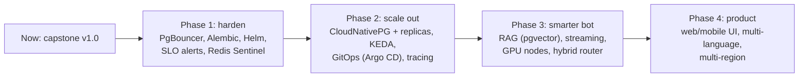

# 13 — Design Decisions, Future Enhancements and Limitations

> This document records **why** ScaleBotAI is built the way it is, as Architecture Decision Records (ADRs):
> the context, the decision, the alternatives that were considered and the consequences — good and bad.
> It closes with the improvement roadmap and an honest list of limitations of the current implementation.
> Every ADR describes what is implemented in this repository (code, configuration, manifests, metrics).

## ADR index

| # | Decision | Status |
|---|---|---|
| [ADR-001](#adr-001--fastapi-over-flask-and-django) | FastAPI (ASGI) over Flask and Django | Accepted |
| [ADR-002](#adr-002--async-sqlalchemy-2x--asyncpg) | Async SQLAlchemy 2.x + asyncpg | Accepted |
| [ADR-003](#adr-003--postgresql-over-mongodb) | PostgreSQL over MongoDB | Accepted |
| [ADR-004](#adr-004--redis-for-cache-rate-limiting-token-denylist-and-counters) | Redis for cache, rate limiting, token denylist and counters | Accepted |
| [ADR-005](#adr-005--one-uvicorn-worker-per-container-scale-with-pods) | One uvicorn worker per container; scale with pods | Accepted |
| [ADR-006](#adr-006--stateless-jwt--redis-denylist-instead-of-server-sessions) | Stateless JWT + Redis denylist instead of server sessions | Accepted |
| [ADR-007](#adr-007--rule-based-engine-by-default-optional-tinyllama-with-fallback) | Rule-based engine by default; optional TinyLlama with fallback | Accepted |
| [ADR-008](#adr-008--nginx-in-compose-ingress-nginx-in-kubernetes) | NGINX in Compose, ingress-nginx in Kubernetes | Accepted (see migration note) |
| [ADR-009](#adr-009--kubernetes-with-hpa-on-cpu-and-memory) | Kubernetes with HPA on CPU and memory | Accepted |
| [ADR-010](#adr-010--plain-yaml--kustomize-instead-of-helm) | Plain YAML + Kustomize instead of Helm | Accepted |
| [ADR-011](#adr-011--jenkins-instead-of-github-actions) | Jenkins instead of GitHub Actions | Accepted |
| [ADR-012](#adr-012--elk-stack-instead-of-loki) | ELK stack instead of Loki | Accepted |
| [ADR-013](#adr-013--prometheus-pull-model) | Prometheus pull model | Accepted |
| [ADR-014](#adr-014--app-created-schema-under-an-advisory-lock-instead-of-alembic) | App-created schema under an advisory lock instead of Alembic | Accepted (Alembic = future) |
| [ADR-015](#adr-015--fail-open-when-redis-is-unavailable) | Fail open when Redis is unavailable | Accepted |
| [ADR-016](#adr-016--self-hosted-postgresql-and-redis-in-the-cluster) | Self-hosted PostgreSQL and Redis in the cluster | Accepted for the capstone |

---

## ADR-001 — FastAPI over Flask and Django

**Context.** The API is overwhelmingly I/O-bound: each request waits on PostgreSQL, Redis and — in LLM mode —
an HTTP call to Ollama. The non-functional targets are 100–500 concurrent requests at peak and an average
latency below 300 ms. The team also needed strict input validation, an always-current API specification for
evaluators and testers, and a short learning curve.

**Decision.** Build the API with **FastAPI** (Starlette + Pydantic v2) on **uvicorn** (ASGI), Python 3.12.

**Alternatives considered.**

| Option | Why not chosen |
|---|---|
| Flask (WSGI) | Synchronous by default: every in-flight request occupies a worker thread/process, so 500 concurrent slow requests need ~500 threads. Validation and OpenAPI need extensions (marshmallow, flask-smorest). |
| Django + DRF | Batteries included (admin site, ORM, migrations) but heavyweight for a pure JSON API; the ORM's async support is partial, so most DB access still runs in threads. |
| Node.js / Go | Excellent performance, but splits the stack away from the Python ecosystem used for the chatbot logic and tests. |

**Consequences.**
- (+) Native `async`/`await`: one process serves hundreds of concurrent I/O-bound requests.
- (+) Pydantic models validate every request and produce structured `422 VALIDATION_ERROR` responses;
  `response_model` guarantees fields such as `password_hash` can never leak.
- (+) Free OpenAPI 3 spec at `/openapi.json`, Swagger UI at `/docs`, ReDoc at `/redoc`.
- (+) Dependency injection (`Depends`) gives clean, testable composition of DB sessions, Redis, the current
  user and admin checks; tests replace them with SQLite + fakeredis via `app.dependency_overrides`.
- (−) Blocking calls inside `async def` handlers freeze the event loop. CPU-bound bcrypt is therefore executed
  with `run_in_threadpool` (`src/app/core/security.py`).
- (−) No built-in admin UI or migrations (admin features are explicit APIs; see ADR-014 for schema management).

---

## ADR-002 — Async SQLAlchemy 2.x + asyncpg

**Context.** An async framework needs a non-blocking database driver; a synchronous driver called from an
`async` handler blocks the whole process. The same models must also run against SQLite in unit tests.

**Decision.** SQLAlchemy 2.x `AsyncEngine`/`AsyncSession` with the **asyncpg** driver
(`postgresql+asyncpg://…`), one engine per process with a `QueuePool`
(`DB_POOL_SIZE=10`, `DB_MAX_OVERFLOW=20`, `DB_POOL_TIMEOUT=10`).

**Alternatives considered.**

| Option | Why not chosen |
|---|---|
| Sync SQLAlchemy + psycopg in a threadpool | Works, but the threadpool (40 threads by default in AnyIO) becomes the concurrency ceiling and adds context switches. |
| Raw asyncpg | Fastest, but no ORM, no model reuse with SQLite tests, hand-written SQL everywhere. |
| psycopg 3 (async) | A valid alternative; asyncpg was chosen for its maturity with SQLAlchemy async and its binary-protocol performance. |
| Tortoise ORM / SQLModel | Smaller ecosystems; SQLModel is a thin layer over SQLAlchemy anyway. |

**Consequences.**
- (+) One set of models for PostgreSQL (production) and `aiosqlite` (unit tests).
- (+) Bound parameters everywhere — SQL injection is structurally prevented.
- (+) Pool metrics (`scalebot_db_pool_size`, `scalebot_db_pool_checked_out`) expose saturation.
- (−) Async ORM rules: no implicit lazy loading (relationships must be eager-loaded or queried explicitly),
  sessions use `expire_on_commit=False`.
- (−) asyncpg's prepared-statement cache conflicts with PgBouncer transaction pooling; this must be disabled
  when PgBouncer is introduced (`docs/04-database-design.md` §9.1).
- (−) Pool size × replica count must respect PostgreSQL `max_connections` (same section).

---

## ADR-003 — PostgreSQL over MongoDB

**Context.** The data is naturally relational: users own conversations, conversations contain exchanges, an
exchange has at most one rating. The system needs uniqueness under concurrency (usernames, emails, one rating
per answer), cascading deletes (right to erasure), transactions, and aggregate queries for the admin dashboard.

**Decision.** **PostgreSQL 16** as the system of record (schema in `docs/04-database-design.md`).

**Alternatives considered.**

| Option | Trade-off |
|---|---|
| MongoDB | A conversation-as-document with embedded messages is natural for transcripts and schema-flexible, but arrays grow unbounded (16 MB document limit), uniqueness/cascades across collections are application-level, and analytics need aggregation pipelines. |
| MySQL 8 | Viable. PostgreSQL offers richer indexing (partial, covering `INCLUDE`, BRIN, GIN/trigram), declarative partitioning, `FILTER` aggregates, `ON CONFLICT` upserts and the `pgvector` path for RAG. |
| Cassandra / DynamoDB | Massive write scale-out, but query-first modelling, no ad-hoc analytics, and either heavy operations or cloud lock-in — unjustified at ~400 k inserts/day. |

**Consequences.**
- (+) Constraints (`UNIQUE`, `CHECK`, `FOREIGN KEY … ON DELETE CASCADE`) enforce invariants even when 20
  replicas write concurrently.
- (+) The `UNIQUE (chat_id)` constraint makes the feedback upsert race-safe: a lost insert race surfaces as an
  `IntegrityError` and is retried as an update (`INSERT … ON CONFLICT` is the single-statement equivalent).
- (+) One engine for OLTP and light analytics; `pgvector` enables future RAG without a new datastore.
- (−) A single primary scales writes vertically; mitigations are partitioning, read replicas and PgBouncer
  (design volume of ~400 k rows/day is far below a single node's capacity).
- (−) Running a stateful database in Kubernetes needs a StatefulSet, persistent volumes and a backup plan
  (ADR-016).

---

## ADR-004 — Redis for cache, rate limiting, token denylist and counters

**Context.** The API pods are stateless and replicated (3–20). Several features need **shared, fast,
expiring** state: a response cache, a rate limiter that is global across pods (a per-process limiter would
allow `replicas × limit`), JWT revocation, and per-day request counters for analytics.

**Decision.** One Redis instance, separated by key prefix, every key with a TTL:
`bot:resp:{mode}:{sha256}` (`CACHE_TTL_SECONDS`=3600), `user:{id}` (300 s), `analytics:summary` (30 s),
`ratelimit:{user_or_ip}:{epoch_minute}` (60 s, fixed window, `RATE_LIMIT_PER_MINUTE`=120),
`jwt:denylist:{jti}` (remaining token life), `stats:requests:{YYYY-MM-DD}` (35 days).

**Alternatives considered.**

| Option | Why not chosen |
|---|---|
| In-process caches (e.g. `cachetools`) | Not shared: each pod has its own copy, limits and revocations are inconsistent across pods. |
| Memcached | Cache-only, no persistence, no rich data structures; still need something else for counters and the denylist. |
| PostgreSQL tables for counters/denylist | Adds a write to the primary on every request — exactly the load we want to keep off the database. |
| One Redis per concern | Better isolation (eviction, failure), but more to operate at capstone scale. |

**Consequences.**
- (+) Sub-millisecond operations; atomic `INCR` + `EXPIRE` gives a correct distributed fixed-window limiter.
- (+) TTLs make cleanup automatic (a denylist entry disappears exactly when the token would have expired).
- (−) Redis is a shared dependency and a single point of failure → handled by failing open (ADR-015).
- (−) Under memory pressure, eviction is instance-wide: an LRU policy could evict denylist or rate-limit keys.
  Size `maxmemory` so eviction does not happen in practice, alert on `evicted_keys`, and split security state
  into its own instance in production.

---

## ADR-005 — One uvicorn worker per container; scale with pods

**Context.** Kubernetes already supervises, restarts and replicates processes, and the HPA scales on per-pod
CPU/memory. `prometheus_client` in a multi-process server needs a shared `PROMETHEUS_MULTIPROC_DIR` and has
awkward gauge semantics. A single CPython process uses about one core for Python code because of the GIL.

**Decision.** `uvicorn app.main:app --host 0.0.0.0 --port 8000 --proxy-headers --forwarded-allow-ips=* --workers 1`
— exactly one process per container; scale with pods (HPA 3–20) or `docker compose up --scale chatbot-api=N`.

**Alternatives considered.**

| Option | Trade-off |
|---|---|
| Gunicorn + N uvicorn workers per container | Better use of a multi-core container, but metrics need multi-process mode, the container becomes a bigger failure domain, HPA granularity becomes coarse, and Kubernetes would supervise a supervisor. |
| Multiple threads | Threads do not parallelise Python code under the GIL. |

**Consequences.**
- (+) Metrics from `/metrics` are exact per pod; Prometheus aggregates across pods.
- (+) Resource requests/limits (250m–1 CPU, 256–512 Mi) map cleanly onto one event loop.
- (+) Crash → kubelet restarts the container; no in-container process manager.
- (−) More pods ⇒ more connection pools (pool math in `docs/04-database-design.md` §9.1) and a ~100 MB
  baseline memory per pod.
- (−) Anything CPU-bound on the event loop stalls the whole pod — hence `run_in_threadpool` for bcrypt.

---

## ADR-006 — Stateless JWT + Redis denylist instead of server sessions

**Context.** Requests are load-balanced across interchangeable pods without sticky sessions. Clients include
scripts, load-testing tools and future mobile apps, not only browsers. Users must be able to log out.

**Decision.** HS256-signed JWTs sent as `Authorization: Bearer <token>`: access token
(`ACCESS_TOKEN_EXPIRE_MINUTES`=30) and refresh token (`REFRESH_TOKEN_EXPIRE_DAYS`=7), claims
`sub` (user UUID), `role`, `type` (access/refresh), `jti`, `iss`=`scalebotai`, `iat`, `exp`.
`POST /api/v1/auth/logout` stores the access token's `jti` in `jwt:denylist:{jti}` with TTL = remaining
lifetime (and, if the client sends its `refresh_token` in the body, revokes that too);
`POST /api/v1/auth/refresh` rotates the refresh token and denylists the old one, so each refresh token works once.

**Alternatives considered.**

| Option | Trade-off |
|---|---|
| Server-side sessions (session id cookie → Redis) | Instant revocation, but every request needs a Redis read anyway, cookies need CSRF protection, and non-browser clients are less natural. |
| Opaque tokens + introspection endpoint | Revocable, but an extra network hop per request. |
| RS256 / OIDC provider (e.g. Keycloak) | Best when several services verify tokens or SSO is needed — planned as future work. |

**Consequences.**
- (+) Any pod can verify any token locally (one HMAC check + one Redis `GET` for the denylist).
- (+) Short-lived access tokens bound the damage of a stolen token; refresh rotation limits replay.
- (±) Tokens are snapshots, so authorisation does **not** trust the `role` claim alone: every request loads the user
  record (Redis `user:{id}`, cached ≤ 300 s and evicted by `PATCH /api/v1/admin/users/{user_id}`), so role changes
  and deactivations take effect on the user's next request at the cost of one cache lookup.
- (−) One symmetric secret (`JWT_SECRET_KEY`) shared by all pods; rotating it logs everybody out (no `kid`
  key rotation yet).
- (−) Revocation depends on Redis; during a Redis outage logged-out tokens remain usable until `exp`
  (ADR-015).

---

## ADR-007 — Rule-based engine by default; optional TinyLlama with fallback

**Context.** The scale targets (1 M requests/day, < 300 ms average latency) must be met on commodity CPU nodes
without a GPU or a paid API. CPU inference of even a 1.1 B-parameter model takes seconds per answer.
Deterministic answers also make automated tests and load tests meaningful.

**Decision.** `CHATBOT_MODE=rule` (default): an intent/keyword + regex rule engine covering greetings, help
and DevOps/cloud topics (Docker, Kubernetes, Jenkins, CI/CD, Git, NGINX, Redis, PostgreSQL, Prometheus,
Grafana, ELK, cloud, scaling …), answers cached in Redis. `CHATBOT_MODE=llm`: Ollama `/api/chat` with model
`tinyllama`, the last 5 exchanges as context and `OLLAMA_TIMEOUT_SECONDS=20`; on timeout or error the rule
engine answers and the exchange is recorded as `bot_mode = "rule-fallback"`. After 3 consecutive LLM failures a
circuit breaker skips Ollama for 30 s, so requests stop waiting on a dead model server (`src/app/chatbot/llm.py`).
Both engines implement one `BotEngine` interface (Strategy pattern, `src/app/chatbot/base.py`).

**Alternatives considered.**

| Option | Trade-off |
|---|---|
| Hosted LLM API | High quality, but per-request cost at ~400 k messages/day, 1–3 s latency, data leaves the cluster, external SLA dependency. |
| Larger local model (7–8 B) | Better answers, needs GPU nodes to be usable. |
| Retrieval/FAQ engine (TF-IDF, embeddings) | A good middle ground — part of the "hybrid router" future work. |

**Consequences.**
- (+) Rule mode answers in milliseconds, scales linearly with pods, and is fully testable.
- (+) LLM mode demonstrates AI integration with **graceful degradation** — an LLM failure never becomes an
  API error; `GET /api/v1/bot/info` reports `llm_available`.
- (−) The rule engine only understands what its intents cover.
- (−) TinyLlama can be inaccurate; on CPU it cannot meet the 300 ms target, so **performance targets apply to
  rule mode**. Ollama is a single instance (`ollama` service / optional `llm` profile).

---

## ADR-008 — NGINX in Compose, ingress-nginx in Kubernetes

**Context.** Both environments need TLS termination, load balancing across replicas, edge rate limiting,
security headers, and must keep `/metrics` private.

**Decision.** Compose: a custom NGINX image (`docker/nginx/`) with upstream `chatbot-api:8000`, HTTP→HTTPS
redirect, a self-signed certificate generated at start if missing, `limit_req`, `/metrics` denied, JSON access
logs and `stub_status` on `:8080/nginx_status` for `nginx-exporter`. Kubernetes: the **ingress-nginx**
controller with Ingress `scalebotai-ingress` (class `nginx`, host `api.scalebotai.local`, TLS secret
`scalebotai-tls`) in front of the ClusterIP Service `scalebotai-api`.

**Alternatives considered.** Traefik (dynamic discovery, good alternative), HAProxy (excellent L4/L7 load
balancer), Envoy/Istio gateway (powerful but heavy for this scope), cloud load balancers only (no local parity).

**Consequences.**
- (+) Same proxy technology and mental model in both environments; widely documented.
- (+) Defence in depth: NGINX `limit_req` at the edge **and** the Redis limiter in the app.
- (−) By default NGINX resolves an upstream hostname only once, at start-up. The Compose configuration therefore
  uses Docker's embedded DNS (`resolver 127.0.0.11 valid=10s`) with the `resolve` flag on the
  `chatbot-api:8000` upstream server (NGINX ≥ 1.27.3), so replicas added with `--scale` receive traffic within
  about 10 s without a reload.
- (−) **Migration note:** the community ingress-nginx project has been retired by Kubernetes SIG Network
  (best-effort maintenance ended in March 2026). The manifests stay valid for the lab, but production should
  move to the **Gateway API** (e.g. NGINX Gateway Fabric or Envoy Gateway) — listed under future work.

---

## ADR-009 — Kubernetes with HPA on CPU and memory

**Context.** Targets: 99.9 % availability, zero-downtime deploys, self-healing, and elastic capacity for
100–500 concurrent requests.

**Decision.** Deployment `scalebotai-api` (3 replicas, RollingUpdate `maxSurge: 25%`, `maxUnavailable: 0`;
startup/liveness probe `GET /health/live`, readiness `GET /health/ready`; requests 250m/256Mi, limits 1 CPU/512Mi)
and an `autoscaling/v2` HPA: `minReplicas: 3`, `maxReplicas: 20`, CPU 70 %, memory 75 %, with `behavior`
for fast scale-up and slow scale-down.

**Alternatives considered.** Docker Swarm (simpler, no native metric-based autoscaling), Nomad, VM
autoscaling groups, serverless containers (cold starts, vendor lock-in), KEDA event-driven scaling (future work).

**Consequences.**
- (+) Self-healing, declarative rollouts and rollbacks, autoscaling, service discovery.
- (+) `maxUnavailable: 0` keeps serving capacity at ≥ 3 ready pods throughout a rollout.
- (−) Utilisation is measured against **requests**: 70 % CPU = 175m, 75 % memory = 192 Mi per pod.
- (−) CPU is only a proxy for load: an I/O-bound async service can see rising latency before CPU reaches 70 %
  (hence KEDA on request rate/latency as future work).
- (−) With several metrics the HPA uses the **largest** recommended replica count. CPython rarely returns freed
  memory to the OS, so if RSS stays above 192 Mi the memory metric can hold the replica count up after load
  drops. Watch `process_resident_memory_bytes`; consider removing the memory metric if it prevents scale-down.
- (−) Requires metrics-server and adds operational complexity.

---

## ADR-010 — Plain YAML + Kustomize instead of Helm

**Context.** One application, one team; a learning objective of the capstone is to understand each Kubernetes
object. `kubectl` has Kustomize built in.

**Decision.** Numbered plain manifests in `k8s/base/` with `k8s/base/kustomization.yaml`; deploy with
`kubectl apply -k k8s/base`; Jenkins changes only the image (`kubectl set image …`).

**Alternatives considered.** Helm (templating, packaging, release history, `helm rollback`, values per
environment), Jsonnet / cdk8s, Pulumi.

**Consequences.**
- (+) Manifests are readable, diffable and reviewable; no template language; nothing extra to install.
- (+) Environment differences can be added as Kustomize overlays/patches.
- (−) No packaged, versioned release; rollback (`kubectl rollout undo`) covers the Deployment, not ConfigMaps or
  other objects. A Helm chart is future work for distribution.

---

## ADR-011 — Jenkins instead of GitHub Actions

**Context.** The lab curriculum uses Jenkins; the target cluster (minikube/kind or a lab cluster) and the Docker
daemon live on the local network and are not reachable from hosted CI runners.

**Decision.** A declarative pipeline at `jenkins/Jenkinsfile`: Checkout → Build → Unit Test → Lint → Docker
Build → Security Scan (Trivy) → Docker Push → Kubernetes Deploy → Smoke Test → Rollback on failure.
Credentials `dockerhub-credentials` and `kubeconfig-scalebotai`; parameters `DOCKERHUB_USER`,
`DEPLOY_STRATEGY` (rolling | canary | blue-green), `SKIP_DEPLOY`. Images are tagged
`<BUILD_NUMBER>-<git short sha>` (+ `latest` on `main`).

**Alternatives considered.** GitHub Actions (hosted, zero maintenance, marketplace, but needs a self-hosted
runner to reach a private cluster and ties CI to GitHub), GitLab CI, Tekton / Argo Workflows (Kubernetes-native).

**Consequences.**
- (+) Full control, runs next to the cluster, secrets in the Jenkins credential store, matches the lab.
- (+) Stages map one-to-one to any other CI system, so migration is mechanical.
- (−) A self-managed server: plugin updates and their CVEs, backups of `JENKINS_HOME`, agent provisioning.

---

## ADR-012 — ELK stack instead of Loki

**Context.** Logs are structured JSON with a `log_type` (api, user, error, system). Evaluators expect
full-text search, field-level filtering and dashboards; the syllabus names ELK.

**Decision.** Filebeat (Kubernetes) or Logstash's file input (Compose, shared `app-logs` volume) → Logstash →
Elasticsearch daily indices `scalebot-{log_type}-logs-YYYY.MM.dd` → Kibana.

**Alternatives considered.** Grafana Loki + Promtail/Alloy (indexes labels only — much cheaper storage, native
in Grafana, but content search is brute-force); EFK with Fluent Bit; OpenSearch; managed cloud logging.

**Consequences.**
- (+) Rich search and aggregations over typed fields (`status_code`, `latency_ms`, `user_id`, `request_id`).
- (+) Industry-standard skills; per-type indices allow different retention per log type.
- (−) Heavy: the Elasticsearch JVM needs 1–2 GB heap even single-node; shard and ILM management.
- (−) Local development runs single-node with X-Pack security disabled — acceptable only for development.

---

## ADR-013 — Prometheus pull model

**Context.** The set of API instances is dynamic (HPA 3–20 pods; `--scale` in Compose). Monitoring must
discover them automatically and detect when one disappears.

**Decision.** Each process exposes `GET /metrics` (`prometheus_client`); Prometheus **scrapes** it —
via `dns_sd_configs` (type A on `chatbot-api`) in Compose and via pod annotations
(`prometheus.io/scrape|port|path`) in Kubernetes — plus postgres-, redis- and nginx-exporters.
Grafana visualises; alert rules live in `monitoring/prometheus/alert-rules.yml`.

**Alternatives considered.** Push models (StatsD/Graphite, InfluxDB/Telegraf, OTLP push, Pushgateway),
commercial agents (Datadog, New Relic).

**Consequences.**
- (+) The `up` series is a free liveness signal per target; the app does not need to know where Prometheus is.
- (+) Prometheus controls scrape rate, so a misbehaving app cannot flood it.
- (−) Prometheus must reach every pod (network policies must allow it); short-lived batch jobs need a
  Pushgateway.
- (−) A single Prometheus is a single point of failure with local retention (Thanos/Mimir for HA/long-term).
- (−) `/metrics` reveals internals, so NGINX and the Ingress never expose it publicly.

---

## ADR-014 — App-created schema under an advisory lock instead of Alembic

**Context.** Four tables, a capstone timeline, and a requirement that `docker compose up` works first time with
no manual steps — while several replicas may start simultaneously.

**Decision.** With `AUTO_CREATE_TABLES=true`, each replica takes a PostgreSQL advisory lock, runs
`metadata.create_all` (idempotent, `checkfirst`), bootstraps the admin user from `ADMIN_*` settings if missing,
and releases the lock.

**Alternatives considered.** Alembic migrations executed by a Kubernetes Job / init container / Jenkins stage
before rollout; Flyway or Liquibase; SQL scripts in `docker/postgres/init/` (run only on first DB initialisation).

**Consequences.**
- (+) Zero-touch setup in every environment; race-free across replicas.
- (−) `create_all` never **alters** existing tables: adding or changing a column in a model does not change the
  database (schema drift risk); there are no downgrades.
- (−) The app's database user needs DDL privileges at runtime (least privilege would separate a migration user).
- Future: Alembic migrations in a pre-deploy pipeline stage using the **expand → migrate → contract** pattern so
  old and new pods remain compatible during rolling updates; then set `AUTO_CREATE_TABLES=false`.

---

## ADR-015 — Fail open when Redis is unavailable

**Context.** Redis holds no authoritative data — only caches, rate-limit windows, the denylist and counters —
and runs as a single instance. The availability target is 99.9 % (~43 min of downtime per month).

**Decision.** Every Redis call is guarded: on connection error or timeout (socket timeout 0.5 s, connect
timeout 0.25 s — `src/app/core/redis.py`) the app logs an error and continues: cache → miss (compute the
answer), rate limiter → allow, denylist → treat token as not revoked, counters → skip. The first failure
also opens a **circuit breaker** for 5 s (`src/app/services/cache.py`): while it is open every Redis helper
and the health checks skip Redis instantly, and the first call after the cooldown probes for recovery.

**Measured** (Docker Compose, 3 API replicas behind NGINX, `docker compose stop redis`, 40 sequential chat
requests): before the breaker every request paid the connect timeout of each of its ~5 Redis calls —
**≈ 2,000 ms per chat request**. With the breaker: **average 73 ms, median 26 ms**, worst case 377 ms (a
replica's recovery probe); readiness answered in 26 ms; the smoke test passed during the outage and Redis
was picked up again automatically after `docker compose start redis`.

**Alternatives considered.**

| Option | Trade-off |
|---|---|
| Fail closed (503 when Redis is down) | Strongest security, but turns a cache outage into a full API outage. |
| Hybrid: fail closed only for the denylist | Revoked tokens stay revoked, but every authenticated request fails during an outage — effectively an outage too. |
| Local fallback limiter (`limit / replicas` per pod) | Keeps approximate rate limiting during outages; more code. |

**Consequences.**
- (+) A Redis outage degrades performance instead of availability.
- (−) No application-level rate limiting during the outage — NGINX/ingress `limit_req` still protects the edge.
- (−) Logged-out access tokens are accepted until they expire (≤ 30 min); refresh-token reuse is not detected.
- (−) More load on PostgreSQL (no `user:{id}` cache) and CPU (no response cache); daily counters under-count.
- (+) The circuit breaker bounds the latency cost of an outage to one probe per replica every 5 s, whether
  Redis refuses connections or is black-holed. Redis error logs are throttled to one line per 10 s so an
  outage does not flood ELK.
- (−) Breaker state is per process: each replica discovers an outage (and recovery) on its own.
- (+) Health checks follow the same philosophy: `/health/ready` pings PostgreSQL **and** Redis but returns
  `503` only when the **database** is unreachable — Redis status is reported, not gating. Otherwise a Redis
  outage would mark every pod NotReady and turn a degradation into a full outage. Likewise `GET /health`
  reports `degraded` (HTTP 200) for a Redis outage and `down` (HTTP 503) only for a database outage.

---

## ADR-016 — Self-hosted PostgreSQL and Redis in the cluster

**Context.** The lab environment has no managed cloud services, and parity between Compose and Kubernetes is
valuable for learning and debugging.

**Decision.** PostgreSQL as StatefulSet `postgres` (Service `postgres`, PVC `postgres-data`); Redis as
Deployment `redis` (Service `redis`, PVC `redis-data`) in namespace `scalebotai`.

**Alternatives considered.** Managed services (Amazon RDS/Aurora, Cloud SQL, Azure Database for PostgreSQL;
ElastiCache/Memorystore) with built-in HA, backups and PITR; operators such as CloudNativePG or a Redis operator.

**Consequences.**
- (+) Self-contained, free, reproducible; identical connection settings in both environments.
- (−) Single instances without automated failover; backups are our responsibility
  (`docs/04-database-design.md` §11). Production recommendation: a managed database or CloudNativePG.

---

## Future enhancements

### Scalability

| Enhancement | What it solves |
|---|---|
| **PgBouncer** (transaction pooling) | Decouples pod count from PostgreSQL connections; keeps PostgreSQL's connection ceiling (200 in Compose, 300 in Kubernetes) safe at 20+ pods. |
| **Read replicas** | Offload admin analytics and history reads; failover candidate. |
| **CloudNativePG operator** | Declarative PostgreSQL cluster: streaming replicas, automated failover, scheduled backups + WAL archiving to object storage, PITR. |
| **Redis Sentinel / Redis Cluster** | Automatic failover for the cache/limiter/denylist; Cluster shards keys when memory or throughput outgrow one node. |
| **KEDA autoscaling on RPS / latency** | Scale on `rate(scalebot_http_requests_total[1m])` or in-flight requests (`scalebot_http_requests_in_progress`) via the Prometheus scaler — a better signal than CPU for async I/O-bound services. |
| **Partitioning + keyset pagination** | Monthly `chats` partitions for retention and pruning; cursor pagination for deep history. |
| **Gateway API** | Replace the retired community ingress-nginx with a Gateway API implementation. |
| **Multi-region** | Active-passive DR first (cross-region replica + backups), then active-active with global load balancing and data-residency rules. |

### AI

| Enhancement | What it solves |
|---|---|
| **RAG with pgvector** | Embed curated DevOps documentation into a `vector` column in PostgreSQL; retrieve top-k chunks and ground LLM answers, reducing hallucinations. |
| **Streaming responses (SSE / WebSockets)** | Token-by-token output improves perceived latency for LLM answers; requires disabling proxy buffering and longer ingress timeouts. |
| **GPU node pool** | Run 7–8 B models (or a serving engine with batching such as vLLM) on nodes with the NVIDIA device plugin, scheduled via taints/tolerations. |
| **Hybrid router** | Rule engine for high-confidence intents (fast, cached), LLM/RAG for open-ended questions; feedback ratings (`/api/v1/admin/feedback`) as the quality signal. |

### Platform

| Enhancement | What it solves |
|---|---|
| **Helm chart** | Versioned, parameterised package for multiple environments and external users. |
| **Argo CD (GitOps)** | Jenkins builds and bumps the image tag in Git; Argo CD syncs the cluster, detects drift and makes rollback a `git revert`. |
| **Service mesh (Istio / Linkerd)** | Automatic mTLS between pods, fine-grained traffic splitting for canaries (or Argo Rollouts / Flagger), retries and timeouts as policy. |
| **OpenTelemetry tracing (Jaeger / Tempo)** | End-to-end traces across NGINX → API → PostgreSQL/Redis/Ollama, with `trace_id` correlated to `request_id` in logs. |
| **SLO-based alerting** | Multi-window, multi-burn-rate alerts on the 99.9 % availability SLO and the "requests under 300 ms" SLI (the 0.3 s histogram bucket), instead of static thresholds. |
| **Alembic migrations** | Versioned, reversible schema evolution (ADR-014). |
| **Long-term metrics (Thanos / Mimir)** and **ILM policies** | HA Prometheus and retention management for Elasticsearch. |

### Security

| Enhancement | What it solves |
|---|---|
| **OAuth2 / OIDC** (Keycloak, Auth0, Entra ID) | SSO, RS256 tokens verified via JWKS, key rotation with `kid`. |
| **MFA** (TOTP / WebAuthn) | Protects admin accounts against credential stuffing. |
| **HashiCorp Vault** (or External Secrets Operator / Sealed Secrets) | Secrets outside Git and etcd, dynamic short-lived database credentials, audit trail. |
| **WAF** (ModSecurity/Coraza with OWASP CRS, or a cloud WAF) | Blocks common attack payloads before they reach the API. |
| Also | Kubernetes NetworkPolicies, Pod Security Admission `restricted`, image signing (cosign) and SBOMs, refresh-token reuse detection, account lockout, email verification and password reset. |

### Product

| Enhancement | What it solves |
|---|---|
| **Web and mobile UI** | A React/Next.js chat front-end and a Flutter/React Native app consuming the same `/api/v1` API. |
| **Multi-language support** | Language detection and localized intents/responses. |
| Also | Conversation search, data-export endpoint (right of access), admin dashboard UI on top of `/api/v1/admin/*`. |

---

## Limitations of the current implementation

1. **Single PostgreSQL instance** (StatefulSet with one replica): a node or disk failure means downtime until the
   pod is rescheduled/restored; no automated failover. Backups are an example CronJob, not a managed service.
2. **Single Redis instance**: outages degrade the system (fail-open) and temporarily disable app-level rate
   limiting and token revocation (ADR-015).
3. **Readiness gates only on PostgreSQL**: a pod whose Redis connection is broken (while other pods' are fine)
   stays in rotation and serves without cache/rate limiting until Redis recovers — the price of not turning a
   Redis outage into an API outage.
4. **Schema evolution**: `create_all` cannot alter existing tables; there are no migrations or downgrades yet.
5. **Connection budget**: the Kubernetes ConfigMap limits each pod to 5 + 3 connections (160 at 20 pods, under
   `max_connections=300`). Scaling beyond ~35 pods, or adding services that share the database, needs PgBouncer,
   which is not deployed.
6. **Chatbot quality**: the rule engine only knows its configured intents; TinyLlama on CPU is slow (seconds per
   answer) and can be inaccurate — the latency targets apply to rule mode only.
7. **No streaming**: answers are returned only when complete.
8. **Token model**: HS256 with a single shared secret and no key rotation; logout revokes the access token (and
   the refresh token only if the client sends it); changing the password does not revoke tokens already issued;
   revocation relies on Redis.
9. **Fixed-window rate limiting** allows a burst of up to 2× the limit around a minute boundary; limits are per
   user/IP, not per endpoint cost.
10. **Offset pagination** slows down for very deep pages and can shift under concurrent inserts.
11. **Analytics on the primary**: admin aggregates run on the primary database (mitigated only by the 30 s cache);
    "today" is the UTC day.
12. **Validation of scale targets**: 1 M requests/day, 99.9 % availability and < 300 ms average latency are
    **design targets validated by load tests in a lab environment** (k6/Locust/JMeter), not by months of
    production traffic. The largest scenarios (25 k–50 k virtual users) need distributed load generators, and
    99.9 % availability can only be demonstrated statistically over a long observation window.
13. **Security posture of the lab setup**: self-signed TLS certificates, Elasticsearch with X-Pack security disabled
    in development, Kubernetes Secrets only base64-encoded unless etcd encryption at rest is enabled.
14. **Ingress controller lifecycle**: ingress-nginx is retired upstream; a Gateway API migration is pending.
15. **No user interface**: interaction is through the REST API, Swagger UI (`/docs`) and scripts; no email
    verification or password-reset flow.
